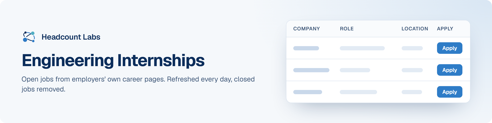

# Engineering Internships

Open mechanical, electrical, civil, chemical, hardware and manufacturing engineering internships in the US.

**400 open jobs** · 262 new since the last update · 53 removed because they closed or left the employer's board · updated November 19, 2026 at 4:33 AM EST

This list is built and refreshed every day by [Headcount Labs](https://headcountlabs.com/?utm_source=github&utm_medium=job-list&utm_campaign=engineering-internships), which reads jobs straight from employers' own career pages and job boards. Every job here was still listed on its source board when we last read that board, within the past 3 days, and was posted in the past 30 days. Copies of the same job are merged into one row, and jobs that close are removed at the next update.

Want this data in your own app or agent? Use the [Headcount Labs jobs API](https://headcountlabs.com/docs/?utm_source=github&utm_medium=job-list&utm_campaign=engineering-internships) (free tier), the [MCP server](https://headcountlabs.com/mcp/?utm_source=github&utm_medium=job-list&utm_campaign=engineering-internships) for Claude, ChatGPT and other AI assistants, or the [public dataset subsets](https://huggingface.co/HeadcountLabs) on Hugging Face (the full dataset is coming soon).

**Full dataset.** A bigger, one-off snapshot dated 2026-10-19 (all matching jobs, not only the open jobs below) is on Hugging Face: [Internships](https://huggingface.co/datasets/HeadcountLabs/internships). It loads with `datasets.load_dataset` and is under the Open Database License (ODbL) 1.0.

**Jump to:** [Posted in the last 7 days (207)](#posted-in-the-last-7-days) · [Posted 8 to 30 days ago (193)](#posted-8-to-30-days-ago)

**Columns.** *Apply* opens the original posting on the employer's site. *Details* opens the job on Headcount Labs, with every posting we found for it. *Remote* shows what the employer states; a dash means the posting doesn't say. *Pay* is the range the employer published.

## Posted in the last 7 days

| Company | Role | Location | Remote | Pay | Posted | Apply | Details |
| --- | --- | --- | --- | --- | --- | :---: | :---: |
| **Siemens** | SkillBridge Internship – Field Service Engineer | 

2 locations
Reston, VA Dallas, TX
 | On-site | — | Nov 19 |  | <a href="https://headcountlabs.com/catalog/jobs/90aa5fd2-9e7e-440d-9a55-d501dd20cd71?utm_source=github&utm_medium=job-list&utm_campaign=engineering-internships">via Headcount Labs</a> |
| **PCI Pharma Services** | Process Engineer Intern | Rockford, IL | — | $20/hr | Nov 19 |  | <a href="https://headcountlabs.com/catalog/jobs/cd048e02-ad3d-4282-8158-cd9754b72c12?utm_source=github&utm_medium=job-list&utm_campaign=engineering-internships">via Headcount Labs</a> |
| **Westinghouse Electric Company, LLC** | Summer Intern - Electrical Engineer | Warrendale | On-site | $25.40–$29/hr | Nov 18 |  | <a href="https://headcountlabs.com/catalog/jobs/c54f3729-bf85-4945-a59c-954fcb39215f?utm_source=github&utm_medium=job-list&utm_campaign=engineering-internships">via Headcount Labs</a> |
| **Westinghouse Electric Company, LLC** | Summer Intern - Piping Mechanical Engineering | Cranberry Township | On-site | $25.40–$29/hr | Nov 18 |  | <a href="https://headcountlabs.com/catalog/jobs/58b91bc9-1500-48c5-91a1-26eded3d4b27?utm_source=github&utm_medium=job-list&utm_campaign=engineering-internships">via Headcount Labs</a> |
| **Wade Trim** | Engineer Summer Intern - #3085.12 | Palm Bay, FL | Hybrid | — | Nov 18 |  | <a href="https://headcountlabs.com/catalog/jobs/f1105adc-1e05-4f22-8c9b-6cfa5dbbd666?utm_source=github&utm_medium=job-list&utm_campaign=engineering-internships">via Headcount Labs</a> |
| **Veolia** | Mechanical Engineering Intern | Boulder, CO | — | — | Nov 18 |  | <a href="https://headcountlabs.com/catalog/jobs/833e9fbd-12dc-40d0-b29c-aab61f0389c9?utm_source=github&utm_medium=job-list&utm_campaign=engineering-internships">via Headcount Labs</a> |
| **Veolia** | Instrumentation &amp; Equipment Engineering Intern | Cary, NC | — | — | Nov 18 |  | <a href="https://headcountlabs.com/catalog/jobs/068ec844-814a-4597-a889-25f351bd9264?utm_source=github&utm_medium=job-list&utm_campaign=engineering-internships">via Headcount Labs</a> |
| **Timmons Group** | Civil Engineering Internship - Summer 2027 | 

2 locations
Raleigh, NC Virginia Beach, VA
 | — | — | Nov 18 |  | <a href="https://headcountlabs.com/catalog/jobs/632d65b3-5357-4464-9b95-d46dd5112470?utm_source=github&utm_medium=job-list&utm_campaign=engineering-internships">via Headcount Labs</a> |
| **Texas Instruments** | Systems Engineering Intern - Power | Dallas, TX | — | — | Nov 18 |  | <a href="https://headcountlabs.com/catalog/jobs/37febe2c-771d-4528-aecf-8dd6deedb84e?utm_source=github&utm_medium=job-list&utm_campaign=engineering-internships">via Headcount Labs</a> |
| **Tenet** | Cloud Engineer Intern – Summer 2027 – Onsite in Dallas, TX | Dallas, TX | On-site | — | Nov 18 |  | <a href="https://headcountlabs.com/catalog/jobs/ab31879c-4dd0-4dd2-b453-e8d7599faebe?utm_source=github&utm_medium=job-list&utm_campaign=engineering-internships">via Headcount Labs</a> |
| **Siemens** | Protection &amp; Automation Mechanical/Industrial &amp; Systems Engineer Intern | Wendell, NC | On-site | $25–$25.50/hr | Nov 18 |  | <a href="https://headcountlabs.com/catalog/jobs/16babc4c-368d-422b-b8fc-f2833406f9df?utm_source=github&utm_medium=job-list&utm_campaign=engineering-internships">via Headcount Labs</a> |
| **SCS Engineers** | Civil or Environmental Engineering Intern | 

2 locations
Houston, TX Fort Worth, TX
 | — | $21–$24/hr | Nov 18 |  | <a href="https://headcountlabs.com/catalog/jobs/94247cca-38a2-495b-b87c-1db419dbf593?utm_source=github&utm_medium=job-list&utm_campaign=engineering-internships">via Headcount Labs</a> |
| **SanDisk** | Summer 2027 Intern - Product Development Engineering, Memory Product Yield Enhancement | Milpitas, CA | On-site | $59.93/hr | Nov 18 |  | <a href="https://headcountlabs.com/catalog/jobs/c0d18f15-88be-4740-9704-c9b754b70d3e?utm_source=github&utm_medium=job-list&utm_campaign=engineering-internships">via Headcount Labs</a> |
| **Samsung Semiconductor** | Intern, Architecture Research Engineer (Resilient Collective Communications) | San Jose, CA | On-site | $28–$68/hr | Nov 18 |  | <a href="https://headcountlabs.com/catalog/jobs/7e17df08-3a2d-4a44-8ab7-8839327da48b?utm_source=github&utm_medium=job-list&utm_campaign=engineering-internships">via Headcount Labs</a> |
| **Samsung Semiconductor** | Intern, SSD Firmware Engineer | San Jose, CA | — | $28–$68/hr | Nov 18 |  | <a href="https://headcountlabs.com/catalog/jobs/89772beb-9b0f-49e5-9aa8-6ac569cd1525?utm_source=github&utm_medium=job-list&utm_campaign=engineering-internships">via Headcount Labs</a> |
| **Samsung Semiconductor** | Intern, Architecture Research Engineer (MoE Placement for Serving at Scale) | San Jose, CA | On-site | $28–$68/hr | Nov 18 |  | <a href="https://headcountlabs.com/catalog/jobs/07ae0762-fcfb-4ba8-867d-e862fc5fcd3e?utm_source=github&utm_medium=job-list&utm_campaign=engineering-internships">via Headcount Labs</a> |
| **RETTEW** | Civil Engineering Internship (TR)- Summer 2027 | 

2 locations
Morgantown, WV Pittsburgh, PA
 | — | — | Nov 18 |  | <a href="https://headcountlabs.com/catalog/jobs/cf237d4b-c0a3-48d2-a2cd-94e6090a538a?utm_source=github&utm_medium=job-list&utm_campaign=engineering-internships">via Headcount Labs</a> |
| **RETTEW** | Civil Engineering Internship (LD)- Summer 2027 | Allentown, PA | — | — | Nov 18 |  | <a href="https://headcountlabs.com/catalog/jobs/7be2759b-0263-403f-9288-bec941337cab?utm_source=github&utm_medium=job-list&utm_campaign=engineering-internships">via Headcount Labs</a> |
| **PCI Pharma Services** | Quality Engineering Intern | Rockford, IL | — | $20/hr | Nov 18 |  | <a href="https://headcountlabs.com/catalog/jobs/72cfbc38-781a-4528-8fa0-898c1ead19ef?utm_source=github&utm_medium=job-list&utm_campaign=engineering-internships">via Headcount Labs</a> |
| **PCI Pharma Services** | Automation/ Project Engineer Intern | Rockford, IL | — | $20/hr | Nov 18 |  | <a href="https://headcountlabs.com/catalog/jobs/59cb2a77-6ed4-464c-ae16-a1f1d08d7b0b?utm_source=github&utm_medium=job-list&utm_campaign=engineering-internships">via Headcount Labs</a> |
| **Orizon Aerostructures** | 2027 Summer Engineering Intern Assembly - Chanute, KS | Chanute, KS | On-site | — | Nov 18 |  | <a href="https://headcountlabs.com/catalog/jobs/aa57329f-71e7-433d-8827-f3715d50bf08?utm_source=github&utm_medium=job-list&utm_campaign=engineering-internships">via Headcount Labs</a> |
| **Kleinfelder Inc** | Engineering Co-Op or Intern | McClure, OH | — | — | Nov 18 |  | <a href="https://headcountlabs.com/catalog/jobs/93cf2e88-2c1d-4fb0-97ca-4919a2442a3a?utm_source=github&utm_medium=job-list&utm_campaign=engineering-internships">via Headcount Labs</a> |
| **Johndeere** | 2027 Intern - Product Engineering | Various Locations, IL | On-site | — | Nov 18 |  | <a href="https://headcountlabs.com/catalog/jobs/678d040a-11b4-4978-87df-03bf30e44d3b?utm_source=github&utm_medium=job-list&utm_campaign=engineering-internships">via Headcount Labs</a> |
| **Internships** | Engineering Student Intern - Industrial Water/Wastewater | Pittsburgh, PA | On-site | — | Nov 18 |  | <a href="https://headcountlabs.com/catalog/jobs/47e843e9-9b43-4769-80d9-6ca0e6efcfc7?utm_source=github&utm_medium=job-list&utm_campaign=engineering-internships">via Headcount Labs</a> |
| **Hubbell Incorporated** | 2027 Summer Intern: Engineering - Manufacturing | Iron Mountain, MI | — | $22.50–$29/hr | Nov 18 |  | <a href="https://headcountlabs.com/catalog/jobs/9012c127-be01-4e7e-8e1d-0eb4e3a959d2?utm_source=github&utm_medium=job-list&utm_campaign=engineering-internships">via Headcount Labs</a> |
| **HII** | Engineering Intern 2 - 30767 | Pocasset, MA | — | — | Nov 18 |  | <a href="https://headcountlabs.com/catalog/jobs/b2c7ea32-4f64-491d-abca-909cbfe090fe?utm_source=github&utm_medium=job-list&utm_campaign=engineering-internships">via Headcount Labs</a> |
| **HII** | Engineering Intern 3 | Pocasset, MA | — | — | Nov 18 |  | <a href="https://headcountlabs.com/catalog/jobs/6160c635-f579-4b1d-8296-ef17300e07a9?utm_source=github&utm_medium=job-list&utm_campaign=engineering-internships">via Headcount Labs</a> |
| **HII** | Systems Test Engineer (SkillBridge Intern) - 26005 | Albuquerque, NM | — | — | Nov 18 |  | <a href="https://headcountlabs.com/catalog/jobs/2edd7c03-6309-4aaf-b743-056a4d0e1985?utm_source=github&utm_medium=job-list&utm_campaign=engineering-internships">via Headcount Labs</a> |
| **Freeport McMoRan** | 2027 Summer Internship - Geotechnical Engineering &amp; Water Resources - TCLW - Hybrid | Phoenix, AZ | Hybrid | $29–$36/hr | Nov 18 |  | <a href="https://headcountlabs.com/catalog/jobs/eb986f68-d727-4bc7-b9df-07397da69eac?utm_source=github&utm_medium=job-list&utm_campaign=engineering-internships">via Headcount Labs</a> |
| **Freeport McMoRan** | 2027 Summer Internship - Environmental Engineering/Science - Hybrid | New Orleans, LA | Hybrid | — | Nov 18 |  | <a href="https://headcountlabs.com/catalog/jobs/48b49119-c540-4184-b7ac-702ebb326307?utm_source=github&utm_medium=job-list&utm_campaign=engineering-internships">via Headcount Labs</a> |
| **FEV North America Inc** | Engineering Assistant (Winter Intern) Engine &amp; Hybrid Powertrain Development | Auburn Hills, MI | Hybrid | — | Nov 18 |  | <a href="https://headcountlabs.com/catalog/jobs/535f6ab3-675f-41ee-9118-7b0f1578f77f?utm_source=github&utm_medium=job-list&utm_campaign=engineering-internships">via Headcount Labs</a> |
| **EVERSOURCE** | 2027 Summer: GIS Engineering Intern | Berlin, CT | — | — | Nov 18 |  | <a href="https://headcountlabs.com/catalog/jobs/cbf418fd-4134-4400-966f-e7dbc895d8b7?utm_source=github&utm_medium=job-list&utm_campaign=engineering-internships">via Headcount Labs</a> |
| **EVERSOURCE** | 2027 Summer: Asset Strategy and Regulatory Compliance, Engineering Intern | Berlin, CT | — | — | Nov 18 |  | <a href="https://headcountlabs.com/catalog/jobs/779edee9-e226-4991-adb9-3c14843b4c59?utm_source=github&utm_medium=job-list&utm_campaign=engineering-internships">via Headcount Labs</a> |
| **Cummins Talent Acquisition** | EATON - Mechanical Engineering Internship (ECJV) | Galesburg, MI | On-site | — | Nov 18 |  | <a href="https://headcountlabs.com/catalog/jobs/e96083e2-7f6a-4192-be67-b405f909ac0a?utm_source=github&utm_medium=job-list&utm_campaign=engineering-internships">via Headcount Labs</a> |
| **Clark Dietz Inc** | Transportation Engineering Internship – Summer 2027 | Lansing, MI | — | $20–$26/hr | Nov 18 |  | <a href="https://headcountlabs.com/catalog/jobs/d0f55c7d-aed0-4852-ac20-49ac65b3c572?utm_source=github&utm_medium=job-list&utm_campaign=engineering-internships">via Headcount Labs</a> |
| **Clark Dietz Inc** | Civil Engineer Intern - Summer 2027 | 

2 locations
Oakbrook Terrace, IL Champaign, IL
 | — | $20–$26/hr | Nov 18 |  | <a href="https://headcountlabs.com/catalog/jobs/950cfb99-a804-4725-9eb5-310a9a8efe7a?utm_source=github&utm_medium=job-list&utm_campaign=engineering-internships">via Headcount Labs</a> |
| **Clark Dietz Inc** | Civil Construction Engineer Intern - Summer 2027 | 

4 locations
Oakbrook Terrace, IL Champaign, IL Libertyville, IL Milwaukee, WI
 | — | $20–$26/hr | Nov 18 |  | <a href="https://headcountlabs.com/catalog/jobs/7ead4bb5-243c-48ca-8c64-29188977d69f?utm_source=github&utm_medium=job-list&utm_campaign=engineering-internships">via Headcount Labs</a> |
| **Clark Dietz Inc** | Mechanical/Electrical Engineering Internship | Indianapolis, IN | — | $20–$26/hr | Nov 18 |  | <a href="https://headcountlabs.com/catalog/jobs/39ffdd99-0ae6-4bcb-8842-d76a4dc53be5?utm_source=github&utm_medium=job-list&utm_campaign=engineering-internships">via Headcount Labs</a> |
| **Clark Dietz Inc** | Mechanical/Electrical Engineering Intern - Summer 2027 | 

2 locations
Chicago, IL Champaign, IL
 | — | $20–$26/hr | Nov 18 |  | <a href="https://headcountlabs.com/catalog/jobs/2c6a9663-bdbf-4f88-a1d7-0e32e89a744c?utm_source=github&utm_medium=job-list&utm_campaign=engineering-internships">via Headcount Labs</a> |
| **City of New York** | Civil Engineer Intern - SIF | New York City, NY | — | $60k–$72k/yr | Nov 18 |  | <a href="https://headcountlabs.com/catalog/jobs/2af666b5-b504-497a-8a73-96d24a2c511a?utm_source=github&utm_medium=job-list&utm_campaign=engineering-internships">via Headcount Labs</a> |
| **BHE GT&amp;S** | Intern (System Planning &amp; Optimization Engineer) | Glen Allen, VA | On-site | $26.50–$29/hr | Nov 18 |  | <a href="https://headcountlabs.com/catalog/jobs/d66e2bd6-3036-48d2-a9f6-c8a4c29b32e0?utm_source=github&utm_medium=job-list&utm_campaign=engineering-internships">via Headcount Labs</a> |
| **Amcor** | Product Development Engineering Intern | Lawrence, KS | — | — | Nov 18 |  | <a href="https://headcountlabs.com/catalog/jobs/38e697db-3b92-4677-ae2f-9ac33bed473b?utm_source=github&utm_medium=job-list&utm_campaign=engineering-internships">via Headcount Labs</a> |
| **AECOM** | Structural Engineering Intern | Morgantown, WV | Hybrid | $21–$27/hr | Nov 18 |  | <a href="https://headcountlabs.com/catalog/jobs/70272838-9717-46ba-95d3-22ead213b64e?utm_source=github&utm_medium=job-list&utm_campaign=engineering-internships">via Headcount Labs</a> |
| **AECOM** | Civil Engineering Intern | 

2 locations
Murray, UT Waterloo, IA
 | — | $18.05–$24.82/hr | Nov 18 |  | <a href="https://headcountlabs.com/catalog/jobs/8cfc8f01-eaf0-40e4-81a2-e4e6767cab69?utm_source=github&utm_medium=job-list&utm_campaign=engineering-internships">via Headcount Labs</a> |
| **Acuity Inc.** | Intern - Electrical Engineer | Decatur, GA | Hybrid | — | Nov 18 |  | <a href="https://headcountlabs.com/catalog/jobs/74dd6910-df94-4057-a739-9aba7b9e1b29?utm_source=github&utm_medium=job-list&utm_campaign=engineering-internships">via Headcount Labs</a> |
| **ABBA Roller** | Operations Engineering Intern | Ontario, CA | — | $22–$24/hr | Nov 18 |  | <a href="https://headcountlabs.com/catalog/jobs/c3da2b14-f4d1-43cf-8f86-143edf2a1d1d?utm_source=github&utm_medium=job-list&utm_campaign=engineering-internships">via Headcount Labs</a> |
| **ABBA Roller** | Lab Engineering Intern | Ontario, CA | — | $22–$24/hr | Nov 18 |  | <a href="https://headcountlabs.com/catalog/jobs/69dc8344-f4ff-4fc0-a3c8-ab7eb457bf81?utm_source=github&utm_medium=job-list&utm_campaign=engineering-internships">via Headcount Labs</a> |
| **WSP** | Geotechnical Engineering Intern – Winter/Spring 2027 | Birmingham, AL | On-site | $23.03–$29.96/hr | Nov 17 |  | <a href="https://headcountlabs.com/catalog/jobs/f7876c66-c3ae-425b-8695-fa1033ff3fa1?utm_source=github&utm_medium=job-list&utm_campaign=engineering-internships">via Headcount Labs</a> |
| **Wright-Pierce** | Structural Engineering Internship | Portland, ME | On-site | $21–$24/hr | Nov 17 |  | <a href="https://headcountlabs.com/catalog/jobs/7d4b95a8-a473-4280-9c63-241373828d5c?utm_source=github&utm_medium=job-list&utm_campaign=engineering-internships">via Headcount Labs</a> |
| **Wade Trim** | Engineer Summer Intern - #3084 | Buford, GA | On-site | — | Nov 17 |  | <a href="https://headcountlabs.com/catalog/jobs/5017ec37-e67d-4f4c-91ed-a14b0f9d18e0?utm_source=github&utm_medium=job-list&utm_campaign=engineering-internships">via Headcount Labs</a> |
| **Ultium Cells Llc** | Inspection Engineer (Vision Systems) Intern | Warren, OH | — | $20/hr | Nov 17 |  | <a href="https://headcountlabs.com/catalog/jobs/560d733d-a974-437c-b1f3-1d863abcf499?utm_source=github&utm_medium=job-list&utm_campaign=engineering-internships">via Headcount Labs</a> |
| **Tighe &amp; Bond** | Civil Engineering Intern - Summer 2027 | United States | — | — | Nov 17 |  | <a href="https://headcountlabs.com/catalog/jobs/16e5b4e2-e09c-4ad4-ba8f-3a5bc2ce39fa?utm_source=github&utm_medium=job-list&utm_campaign=engineering-internships">via Headcount Labs</a> |
| **The PENTA Building Group** | Project Engineer Intern | 

3 locations
Henderson, NV Phoenix, AZ Los Angeles, CA
 | — | — | Nov 17 |  | <a href="https://headcountlabs.com/catalog/jobs/9d3e560d-3709-4a6f-a458-ad2effd3612c?utm_source=github&utm_medium=job-list&utm_campaign=engineering-internships">via Headcount Labs</a> |
| **The Haskell Company** | Summer 2027 Structural Engineering Intern | Jacksonville, FL | — | — | Nov 17 |  | <a href="https://headcountlabs.com/catalog/jobs/e7bf47b6-5ccb-4d96-a018-8154c7d520a4?utm_source=github&utm_medium=job-list&utm_campaign=engineering-internships">via Headcount Labs</a> |
| **The American Housing Corporation** | Mechanical Engineering Internship (Summer 2027) | Austin, TX | On-site | — | Nov 17 |  | <a href="https://headcountlabs.com/catalog/jobs/4a3deb12-714a-4318-a8ae-8282366384fd?utm_source=github&utm_medium=job-list&utm_campaign=engineering-internships">via Headcount Labs</a> |
| **The American Housing Corporation** | Manufacturing Engineering Internship (Summer 2027) | Austin, TX | On-site | — | Nov 17 |  | <a href="https://headcountlabs.com/catalog/jobs/c9f1cf40-d8eb-4d42-99b7-cf9c248c18d6?utm_source=github&utm_medium=job-list&utm_campaign=engineering-internships">via Headcount Labs</a> |
| **Texas Instruments** | Test Engineering intern - PhD | 

2 locations
Dallas, TX United States
 | — | — | Nov 17 |  | <a href="https://headcountlabs.com/catalog/jobs/0bae7c40-a0e7-47f3-96f3-e43ee21e0567?utm_source=github&utm_medium=job-list&utm_campaign=engineering-internships">via Headcount Labs</a> |
| **Steel Dynamics, Inc.** | Mechanical Engineering Internship | Roanoke, VA | — | — | Nov 17 |  | <a href="https://headcountlabs.com/catalog/jobs/decfb694-bfd4-478d-a821-3630074846f4?utm_source=github&utm_medium=job-list&utm_campaign=engineering-internships">via Headcount Labs</a> |
| **Smith+Nephew** | Optics and Optical Engineering R&amp;D Intern | United States | — | — | Nov 17 |  | <a href="https://headcountlabs.com/catalog/jobs/f8faf9ed-2cab-4a91-90d0-e9a440e90762?utm_source=github&utm_medium=job-list&utm_campaign=engineering-internships">via Headcount Labs</a> |
| **SitelogIQ** | 2027 Summer Engineering Intern | Harrisburg, PA | On-site | — | Nov 17 |  | <a href="https://headcountlabs.com/catalog/jobs/c71f8051-a075-4875-a356-b7da7229871d?utm_source=github&utm_medium=job-list&utm_campaign=engineering-internships">via Headcount Labs</a> |
| **Signify Netherlands B.V.** | Firmware Development Engineer Intern, Cooper Lighting Solutions - Spring 2027 | Atlanta, GA | — | $23–$31/hr | Nov 17 |  | <a href="https://headcountlabs.com/catalog/jobs/e99bd035-32eb-47c5-861f-d05ad631fe74?utm_source=github&utm_medium=job-list&utm_campaign=engineering-internships">via Headcount Labs</a> |
| **ServiceNow, Inc.** | Forward Deployed Solution Engineer Intern (Masters Summer 2027) | 

2 locations
Santa Clara, CA New York, NY
 | — | $54.49–$69.87/hr | Nov 17 |  | <a href="https://headcountlabs.com/catalog/jobs/1bb25780-b597-402a-8d0e-f4abe37487be?utm_source=github&utm_medium=job-list&utm_campaign=engineering-internships">via Headcount Labs</a> |
| **ServiceNow, Inc.** | Associate Forward Deployed Solution Engineer Intern (Bachelors Summer 2027) | 

2 locations
Santa Clara, CA New York, NY
 | — | $43.27–$55.47/hr | Nov 17 |  | <a href="https://headcountlabs.com/catalog/jobs/e8ce0cb0-e552-421c-9912-84326de30428?utm_source=github&utm_medium=job-list&utm_campaign=engineering-internships">via Headcount Labs</a> |
| **S&amp;S Worldwide Inc.** | Mechanical Engineering Intern | Logan, UT | — | $18/hr | Nov 17 |  | <a href="https://headcountlabs.com/catalog/jobs/08f708b1-4e4e-4dd1-998b-e9a7882d305d?utm_source=github&utm_medium=job-list&utm_campaign=engineering-internships">via Headcount Labs</a> |
| **RTX Corporation** | Systems Engineering Intern (Summer 2027) - Onsite | cedar rapids, IA | On-site | $37k–$82k/yr | Nov 17 |  | <a href="https://headcountlabs.com/catalog/jobs/addb4b18-2c8d-420f-8207-a0d59c7b9995?utm_source=github&utm_medium=job-list&utm_campaign=engineering-internships">via Headcount Labs</a> |
| **RTX Corporation** | Systems Engineering Intern - Open Systems Solutions - Summer 2027 - Onsite | cedar rapids, IA | On-site | $37k–$82k/yr | Nov 17 |  | <a href="https://headcountlabs.com/catalog/jobs/088ce75e-e2c9-42e0-b182-b656858eb88e?utm_source=github&utm_medium=job-list&utm_campaign=engineering-internships">via Headcount Labs</a> |
| **RS&amp;H** | Civil Engineering Intern (Highway) - Summer 2027 | United States | — | — | Nov 17 |  | <a href="https://headcountlabs.com/catalog/jobs/d8a89986-7a08-40f9-9fb9-f19220e07d44?utm_source=github&utm_medium=job-list&utm_campaign=engineering-internships">via Headcount Labs</a> |
| **Roche** | 2027 Summer Intern - Logistics Engineering | Indianapolis, IN | — | $25–$29/hr | Nov 17 |  | <a href="https://headcountlabs.com/catalog/jobs/092e026d-5f59-4177-aed1-50bd287b40d1?utm_source=github&utm_medium=job-list&utm_campaign=engineering-internships">via Headcount Labs</a> |
| **Renesas Electronics** | Field Applications Engineer Intern | Bridgewater, NJ | — | — | Nov 17 |  | <a href="https://headcountlabs.com/catalog/jobs/f7476cb0-cf04-4e43-bcb2-afa9ec60bc43?utm_source=github&utm_medium=job-list&utm_campaign=engineering-internships">via Headcount Labs</a> |
| **Redhawk Copper Inc** | Engineering Internship | San Manuel, AZ | — | — | Nov 17 |  | <a href="https://headcountlabs.com/catalog/jobs/bbfb7c0e-b146-474a-a00a-6a563aca8c55?utm_source=github&utm_medium=job-list&utm_campaign=engineering-internships">via Headcount Labs</a> |
| **Parabola** | Engineering Intern | 

2 locations
San Francisco, CA New York, NY
 | On-site | — | Nov 17 |  | <a href="https://headcountlabs.com/catalog/jobs/62ee73a6-90b5-4296-891a-c18f351abfd7?utm_source=github&utm_medium=job-list&utm_campaign=engineering-internships">via Headcount Labs</a> |
| **Novelis** | Electrical Engineering Intern - Terre Haute, IN | United States | — | — | Nov 17 |  | <a href="https://headcountlabs.com/catalog/jobs/939fbe07-7943-4259-aba2-41ab115ad8db?utm_source=github&utm_medium=job-list&utm_campaign=engineering-internships">via Headcount Labs</a> |
| **NORTHROP GRUMMAN SYSTEMS CORPORATION** | 2027 Environmental Health and Safety Engineer Intern - Sunnyvale CA | Sunnyvale, CA | On-site | $21.50–$39/hr | Nov 17 |  | <a href="https://headcountlabs.com/catalog/jobs/5587dfc6-df6f-4129-adab-4d68223b987d?utm_source=github&utm_medium=job-list&utm_campaign=engineering-internships">via Headcount Labs</a> |
| **NORTHROP GRUMMAN SYSTEMS CORPORATION** | 2027 Industrial Engineer Intern - Apopka FL | Apopka, FL | On-site | $18.50–$33.50/hr | Nov 17 |  | <a href="https://headcountlabs.com/catalog/jobs/39fbdc90-403d-4dd5-86e8-74c765376b35?utm_source=github&utm_medium=job-list&utm_campaign=engineering-internships">via Headcount Labs</a> |
| **NORTHROP GRUMMAN SYSTEMS CORPORATION** | 2027 Manufacturing Engineer Intern - Baltimore MD | Baltimore, MD | On-site | $20.50–$37.25/hr | Nov 17 |  | <a href="https://headcountlabs.com/catalog/jobs/19f45bae-b874-44a6-bc8b-40de350a8937?utm_source=github&utm_medium=job-list&utm_campaign=engineering-internships">via Headcount Labs</a> |
| **NORTHROP GRUMMAN SYSTEMS CORPORATION** | 2027 Thermal / Propulsion Engineer Intern - Redondo Beach CA | Redondo Beach, CA | On-site | $21.50–$39/hr | Nov 17 |  | <a href="https://headcountlabs.com/catalog/jobs/fbceccb2-32b7-43a0-b737-4254970173d1?utm_source=github&utm_medium=job-list&utm_campaign=engineering-internships">via Headcount Labs</a> |
| **NORTHROP GRUMMAN SYSTEMS CORPORATION** | 2027 Intern - Human Factors Engineering | Melbourne, FL | On-site | $18.50–$33.50/hr | Nov 17 |  | <a href="https://headcountlabs.com/catalog/jobs/6bc4c98c-bd6b-4b0c-8c91-19ca439af1cc?utm_source=github&utm_medium=job-list&utm_campaign=engineering-internships">via Headcount Labs</a> |
| **Nabors** | Intern - Electrical Engineering (Nabors) | Houston, TX | On-site | — | Nov 17 |  | <a href="https://headcountlabs.com/catalog/jobs/388cfcea-7b27-493e-be3d-810cb3f1d973?utm_source=github&utm_medium=job-list&utm_campaign=engineering-internships">via Headcount Labs</a> |
| **Nabors** | Intern - Mechanical Engineering (Nabors) | Houston, TX | On-site | — | Nov 17 |  | <a href="https://headcountlabs.com/catalog/jobs/0d2b74dc-a14f-427b-a51d-8d9d4ccf15af?utm_source=github&utm_medium=job-list&utm_campaign=engineering-internships">via Headcount Labs</a> |
| **MM Project Leaders** | Mechanical Engineering Internship - 2027 | United States | — | $18–$35/hr | Nov 17 |  | <a href="https://headcountlabs.com/catalog/jobs/6cefc5f3-fb40-4d3c-ba3d-40f0045f9225?utm_source=github&utm_medium=job-list&utm_campaign=engineering-internships">via Headcount Labs</a> |
| **M.C. Dean, Inc** | Engineering Internship Program - 2026 - 2027 (CIS - MMC) | Caroline County, VA | — | $18–$28/hr | Nov 17 |  | <a href="https://headcountlabs.com/catalog/jobs/c4116f01-01e9-4242-bef8-177489956f9a?utm_source=github&utm_medium=job-list&utm_campaign=engineering-internships">via Headcount Labs</a> |
| **M.C. Dean, Inc** | Engineering Internship Program - 2026 - 2027 (I2CS - Memphis, TN) | Memphis, TN | — | $18–$28/hr | Nov 17 |  | <a href="https://headcountlabs.com/catalog/jobs/c99f0a67-11bc-4e10-a62c-648f22082552?utm_source=github&utm_medium=job-list&utm_campaign=engineering-internships">via Headcount Labs</a> |
| **M.C. Dean, Inc** | Engineering Internship Program - 2026 - 2027 (E&amp;C - Burlington, TX) | Burlington, TX | — | — | Nov 17 |  | <a href="https://headcountlabs.com/catalog/jobs/a124b1e2-8fe3-4364-8222-d5caab72c247?utm_source=github&utm_medium=job-list&utm_campaign=engineering-internships">via Headcount Labs</a> |
| **M.C. Dean, Inc** | Engineering Internship Program - 2026 - 2027 Season (CIM - Harrisonburg, VA) | Harrisonburg, VA | — | $18–$28/hr | Nov 17 |  | <a href="https://headcountlabs.com/catalog/jobs/7833d233-2ecc-432c-8afe-6b411b70c4c5?utm_source=github&utm_medium=job-list&utm_campaign=engineering-internships">via Headcount Labs</a> |
| **M.C. Dean, Inc** | Engineering Internship Program - 2026 - 2027 (E&amp;C - MMC) | Caroline County, VA | — | $18–$28/hr | Nov 17 |  | <a href="https://headcountlabs.com/catalog/jobs/2e1a8fbe-aaac-497f-8de8-cfc354eefb1d?utm_source=github&utm_medium=job-list&utm_campaign=engineering-internships">via Headcount Labs</a> |
| **Leonardo DRS, Inc.** | Senior Technical Intern - Engineering Physics | Madison, WI | — | $19.70–$28.20/hr | Nov 17 |  | <a href="https://headcountlabs.com/catalog/jobs/e196b7f2-f615-4e23-9a1e-4b371a9dad60?utm_source=github&utm_medium=job-list&utm_campaign=engineering-internships">via Headcount Labs</a> |
| **Larson Design Group** | Summer Intern - Mechanical Engineering | Williamsport, PA | On-site | $20–$22/hr | Nov 17 |  | <a href="https://headcountlabs.com/catalog/jobs/c270c264-8d13-4d25-a447-07b3d539b6a8?utm_source=github&utm_medium=job-list&utm_campaign=engineering-internships">via Headcount Labs</a> |
| **Larson Design Group** | Summer Intern - Electrical Engineering | Williamsport, PA | On-site | $20–$22/hr | Nov 17 |  | <a href="https://headcountlabs.com/catalog/jobs/30da926e-1d95-48c0-b746-f3ba92c32b3a?utm_source=github&utm_medium=job-list&utm_campaign=engineering-internships">via Headcount Labs</a> |
| **Kilby Labs** | Systems Engineering Intern - Power | Dallas, TX | On-site | — | Nov 17 |  | <a href="https://headcountlabs.com/catalog/jobs/da4ccfc2-8bea-4a75-b462-d0df2a39eca0?utm_source=github&utm_medium=job-list&utm_campaign=engineering-internships">via Headcount Labs</a> |
| **ITW** | Quality Engineering - Summer Intern 2027 | United States | — | — | Nov 17 |  | <a href="https://headcountlabs.com/catalog/jobs/5d7fa8bc-f2c7-4120-a379-48c44b207071?utm_source=github&utm_medium=job-list&utm_campaign=engineering-internships">via Headcount Labs</a> |
| **Intuitive** | Clinical Development Engineering Intern | Sunnyvale, CA | — | — | Nov 17 |  | <a href="https://headcountlabs.com/catalog/jobs/41497adc-c7cb-446a-99cd-5d27b59adf81?utm_source=github&utm_medium=job-list&utm_campaign=engineering-internships">via Headcount Labs</a> |
| **Heartland Business Systems, LLC** | Engineering Associate - Summer 2027 Internship Program | Eau Claire, WI | — | — | Nov 17 |  | <a href="https://headcountlabs.com/catalog/jobs/c0571b88-013a-4ddc-98ea-e3a2055d6f60?utm_source=github&utm_medium=job-list&utm_campaign=engineering-internships">via Headcount Labs</a> |
| **GHD** | Civil Engineering Intern | SEATTLE, WA | Hybrid | $26–$28/hr | Nov 17 |  | <a href="https://headcountlabs.com/catalog/jobs/3a376bb8-fda9-4a70-b9eb-54e1fd6c94cc?utm_source=github&utm_medium=job-list&utm_campaign=engineering-internships">via Headcount Labs</a> |
| **GFT.** | Intern - Geotechnical Engineering | Mechanicsburg, PA | — | $21–$28/hr | Nov 17 |  | <a href="https://headcountlabs.com/catalog/jobs/c5cbe5a1-5b1d-4718-b7c7-d138ea538b07?utm_source=github&utm_medium=job-list&utm_campaign=engineering-internships">via Headcount Labs</a> |
| **Geosyntec Consultants, Inc.** | Intern / Co-Op – Civil / Geotechnical Engineering | Johnson City, TN | — | — | Nov 17 |  | <a href="https://headcountlabs.com/catalog/jobs/b715b30b-b43b-484c-a734-b013f9c727e8?utm_source=github&utm_medium=job-list&utm_campaign=engineering-internships">via Headcount Labs</a> |
| **GE Aerospace** | US Engineering Intern – Muskegon, MI – Summer 2027 | Muskegon, MI | On-site | $20/hr | Nov 17 |  | <a href="https://headcountlabs.com/catalog/jobs/3d0ecf79-37f6-46c8-b2a5-28c6b3d7f544?utm_source=github&utm_medium=job-list&utm_campaign=engineering-internships">via Headcount Labs</a> |
| **EwingCole, Inc.** | Mechanical Engineering 2027 Summer Intern | Philadelphia, PA | — | — | Nov 17 |  | <a href="https://headcountlabs.com/catalog/jobs/4c2d3744-5656-417a-8a6d-5069c82e0d32?utm_source=github&utm_medium=job-list&utm_campaign=engineering-internships">via Headcount Labs</a> |
| **EVERSOURCE** | 2027 Summer: Distribution Engineering Intern (Dorchester, MA-Hybrid Schedule) | Dorchester, MA | Hybrid | — | Nov 17 |  | <a href="https://headcountlabs.com/catalog/jobs/53ecfbc4-7890-4415-a0f6-4abd0fbb7929?utm_source=github&utm_medium=job-list&utm_campaign=engineering-internships">via Headcount Labs</a> |
| **EVERSOURCE** | 2027 Distribution Engineering Intern (CT, Hybrid Schedule) | 

4 locations
Newtown, CT Norwalk, CT Stamford, CT West Torrington, CT
 | Hybrid | — | Nov 17 |  | <a href="https://headcountlabs.com/catalog/jobs/06351c6d-41a7-4520-b114-444a1f2ce536?utm_source=github&utm_medium=job-list&utm_campaign=engineering-internships">via Headcount Labs</a> |
| **Ecolab Inc.** | Engineering Technical Sales Intern | 

14 locations
St Louis, MO Goodyear, AZ Phoenix, AZ San Francisco, CA San Jose, CA Atlanta, GA Gary, IN Boston, MA Pascagoula, MS Las Vegas, NV Cleveland, OH Toledo, OH +2 more
 | Hybrid | $23–$25/hr | Nov 17 |  | <a href="https://headcountlabs.com/catalog/jobs/810d0bb3-4a97-4bbe-99fa-b1b8044f8ba9?utm_source=github&utm_medium=job-list&utm_campaign=engineering-internships">via Headcount Labs</a> |
| **EAC Consulting Inc** | CEI Inspector / Engineer Intern (EI) | 

3 locations
West Palm Beach, FL Ft. Lauderdale, FL Miami, FL
 | — | — | Nov 17 |  | <a href="https://headcountlabs.com/catalog/jobs/55e6b137-a008-49a0-95a4-e871427b0dd9?utm_source=github&utm_medium=job-list&utm_campaign=engineering-internships">via Headcount Labs</a> |
| **Curtiss-Wright Corporation** | Design Engineering Intern | East Farmingdale, NY | — | $20–$25/hr | Nov 17 |  | <a href="https://headcountlabs.com/catalog/jobs/1b685c69-6332-40fd-a9c4-d5632de5f6e8?utm_source=github&utm_medium=job-list&utm_campaign=engineering-internships">via Headcount Labs</a> |
| **Continental Group Sector ContiTech** | Intern - Engineering | Norfolk, NE | — | — | Nov 17 |  | <a href="https://headcountlabs.com/catalog/jobs/e5ebd525-8ee9-4af8-85e3-51dcae0e4138?utm_source=github&utm_medium=job-list&utm_campaign=engineering-internships">via Headcount Labs</a> |
| **Constellation Energy Generation, LLC.** | Summer 2027 Engineering Intern - Warrenville, IL | Warrenville, IL | — | — | Nov 17 |  | <a href="https://headcountlabs.com/catalog/jobs/9d66715d-f773-42b3-9fcd-851552719ad0?utm_source=github&utm_medium=job-list&utm_campaign=engineering-internships">via Headcount Labs</a> |
| **Constellation Energy Generation, LLC.** | Summer 2027 Engineering Internship - Oswego, NY | Oswego, NY | — | — | Nov 17 |  | <a href="https://headcountlabs.com/catalog/jobs/f05116ae-5621-42cd-a243-ddd03909376e?utm_source=github&utm_medium=job-list&utm_campaign=engineering-internships">via Headcount Labs</a> |
| **Colliers Engineering &amp; Design** | Architectural Engineering - Mechanical Intern | Rochester, NY | — | $25–$27/hr | Nov 17 |  | <a href="https://headcountlabs.com/catalog/jobs/1443433f-ecf4-4731-ac3c-f786a8ec033a?utm_source=github&utm_medium=job-list&utm_campaign=engineering-internships">via Headcount Labs</a> |
| **Colliers Engineering &amp; Design** | Civil/Site Engineering Intern | 

3 locations
Allentown, PA Exton, PA Philadelphia, PA
 | — | — | Nov 17 |  | <a href="https://headcountlabs.com/catalog/jobs/08e9f438-d751-47ac-aaec-88a2f5be9394?utm_source=github&utm_medium=job-list&utm_campaign=engineering-internships">via Headcount Labs</a> |
| **BWX Technologies, Inc.** | Intern, Electrical Engineer | Barberton, OH | — | — | Nov 17 |  | <a href="https://headcountlabs.com/catalog/jobs/092c7590-b3d2-485f-b5ee-1d0aa4d40838?utm_source=github&utm_medium=job-list&utm_campaign=engineering-internships">via Headcount Labs</a> |
| **BROWN AND CALDWELL** | Electrical Engineering Intern - Summer 2027 (Denver or Boise) | Portland, OR | Hybrid | $18.40–$25.20/hr | Nov 17 |  | <a href="https://headcountlabs.com/catalog/jobs/dbb647b8-8398-4add-82fd-bd6f000521cb?utm_source=github&utm_medium=job-list&utm_campaign=engineering-internships">via Headcount Labs</a> |
| **BROWN AND CALDWELL** | Electrical Engineering Intern - Summer 2027 (Portland, OR) | Portland, OR | Hybrid | $18.40–$25.20/hr | Nov 17 |  | <a href="https://headcountlabs.com/catalog/jobs/a1759c1e-5ed5-4e45-a129-f1b7988ef8d7?utm_source=github&utm_medium=job-list&utm_campaign=engineering-internships">via Headcount Labs</a> |
| **Booth &amp; Associates LLC** | Project Engineer Intern - Renewable Studies and Planning | Raleigh, NC | — | — | Nov 17 |  | <a href="https://headcountlabs.com/catalog/jobs/603cbba8-789d-482a-9a47-b43b7a40d6d3?utm_source=github&utm_medium=job-list&utm_campaign=engineering-internships">via Headcount Labs</a> |
| **Black &amp; Veatch Family of Companies** | Engineering Technician Intern (Raleigh) | Cary, NC | — | — | Nov 17 |  | <a href="https://headcountlabs.com/catalog/jobs/d5bfe1d6-3fb9-42e8-8671-4d3a38fc3d37?utm_source=github&utm_medium=job-list&utm_campaign=engineering-internships">via Headcount Labs</a> |
| **BHE** | Intern - Engineering | Omaha, NE | On-site | $23–$28/hr | Nov 17 |  | <a href="https://headcountlabs.com/catalog/jobs/0eba742a-9d07-4d2e-8df4-da0ff2a941a0?utm_source=github&utm_medium=job-list&utm_campaign=engineering-internships">via Headcount Labs</a> |
| **Basis Research Institute** | Electronics &amp; Sensing Engineer (Part-time Intern or Contractor) | New York, NY | On-site | $33–$43/hr | Nov 17 |  | <a href="https://headcountlabs.com/catalog/jobs/5041b682-3382-4101-a2d3-9c7437725449?utm_source=github&utm_medium=job-list&utm_campaign=engineering-internships">via Headcount Labs</a> |
| **Barber-Nichols, Inc.** | Summer Electrical Engineering Internship | Arvada, CO | — | $27/hr | Nov 17 |  | <a href="https://headcountlabs.com/catalog/jobs/2ceab4fa-fe75-4cf2-bff2-4f70ceff1408?utm_source=github&utm_medium=job-list&utm_campaign=engineering-internships">via Headcount Labs</a> |
| **Auria Solutions** | Engineering Intern | Sidney, OH | — | — | Nov 17 |  | <a href="https://headcountlabs.com/catalog/jobs/53013046-2ace-450c-afff-6000321ffe16?utm_source=github&utm_medium=job-list&utm_campaign=engineering-internships">via Headcount Labs</a> |
| **Arcadis** | Control, Automation &amp; Energy Systems Engineering Intern | Los Angeles, CA | Hybrid | $26–$37/hr | Nov 17 |  | <a href="https://headcountlabs.com/catalog/jobs/50019d96-d78d-4116-b7ba-d4b24acf01cc?utm_source=github&utm_medium=job-list&utm_campaign=engineering-internships">via Headcount Labs</a> |
| **Amgen** | Grad Intern – Protein Engineering (Summer 2027) | Thousand Oaks, CA | — | $35.34–$41.20/hr | Nov 17 |  | <a href="https://headcountlabs.com/catalog/jobs/bee2ee69-ae65-40d8-bb55-137209d4345a?utm_source=github&utm_medium=job-list&utm_campaign=engineering-internships">via Headcount Labs</a> |
| **ALLETE Inc** | Internship - Substation Engineering | United States | — | — | Nov 17 |  | <a href="https://headcountlabs.com/catalog/jobs/12d94533-06e3-47ba-95dc-012f3796713b?utm_source=github&utm_medium=job-list&utm_campaign=engineering-internships">via Headcount Labs</a> |
| **Affiliated Engineers** | Electrical Engineer Intern | 

2 locations
Phoenix, AZ San Francisco, CA
 | On-site | — | Nov 17 |  | <a href="https://headcountlabs.com/catalog/jobs/ba4c23a0-7c84-4b79-b28d-7188547ffe98?utm_source=github&utm_medium=job-list&utm_campaign=engineering-internships">via Headcount Labs</a> |
| **AECOM** | Highway Civil Engineering Intern | Conshohocken, PA | Hybrid | $21–$28/hr | Nov 17 |  | <a href="https://headcountlabs.com/catalog/jobs/fc03d4cc-f06f-435f-8172-98a15337d635?utm_source=github&utm_medium=job-list&utm_campaign=engineering-internships">via Headcount Labs</a> |
| **Acuity Inc.** | Intern - Mechanical Engineer | Decatur, GA | — | — | Nov 17 |  | <a href="https://headcountlabs.com/catalog/jobs/2595519c-ffce-425f-98c1-18c3bd89e232?utm_source=github&utm_medium=job-list&utm_campaign=engineering-internships">via Headcount Labs</a> |
| **Walter P Moore** | Engineering Intern - Structures | Tampa, FL | — | — | Nov 16 |  | <a href="https://headcountlabs.com/catalog/jobs/b803f8c5-de5c-4431-a042-e91c044f09bc?utm_source=github&utm_medium=job-list&utm_campaign=engineering-internships">via Headcount Labs</a> |
| **States Industries, LLC** | R&amp;D Engineering Intern | United States | — | — | Nov 16 |  | <a href="https://headcountlabs.com/catalog/jobs/cdf44974-3d39-4e0f-a599-decd35a68d00?utm_source=github&utm_medium=job-list&utm_campaign=engineering-internships">via Headcount Labs</a> |
| **SRC, Inc** | Embedded Design Engineer (Intern - Spring 2027) | Syracuse, NY | — | $22–$26/hr | Nov 16 |  | <a href="https://headcountlabs.com/catalog/jobs/e4cfc99e-8569-491c-a61b-494299953064?utm_source=github&utm_medium=job-list&utm_campaign=engineering-internships">via Headcount Labs</a> |
| **Southern States LLC** | Summer 2027 Electrical Engineering Intern or Co-op | United States | — | — | Nov 16 |  | <a href="https://headcountlabs.com/catalog/jobs/2f9a4c06-ac2d-44f2-9849-cd9cc87535c9?utm_source=github&utm_medium=job-list&utm_campaign=engineering-internships">via Headcount Labs</a> |
| **Shrewsberry &amp; Associates LLC** | Intern - Aviation Engineering | Denver, CO | — | $22–$25/hr | Nov 16 |  | <a href="https://headcountlabs.com/catalog/jobs/2c30d26b-0411-4044-9e52-9101c534c523?utm_source=github&utm_medium=job-list&utm_campaign=engineering-internships">via Headcount Labs</a> |
| **Search Jobs - INL Interns** | MFC Reactor Engineering for Digital Thread Intern - Summer 2027 | Idaho Falls, ID | On-site | $32.41–$41.29/hr | Nov 16 |  | <a href="https://headcountlabs.com/catalog/jobs/acd5b1b2-e2ae-4717-8a11-462d5668097d?utm_source=github&utm_medium=job-list&utm_campaign=engineering-internships">via Headcount Labs</a> |
| **Sargent &amp; Lundy** | Transmission &amp; Distribution Engineer Intern - Grid (Summer 2027) | Charlotte, NC | Hybrid | $18–$30/hr | Nov 16 |  | <a href="https://headcountlabs.com/catalog/jobs/f15dc0b9-c355-492f-aae9-a91ee1e5bade?utm_source=github&utm_medium=job-list&utm_campaign=engineering-internships">via Headcount Labs</a> |
| **Roach &amp; Associates, LLC** | Summer Engineering Intern | United States | — | — | Nov 16 |  | <a href="https://headcountlabs.com/catalog/jobs/bb4b5e97-1638-4a60-8d12-cf99e8688b78?utm_source=github&utm_medium=job-list&utm_campaign=engineering-internships">via Headcount Labs</a> |
| **PACCAR** | 2027 Summer Internship: Cost Reduction Mechanical Design Engineer | Denton, TX | — | — | Nov 16 |  | <a href="https://headcountlabs.com/catalog/jobs/db50acf9-74e4-4047-94e2-bb5421a585bf?utm_source=github&utm_medium=job-list&utm_campaign=engineering-internships">via Headcount Labs</a> |
| **NORTHROP GRUMMAN SYSTEMS CORPORATION** | 2027 Engineering Intern - Warner Robins GA | Warner Robins, GA | On-site | $18.50–$33.50/hr | Nov 16 |  | <a href="https://headcountlabs.com/catalog/jobs/274bf5d8-af59-453a-9bf0-c5665c55e8a8?utm_source=github&utm_medium=job-list&utm_campaign=engineering-internships">via Headcount Labs</a> |
| **NORTHROP GRUMMAN SYSTEMS CORPORATION** | 2027 Mechanical Engineer Intern - Ocean Springs MS | Ocean Springs, MS | On-site | $18.50–$33.50/hr | Nov 16 |  | <a href="https://headcountlabs.com/catalog/jobs/080833ef-b9cb-4fb8-89ec-07989645b02b?utm_source=github&utm_medium=job-list&utm_campaign=engineering-internships">via Headcount Labs</a> |
| **NORTHROP GRUMMAN SYSTEMS CORPORATION** | 2027 Manufacturing Engineer Intern - Salt Lake City UT | Salt Lake City, UT | On-site | $18.50–$33.50/hr | Nov 16 |  | <a href="https://headcountlabs.com/catalog/jobs/cbaf5312-c746-45dd-9171-6f615c5aec3c?utm_source=github&utm_medium=job-list&utm_campaign=engineering-internships">via Headcount Labs</a> |
| **Microsoft** | Electrical Engineering PhD Intern | United States | — | — | Nov 16 |  | <a href="https://headcountlabs.com/catalog/jobs/5c4358c4-2e4d-4874-a187-84c9e7265ecd?utm_source=github&utm_medium=job-list&utm_campaign=engineering-internships">via Headcount Labs</a> |
| **Metromont** | Engineering Intern | United States | — | — | Nov 16 |  | <a href="https://headcountlabs.com/catalog/jobs/4ab0407e-a96b-4312-8075-fb4fc6af4d70?utm_source=github&utm_medium=job-list&utm_campaign=engineering-internships">via Headcount Labs</a> |
| **Local Grown Salads** | IoT (Electronics) Engineer (OPT/CPT/Capstone/Experience) Internship | United States | — | — | Nov 16 |  | <a href="https://headcountlabs.com/catalog/jobs/e16b86ff-bb95-4c4c-9807-ccf66a688fa8?utm_source=github&utm_medium=job-list&utm_campaign=engineering-internships">via Headcount Labs</a> |
| **LinkedIn** | Systems &amp; Infrastructure Engineer Intern, Masters - Summer 2027 (Mountain View, CA) | Mountain View, CA | Hybrid | $60–$70/hr | Nov 16 |  | <a href="https://headcountlabs.com/catalog/jobs/193c68f4-475e-4002-82dd-c9fb555871cf?utm_source=github&utm_medium=job-list&utm_campaign=engineering-internships">via Headcount Labs</a> |
| **Lincoln Electric** | Engineering Summer 2027 Internship (Euclid, OH) | Cleveland, OH | — | — | Nov 16 |  | <a href="https://headcountlabs.com/catalog/jobs/d2a06be5-6f5a-4649-8ba2-16cb8896dd0d?utm_source=github&utm_medium=job-list&utm_campaign=engineering-internships">via Headcount Labs</a> |
| **Lincoln Electric** | Electrical Engineering Summer 2027 Internship (Michigan City, IN) | Michigan City, IN | — | — | Nov 16 |  | <a href="https://headcountlabs.com/catalog/jobs/cac6f8bf-083c-4bbb-a1ff-20e6e912a3fd?utm_source=github&utm_medium=job-list&utm_campaign=engineering-internships">via Headcount Labs</a> |
| **Lincoln Electric** | Mechanical Engineering Summer 2027 Internship (Bettendorf, IA) | Bettendorf, IA | — | — | Nov 16 |  | <a href="https://headcountlabs.com/catalog/jobs/e9143667-1906-4696-9833-4456ae7d8156?utm_source=github&utm_medium=job-list&utm_campaign=engineering-internships">via Headcount Labs</a> |
| **Lincoln Electric** | Controls Engineering Summer 2027 Internship (Shelby Township, Mi) | Shelby Township, MI | — | — | Nov 16 |  | <a href="https://headcountlabs.com/catalog/jobs/a7e376ca-5fce-4794-a839-04e373e1b9b9?utm_source=github&utm_medium=job-list&utm_campaign=engineering-internships">via Headcount Labs</a> |
| **Lincoln Electric** | Mechanical Engineering Summer 2027 Internship (Gainesville, GA) | Gainesville, GA | — | — | Nov 16 |  | <a href="https://headcountlabs.com/catalog/jobs/a1028a1c-90e9-40f4-8cbc-4259820cbe79?utm_source=github&utm_medium=job-list&utm_campaign=engineering-internships">via Headcount Labs</a> |
| **Lincoln Electric** | Mechanical Engineering Summer 2027 Internship (Michigan City, IN) | Michigan City, IN | — | — | Nov 16 |  | <a href="https://headcountlabs.com/catalog/jobs/b72e015f-d726-47fe-b148-2ef4f28d84c4?utm_source=github&utm_medium=job-list&utm_campaign=engineering-internships">via Headcount Labs</a> |
| **Lincoln Electric** | Controls Engineering Summer 2027 Internship (Bettendorf, IA) | Bettendorf, IA | — | — | Nov 16 |  | <a href="https://headcountlabs.com/catalog/jobs/3783fa90-5737-4852-b20c-4823c631c9f5?utm_source=github&utm_medium=job-list&utm_campaign=engineering-internships">via Headcount Labs</a> |
| **LHB** | Civil Engineering Intern | United States | — | — | Nov 16 |  | <a href="https://headcountlabs.com/catalog/jobs/daa5e8c3-8a99-4815-8b52-254403005f48?utm_source=github&utm_medium=job-list&utm_campaign=engineering-internships">via Headcount Labs</a> |
| **Lam Research** | Summer 2027 - Electrical Engineering Intern - BS | Fremont, CA | On-site | $29.75–$40.25/hr | Nov 16 |  | <a href="https://headcountlabs.com/catalog/jobs/e76ae4cf-41e3-4a8f-9f5e-7d6892133c26?utm_source=github&utm_medium=job-list&utm_campaign=engineering-internships">via Headcount Labs</a> |
| **Lam Research** | 2027 Process Engineering Intern - PhD (6 months) | Fremont, CA | On-site | $35.75–$57.50/hr | Nov 16 |  | <a href="https://headcountlabs.com/catalog/jobs/8629573d-d61d-48da-87f0-08cd5a05920d?utm_source=github&utm_medium=job-list&utm_campaign=engineering-internships">via Headcount Labs</a> |
| **KCI Technologies Inc.** | Structural Engineer Intern | New York, NY | — | $26–$28/hr | Nov 16 |  | <a href="https://headcountlabs.com/catalog/jobs/bde196ef-6aab-4379-b5ad-3a439661add1?utm_source=github&utm_medium=job-list&utm_campaign=engineering-internships">via Headcount Labs</a> |
| **Johnson Health Tech Companies** | Mechanical Engineering Intern-Matrix Fitness | United States | — | — | Nov 16 |  | <a href="https://headcountlabs.com/catalog/jobs/c4998971-a502-4480-b19a-65f2f57b6697?utm_source=github&utm_medium=job-list&utm_campaign=engineering-internships">via Headcount Labs</a> |
| **Intuitive** | Mechanical Engineering Intern | Blacksburg, VA | — | — | Nov 16 |  | <a href="https://headcountlabs.com/catalog/jobs/f34c17fa-9f64-4e38-a32c-acde44fdc6d6?utm_source=github&utm_medium=job-list&utm_campaign=engineering-internships">via Headcount Labs</a> |
| **Intuitive** | Clinical Research Engineering Intern | Sunnyvale, CA | — | — | Nov 16 |  | <a href="https://headcountlabs.com/catalog/jobs/bdbf9620-3b36-49a7-a8d6-37cd33bafd29?utm_source=github&utm_medium=job-list&utm_campaign=engineering-internships">via Headcount Labs</a> |
| **Illinois Tool Works** | Engineering - Co-Op Intern | Danvers, MA | — | $24–$29/hr | Nov 16 |  | <a href="https://headcountlabs.com/catalog/jobs/7d39029e-856b-4996-986e-56bae3464ce6?utm_source=github&utm_medium=job-list&utm_campaign=engineering-internships">via Headcount Labs</a> |
| **Graham Packaging Company** | Package Engineering Intern | York, PA | — | — | Nov 16 |  | <a href="https://headcountlabs.com/catalog/jobs/49c45066-3461-49d5-8cd0-537234c0fe16?utm_source=github&utm_medium=job-list&utm_campaign=engineering-internships">via Headcount Labs</a> |
| **Fluor** | Construction Engineering Aide I- Summer Internship | Lebanon, IN | On-site | $39k–$53k/yr | Nov 16 |  | <a href="https://headcountlabs.com/catalog/jobs/e38ce365-c75b-4f64-829f-84585e134905?utm_source=github&utm_medium=job-list&utm_campaign=engineering-internships">via Headcount Labs</a> |
| **Fluor** | Construction Engineering Aide II- Summer Internship | Lebanon, IN | On-site | $43k–$66k/yr | Nov 16 |  | <a href="https://headcountlabs.com/catalog/jobs/5e39ee03-1f8a-4049-bd7a-45b57a57741e?utm_source=github&utm_medium=job-list&utm_campaign=engineering-internships">via Headcount Labs</a> |
| **Find a Career - Textron** | 2027 Intern - Mechanical Engineer (Uncrewed Land &amp; Air) - Hunt Valley, MD | Hunt Valley, MD | — | $28–$32/hr | Nov 16 |  | <a href="https://headcountlabs.com/catalog/jobs/61f69b33-e034-4358-8b21-e9dc04175fd2?utm_source=github&utm_medium=job-list&utm_campaign=engineering-internships">via Headcount Labs</a> |
| **Entegris** | Materials Solutions Engineering Intern - Summer 2027 | United States | — | — | Nov 16 |  | <a href="https://headcountlabs.com/catalog/jobs/da01805f-0381-4fae-969a-179611e380c6?utm_source=github&utm_medium=job-list&utm_campaign=engineering-internships">via Headcount Labs</a> |
| **Entegris** | Mechanical Engineering Intern - Summer 2027 | United States | — | — | Nov 16 |  | <a href="https://headcountlabs.com/catalog/jobs/295f5e4b-dddf-4862-b934-de85c2ddb820?utm_source=github&utm_medium=job-list&utm_campaign=engineering-internships">via Headcount Labs</a> |
| **EchoStar** | Hardware Engineering Intern | Englewood, CO | — | $37/hr | Nov 16 |  | <a href="https://headcountlabs.com/catalog/jobs/fe349e31-530b-43e2-927d-b7fc9f1beb65?utm_source=github&utm_medium=job-list&utm_campaign=engineering-internships">via Headcount Labs</a> |
| **Constellation Energy Generation, LLC.** | 2027 Engineering Intern - Morgan Energy Center | Decatur, AL | — | — | Nov 16 |  | <a href="https://headcountlabs.com/catalog/jobs/d0c3dbc2-d682-43fb-a3ed-b94c18d2e3dd?utm_source=github&utm_medium=job-list&utm_campaign=engineering-internships">via Headcount Labs</a> |
| **Constellation Energy Generation, LLC.** | Summer 2027 Engineering Intern - Lusby, MD | Lusby, MD | — | — | Nov 16 |  | <a href="https://headcountlabs.com/catalog/jobs/b6bbd37f-0645-494b-b9e8-3009233d2aa9?utm_source=github&utm_medium=job-list&utm_campaign=engineering-internships">via Headcount Labs</a> |
| **Constellation Energy Generation, LLC.** | Summer 2027 Engineering Intern - Kennett Square, PA | Kennett Square, PA | — | — | Nov 16 |  | <a href="https://headcountlabs.com/catalog/jobs/94344c6c-412e-4c7a-bb3a-6bbcc47d0059?utm_source=github&utm_medium=job-list&utm_campaign=engineering-internships">via Headcount Labs</a> |
| **Charter Communications** | 2027 Summer Intern: Wireless Engineer I | Greenwood Village, CO | — | — | Nov 16 |  | <a href="https://headcountlabs.com/catalog/jobs/d9bcb9e9-a182-470d-9a19-4dc4474a65cc?utm_source=github&utm_medium=job-list&utm_campaign=engineering-internships">via Headcount Labs</a> |
| **Burns&amp;McDonnell** | Civil Engineering Intern - Environmental Services, Environmental Engineering (Austin) | Austin, TX | — | — | Nov 16 |  | <a href="https://headcountlabs.com/catalog/jobs/80faaae8-1db9-40c3-99ce-af4ce044568d?utm_source=github&utm_medium=job-list&utm_campaign=engineering-internships">via Headcount Labs</a> |
| **Black &amp; Veatch Family of Companies** | Electrical Engineer Intern - Industrial Manufacturing | 

2 locations
Atlanta, GA Orlando, FL
 | — | — | Nov 16 |  | <a href="https://headcountlabs.com/catalog/jobs/bc3c2217-1f94-446d-baf1-d5a4bbd78286?utm_source=github&utm_medium=job-list&utm_campaign=engineering-internships">via Headcount Labs</a> |
| **Avient** | Engineering Intern - Summer 2027 | Winona, MN | On-site | — | Nov 16 |  | <a href="https://headcountlabs.com/catalog/jobs/288a9b21-f1fd-4176-85ed-156eead39b9d?utm_source=github&utm_medium=job-list&utm_campaign=engineering-internships">via Headcount Labs</a> |
| **Ascendarc** | Electrical Engineering Intern | Beaverton | — | $30–$40/hr | Nov 16 |  | <a href="https://headcountlabs.com/catalog/jobs/bb255f50-679c-4e7a-8f78-08c1999d8cc5?utm_source=github&utm_medium=job-list&utm_campaign=engineering-internships">via Headcount Labs</a> |
| **Ascendarc** | Mechanical Engineer Intern | 

2 locations
Portland Portland Metro Area, OR
 | — | $30–$40/hr | Nov 16 |  | <a href="https://headcountlabs.com/catalog/jobs/465a7c98-db4b-40ff-ba6f-a4d2a1025764?utm_source=github&utm_medium=job-list&utm_campaign=engineering-internships">via Headcount Labs</a> |
| **AECOM** | Engineering Intern | Cleveland, OH | — | $20.31–$27.92/hr | Nov 16 |  | <a href="https://headcountlabs.com/catalog/jobs/646dfac2-f813-45e5-97a0-3048781a843d?utm_source=github&utm_medium=job-list&utm_campaign=engineering-internships">via Headcount Labs</a> |
| **Hubbell Incorporated** | 2027 Summer Intern: Engineering - Packaging | Greenville, SC | — | $22.50–$29/hr | Nov 15 |  | <a href="https://headcountlabs.com/catalog/jobs/5a5ded25-3ce0-4f0d-8b29-b4ed4e48bcd7?utm_source=github&utm_medium=job-list&utm_campaign=engineering-internships">via Headcount Labs</a> |
| **Hubbell Incorporated** | 2027 Summer Intern: Engineering - PLM Transformation | 

2 locations
Shelton, CT Manchester, NH
 | — | $22.50–$29/hr | Nov 15 |  | <a href="https://headcountlabs.com/catalog/jobs/39105ce9-cfd0-4742-ad31-f3b5f5d3aa37?utm_source=github&utm_medium=job-list&utm_campaign=engineering-internships">via Headcount Labs</a> |
| **Hubbell Incorporated** | 2027 Summer Intern: Engineering - Product | Hamilton, OH | — | $22.50–$29/hr | Nov 15 |  | <a href="https://headcountlabs.com/catalog/jobs/9ea02d77-9a98-4dd6-8445-e56dca27e1fc?utm_source=github&utm_medium=job-list&utm_campaign=engineering-internships">via Headcount Labs</a> |
| **Hubbell Incorporated** | 2027 Summer Intern: Engineering - Product Development | Solon, OH | — | $22.50–$29/hr | Nov 15 |  | <a href="https://headcountlabs.com/catalog/jobs/9de73dfc-d889-4eb6-ade1-966f95a5ead3?utm_source=github&utm_medium=job-list&utm_campaign=engineering-internships">via Headcount Labs</a> |
| **Hubbell Incorporated** | 2027 Summer Intern: Test Engineering | St. Louis, MO | — | $22.50–$29/hr | Nov 15 |  | <a href="https://headcountlabs.com/catalog/jobs/10b3b574-63a7-4248-99c6-15d073c6b06d?utm_source=github&utm_medium=job-list&utm_campaign=engineering-internships">via Headcount Labs</a> |
| **Fanatics Collectibles** | Summer 2027 Internship - Manufacturing Engineering &amp; Capital Projects Intern | Sunnyvale, TX | On-site | — | Nov 15 |  | <a href="https://headcountlabs.com/catalog/jobs/7f8f00bf-05be-4a6f-8342-56e97270e9ab?utm_source=github&utm_medium=job-list&utm_campaign=engineering-internships">via Headcount Labs</a> |
| **Fanatics Collectibles** | Summer 2027 Internship - Industrial Engineering Intern | Sunnyvale, TX | On-site | — | Nov 15 |  | <a href="https://headcountlabs.com/catalog/jobs/30eff3ec-1202-402d-a7d2-b99f427a3ead?utm_source=github&utm_medium=job-list&utm_campaign=engineering-internships">via Headcount Labs</a> |
| **Black &amp; Veatch Family of Companies** | Structural Engineer Intern, Substation (Central Region) | 

6 locations
Overland Park, KS Austin, TX Houston, TX Bloomington, MN College Station, TX Dallas, TX
 | — | $18.73–$36.86/hr | Nov 15 |  | <a href="https://headcountlabs.com/catalog/jobs/880b02eb-c406-4a08-8163-9f4821946441?utm_source=github&utm_medium=job-list&utm_campaign=engineering-internships">via Headcount Labs</a> |
| **ServiceNow, Inc.** | Security Engineer Intern | Kirkland, WA | — | $58.96/hr | Nov 14 |  | <a href="https://headcountlabs.com/catalog/jobs/f0adb715-b5b8-4423-87c6-f8410e1e52aa?utm_source=github&utm_medium=job-list&utm_campaign=engineering-internships">via Headcount Labs</a> |
| **General Dynamics Mission Systems, Inc** | Intern Engineer | Pittsfield, MA | — | — | Nov 14 |  | <a href="https://headcountlabs.com/catalog/jobs/1d9bcefd-a44f-4f30-9e3c-43609b884f9e?utm_source=github&utm_medium=job-list&utm_campaign=engineering-internships">via Headcount Labs</a> |
| **The Haskell Company** | Summer 2027 Electrical Engineering Intern | Charlotte, NC | — | — | Nov 13 |  | <a href="https://headcountlabs.com/catalog/jobs/50973cca-4100-4e34-a935-ad382266f04e?utm_source=github&utm_medium=job-list&utm_campaign=engineering-internships">via Headcount Labs</a> |
| **Skanska USA** | Summer 2027 Construction Project Engineer Intern | Portland, OR | — | — | Nov 13 |  | <a href="https://headcountlabs.com/catalog/jobs/df1dd863-1bcc-4d7a-aeda-f2673a1036ef?utm_source=github&utm_medium=job-list&utm_campaign=engineering-internships">via Headcount Labs</a> |
| **SharkNinja** | Summer 2027: Mechanical Engineering Intern, Ninja (May to August) | Needham, MA | — | $30–$36/hr | Nov 13 |  | <a href="https://headcountlabs.com/catalog/jobs/9a125d4a-5c19-4d40-a9e6-80b6f5f8eb28?utm_source=github&utm_medium=job-list&utm_campaign=engineering-internships">via Headcount Labs</a> |
| **Samsung Semiconductor** | Intern, Compiler Engineer | San Jose, CA | On-site | $28–$68/hr | Nov 13 |  | <a href="https://headcountlabs.com/catalog/jobs/56863220-c4d9-4681-b793-769d1d94f241?utm_source=github&utm_medium=job-list&utm_campaign=engineering-internships">via Headcount Labs</a> |
| **Saint-Gobain** | Quality Engineering Intern | HOOSICK FALLS, NY | — | $24/hr | Nov 13 |  | <a href="https://headcountlabs.com/catalog/jobs/ae5c9f61-bfde-4bfd-b0dd-c8bdb4098476?utm_source=github&utm_medium=job-list&utm_campaign=engineering-internships">via Headcount Labs</a> |
| **Saint-Gobain** | Process Engineering Intern | 

2 locations
WILLIAMSBURG, MI Middleburg Heights, OH
 | — | $24/hr | Nov 13 |  | <a href="https://headcountlabs.com/catalog/jobs/a84fda64-50f7-4534-bc9b-fc6aa652acac?utm_source=github&utm_medium=job-list&utm_campaign=engineering-internships">via Headcount Labs</a> |
| **Saint-Gobain** | Engineering Intern | SHAKOPEE, MN | — | $30/hr | Nov 13 |  | <a href="https://headcountlabs.com/catalog/jobs/26250c67-20f9-45f2-be65-0ad8a2229c47?utm_source=github&utm_medium=job-list&utm_campaign=engineering-internships">via Headcount Labs</a> |
| **MM Project Leaders** | Structural Engineering Internship - 2027 | United States | — | $18–$35/hr | Nov 13 |  | <a href="https://headcountlabs.com/catalog/jobs/1270ea68-de40-4ab4-a405-1c72533567b6?utm_source=github&utm_medium=job-list&utm_campaign=engineering-internships">via Headcount Labs</a> |
| **HDR** | Electrical Engineering Intern | 

2 locations
Philadelphia, PA Pennington, NJ
 | — | — | Nov 13 |  | <a href="https://headcountlabs.com/catalog/jobs/521f9d41-da62-46ef-841d-9afb3b42f006?utm_source=github&utm_medium=job-list&utm_campaign=engineering-internships">via Headcount Labs</a> |
| **Constellation Energy Generation, LLC.** | Summer 2027 Engineering Intern - Handley, TX | Fort Worth, TX | — | — | Nov 13 |  | <a href="https://headcountlabs.com/catalog/jobs/eb0a4a09-abdb-48b8-b3bc-afd4c857e9e6?utm_source=github&utm_medium=job-list&utm_campaign=engineering-internships">via Headcount Labs</a> |
| **Charles River Laboratories** | 2027 Summer Intern - Architectural Engineer, Facilities | Wilmington, MA | — | $21–$24/hr | Nov 13 |  | <a href="https://headcountlabs.com/catalog/jobs/745271f9-8d3b-4059-8be6-542a35d7f6e3?utm_source=github&utm_medium=job-list&utm_campaign=engineering-internships">via Headcount Labs</a> |
| **Build Your Future with The Boldt Company** | Project Engineer Intern | Eau Claire, WI | On-site | $21–$25/hr | Nov 13 |  | <a href="https://headcountlabs.com/catalog/jobs/9efdc395-755f-432c-9e90-d292289ce73f?utm_source=github&utm_medium=job-list&utm_campaign=engineering-internships">via Headcount Labs</a> |
| **Bowman Consulting Group, Ltd.** | Civil Engineering Intern | 

2 locations
Parsippany, NJ Freehold, NJ
 | — | $20–$25/hr | Nov 13 |  | <a href="https://headcountlabs.com/catalog/jobs/bcfc1f81-1ada-446d-845f-878ffde9e63c?utm_source=github&utm_medium=job-list&utm_campaign=engineering-internships">via Headcount Labs</a> |
| **Ametek, Inc.** | Intern, Engineering - Superior Tube Collegeville, Pa | Collegeville, PA | — | — | Nov 13 |  | <a href="https://headcountlabs.com/catalog/jobs/990736c9-1938-4ff6-9a88-58d813c532ba?utm_source=github&utm_medium=job-list&utm_campaign=engineering-internships">via Headcount Labs</a> |
| **Ametek, Inc.** | Electrical Engineer Summer Intern | Aurora, IL | — | — | Nov 13 |  | <a href="https://headcountlabs.com/catalog/jobs/808f7d12-c20c-4d3b-a69e-bf91b1f1c59d?utm_source=github&utm_medium=job-list&utm_campaign=engineering-internships">via Headcount Labs</a> |
| **Volvo Group** | Intern: Mack Cab-Over Mechanical Engineering (Summer 2027) | Macungie, PA | — | $17–$46/hr | Nov 12 |  | <a href="https://headcountlabs.com/catalog/jobs/3e18168d-4630-4b20-8d84-e1a4ce40a8ad?utm_source=github&utm_medium=job-list&utm_campaign=engineering-internships">via Headcount Labs</a> |
| **UF Health** | Health System Design Engineer Associate &#124; Student Internship | Gainesville, FL | On-site | — | Nov 12 |  | <a href="https://headcountlabs.com/catalog/jobs/78265b03-1035-4ffb-ab47-166853b826bf?utm_source=github&utm_medium=job-list&utm_campaign=engineering-internships">via Headcount Labs</a> |
| **ServiceNow, Inc.** | Assoc Detection Engineering Intern | Kirkland, WA | — | $50.12/hr | Nov 12 |  | <a href="https://headcountlabs.com/catalog/jobs/ef4bd1fe-6214-4c60-afcf-66acfb30443b?utm_source=github&utm_medium=job-list&utm_campaign=engineering-internships">via Headcount Labs</a> |
| **ServiceNow, Inc.** | Assoc Security Engineering &amp; Automation Intern | Santa Clara, CA | — | $50.12/hr | Nov 12 |  | <a href="https://headcountlabs.com/catalog/jobs/dc95a117-ab31-45f4-b40f-db46d7178fff?utm_source=github&utm_medium=job-list&utm_campaign=engineering-internships">via Headcount Labs</a> |
| **ServiceNow, Inc.** | Assoc Information Security Engineer Intern | San Diego, CA | — | $45.12/hr | Nov 12 |  | <a href="https://headcountlabs.com/catalog/jobs/be68b407-64fa-4d32-8344-72f4a88b8cc6?utm_source=github&utm_medium=job-list&utm_campaign=engineering-internships">via Headcount Labs</a> |
| **PCI Pharma Services** | Automation /Tooling Engineer Intern | Rockford, IL | — | $20/hr | Nov 12 |  | <a href="https://headcountlabs.com/catalog/jobs/6fa83aba-3348-44c1-b52b-49f71a667de8?utm_source=github&utm_medium=job-list&utm_campaign=engineering-internships">via Headcount Labs</a> |
| **Medpace, Inc.** | Business Intelligence Engineer Internship - Spring &amp; Summer 2027 | Cincinnati, OH | — | — | Nov 12 |  | <a href="https://headcountlabs.com/catalog/jobs/55f3718e-c48e-4c8d-8832-bb84635eb850?utm_source=github&utm_medium=job-list&utm_campaign=engineering-internships">via Headcount Labs</a> |
| **Langan** | Traffic Engineering Intern / Co-op - Fall 2026 | 

3 locations
Cleveland, OH Chicago, IL Pittsburgh, PA
 | — | $22–$29/hr | Nov 12 |  | <a href="https://headcountlabs.com/catalog/jobs/b03e64c0-2e49-492a-a977-43d4de2487f9?utm_source=github&utm_medium=job-list&utm_campaign=engineering-internships">via Headcount Labs</a> |
| **Keysight Technologies, Inc.** | RF Engineer Intern - Quantum | Santa Rosa, CA | — | — | Nov 12 |  | <a href="https://headcountlabs.com/catalog/jobs/f67bca21-5ad9-4d43-8eb6-c0f35490b9d7?utm_source=github&utm_medium=job-list&utm_campaign=engineering-internships">via Headcount Labs</a> |
| **City of Suffolk** | College Intern ( Engineering) | Suffolk, VA | — | $20/hr | Nov 12 |  | <a href="https://headcountlabs.com/catalog/jobs/9b84bc8e-64fc-432b-839c-6f856adaec11?utm_source=github&utm_medium=job-list&utm_campaign=engineering-internships">via Headcount Labs</a> |
| **AMETEK** | Mechanical Engineer Summer Intern | 

2 locations
Aurora, IL United States
 | — | — | Nov 12 |  | <a href="https://headcountlabs.com/catalog/jobs/d380294e-5325-4784-abb5-fc7041edd4b0?utm_source=github&utm_medium=job-list&utm_campaign=engineering-internships">via Headcount Labs</a> |
| **Aerotech, Inc.** | Inside Sales Engineer Internship | Pittsburgh, PA | On-site | — | Nov 12 |  | <a href="https://headcountlabs.com/catalog/jobs/6d810e68-c82d-4e8a-bd71-185062fcee80?utm_source=github&utm_medium=job-list&utm_campaign=engineering-internships">via Headcount Labs</a> |

## Posted 8 to 30 days ago

| Company | Role | Location | Remote | Pay | Posted | Apply | Details |
| --- | --- | --- | --- | --- | --- | :---: | :---: |
| **Wade Trim** | Engineer Summer Intern - #3083 | Pittsburgh, PA | On-site | — | Nov 11 |  | <a href="https://headcountlabs.com/catalog/jobs/084ebac2-93d4-4a4b-8ac1-bd9cafdb5d5e?utm_source=github&utm_medium=job-list&utm_campaign=engineering-internships">via Headcount Labs</a> |
| **Volvo Group** | Intern: Manufacturing Engineer (Summer 2027) | Hagerstown, MD | — | $17–$46/hr | Nov 11 |  | <a href="https://headcountlabs.com/catalog/jobs/f18ecfc9-2282-48a2-b19b-d7571ff1b156?utm_source=github&utm_medium=job-list&utm_campaign=engineering-internships">via Headcount Labs</a> |
| **Volvo Group** | Intern: Product Mechanical Engineer (Summer 2027) | Salem, VA | — | $17–$46/hr | Nov 11 |  | <a href="https://headcountlabs.com/catalog/jobs/d7f28297-a70a-4e12-bf1a-88de10055fb0?utm_source=github&utm_medium=job-list&utm_campaign=engineering-internships">via Headcount Labs</a> |
| **Medpace, Inc.** | Spring 2027- Imaging Intern - Biomedical Engineering | Cincinnati, OH | — | — | Nov 11 |  | <a href="https://headcountlabs.com/catalog/jobs/bf82f25b-502e-4fc1-9f47-5fed92660ea2?utm_source=github&utm_medium=job-list&utm_campaign=engineering-internships">via Headcount Labs</a> |
| **Constellation Energy Generation, LLC.** | Summer 2027 Fuels Engineering Internship - Warrenville, IL | Warrenville, IL | — | — | Nov 11 |  | <a href="https://headcountlabs.com/catalog/jobs/766ecff2-ef44-45ea-bd45-a74a9e5e85cb?utm_source=github&utm_medium=job-list&utm_campaign=engineering-internships">via Headcount Labs</a> |
| **Volvo Group** | Intern: Manufacturing Engineering (Spring 2027) | Dublin, VA | — | $17–$46/hr | Nov 10 |  | <a href="https://headcountlabs.com/catalog/jobs/9ad4b98d-36ee-4e9d-98e1-73ad0d471d43?utm_source=github&utm_medium=job-list&utm_campaign=engineering-internships">via Headcount Labs</a> |
| **Volvo Group** | Intern: Logistics Engineer Cab Factory | Dublin, VA | — | $17–$46/hr | Nov 10 |  | <a href="https://headcountlabs.com/catalog/jobs/7ecb1882-42cd-483a-a0c0-3e8117cf6dbf?utm_source=github&utm_medium=job-list&utm_campaign=engineering-internships">via Headcount Labs</a> |
| **Texas Instruments** | Quality Engineering Intern - Santa Clara | Santa Clara, CA | — | $33–$47.50/hr | Nov 10 |  | <a href="https://headcountlabs.com/catalog/jobs/6d79600a-a854-4b5e-8e53-c91a60072f37?utm_source=github&utm_medium=job-list&utm_campaign=engineering-internships">via Headcount Labs</a> |
| **SRC, Inc** | Test Engineering (Intern - Summer 2027) | Syracuse, NY | — | $22–$26/hr | Nov 10 |  | <a href="https://headcountlabs.com/catalog/jobs/ef55a3a5-87e7-4454-bca3-21fd56f044c7?utm_source=github&utm_medium=job-list&utm_campaign=engineering-internships">via Headcount Labs</a> |
| **SRC, Inc** | Manufacturing Engineering (Intern - Summer 2027) | Syracuse, NY | — | $22–$26/hr | Nov 10 |  | <a href="https://headcountlabs.com/catalog/jobs/609e5cfc-50e8-48bd-89ec-ea3057840a11?utm_source=github&utm_medium=job-list&utm_campaign=engineering-internships">via Headcount Labs</a> |
| **Sealed Air Corporation** | Product Development Engineer Summer Intern 2027 | 

2 locations
North Carolina Charlotte, NC
 | — | — | Nov 10 |  | <a href="https://headcountlabs.com/catalog/jobs/644dd5cc-372d-47fd-ac6d-46e3bd23156e?utm_source=github&utm_medium=job-list&utm_campaign=engineering-internships">via Headcount Labs</a> |
| **Schneider Electric** | Continuous Engineering Intern | Morristown, NJ | — | — | Nov 10 |  | <a href="https://headcountlabs.com/catalog/jobs/9716292c-4980-42bb-83fa-a76a58ea11e2?utm_source=github&utm_medium=job-list&utm_campaign=engineering-internships">via Headcount Labs</a> |
| **Savannah River Mission Completion** | 2027 Summer Intern-Fire Protection Engineering | Aiken, SC | — | $20/hr | Nov 10 |  | <a href="https://headcountlabs.com/catalog/jobs/750dfe26-d19d-4d1f-b960-d04168ff409e?utm_source=github&utm_medium=job-list&utm_campaign=engineering-internships">via Headcount Labs</a> |
| **SanDisk** | Summer 2027 Intern - Failure Analysis Engineering (Memory Technology) | Milpitas, CA | — | $49/hr | Nov 10 |  | <a href="https://headcountlabs.com/catalog/jobs/d7b3dcc7-245b-413e-8c23-ca40f1119646?utm_source=github&utm_medium=job-list&utm_campaign=engineering-internships">via Headcount Labs</a> |
| **SanDisk** | Summer 2027 Intern – VLSI CAD / Design Automation Engineering | Milpitas, CA | — | $47.35/hr | Nov 10 |  | <a href="https://headcountlabs.com/catalog/jobs/8b518bb1-8cf5-4e13-b0ce-d488e1f8d4e1?utm_source=github&utm_medium=job-list&utm_campaign=engineering-internships">via Headcount Labs</a> |
| **RTX Corporation** | Systems Engineering Intern (Summer 2027), SAOC, Cedar Rapids, IA (Onsite) | cedar rapids, IA | On-site | $37k–$82k/yr | Nov 10 |  | <a href="https://headcountlabs.com/catalog/jobs/a5857e3c-d810-4fa9-ab59-28e20a35bc44?utm_source=github&utm_medium=job-list&utm_campaign=engineering-internships">via Headcount Labs</a> |
| **PND Engineers** | 2027 Summer Civil Engineering Intern | Anchorage, AK | On-site | $20–$30/hr | Nov 10 |  | <a href="https://headcountlabs.com/catalog/jobs/5e4e6050-ecaf-46b4-9590-179550c0df62?utm_source=github&utm_medium=job-list&utm_campaign=engineering-internships">via Headcount Labs</a> |
| **PACCAR** | Resident Engineer Intern Spring 2027 | Columbus, MS | — | — | Nov 10 |  | <a href="https://headcountlabs.com/catalog/jobs/b0ee19e0-0d1c-44cd-9d9b-46baa802bbe3?utm_source=github&utm_medium=job-list&utm_campaign=engineering-internships">via Headcount Labs</a> |
| **PACCAR** | 2027 Summer Internship: Engineering Systems | Denton, TX | — | — | Nov 10 |  | <a href="https://headcountlabs.com/catalog/jobs/a9ccf1ee-8e39-44fa-a21e-7ee91cee1a88?utm_source=github&utm_medium=job-list&utm_campaign=engineering-internships">via Headcount Labs</a> |
| **PACCAR** | 2027 Summer Internship: Warranty Containment Engineer | Denton, TX | — | — | Nov 10 |  | <a href="https://headcountlabs.com/catalog/jobs/324a9eb9-764a-49c9-b5de-c8d635d2bab6?utm_source=github&utm_medium=job-list&utm_campaign=engineering-internships">via Headcount Labs</a> |
| **PACCAR** | 2027 Summer Internship: Design Engineer- Hoods and Outer Body | Denton, TX | — | — | Nov 10 |  | <a href="https://headcountlabs.com/catalog/jobs/232f7fd4-999b-49bf-8408-9cff01612a20?utm_source=github&utm_medium=job-list&utm_campaign=engineering-internships">via Headcount Labs</a> |
| **Keysight Technologies, Inc.** | Hardware Engineering Intern (EE) | Santa Rosa, CA | — | $39.53/hr | Nov 10 |  | <a href="https://headcountlabs.com/catalog/jobs/3e0e760d-22d0-4120-8b90-7190682f549a?utm_source=github&utm_medium=job-list&utm_campaign=engineering-internships">via Headcount Labs</a> |
| **HDR** | BIM Engineering Intern | Omaha, NE | — | — | Nov 10 |  | <a href="https://headcountlabs.com/catalog/jobs/5a85500c-059e-48d2-813c-d0c0fcc78760?utm_source=github&utm_medium=job-list&utm_campaign=engineering-internships">via Headcount Labs</a> |
| **Clean Harbors** | Mechanical Engineering Intern Industrial Services &#124; Summer 2027 | Canal Fulton, OH | Remote | $20/hr | Nov 10 |  | <a href="https://headcountlabs.com/catalog/jobs/3aeca885-8838-4ff2-bfe7-789abc3c9d8a?utm_source=github&utm_medium=job-list&utm_campaign=engineering-internships">via Headcount Labs</a> |
| **Burns&amp;McDonnell** | Civil Engineering Intern - Transmission &amp; Distribution, Civil-Structural (Akron) | Akron, OH | — | — | Nov 10 |  | <a href="https://headcountlabs.com/catalog/jobs/a8d041c6-b33f-4955-a028-497f1f702ae2?utm_source=github&utm_medium=job-list&utm_campaign=engineering-internships">via Headcount Labs</a> |
| **Burns&amp;McDonnell** | Structural Engineering Intern - Transmission &amp; Distribution, Civil-Structural (St. Louis) | Saint Louis, MO | — | — | Nov 10 |  | <a href="https://headcountlabs.com/catalog/jobs/455f20ad-43e9-43d8-952d-1016d51cce7e?utm_source=github&utm_medium=job-list&utm_campaign=engineering-internships">via Headcount Labs</a> |
| **StandardAero** | Engineering Summer Intern | Hillsboro, OH | On-site | — | Nov 9 |  | <a href="https://headcountlabs.com/catalog/jobs/d8e25405-3524-4ab0-bf42-c4f5b4cd146a?utm_source=github&utm_medium=job-list&utm_campaign=engineering-internships">via Headcount Labs</a> |
| **SRC, Inc** | Product Engineering (Intern - Summer 2027) | Syracuse, NY | — | $22–$26/hr | Nov 9 |  | <a href="https://headcountlabs.com/catalog/jobs/609c8b9b-24ff-4539-b009-bece7b0b6b8c?utm_source=github&utm_medium=job-list&utm_campaign=engineering-internships">via Headcount Labs</a> |
| **Schneider Electric** | Summer 2027 Engineering Design Intern | Fairfield, OH | — | $23–$27.50/hr | Nov 9 |  | <a href="https://headcountlabs.com/catalog/jobs/2961076a-01e4-48b2-a3da-77571a7a49b8?utm_source=github&utm_medium=job-list&utm_campaign=engineering-internships">via Headcount Labs</a> |
| **PACCAR** | Controls Engineer Intern | Chillicothe, OH | — | — | Nov 9 |  | <a href="https://headcountlabs.com/catalog/jobs/999fcb87-f824-4a00-a944-7ccae1d3fe64?utm_source=github&utm_medium=job-list&utm_campaign=engineering-internships">via Headcount Labs</a> |
| **PACCAR** | 2027 Summer Internship: Division Applications Engineering | Denton, TX | — | — | Nov 9 |  | <a href="https://headcountlabs.com/catalog/jobs/85b4d15e-64d1-4d38-890b-16de88e209bf?utm_source=github&utm_medium=job-list&utm_campaign=engineering-internships">via Headcount Labs</a> |
| **onsemi** | Summer 2027 - Validation Engineering Intern | Nampa, ID | On-site | — | Nov 9 |  | <a href="https://headcountlabs.com/catalog/jobs/4ca852ce-2343-4004-8d49-25895c8f538a?utm_source=github&utm_medium=job-list&utm_campaign=engineering-internships">via Headcount Labs</a> |
| **Keysight Technologies, Inc.** | RF/uW/Wireless Solution Engineer, Intern | Austin, TX | — | — | Nov 9 |  | <a href="https://headcountlabs.com/catalog/jobs/0a3e9536-d0cc-4219-ad6d-71f666040d10?utm_source=github&utm_medium=job-list&utm_campaign=engineering-internships">via Headcount Labs</a> |
| **Forsgren Associates** | Engineering Internship (Spring/Summer 2027) | Boise, ID | — | — | Nov 9 |  | <a href="https://headcountlabs.com/catalog/jobs/bab3e003-753c-4929-a58b-f7abb2864c3d?utm_source=github&utm_medium=job-list&utm_campaign=engineering-internships">via Headcount Labs</a> |
| **Corning** | Intern, Electrical Engineering - Summer 2027 | Painted Post, NY | — | — | Nov 9 |  | <a href="https://headcountlabs.com/catalog/jobs/fc732646-cb80-4cea-9995-5de030485165?utm_source=github&utm_medium=job-list&utm_campaign=engineering-internships">via Headcount Labs</a> |
| **Corning** | Melting/Forming Process Engineering Intern - Summer 2027 | Harrodsburg, KY | — | — | Nov 9 |  | <a href="https://headcountlabs.com/catalog/jobs/dca15ddf-17f5-4cc5-bbb0-29f6e676193a?utm_source=github&utm_medium=job-list&utm_campaign=engineering-internships">via Headcount Labs</a> |
| **Corning** | Quality Engineering Intern - Summer 2027 | Harrodsburg, KY | — | — | Nov 9 |  | <a href="https://headcountlabs.com/catalog/jobs/8bbdf1a7-045d-4d69-b00b-fefcf7fde320?utm_source=github&utm_medium=job-list&utm_campaign=engineering-internships">via Headcount Labs</a> |
| **Corning** | Process Engineering Intern - Summer 2027 | Durham, NC | — | — | Nov 9 |  | <a href="https://headcountlabs.com/catalog/jobs/79100441-3b41-4901-9782-28e5704245c9?utm_source=github&utm_medium=job-list&utm_campaign=engineering-internships">via Headcount Labs</a> |
| **Corning** | Product Development Engineer Intern - Summer 2027 | Kennebunk, ME | — | — | Nov 9 |  | <a href="https://headcountlabs.com/catalog/jobs/6fd203c2-466e-4798-b0f9-ea2bd7a2eb15?utm_source=github&utm_medium=job-list&utm_campaign=engineering-internships">via Headcount Labs</a> |
| **Corning** | Controls Engineering Intern - Summer 2027 | Durham, NC | — | — | Nov 9 |  | <a href="https://headcountlabs.com/catalog/jobs/1718844d-5670-4220-8a2a-81a89451a5b4?utm_source=github&utm_medium=job-list&utm_campaign=engineering-internships">via Headcount Labs</a> |
| **Corning** | Mechanical Engineering Intern - Summer 2027 | Fairport, NY | — | — | Nov 9 |  | <a href="https://headcountlabs.com/catalog/jobs/06802bae-80df-4508-898f-11ba670ed369?utm_source=github&utm_medium=job-list&utm_campaign=engineering-internships">via Headcount Labs</a> |
| **BROWN AND CALDWELL** | Engineering Intern - Summer 2027 (Columbus, OH) | Columbus, OH | Hybrid | $18.40–$25.20/hr | Nov 9 |  | <a href="https://headcountlabs.com/catalog/jobs/4f0b967a-7ff3-40c5-8b4c-11cc9f510236?utm_source=github&utm_medium=job-list&utm_campaign=engineering-internships">via Headcount Labs</a> |
| **Black &amp; Veatch Family of Companies** | Civil Engineer Intern - Water (Northwest Region) | 

3 locations
Tualatin, OR Walnut Creek, CA Rancho Cordova, CA
 | — | $19.67–$45.74/hr | Nov 8 |  | <a href="https://headcountlabs.com/catalog/jobs/d6c8d3ad-38c7-4680-b487-623fb0e5c714?utm_source=github&utm_medium=job-list&utm_campaign=engineering-internships">via Headcount Labs</a> |
| **Westinghouse Electric Company, LLC** | Summer Intern - Licensing Engineer | Hopkins, SC | On-site | $25.40–$29/hr | Nov 7 |  | <a href="https://headcountlabs.com/catalog/jobs/dcdefc20-488e-4e12-8335-9513995b80e8?utm_source=github&utm_medium=job-list&utm_campaign=engineering-internships">via Headcount Labs</a> |
| **Westinghouse Electric Company, LLC** | Summer Intern - Electrical Engineering | Rock Hill, SC | On-site | $25.40–$29/hr | Nov 7 |  | <a href="https://headcountlabs.com/catalog/jobs/50b38beb-b4dc-4768-8f14-c421e5102683?utm_source=github&utm_medium=job-list&utm_campaign=engineering-internships">via Headcount Labs</a> |
| **Sealed Air Corporation** | Applications Engineer Summer Intern 2027 | 

2 locations
North Carolina Charlotte, NC
 | — | — | Nov 7 |  | <a href="https://headcountlabs.com/catalog/jobs/84298e97-b423-4cb4-952f-fe4f94e0dd60?utm_source=github&utm_medium=job-list&utm_campaign=engineering-internships">via Headcount Labs</a> |
| **HII** | Engineering Intern - Summer 2027 - 30598 | Crane, IN | — | — | Nov 7 |  | <a href="https://headcountlabs.com/catalog/jobs/33aef488-46f9-4f24-9574-3b9108fd88b4?utm_source=github&utm_medium=job-list&utm_campaign=engineering-internships">via Headcount Labs</a> |
| **Westinghouse Electric Company, LLC** | Summer Intern - Supplier Quality Engineering | Cranberry Township | On-site | $25.40–$29/hr | Nov 6 |  | <a href="https://headcountlabs.com/catalog/jobs/27360f1e-921b-4ed9-9d64-d07cf7c15d69?utm_source=github&utm_medium=job-list&utm_campaign=engineering-internships">via Headcount Labs</a> |
| **Thales Defense &amp; Security, Inc.** | DF/RF Engineering Intern (DRT) | GERMANTOWN, MD | — | $34–$37/hr | Nov 6 |  | <a href="https://headcountlabs.com/catalog/jobs/43751455-79b8-4da4-b226-62dc4467adb8?utm_source=github&utm_medium=job-list&utm_campaign=engineering-internships">via Headcount Labs</a> |
| **Saint-Gobain** | Maintenance Engineer Intern | GAITHERSBURG, MD | — | $24/hr | Nov 6 |  | <a href="https://headcountlabs.com/catalog/jobs/723e66fc-8bb5-4a58-b0bc-45230191ab30?utm_source=github&utm_medium=job-list&utm_campaign=engineering-internships">via Headcount Labs</a> |
| **PCI Pharma Services** | Automation Engineer Intern | Rockford, IL | — | $20/hr | Nov 6 |  | <a href="https://headcountlabs.com/catalog/jobs/992eb19f-0595-4feb-bfd1-b559091f60e4?utm_source=github&utm_medium=job-list&utm_campaign=engineering-internships">via Headcount Labs</a> |
| **PACCAR** | 2026 Winter Internship: Engineering Accounting | Denton, TX | — | — | Nov 6 |  | <a href="https://headcountlabs.com/catalog/jobs/5dffe6eb-52f1-41b6-a968-e3b329eacc95?utm_source=github&utm_medium=job-list&utm_campaign=engineering-internships">via Headcount Labs</a> |
| **HDR** | Transportation Engineering Intern/Co-Op (Traffic/Planning) | 

2 locations
Raleigh, NC Charlotte, NC
 | — | — | Nov 6 |  | <a href="https://headcountlabs.com/catalog/jobs/1b6868e9-755c-4a67-a5b2-1a4b44cb39b6?utm_source=github&utm_medium=job-list&utm_campaign=engineering-internships">via Headcount Labs</a> |
| **Constellation Energy Generation, LLC.** | Summer 2027 Engineering Intern - Crane | Middletown, PA | — | — | Nov 6 |  | <a href="https://headcountlabs.com/catalog/jobs/d141a9f4-18ee-48ca-96db-1a020e533cf9?utm_source=github&utm_medium=job-list&utm_campaign=engineering-internships">via Headcount Labs</a> |
| **Carrier** | General Engineering Intern - Summer | Ohio | On-site | — | Nov 6 |  | <a href="https://headcountlabs.com/catalog/jobs/6b543577-942a-471a-a89e-dc5ec4ce4b8e?utm_source=github&utm_medium=job-list&utm_campaign=engineering-internships">via Headcount Labs</a> |
| **Carrier** | Systems Engineering Intern - Summer | 

2 locations
Indiana Georgia
 | On-site | — | Nov 6 |  | <a href="https://headcountlabs.com/catalog/jobs/42494b30-0e64-4492-92fe-6075c2fb7076?utm_source=github&utm_medium=job-list&utm_campaign=engineering-internships">via Headcount Labs</a> |
| **Westinghouse Electric Company, LLC** | Summer Intern - Fuel Rod Design Engineering | Cranberry Township | On-site | $25.40–$29/hr | Nov 5 |  | <a href="https://headcountlabs.com/catalog/jobs/c78a268b-a934-466e-ad5e-9d524db4d6cd?utm_source=github&utm_medium=job-list&utm_campaign=engineering-internships">via Headcount Labs</a> |
| **Westinghouse Electric Company, LLC** | Summer Intern - Systems Mechanical Engineering | Cranberry Township | On-site | $25.40–$29/hr | Nov 5 |  | <a href="https://headcountlabs.com/catalog/jobs/3037e652-df2d-4fd3-ade1-46c7bae7eb36?utm_source=github&utm_medium=job-list&utm_campaign=engineering-internships">via Headcount Labs</a> |
| **UES** | Intern, Geotechnical Engineering | Lehigh Acres, FL | — | — | Nov 5 |  | <a href="https://headcountlabs.com/catalog/jobs/7b2d83e9-5e84-4a9e-9c75-96e98012a603?utm_source=github&utm_medium=job-list&utm_campaign=engineering-internships">via Headcount Labs</a> |
| **Saint-Gobain** | Maintenance &amp; Facilities Engineering Intern | BEAVERTON, MI | — | $24/hr | Nov 5 |  | <a href="https://headcountlabs.com/catalog/jobs/e760ea92-27c7-4c66-a649-050445119fa4?utm_source=github&utm_medium=job-list&utm_campaign=engineering-internships">via Headcount Labs</a> |
| **Legence** | Plumbing Engineer Intern/Co-op Summer 2027 | Lafayette, CA | On-site | — | Nov 5 |  | <a href="https://headcountlabs.com/catalog/jobs/f7bb061d-56fd-4d7a-91ca-d3fc0438cf34?utm_source=github&utm_medium=job-list&utm_campaign=engineering-internships">via Headcount Labs</a> |
| **Colliers Engineering &amp; Design** | Waterway Structures Engineering Intern | 

3 locations
Woodcliff Lake, NJ Albany, NY Rochester, NY
 | — | $21–$27/hr | Nov 5 |  | <a href="https://headcountlabs.com/catalog/jobs/5d8af8ee-d1cb-44a7-81e6-2c704a7b5375?utm_source=github&utm_medium=job-list&utm_campaign=engineering-internships">via Headcount Labs</a> |
| **Colliers Engineering &amp; Design** | Structural Engineering Intern | 

3 locations
Holmdel, NJ Woodcliff Lake, NJ Lansing, MI
 | — | $23–$30/hr | Nov 5 |  | <a href="https://headcountlabs.com/catalog/jobs/c82c97c7-f654-42cf-88a6-ad3e1f908113?utm_source=github&utm_medium=job-list&utm_campaign=engineering-internships">via Headcount Labs</a> |
| **City of Riverside** | Civil Engineering Unpaid Intern | Riverside, CA | — | — | Nov 5 |  | <a href="https://headcountlabs.com/catalog/jobs/5114935d-6ff2-4104-b005-77d80bb683ff?utm_source=github&utm_medium=job-list&utm_campaign=engineering-internships">via Headcount Labs</a> |
| **Blount Fine Foods** | Process &amp; Machinal Engineer Intern - Spring 2027 | McKinney, TX | — | — | Nov 5 |  | <a href="https://headcountlabs.com/catalog/jobs/e36416fb-26b7-4fd6-ab65-07b94354c22f?utm_source=github&utm_medium=job-list&utm_campaign=engineering-internships">via Headcount Labs</a> |
| **Baker Hughes** | Field Engineering Intern- Summer 2027 Opportunities | 

3 locations
Canonsburg, PA Minden, NV Houston, TX
 | — | $22–$44/hr | Nov 5 |  | <a href="https://headcountlabs.com/catalog/jobs/c34c609f-cd36-4d8f-91c0-7efa1841d44f?utm_source=github&utm_medium=job-list&utm_campaign=engineering-internships">via Headcount Labs</a> |
| **Baker Hughes** | Field Engineer Intern - Summer 2027 Opportunities | Shafter, CA | — | $22–$44/hr | Nov 5 |  | <a href="https://headcountlabs.com/catalog/jobs/62a05644-5a79-4e51-954b-1c87ad9e6718?utm_source=github&utm_medium=job-list&utm_campaign=engineering-internships">via Headcount Labs</a> |
| **Baker Hughes** | Engineering &amp; Technology Intern- Summer 2027 Opportunities | Midland, TX | — | $22–$44/hr | Nov 5 |  | <a href="https://headcountlabs.com/catalog/jobs/fba450eb-7286-4380-942a-2472e48746c5?utm_source=github&utm_medium=job-list&utm_campaign=engineering-internships">via Headcount Labs</a> |
| **Atlas Technical Consultants** | Geotechnical Engineer Intern or Co-Op | Louisville, KY | — | — | Nov 5 |  | <a href="https://headcountlabs.com/catalog/jobs/9628d16a-c1bf-4acf-a0fc-65bb01cf00ba?utm_source=github&utm_medium=job-list&utm_campaign=engineering-internships">via Headcount Labs</a> |
| **ZF** | Gear Engineering Intern | Marysville, MI | — | — | Nov 4 |  | <a href="https://headcountlabs.com/catalog/jobs/962bbcd3-d9d8-4297-a8ae-89a7b7c6ff20?utm_source=github&utm_medium=job-list&utm_campaign=engineering-internships">via Headcount Labs</a> |
| **Thales Defense &amp; Security, Inc.** | Digital Electrical Engineering Intern (Comms/TVI) | 

2 locations
CLARKSBURG, MD GERMANTOWN, MD
 | — | $34–$37/hr | Nov 4 |  | <a href="https://headcountlabs.com/catalog/jobs/cd3bd1de-406c-4c89-8476-dc395e34fe30?utm_source=github&utm_medium=job-list&utm_campaign=engineering-internships">via Headcount Labs</a> |
| **Huntington Ingalls** | 2027 COLLEGE SUMMER INTERN- INDUSTRIAL ENGINEERING | Pascagoula, MS | — | — | Nov 4 |  | <a href="https://headcountlabs.com/catalog/jobs/9b8aec1b-198c-432c-8418-554c166ca26e?utm_source=github&utm_medium=job-list&utm_campaign=engineering-internships">via Headcount Labs</a> |
| **General Dynamics Mission Systems, Inc** | SW Engineering Intern (Port Orchard) | Port Orchard, WA | — | $24.70/hr | Nov 4 |  | <a href="https://headcountlabs.com/catalog/jobs/7fec9840-7cfb-4577-8a0c-fb6523e7408b?utm_source=github&utm_medium=job-list&utm_campaign=engineering-internships">via Headcount Labs</a> |
| **Fluor** | Engineering Technician I - Civil Structural Intern | Houston, TX | — | $43k–$66k/yr | Nov 4 |  | <a href="https://headcountlabs.com/catalog/jobs/dd9e04df-451b-4924-9cd8-f0c466338b9f?utm_source=github&utm_medium=job-list&utm_campaign=engineering-internships">via Headcount Labs</a> |
| **Clean Harbors company** | Electrical Engineer Intern - Summer 2027 | Fallon, NV | Remote | $42k–$133k/yr | Nov 4 |  | <a href="https://headcountlabs.com/catalog/jobs/9a3b7aa7-0fe2-4f3d-b417-4407a8fa49ff?utm_source=github&utm_medium=job-list&utm_campaign=engineering-internships">via Headcount Labs</a> |
| **Clean Harbors** | Mechanical Engineer Intern - Summer 2027 | 

2 locations
Wichita, KS El Dorado, AR
 | Remote | $42k–$133k/yr | Nov 4 |  | <a href="https://headcountlabs.com/catalog/jobs/57cae926-f3d9-4961-aa99-7c2d1a52530c?utm_source=github&utm_medium=job-list&utm_campaign=engineering-internships">via Headcount Labs</a> |
| **Berkshire Hathaway Energy** | Intern - Renewable Generation Engineering | Des Moines, IA | — | — | Nov 4 |  | <a href="https://headcountlabs.com/catalog/jobs/15849458-5c60-44e4-abd2-d72deb7a79e0?utm_source=github&utm_medium=job-list&utm_campaign=engineering-internships">via Headcount Labs</a> |
| **Westinghouse Electric Company, LLC** | Summer Intern - Delivery Stream Engineering | Cranberry Township | — | $25.40–$29/hr | Nov 3 |  | <a href="https://headcountlabs.com/catalog/jobs/7bff8509-bdc4-45a8-9d49-57f638c21ad7?utm_source=github&utm_medium=job-list&utm_campaign=engineering-internships">via Headcount Labs</a> |
| **Trilon Group** | Civil Engineering Intern | 

2 locations
Neptune, NJ East Brunswick, NJ
 | On-site | $24–$27/hr | Nov 3 |  | <a href="https://headcountlabs.com/catalog/jobs/5b1a4466-d82c-4a82-a5a3-f4e8f3e460ec?utm_source=github&utm_medium=job-list&utm_campaign=engineering-internships">via Headcount Labs</a> |
| **SRC, Inc** | Engineering Intern (Summer 2027) | Syracuse, NY | — | $22–$26/hr | Nov 3 |  | <a href="https://headcountlabs.com/catalog/jobs/c27c4c88-daf4-4ec6-a6c4-bbf2c5d7ed42?utm_source=github&utm_medium=job-list&utm_campaign=engineering-internships">via Headcount Labs</a> |
| **SRC, Inc** | Engineering Technician (Intern - Summer 2027) | Syracuse, NY | — | $22–$26/hr | Nov 3 |  | <a href="https://headcountlabs.com/catalog/jobs/aad37171-1765-4e60-82a4-3661ea177a82?utm_source=github&utm_medium=job-list&utm_campaign=engineering-internships">via Headcount Labs</a> |
| **Skanska USA** | Project Engineer Fall/Winter Internship 2026-2027- Building | Boston, MA | — | $25/hr | Nov 3 |  | <a href="https://headcountlabs.com/catalog/jobs/a40bc026-1ac3-497d-9748-b6ada0d3296a?utm_source=github&utm_medium=job-list&utm_campaign=engineering-internships">via Headcount Labs</a> |
| **Panasonic** | Quality Engineering Intern | Sparks, NV | — | — | Nov 3 |  | <a href="https://headcountlabs.com/catalog/jobs/e8b3dbf1-e11a-46d9-b814-d30c3a2b5193?utm_source=github&utm_medium=job-list&utm_campaign=engineering-internships">via Headcount Labs</a> |
| **NDI** | Mechanical Engineering Intern – Manufacturing | Shelburne, Town of, VT | On-site | $24/hr | Nov 3 |  | <a href="https://headcountlabs.com/catalog/jobs/e82066c7-bbf1-4239-94e1-28be544190b9?utm_source=github&utm_medium=job-list&utm_campaign=engineering-internships">via Headcount Labs</a> |
| **MidAmerican Energy Company** | Intern - Gas Engineering | 

4 locations
Waterloo, IA Sioux City, IA Sioux Falls, SD Cedar Rapids, IA
 | On-site | $23–$29/hr | Nov 3 |  | <a href="https://headcountlabs.com/catalog/jobs/3d288726-e1c6-4e08-b508-2e586e9a0088?utm_source=github&utm_medium=job-list&utm_campaign=engineering-internships">via Headcount Labs</a> |
| **HAWAII ELECTRIC LIGHT CO INC** | Summer Intern - Substation Engineering - Maui | Kahului | — | $23/hr | Nov 3 |  | <a href="https://headcountlabs.com/catalog/jobs/a6f06995-d897-4457-935b-cdcd20c9d608?utm_source=github&utm_medium=job-list&utm_campaign=engineering-internships">via Headcount Labs</a> |
| **HAWAII ELECTRIC LIGHT CO INC** | Summer Intern - Substation Engineering - Oahu | Honolulu | — | $23/hr | Nov 3 |  | <a href="https://headcountlabs.com/catalog/jobs/9285594f-f216-4d10-a4b8-f78d6e9d09d5?utm_source=github&utm_medium=job-list&utm_campaign=engineering-internships">via Headcount Labs</a> |
| **HAWAII ELECTRIC LIGHT CO INC** | Summer Intern - Urban Planning/Civil Engineering - Oahu | Honolulu | — | $23/hr | Nov 3 |  | <a href="https://headcountlabs.com/catalog/jobs/62ce0ae3-2450-4295-92b0-c8b7a922cf51?utm_source=github&utm_medium=job-list&utm_campaign=engineering-internships">via Headcount Labs</a> |
| **Burns&amp;McDonnell** | Electrical Engineering Intern - 1898 &amp; Co., Renewable (Houston) | Houston, TX | — | — | Nov 3 |  | <a href="https://headcountlabs.com/catalog/jobs/f456f08d-cca9-4a62-9625-4baabb42a4b9?utm_source=github&utm_medium=job-list&utm_campaign=engineering-internships">via Headcount Labs</a> |
| **Burns&amp;McDonnell** | Electrical Engineering Intern - 1898 &amp; Co., Transmission Planning (Houston) | Houston, TX | — | — | Nov 3 |  | <a href="https://headcountlabs.com/catalog/jobs/4232a18c-947a-445c-9d60-5ee3aea19a4d?utm_source=github&utm_medium=job-list&utm_campaign=engineering-internships">via Headcount Labs</a> |
| **UPS** | 2027 Industrial Engineering Summer Internship - Phoenix, AZ | 

2 locations
PHOENIX, AZ United States
 | — | — | Nov 2 |  | <a href="https://headcountlabs.com/catalog/jobs/f248e772-f8c4-4252-8197-3aa4c7c384ef?utm_source=github&utm_medium=job-list&utm_campaign=engineering-internships">via Headcount Labs</a> |
| **Olsson** | Structural Engineering Internship - Bridge | Omaha, NE | — | — | Nov 2 |  | <a href="https://headcountlabs.com/catalog/jobs/75027197-730b-4417-90f5-f1063ba9ddc3?utm_source=github&utm_medium=job-list&utm_campaign=engineering-internships">via Headcount Labs</a> |
| **Huntington Ingalls** | ENGINEER INDUSTRIAL SKILLBRIDGE INTERN | Newport News, VA | — | — | Nov 2 |  | <a href="https://headcountlabs.com/catalog/jobs/0660b144-8358-43cf-b267-cf11914ee109?utm_source=github&utm_medium=job-list&utm_campaign=engineering-internships">via Headcount Labs</a> |
| **Fanatics Collectibles** | Packaging Engineer Co-op Intern | Sunnyvale, TX | On-site | — | Nov 2 |  | <a href="https://headcountlabs.com/catalog/jobs/7146ebe9-aa6f-4813-90ad-3ce0e53a495a?utm_source=github&utm_medium=job-list&utm_campaign=engineering-internships">via Headcount Labs</a> |
| **Enercon Services, Inc.** | Intern- Mechanical Engineer - ENERCON Federal Services | 

2 locations
Kennewick, WA Kennesaw, GA
 | — | $24–$28/hr | Nov 2 |  | <a href="https://headcountlabs.com/catalog/jobs/61eaea43-5877-4dda-af90-75497ed91937?utm_source=github&utm_medium=job-list&utm_campaign=engineering-internships">via Headcount Labs</a> |
| **Consor** | Water &amp; Wastewater Treatment Engineering Intern | Knoxville, TN | — | — | Nov 2 |  | <a href="https://headcountlabs.com/catalog/jobs/72a2f3a3-1e28-4f19-a8fc-eae70d1ed098?utm_source=github&utm_medium=job-list&utm_campaign=engineering-internships">via Headcount Labs</a> |
| **Burns&amp;McDonnell** | Electrical Engineering Intern - Aviation &amp; Federal (Honolulu) | Honolulu, HI | — | — | Nov 2 |  | <a href="https://headcountlabs.com/catalog/jobs/9bfda961-efac-4edd-ae12-ddcccaf21fab?utm_source=github&utm_medium=job-list&utm_campaign=engineering-internships">via Headcount Labs</a> |
| **Black &amp; Veatch Family of Companies** | Structural Engineer Intern, Transmission Line (East Region) | 

4 locations
Ann Arbor, MI Orlando, FL Cary, NC Seven Hills, OH
 | — | $18.95–$35.61/hr | Nov 1 |  | <a href="https://headcountlabs.com/catalog/jobs/6b8ada50-4e48-4390-a478-15f6bb7de4f8?utm_source=github&utm_medium=job-list&utm_campaign=engineering-internships">via Headcount Labs</a> |
| **Black &amp; Veatch Family of Companies** | Structural Engineer Intern, Transmission Line (West Region) | 

3 locations
Tualatin, OR Rancho Cordova, CA Greenwood Village, CO
 | — | $20.70–$36.86/hr | Nov 1 |  | <a href="https://headcountlabs.com/catalog/jobs/512c5c7e-9203-4dbe-b274-3c27d90a57b9?utm_source=github&utm_medium=job-list&utm_campaign=engineering-internships">via Headcount Labs</a> |
| **Black &amp; Veatch Family of Companies** | Structural Engineer Intern, Transmission Line (Central Region) | 

4 locations
Overland Park, KS Bloomington, MN Houston, TX Dallas, TX
 | — | $19.71–$36.86/hr | Nov 1 |  | <a href="https://headcountlabs.com/catalog/jobs/c161ae0c-8e28-4e27-bc01-1b16146a52c3?utm_source=github&utm_medium=job-list&utm_campaign=engineering-internships">via Headcount Labs</a> |
| **Savannah River Mission Completion** | 2027 Summer Intern-Mechanical, Structural or Civil Engineering | Aiken, SC | — | $20/hr | Oct 31 |  | <a href="https://headcountlabs.com/catalog/jobs/9b138ae4-dcfe-4465-9cac-6399f84f2e4c?utm_source=github&utm_medium=job-list&utm_campaign=engineering-internships">via Headcount Labs</a> |
| **Savannah River Mission Completion** | 2027 Summer Intern-Construction Discipline Engineering (Electrical, Mechanical or Civil Engineering) | Aiken, SC | — | $20/hr | Oct 31 |  | <a href="https://headcountlabs.com/catalog/jobs/c4ad5e88-bd4f-429c-8c20-1f5eeb14c13c?utm_source=github&utm_medium=job-list&utm_campaign=engineering-internships">via Headcount Labs</a> |
| **Savannah River Mission Completion** | 2027 Summer Intern-Mechanical Engineering (DWPF Maintenance) | Aiken, SC | — | $20/hr | Oct 31 |  | <a href="https://headcountlabs.com/catalog/jobs/bf9161b8-eda2-4f7c-8be3-6b470fb584f6?utm_source=github&utm_medium=job-list&utm_campaign=engineering-internships">via Headcount Labs</a> |
| **Savannah River Mission Completion** | 2027 Summer Intern-Chemical, Biochemical, or Nuclear Engineering | Aiken, SC | — | $20/hr | Oct 31 |  | <a href="https://headcountlabs.com/catalog/jobs/b86af1f5-84a4-4c4b-9a7f-512a50c557b6?utm_source=github&utm_medium=job-list&utm_campaign=engineering-internships">via Headcount Labs</a> |
| **Savannah River Mission Completion** | 2027 Summer Intern- Chemical or Electrical Engineering (OT Systems) | Aiken, SC | — | $20/hr | Oct 31 |  | <a href="https://headcountlabs.com/catalog/jobs/a92dae3d-15f0-4ec5-9b18-8951017aa23d?utm_source=github&utm_medium=job-list&utm_campaign=engineering-internships">via Headcount Labs</a> |
| **Savannah River Mission Completion** | 2027 Summer Intern-Electrical Engineering | Aiken, SC | — | $20/hr | Oct 31 |  | <a href="https://headcountlabs.com/catalog/jobs/17fe28b1-dbb7-47b6-88af-ec7ad3a543ea?utm_source=github&utm_medium=job-list&utm_campaign=engineering-internships">via Headcount Labs</a> |
| **RTX Corporation** | Systems Engineer Intern (Summer 2027) - Tac Comm - Onsite | cedar rapids, IA | On-site | $37k–$82k/yr | Oct 31 |  | <a href="https://headcountlabs.com/catalog/jobs/06b4bd04-b626-47a4-be62-8bce76bcaef0?utm_source=github&utm_medium=job-list&utm_campaign=engineering-internships">via Headcount Labs</a> |
| **Lincoln Electric** | Mechanical Engineering Summer 2027 Internship (Plymouth, MI) | Plymouth, MI | — | — | Oct 31 |  | <a href="https://headcountlabs.com/catalog/jobs/7bc899de-8a94-439c-9931-66a34e7c6892?utm_source=github&utm_medium=job-list&utm_campaign=engineering-internships">via Headcount Labs</a> |
| **Kerry** | Engineering Internship | 

2 locations
United States Beloit, WI
 | — | $22/hr | Oct 31 |  | <a href="https://headcountlabs.com/catalog/jobs/768b1457-c9ba-4093-aef3-f02da5252fce?utm_source=github&utm_medium=job-list&utm_campaign=engineering-internships">via Headcount Labs</a> |
| **Doosan Corp** | Engineer Intern Sr - Spring 2027 | 

3 locations
Fargo, ND Bismarck, ND Charlotte, NC
 | — | — | Oct 31 |  | <a href="https://headcountlabs.com/catalog/jobs/ac125076-923e-4d70-b207-485320093b2b?utm_source=github&utm_medium=job-list&utm_campaign=engineering-internships">via Headcount Labs</a> |
| **V2X** | Electrical Engineer Intern - Senior | Indianapolis, IN | — | — | Oct 30 |  | <a href="https://headcountlabs.com/catalog/jobs/f9214016-b1e1-4742-aca4-7a7ab40e4ea2?utm_source=github&utm_medium=job-list&utm_campaign=engineering-internships">via Headcount Labs</a> |
| **UPS** | 2027 Industrial Engineering Summer Internship - Denver, CO | 

2 locations
COMMERCE CITY, CO United States
 | — | $16–$33.44/hr | Oct 30 |  | <a href="https://headcountlabs.com/catalog/jobs/cb9869b6-8b5b-410c-b2b8-8a4fdb13877e?utm_source=github&utm_medium=job-list&utm_campaign=engineering-internships">via Headcount Labs</a> |
| **Stantec** | Environmental Engineering Intern - Summer 2027 | Sacramento, CA | — | $23.47–$34.50/hr | Oct 30 |  | <a href="https://headcountlabs.com/catalog/jobs/43a611bd-e7ec-45db-a392-a95ccae76b62?utm_source=github&utm_medium=job-list&utm_campaign=engineering-internships">via Headcount Labs</a> |
| **Samsung Semiconductor** | Intern, SRAM Design Engineer | San Jose, CA | On-site | $28–$68/hr | Oct 30 |  | <a href="https://headcountlabs.com/catalog/jobs/e393bc63-e0d3-4794-9c08-752246e4c95e?utm_source=github&utm_medium=job-list&utm_campaign=engineering-internships">via Headcount Labs</a> |
| **Ragnar Benson, LLC** | Field Engineer Internship - Summer 2027 | Rockford, IL | — | $20–$21/hr | Oct 30 |  | <a href="https://headcountlabs.com/catalog/jobs/c8d2e06e-43b8-4a93-9716-e3d663c3d19f?utm_source=github&utm_medium=job-list&utm_campaign=engineering-internships">via Headcount Labs</a> |
| **Keysight Technologies, Inc.** | Solutions Engineering, Intern | 

3 locations
Santa Clara, CA San Diego, CA El Segundo, CA
 | — | — | Oct 30 |  | <a href="https://headcountlabs.com/catalog/jobs/ba397712-e2c8-4d55-a77e-ccad6c2a520b?utm_source=github&utm_medium=job-list&utm_campaign=engineering-internships">via Headcount Labs</a> |
| **Keysight Technologies, Inc.** | Quality Engineer Intern | Roseville, CA | — | $28.72–$30.93/hr | Oct 30 |  | <a href="https://headcountlabs.com/catalog/jobs/affcd260-ca0b-49a3-a178-498361461df4?utm_source=github&utm_medium=job-list&utm_campaign=engineering-internships">via Headcount Labs</a> |
| **HDR** | Civil Engineering Intern - Aviation (Summer 2027) | Pittsburgh, PA | — | — | Oct 30 |  | <a href="https://headcountlabs.com/catalog/jobs/b78c3431-0cae-44ae-ba26-21b0862a065d?utm_source=github&utm_medium=job-list&utm_campaign=engineering-internships">via Headcount Labs</a> |
| **GRANGER CONSTRUCTION COMPANY** | Assistant Project Engineer Intern | Grand Rapids, MI | — | — | Oct 30 |  | <a href="https://headcountlabs.com/catalog/jobs/afb0dff0-2425-4e03-af77-08d566fa8045?utm_source=github&utm_medium=job-list&utm_campaign=engineering-internships">via Headcount Labs</a> |
| **CEI Services** | Field Engineer Internship - Summer 2027 | Rockford, IL | — | $20–$21/hr | Oct 30 |  | <a href="https://headcountlabs.com/catalog/jobs/50b72999-7168-4654-b618-b1b13e277b9e?utm_source=github&utm_medium=job-list&utm_campaign=engineering-internships">via Headcount Labs</a> |
| **BHE** | Intern (Environmental Engineer) | Charleroi, PA | On-site | $26.50–$28/hr | Oct 30 |  | <a href="https://headcountlabs.com/catalog/jobs/94aa9c94-c8b0-4575-8c3e-42073868d1b2?utm_source=github&utm_medium=job-list&utm_campaign=engineering-internships">via Headcount Labs</a> |
| **Base Power Company** | Manufacturing Test Engineering Intern | Austin, TX | On-site | — | Oct 30 |  | <a href="https://headcountlabs.com/catalog/jobs/e4466900-c40b-4b68-9a11-f5d77fd37d26?utm_source=github&utm_medium=job-list&utm_campaign=engineering-internships">via Headcount Labs</a> |
| **Ametek, Inc.** | Engineering Intern | Atlanta, GA | — | — | Oct 30 |  | <a href="https://headcountlabs.com/catalog/jobs/9b1d181c-9e29-41cf-a3bf-c24c620dd067?utm_source=github&utm_medium=job-list&utm_campaign=engineering-internships">via Headcount Labs</a> |
| **Acuity Inc.** | Illumination Engineering Intern (Summer 2027) | Wheat Ridge, CO | — | $25/hr | Oct 30 |  | <a href="https://headcountlabs.com/catalog/jobs/223f7fa1-7315-405c-a5ec-3fa5bb772437?utm_source=github&utm_medium=job-list&utm_campaign=engineering-internships">via Headcount Labs</a> |
| **TASI Measurement** | Embedded Engineering Intern | Kent, WA | On-site | $20–$28/hr | Oct 29 |  | <a href="https://headcountlabs.com/catalog/jobs/c1c3d800-240b-4514-8779-5b2bdf6794ee?utm_source=github&utm_medium=job-list&utm_campaign=engineering-internships">via Headcount Labs</a> |
| **Rendezvous Robotics** | Manufacturing and Test Engineering Intern (Summer 2027) | Golden, CO | — | — | Oct 29 |  | <a href="https://headcountlabs.com/catalog/jobs/b82fb9e1-8700-4b2c-8b1a-48a243da3cf6?utm_source=github&utm_medium=job-list&utm_campaign=engineering-internships">via Headcount Labs</a> |
| **Keysight Technologies, Inc.** | R&amp;D Power Electronics Electrical Engineering Intern | Loveland, CO | — | $30.34–$32.68/hr | Oct 29 |  | <a href="https://headcountlabs.com/catalog/jobs/c2dcb52a-8362-42ea-b15b-12a8c52b83e0?utm_source=github&utm_medium=job-list&utm_campaign=engineering-internships">via Headcount Labs</a> |
| **Keysight Technologies, Inc.** | Quantum Product Marketing Engineer Intern | Santa Rosa, CA | — | $27.41–$29.52/hr | Oct 29 |  | <a href="https://headcountlabs.com/catalog/jobs/915dd199-1674-4ae7-9293-ec7470b3b61a?utm_source=github&utm_medium=job-list&utm_campaign=engineering-internships">via Headcount Labs</a> |
| **Janus Henderson Investors** | Application Engineer Intern | Denver, CO | Hybrid | $25/hr | Oct 29 |  | <a href="https://headcountlabs.com/catalog/jobs/9ce802cd-a281-4cd2-ae8c-f9ace57b5196?utm_source=github&utm_medium=job-list&utm_campaign=engineering-internships">via Headcount Labs</a> |
| **GAF** | R&amp;D Commercial Product Development Engineer Intern | Parsippany, NJ | — | $20/hr | Oct 29 |  | <a href="https://headcountlabs.com/catalog/jobs/48ec80b4-1297-49fd-99ab-6f2f95d66825?utm_source=github&utm_medium=job-list&utm_campaign=engineering-internships">via Headcount Labs</a> |
| **Etched** | Core Engineering Intern | San Jose, CA | On-site | — | Oct 29 |  | <a href="https://headcountlabs.com/catalog/jobs/29094d50-f80b-49ab-9931-53cdfb5fca87?utm_source=github&utm_medium=job-list&utm_campaign=engineering-internships">via Headcount Labs</a> |
| **Enercon Services, Inc.** | Intern- Asset Integrity &amp; Corrosion Control Engineer – Energy Group | The Woodlands, TX | — | $24–$28/hr | Oct 29 |  | <a href="https://headcountlabs.com/catalog/jobs/357eccc3-26ce-4f63-b0f1-1184e4284b7a?utm_source=github&utm_medium=job-list&utm_campaign=engineering-internships">via Headcount Labs</a> |
| **BHE** | Intern (Pipeline Integrity Engineering) | Bridgeport, WV | On-site | $26.50–$29/hr | Oct 29 |  | <a href="https://headcountlabs.com/catalog/jobs/9267a748-d65e-45e9-be9e-21f6d09dd305?utm_source=github&utm_medium=job-list&utm_campaign=engineering-internships">via Headcount Labs</a> |
| **Base Power Company** | Power Systems Engineering Intern | Austin, TX | On-site | — | Oct 29 |  | <a href="https://headcountlabs.com/catalog/jobs/e7c75bee-0df4-4194-84de-cc54a0560104?utm_source=github&utm_medium=job-list&utm_campaign=engineering-internships">via Headcount Labs</a> |
| **Toshiba America Electronic Components, Inc** | 5054 SSW Engineer Intern | San Jose, CA | On-site | $52–$55/hr | Oct 28 |  | <a href="https://headcountlabs.com/catalog/jobs/38422d14-c2b4-4998-b4e2-4845451ae006?utm_source=github&utm_medium=job-list&utm_campaign=engineering-internships">via Headcount Labs</a> |
| **Stantec** | Civil Engineering Intern - Infrastructure (Summer 2027) | Naples, FL | — | — | Oct 28 |  | <a href="https://headcountlabs.com/catalog/jobs/643a5505-d31a-4b4d-8474-fadc8d839d4a?utm_source=github&utm_medium=job-list&utm_campaign=engineering-internships">via Headcount Labs</a> |
| **Servotronics** | Engineering Intern - Winter Coop/Internship | Elma, NY | — | $20/hr | Oct 28 |  | <a href="https://headcountlabs.com/catalog/jobs/2141ac23-3c63-407d-bd3f-071a05a4e4fd?utm_source=github&utm_medium=job-list&utm_campaign=engineering-internships">via Headcount Labs</a> |
| **Samsung Semiconductor** | Intern, RTL Power Macromodeling Engineer | San Jose, CA | On-site | $28–$68/hr | Oct 28 |  | <a href="https://headcountlabs.com/catalog/jobs/b40e880f-1513-48da-b7f4-647f6b3ae221?utm_source=github&utm_medium=job-list&utm_campaign=engineering-internships">via Headcount Labs</a> |
| **RTX Corporation** | 2027 Summer Intern: Systems Engineering - Onsite | cedar rapids, IA | On-site | $37k–$82k/yr | Oct 28 |  | <a href="https://headcountlabs.com/catalog/jobs/48e8ae7f-2cd4-4446-ab40-5cebe45adc75?utm_source=github&utm_medium=job-list&utm_campaign=engineering-internships">via Headcount Labs</a> |
| **Pennoni** | Intern Transportation Engineer | Leesburg, VA | — | $24–$30/hr | Oct 28 |  | <a href="https://headcountlabs.com/catalog/jobs/0f52aef6-c667-45f7-8a79-72d72a25da3a?utm_source=github&utm_medium=job-list&utm_campaign=engineering-internships">via Headcount Labs</a> |
| **Pennoni** | Intern Civil Engineering | Leesburg, VA | — | $24–$30/hr | Oct 28 |  | <a href="https://headcountlabs.com/catalog/jobs/ecb3d94e-b135-49ad-a04a-8709a6b277f7?utm_source=github&utm_medium=job-list&utm_campaign=engineering-internships">via Headcount Labs</a> |
| **PCC Talent Acquisition Portal** | Quality Engineer Intern (Co-Op) | North Hollywood | On-site | — | Oct 28 |  | <a href="https://headcountlabs.com/catalog/jobs/a638a2c0-8559-4a0f-85bc-cd05aea53d08?utm_source=github&utm_medium=job-list&utm_campaign=engineering-internships">via Headcount Labs</a> |
| **Olsson** | Engineering Internship - Fire Protection | 

2 locations
Dallas, TX Tulsa, OK
 | — | — | Oct 28 |  | <a href="https://headcountlabs.com/catalog/jobs/163df636-78cc-4edf-adae-6ee6d7534852?utm_source=github&utm_medium=job-list&utm_campaign=engineering-internships">via Headcount Labs</a> |
| **National Beef** | Engineering Summer Internship | Liberal, KS | On-site | — | Oct 28 |  | <a href="https://headcountlabs.com/catalog/jobs/6b15a232-3d3c-49ca-9779-518dc1a77620?utm_source=github&utm_medium=job-list&utm_campaign=engineering-internships">via Headcount Labs</a> |
| **MasTec Inc** | Internship - Field Engineering | Louisville, CO | — | $30/hr | Oct 28 |  | <a href="https://headcountlabs.com/catalog/jobs/0028ee35-bf8b-4650-a143-abfd9e1e3485?utm_source=github&utm_medium=job-list&utm_campaign=engineering-internships">via Headcount Labs</a> |
| **Lionakis** | Student Intern Summer 2027 - Structural Engineering | Irvine, CA | On-site | $25/hr | Oct 28 |  | <a href="https://headcountlabs.com/catalog/jobs/2017d3c0-947d-4072-9d81-8313f84fb6e2?utm_source=github&utm_medium=job-list&utm_campaign=engineering-internships">via Headcount Labs</a> |
| **Hyundai Motor Company** | 2027 Summer Internship (Engineering) | Montgomery, AL | — | — | Oct 28 |  | <a href="https://headcountlabs.com/catalog/jobs/53426915-cea7-46dc-9f93-b426be0683dd?utm_source=github&utm_medium=job-list&utm_campaign=engineering-internships">via Headcount Labs</a> |
| **HDR** | Civil Engineering Intern | 

2 locations
Phoenix, AZ Tucson, AZ
 | — | — | Oct 28 |  | <a href="https://headcountlabs.com/catalog/jobs/64d8d3bc-074b-43eb-9511-e768b70b9fa8?utm_source=github&utm_medium=job-list&utm_campaign=engineering-internships">via Headcount Labs</a> |
| **General Dynamics Mission Systems, Inc** | Mechanical Engineering Intern | Scottsdale, AZ | — | $29/hr | Oct 28 |  | <a href="https://headcountlabs.com/catalog/jobs/6a7778d4-a83d-401c-83d2-6123ffde43d6?utm_source=github&utm_medium=job-list&utm_campaign=engineering-internships">via Headcount Labs</a> |
| **Bolton &amp; Menk, Inc.** | Civil Engineering Intern - Municipal: Summer 2027 | 

2 locations
GREENVILLE, SC MYRTLE BEACH, SC
 | On-site | — | Oct 28 |  | <a href="https://headcountlabs.com/catalog/jobs/51fe2310-21be-4a43-86b7-72326f026a8a?utm_source=github&utm_medium=job-list&utm_campaign=engineering-internships">via Headcount Labs</a> |
| **Benesch** | Structural Engineering Internship | Kansas City, KS | — | — | Oct 28 |  | <a href="https://headcountlabs.com/catalog/jobs/13d93eb4-fdc0-46bf-a491-6b42b646a65f?utm_source=github&utm_medium=job-list&utm_campaign=engineering-internships">via Headcount Labs</a> |
| **Wing** | Hardware Test Engineering Intern | Palo Alto, CA | — | — | Oct 27 |  | <a href="https://headcountlabs.com/catalog/jobs/1da1d84b-53d9-4a20-8b3a-5c8fad52f037?utm_source=github&utm_medium=job-list&utm_campaign=engineering-internships">via Headcount Labs</a> |
| **WENDEL** | Mechanical Engineering Internship | Albany, NY | — | $20–$24/hr | Oct 27 |  | <a href="https://headcountlabs.com/catalog/jobs/0defb8a7-4a37-4cec-8d61-d2b688d70958?utm_source=github&utm_medium=job-list&utm_campaign=engineering-internships">via Headcount Labs</a> |
| **Waymo** | 2027 Summer Intern, MS/PhD, Sensor Performance Engineer Intern | Mountain View, CA | — | $70/hr | Oct 27 |  | <a href="https://headcountlabs.com/catalog/jobs/6ab00378-af47-465d-92d9-99284da22b2e?utm_source=github&utm_medium=job-list&utm_campaign=engineering-internships">via Headcount Labs</a> |
| **V2X** | Mechanical Engineering Intern - Senior | Indianapolis, IN | — | — | Oct 27 |  | <a href="https://headcountlabs.com/catalog/jobs/7ab620dc-f60e-4cf3-a621-ee163e4229be?utm_source=github&utm_medium=job-list&utm_campaign=engineering-internships">via Headcount Labs</a> |
| **Toshiba America Electronic Components, Inc** | 5052 Servo Engineer Intern | San Jose, CA | On-site | $52–$55/hr | Oct 27 |  | <a href="https://headcountlabs.com/catalog/jobs/72a01f1c-7ff2-4632-9290-00251bf8acff?utm_source=github&utm_medium=job-list&utm_campaign=engineering-internships">via Headcount Labs</a> |
| **Skyworks** | Test Engineering Intern | Chandler, AZ | — | $29–$49/hr | Oct 27 |  | <a href="https://headcountlabs.com/catalog/jobs/f91e7e67-29c3-476f-8adb-6b5572e69ff0?utm_source=github&utm_medium=job-list&utm_campaign=engineering-internships">via Headcount Labs</a> |
| **RHI Magnesita** | Operational Excellence Engineering Intern - Summer 2027 | East Canton, OH | — | — | Oct 27 |  | <a href="https://headcountlabs.com/catalog/jobs/913cfe6a-c086-4bda-9927-c08f6425cac4?utm_source=github&utm_medium=job-list&utm_campaign=engineering-internships">via Headcount Labs</a> |
| **Leopardo Construction** | Project Engineer Internship (Summer 2027) | 

2 locations
Hoffman Estates, IL Chicago, IL
 | — | $20/hr | Oct 27 |  | <a href="https://headcountlabs.com/catalog/jobs/b62fc127-a8ea-45ba-b1e3-152cf5403b8c?utm_source=github&utm_medium=job-list&utm_campaign=engineering-internships">via Headcount Labs</a> |
| **Kodak** | Mechanical Engineering Intern | Rochester, NY | — | $23–$25/hr | Oct 27 |  | <a href="https://headcountlabs.com/catalog/jobs/f4eb55ef-cb90-428c-844f-b683cb07063e?utm_source=github&utm_medium=job-list&utm_campaign=engineering-internships">via Headcount Labs</a> |
| **Keysight Technologies, Inc.** | RF/uW Solutions Engineering Intern | El Segundo, CA | — | — | Oct 27 |  | <a href="https://headcountlabs.com/catalog/jobs/b6ccf2da-fb16-4ed9-b186-44598a2596c9?utm_source=github&utm_medium=job-list&utm_campaign=engineering-internships">via Headcount Labs</a> |
| **HP IQ** | Electrical Engineering Intern, Hardware (Summer 2027) | San Francisco, CA | — | $40–$50/hr | Oct 27 |  | <a href="https://headcountlabs.com/catalog/jobs/d6f767ae-6a39-469a-bacd-ab7c1eeb0c86?utm_source=github&utm_medium=job-list&utm_campaign=engineering-internships">via Headcount Labs</a> |
| **HP IQ** | Product Design Engineering Intern (Summer 2027) | San Francisco, CA | — | $40–$50/hr | Oct 27 |  | <a href="https://headcountlabs.com/catalog/jobs/1220c3ee-0c98-4d85-b08a-d202f68da161?utm_source=github&utm_medium=job-list&utm_campaign=engineering-internships">via Headcount Labs</a> |
| **HP IQ** | Engineering Intern, Wireless Automation and Test (Summer 2027) | San Francisco, CA | — | $40–$50/hr | Oct 27 |  | <a href="https://headcountlabs.com/catalog/jobs/3ce2cea8-0e23-4d58-985d-a73b58bd7da2?utm_source=github&utm_medium=job-list&utm_campaign=engineering-internships">via Headcount Labs</a> |
| **General Dynamics Mission Systems, Inc** | Systems Engineer - Intern | Scottsdale, AZ | — | $29/hr | Oct 27 |  | <a href="https://headcountlabs.com/catalog/jobs/d06a32df-ab2b-4e8d-b2af-9bb405b9c5f1?utm_source=github&utm_medium=job-list&utm_campaign=engineering-internships">via Headcount Labs</a> |
| **Generac Power Systems** | Engineering Intern-Engine Development | Waukesha, WI | — | — | Oct 27 |  | <a href="https://headcountlabs.com/catalog/jobs/f8ab6523-ee1e-4670-b269-695197a48cd1?utm_source=github&utm_medium=job-list&utm_campaign=engineering-internships">via Headcount Labs</a> |
| **Enercon Services, Inc.** | Intern- Mechanical Engineer - Pipeline and Power Generation Group | 

4 locations
Kennesaw, GA Peachtree Corners, GA Tampa, FL Englewood, CO
 | — | $24–$28/hr | Oct 27 |  | <a href="https://headcountlabs.com/catalog/jobs/26badfd9-0d84-4ba8-b436-309f208f6a17?utm_source=github&utm_medium=job-list&utm_campaign=engineering-internships">via Headcount Labs</a> |
| **CQ Medical** | Manufacturing Engineering Intern | Toughkenamon, PA | On-site | — | Oct 27 |  | <a href="https://headcountlabs.com/catalog/jobs/32e78388-e0a2-42ec-b951-aa55808cfd3b?utm_source=github&utm_medium=job-list&utm_campaign=engineering-internships">via Headcount Labs</a> |
| **Carrier** | Mechanical Engineering Intern - Spring | New York | On-site | — | Oct 27 |  | <a href="https://headcountlabs.com/catalog/jobs/c0a81bca-3199-4a6f-b763-7ee2c53bcabe?utm_source=github&utm_medium=job-list&utm_campaign=engineering-internships">via Headcount Labs</a> |
| **Carollo Engineers** | Water/Wastewater Engineering Intern | Seattle, WA | — | $22–$29/hr | Oct 27 |  | <a href="https://headcountlabs.com/catalog/jobs/e653ac2e-8761-47b0-9431-801f81c5cdd2?utm_source=github&utm_medium=job-list&utm_campaign=engineering-internships">via Headcount Labs</a> |
| **BAE Systems** | Quality Engineering Intern II (Summer 2027) Cedar Rapids, IA | Cedar Rapids, IA | — | $43k–$58k/yr | Oct 27 |  | <a href="https://headcountlabs.com/catalog/jobs/2b89d8e1-49a7-4a45-bdd5-5744e957bee2?utm_source=github&utm_medium=job-list&utm_campaign=engineering-internships">via Headcount Labs</a> |
| **V2X** | Mechanical Engineering Intern - Junior | Indianapolis, IN | — | — | Oct 26 |  | <a href="https://headcountlabs.com/catalog/jobs/73227f6e-1f6d-4b3d-8671-c48d75b0a708?utm_source=github&utm_medium=job-list&utm_campaign=engineering-internships">via Headcount Labs</a> |
| **Trilon Group** | Transportation Engineering Internship | Raleigh, NC | On-site | — | Oct 26 |  | <a href="https://headcountlabs.com/catalog/jobs/2c04b160-356d-4cfd-8ee7-807df512e149?utm_source=github&utm_medium=job-list&utm_campaign=engineering-internships">via Headcount Labs</a> |
| **Toshiba America Electronic Components, Inc** | 5053 Firmware Engineer Intern | San Jose, CA | On-site | $52–$55/hr | Oct 26 |  | <a href="https://headcountlabs.com/catalog/jobs/8e30961d-3444-465d-9c10-2f6419cac32e?utm_source=github&utm_medium=job-list&utm_campaign=engineering-internships">via Headcount Labs</a> |
| **OEG** | Project Engineer Intern | Mesa, AZ | On-site | — | Oct 26 |  | <a href="https://headcountlabs.com/catalog/jobs/662acf98-241c-4bb4-ba05-442114619d61?utm_source=github&utm_medium=job-list&utm_campaign=engineering-internships">via Headcount Labs</a> |
| **Hearst** | WMUR Engineering and Production Intern | Manchester, NH | — | — | Oct 26 |  | <a href="https://headcountlabs.com/catalog/jobs/8cf2185a-5cfb-44c9-ab28-9c16b352baa4?utm_source=github&utm_medium=job-list&utm_campaign=engineering-internships">via Headcount Labs</a> |
| **Colliers Engineering &amp; Design** | Civil Engineering Intern - Highway Design | Maumee, OH | — | — | Oct 26 |  | <a href="https://headcountlabs.com/catalog/jobs/c8355615-4466-43dd-9b23-22e62379fb40?utm_source=github&utm_medium=job-list&utm_campaign=engineering-internships">via Headcount Labs</a> |
| **Colliers Engineering &amp; Design** | Traffic Planning - Civil Engineering Intern | 

3 locations
Exton, PA Valhalla, NY Holmdel, NJ
 | — | — | Oct 26 |  | <a href="https://headcountlabs.com/catalog/jobs/b1926885-999f-4e20-952e-a5bd599d8f2b?utm_source=github&utm_medium=job-list&utm_campaign=engineering-internships">via Headcount Labs</a> |
| **Carollo Engineers Inc.** | Water/Wastewater Engineering Intern | Seattle, WA | — | $22–$29/hr | Oct 26 |  | <a href="https://headcountlabs.com/catalog/jobs/614d6fea-fa19-4d20-b65e-ca53f951ceac?utm_source=github&utm_medium=job-list&utm_campaign=engineering-internships">via Headcount Labs</a> |
| **Benesch** | Bridge Design &amp; Structural Engineering Internship | Glastonbury, CT | — | $18–$30/hr | Oct 26 |  | <a href="https://headcountlabs.com/catalog/jobs/f1bd4e78-1681-4f36-a711-d28e0b310b8c?utm_source=github&utm_medium=job-list&utm_campaign=engineering-internships">via Headcount Labs</a> |
| **RHI Magnesita** | Manufacturing Engineering Intern - Summer 2027 | East Canton, OH | — | — | Oct 24 |  | <a href="https://headcountlabs.com/catalog/jobs/cb38d98e-e902-49f6-9f2e-381454e4383a?utm_source=github&utm_medium=job-list&utm_campaign=engineering-internships">via Headcount Labs</a> |
| **Path Robotics** | Manufacturing Design Engineering Internship - Spring 2027 | Columbus, OH | — | — | Oct 23 |  | <a href="https://headcountlabs.com/catalog/jobs/39e178fa-63bc-4e82-9275-71e9ed1e71a4?utm_source=github&utm_medium=job-list&utm_campaign=engineering-internships">via Headcount Labs</a> |
| **Path Robotics** | Manufacturing Design Engineering Internship | Columbus, OH | — | — | Oct 23 |  | <a href="https://headcountlabs.com/catalog/jobs/06e1179e-0bef-4321-830e-9e31ef454fae?utm_source=github&utm_medium=job-list&utm_campaign=engineering-internships">via Headcount Labs</a> |
| **Mercedes-Benz U.S. International, Inc.** | Internship in Chief Engineer Project Support (International Student) | Vance, AL | — | $18/hr | Oct 23 |  | <a href="https://headcountlabs.com/catalog/jobs/590c0a67-7c33-4e57-977f-908fd03a4e09?utm_source=github&utm_medium=job-list&utm_campaign=engineering-internships">via Headcount Labs</a> |
| **Interstates** | Engineering intern | 

2 locations
Fort Collins, CO Cincinnati, OH
 | Remote | — | Oct 23 |  | <a href="https://headcountlabs.com/catalog/jobs/e364a7f2-cd6f-46d5-a5bd-c01e365cf146?utm_source=github&utm_medium=job-list&utm_campaign=engineering-internships">via Headcount Labs</a> |
| **Intercontinental Exchange Holdings, Inc.** | Summer Internship Program 2027 - Release Engineering Intern | Jacksonville, FL | — | — | Oct 23 |  | <a href="https://headcountlabs.com/catalog/jobs/5671d602-f8a3-4377-bc5c-54f5081c3edc?utm_source=github&utm_medium=job-list&utm_campaign=engineering-internships">via Headcount Labs</a> |
| **Intercontinental Exchange Holdings, Inc.** | Summer Internship Program 2027 - Quantitative Engineer Intern | Atlanta, GA | — | — | Oct 23 |  | <a href="https://headcountlabs.com/catalog/jobs/d6cafa18-5498-4485-b845-e21966ec819f?utm_source=github&utm_medium=job-list&utm_campaign=engineering-internships">via Headcount Labs</a> |
| **Intercontinental Exchange Holdings, Inc.** | Summer Internship Program 2027 - Financial Engineering Intern | Atlanta, GA | — | — | Oct 23 |  | <a href="https://headcountlabs.com/catalog/jobs/cefb42bd-5ea0-4751-94d2-d272b35a561b?utm_source=github&utm_medium=job-list&utm_campaign=engineering-internships">via Headcount Labs</a> |
| **CRH PLC Ordinary Shares** | Mining Engineer - Intern 2027 - Braselton, GA | Georgia | — | — | Oct 23 |  | <a href="https://headcountlabs.com/catalog/jobs/f640905e-00a3-4394-bb27-aee59f82cce2?utm_source=github&utm_medium=job-list&utm_campaign=engineering-internships">via Headcount Labs</a> |
| **Ametek, Inc.** | Electrical Engineering Intern - Summer 2027 | Kent, OH | — | — | Oct 23 |  | <a href="https://headcountlabs.com/catalog/jobs/14308595-1718-4c1d-9d29-36a908bb61da?utm_source=github&utm_medium=job-list&utm_campaign=engineering-internships">via Headcount Labs</a> |
| **The Kroger Co.** | Spring 2027 Engineering Intern-Supply Chain | Cincinnati, OH | On-site | — | Oct 22 |  | <a href="https://headcountlabs.com/catalog/jobs/7d43465d-e800-4744-b2c7-cfc0f6520116?utm_source=github&utm_medium=job-list&utm_campaign=engineering-internships">via Headcount Labs</a> |
| **Texas Instruments** | Process Engineering Intern | Lehi, UT | — | — | Oct 22 |  | <a href="https://headcountlabs.com/catalog/jobs/b615e415-61ac-424a-b16a-58101cad8be6?utm_source=github&utm_medium=job-list&utm_campaign=engineering-internships">via Headcount Labs</a> |
| **Solstice Advanced Materials** | Intern Bachelors Engineering | 

2 locations
Spokane, WA Metropolis, IL
 | On-site | $27–$35/hr | Oct 22 |  | <a href="https://headcountlabs.com/catalog/jobs/20ba0a18-12b3-4d4b-a385-d0b532b92583?utm_source=github&utm_medium=job-list&utm_campaign=engineering-internships">via Headcount Labs</a> |

## Related data on Headcount Labs

- [Mechanical engineer salary data from posted pay](https://headcountlabs.com/salary-data/mechanical-engineer/)
- [Electrical engineer job postings dataset](https://headcountlabs.com/data/electrical-engineer-job-postings/)
- [US job market report: open jobs by state, top employers, pay and remote share](https://headcountlabs.com/reports/us-job-market/)

## More lists from Headcount Labs

[Software Engineering Internships](https://github.com/HeadcountLabs/software-engineering-internships) · [Data Science, AI and Machine Learning Internships](https://github.com/HeadcountLabs/data-science-ai-internships) · [Business, Finance and Marketing Internships](https://github.com/HeadcountLabs/business-finance-internships) · [Internships in the US](https://github.com/HeadcountLabs/internships) · [New Grad Software Engineer Jobs](https://github.com/HeadcountLabs/new-grad-software-engineer-jobs) · [Entry-Level and New Grad Jobs](https://github.com/HeadcountLabs/entry-level-jobs) · [Entry-Level Data Analyst Jobs](https://github.com/HeadcountLabs/entry-level-data-analyst-jobs) · [Remote Software Engineer Jobs](https://github.com/HeadcountLabs/remote-software-engineer-jobs) · [Remote Data, AI and Machine Learning Jobs](https://github.com/HeadcountLabs/remote-data-jobs) · [Remote Product Manager Jobs](https://github.com/HeadcountLabs/remote-product-manager-jobs) · [Remote Marketing Jobs](https://github.com/HeadcountLabs/remote-marketing-jobs) · [Remote Sales Jobs](https://github.com/HeadcountLabs/remote-sales-jobs) · [Remote Customer Support and Success Jobs](https://github.com/HeadcountLabs/remote-customer-support-jobs) · [Remote Healthcare Jobs](https://github.com/HeadcountLabs/remote-healthcare-jobs) · [Remote Finance and Accounting Jobs](https://github.com/HeadcountLabs/remote-finance-accounting-jobs) · [Remote Jobs in the US](https://github.com/HeadcountLabs/remote-jobs) · [AI and Machine Learning Engineer Jobs](https://github.com/HeadcountLabs/ai-ml-engineer-jobs) · [Data Engineer Jobs](https://github.com/HeadcountLabs/data-engineer-jobs) · [Cybersecurity Jobs](https://github.com/HeadcountLabs/cybersecurity-jobs) · [Product Manager Jobs](https://github.com/HeadcountLabs/product-manager-jobs) · [Registered Nurse Jobs](https://github.com/HeadcountLabs/registered-nurse-jobs) · [Software Jobs Paying $200k+](https://github.com/HeadcountLabs/high-paying-software-jobs) · [Tech and Software Jobs in the US](https://github.com/HeadcountLabs/tech-jobs) · [Jobs with Salary Listed in the US](https://github.com/HeadcountLabs/pay-transparency-jobs) · [San Francisco Bay Area Tech Jobs](https://github.com/HeadcountLabs/bay-area-tech-jobs) · [New York City Tech Jobs](https://github.com/HeadcountLabs/new-york-tech-jobs) · [Seattle Tech Jobs](https://github.com/HeadcountLabs/seattle-tech-jobs) · [Austin Tech Jobs](https://github.com/HeadcountLabs/austin-tech-jobs) · [Boston Tech Jobs](https://github.com/HeadcountLabs/boston-tech-jobs) · [Los Angeles Tech Jobs](https://github.com/HeadcountLabs/los-angeles-tech-jobs) · [Washington, DC Tech Jobs](https://github.com/HeadcountLabs/washington-dc-tech-jobs)

## Contributing

This README is generated, so edits to it are overwritten at the next update. If a job is closed, a link is broken or a detail is wrong, [open an issue](../../issues/new) with the link and we'll fix it in the data, which fixes it everywhere. Requests for new lists are welcome too.

## License

The list data is under the [Open Database License (ODbL) 1.0](LICENSE). Our own values in it are under the [Database Contents License (DbCL) 1.0](https://opendatacommons.org/licenses/dbcl/1-0/). Credit "Headcount Labs (https://headcountlabs.com)" when you reuse it. Job description text is the employer's own text and is not licensed by us. Takedown requests: [https://headcountlabs.com/remove/](https://headcountlabs.com/remove/). Location data includes data from OpenStreetMap contributors (ODbL) and Overture Maps. The same rows are in [`data/jobs.csv`](data/jobs.csv).

Generated by Headcount Labs from the jobs API on November 19, 2026 at 4:33 AM EST. At most 8 jobs per employer are shown in each list.
