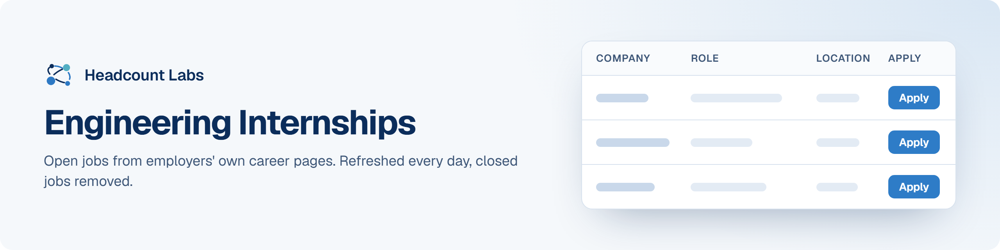

# Engineering Internships

Open mechanical, electrical, civil, chemical, hardware and manufacturing engineering internships in the US.

**400 open jobs** · 390 new since the last update · 236 removed because they closed or left the employer's board · updated November 2, 2026 at 4:33 AM EST

This list is built and refreshed every day by [Headcount Labs](https://headcountlabs.com/?utm_source=github&utm_medium=job-list&utm_campaign=engineering-internships), which reads jobs straight from employers' own career pages and job boards. Every job here was still listed on its source board when we last read that board, within the past 3 days, and was posted in the past 30 days. Copies of the same job are merged into one row, and jobs that close are removed at the next update.

Want this data in your own app or agent? Use the [Headcount Labs jobs API](https://headcountlabs.com/docs/?utm_source=github&utm_medium=job-list&utm_campaign=engineering-internships) (free tier), the [MCP server](https://headcountlabs.com/mcp/?utm_source=github&utm_medium=job-list&utm_campaign=engineering-internships) for Claude, ChatGPT and other AI assistants, or the [public dataset subsets](https://huggingface.co/HeadcountLabs) on Hugging Face (the full dataset is coming soon).

**Full dataset.** A bigger, one-off snapshot dated 2026-10-19 (all matching jobs, not only the open jobs below) is on Hugging Face: [Internships](https://huggingface.co/datasets/HeadcountLabs/internships). It loads with `datasets.load_dataset` and is under the Open Database License (ODbL) 1.0.

**Jump to:** [Posted in the last 7 days (200)](#posted-in-the-last-7-days) · [Posted 8 to 30 days ago (200)](#posted-8-to-30-days-ago)

**Columns.** *Apply* opens the original posting on the employer's site. *Details* opens the job on Headcount Labs, with every posting we found for it. *Remote* shows what the employer states; a dash means the posting doesn't say. *Pay* is the range the employer published.

## Posted in the last 7 days

| Company | Role | Location | Remote | Pay | Posted | Apply | Details |
| --- | --- | --- | --- | --- | --- | :---: | :---: |
| **Simplot** | Environmental Engineering Intern | Boise, ID | — | — | Nov 1 |  | <a href="https://headcountlabs.com/catalog/jobs/a2c745e4-84b5-48d0-86ec-eff91b98027e?utm_source=github&utm_medium=job-list&utm_campaign=engineering-internships">via Headcount Labs</a> |
| **Knorr-Bremse** | Intern, Test Engineering | Irving, TX | Hybrid | — | Nov 1 |  | <a href="https://headcountlabs.com/catalog/jobs/78b77435-a974-45a3-9cec-a0c1848d88f9?utm_source=github&utm_medium=job-list&utm_campaign=engineering-internships">via Headcount Labs</a> |
| **Knorr-Bremse** | Intern, Process Engineering | Riverside, MO | — | — | Nov 1 |  | <a href="https://headcountlabs.com/catalog/jobs/64e78b9c-4845-4eee-a1e4-3ef1a69b1ddb?utm_source=github&utm_medium=job-list&utm_campaign=engineering-internships">via Headcount Labs</a> |
| **Hubbell Incorporated** | 2027 Summer Intern: Engineering - Mechanical Design | Aiken, SC | — | $22.50–$29/hr | Nov 1 |  | <a href="https://headcountlabs.com/catalog/jobs/5c629a2e-84a5-4f15-8462-5e7998f2ed65?utm_source=github&utm_medium=job-list&utm_campaign=engineering-internships">via Headcount Labs</a> |
| **Black &amp; Veatch Family of Companies** | Structural Engineer Intern, Substation (East Region) | 

3 locations
Cary, NC Orlando, FL Ann Arbor, MI
 | — | — | Nov 1 |  | <a href="https://headcountlabs.com/catalog/jobs/aea55477-ec99-41c4-8ffe-02c181e743db?utm_source=github&utm_medium=job-list&utm_campaign=engineering-internships">via Headcount Labs</a> |
| **Black &amp; Veatch Family of Companies** | Structural Engineer Intern, Transmission Line (Central Region) | 

4 locations
Overland Park, KS Bloomington, MN Houston, TX Dallas, TX
 | — | $19.71–$36.86/hr | Nov 1 |  | <a href="https://headcountlabs.com/catalog/jobs/c161ae0c-8e28-4e27-bc01-1b16146a52c3?utm_source=github&utm_medium=job-list&utm_campaign=engineering-internships">via Headcount Labs</a> |
| **Black &amp; Veatch Family of Companies** | Structural Engineer Intern, Power | 

4 locations
Cary, NC Chattanooga, TN Houston, TX Overland Park, KS
 | — | — | Nov 1 |  | <a href="https://headcountlabs.com/catalog/jobs/88faf8b9-2c88-4e1d-8ce2-ff789c8e03d8?utm_source=github&utm_medium=job-list&utm_campaign=engineering-internships">via Headcount Labs</a> |
| **Black &amp; Veatch Family of Companies** | Structural Engineer Intern, Transmission Line (East Region) | 

4 locations
Ann Arbor, MI Cary, NC Seven Hills, OH Orlando, FL
 | — | $18.95–$35.61/hr | Nov 1 |  | <a href="https://headcountlabs.com/catalog/jobs/6b8ada50-4e48-4390-a478-15f6bb7de4f8?utm_source=github&utm_medium=job-list&utm_campaign=engineering-internships">via Headcount Labs</a> |
| **Black &amp; Veatch Family of Companies** | Structural Engineer Intern, Water | Cary, NC | — | — | Nov 1 |  | <a href="https://headcountlabs.com/catalog/jobs/69d01fbf-46e5-4beb-8172-7a372e0fa0d4?utm_source=github&utm_medium=job-list&utm_campaign=engineering-internships">via Headcount Labs</a> |
| **Black &amp; Veatch Family of Companies** | Structural Engineer Intern, Federal | Overland Park, KS | — | — | Nov 1 |  | <a href="https://headcountlabs.com/catalog/jobs/563ca73f-e0bc-4bb0-acc7-88c255ad7c73?utm_source=github&utm_medium=job-list&utm_campaign=engineering-internships">via Headcount Labs</a> |
| **Black &amp; Veatch Family of Companies** | Structural Engineer Intern, Substation (West Region) | 

2 locations
Greenwood Village, CO Tualatin, OR
 | — | $20.70–$36.86/hr | Nov 1 |  | <a href="https://headcountlabs.com/catalog/jobs/617774b9-14c1-4d57-9f4b-b78cc5003965?utm_source=github&utm_medium=job-list&utm_campaign=engineering-internships">via Headcount Labs</a> |
| **Black &amp; Veatch Family of Companies** | Structural Engineer Intern, Transmission Line (West Region) | 

3 locations
Tualatin, OR Greenwood Village, CO Rancho Cordova, CA
 | — | $20.70–$36.86/hr | Nov 1 |  | <a href="https://headcountlabs.com/catalog/jobs/512c5c7e-9203-4dbe-b274-3c27d90a57b9?utm_source=github&utm_medium=job-list&utm_campaign=engineering-internships">via Headcount Labs</a> |
| **WSP USA** | Civil Engineering Intern - Summer 2027 | 

12 locations
Lakewood, CO Madison, WI Virginia Beach, VA New York, NY Lawrenceville, NJ Chicago, IL Tampa, FL San Francisco, CA Columbus, OH Buffalo, NY Indianapolis, IN Charlotte, NC
 | — | $19–$30/hr | Oct 31 |  | <a href="https://headcountlabs.com/catalog/jobs/2c259cba-1799-433e-acee-9ca9abee8d76?utm_source=github&utm_medium=job-list&utm_campaign=engineering-internships">via Headcount Labs</a> |
| **WSP USA** | Electrical Engineering Intern - Summer 2027 | 

5 locations
Milwaukee, WI Minneapolis, MN Tempe, AZ Boise, ID Kansas City, MO
 | — | $23.03–$29.96/hr | Oct 31 |  | <a href="https://headcountlabs.com/catalog/jobs/8243ae8b-d2cd-4457-8b9f-b52102e192b0?utm_source=github&utm_medium=job-list&utm_campaign=engineering-internships">via Headcount Labs</a> |
| **Lincoln Electric** | Mechanical Engineering Summer 2027 Internship (Plymouth, MI) | Plymouth, MI | — | — | Oct 31 |  | <a href="https://headcountlabs.com/catalog/jobs/7bc899de-8a94-439c-9931-66a34e7c6892?utm_source=github&utm_medium=job-list&utm_campaign=engineering-internships">via Headcount Labs</a> |
| **Lincoln Electric** | Electrical Engineering Assistant-Intern | Coldwater, OH | — | $16–$24/hr | Oct 31 |  | <a href="https://headcountlabs.com/catalog/jobs/705e075e-b7ff-4a1e-af92-ac4283d1cf1a?utm_source=github&utm_medium=job-list&utm_campaign=engineering-internships">via Headcount Labs</a> |
| **L3HHCM20** | Image Processing Engineer Intern | Tulsa, OK | — | — | Oct 31 |  | <a href="https://headcountlabs.com/catalog/jobs/d8373059-9832-4be8-9a55-dbef834f8e0d?utm_source=github&utm_medium=job-list&utm_campaign=engineering-internships">via Headcount Labs</a> |
| **HII** | 2027 - Cybersecurity Engineering Intern - Sophomore, Junior, Senior * | Dayton Wright-Patterson AFB | — | — | Oct 31 |  | <a href="https://headcountlabs.com/catalog/jobs/3bf92210-d852-4fea-aec8-542cd2c3ed15?utm_source=github&utm_medium=job-list&utm_campaign=engineering-internships">via Headcount Labs</a> |
| **Doosan Corp** | Engineer Intern Sr - Spring 2027 | 

3 locations
Fargo, ND Bismarck, ND Charlotte, NC
 | — | — | Oct 31 |  | <a href="https://headcountlabs.com/catalog/jobs/ac125076-923e-4d70-b207-485320093b2b?utm_source=github&utm_medium=job-list&utm_campaign=engineering-internships">via Headcount Labs</a> |
| **WSP USA** | Electrical Engineering Intern (Substation) - Summer 2027 | 

2 locations
Burnsville, MN Minneapolis, MN
 | — | $23.03–$29.96/hr | Oct 30 |  | <a href="https://headcountlabs.com/catalog/jobs/eb4df5b5-5e17-4125-b98c-02ab1c798d76?utm_source=github&utm_medium=job-list&utm_campaign=engineering-internships">via Headcount Labs</a> |
| **Samsung Semiconductor** | Intern, SRAM Design Engineer | San Jose, CA | On-site | $28–$68/hr | Oct 30 |  | <a href="https://headcountlabs.com/catalog/jobs/b3d03394-d7d0-490c-88b8-e21c525144d4?utm_source=github&utm_medium=job-list&utm_campaign=engineering-internships">via Headcount Labs</a> |
| **Salesforce, Inc.** | Summer 2027 Intern - Forward Deployed Engineer – Global Public Sector | Arkansas | Remote | $27–$29/hr | Oct 30 |  | <a href="https://headcountlabs.com/catalog/jobs/45e0cc1d-7542-461c-9339-075708158740?utm_source=github&utm_medium=job-list&utm_campaign=engineering-internships">via Headcount Labs</a> |
| **RE/SPEC Inc.** | Student Engineering Intern – Water Resources | 

2 locations
Denver, CO Anchorage, AK
 | — | $22–$26/hr | Oct 30 |  | <a href="https://headcountlabs.com/catalog/jobs/ed3a6ad2-d489-4826-b7ff-dfa6bdfef164?utm_source=github&utm_medium=job-list&utm_campaign=engineering-internships">via Headcount Labs</a> |
| **Rasirc** | Chemical Engineering Intern (R&amp;D) | San Diego, CA | On-site | $20–$25/hr | Oct 30 |  | <a href="https://headcountlabs.com/catalog/jobs/8715b635-23aa-4ed5-b4e0-6f349e8d2c3c?utm_source=github&utm_medium=job-list&utm_campaign=engineering-internships">via Headcount Labs</a> |
| **Ragnar Benson, LLC** | Field Engineer Internship - Summer 2027 | Rockford, IL | — | $20–$21/hr | Oct 30 |  | <a href="https://headcountlabs.com/catalog/jobs/b97bea8e-e0c7-4e64-992b-ab46d8a1a0f1?utm_source=github&utm_medium=job-list&utm_campaign=engineering-internships">via Headcount Labs</a> |
| **Principal Financial Group** | Technical Engineer Internship - Des Moines, IA (Summer 2027) | Des Moines, IA | Hybrid | $28–$30/hr | Oct 30 |  | <a href="https://headcountlabs.com/catalog/jobs/59ec0c6a-d02d-4993-ae78-ee8852ab757c?utm_source=github&utm_medium=job-list&utm_campaign=engineering-internships">via Headcount Labs</a> |
| **Northrop Grumman** | 2027 Intern Engineer - Product Support | Melbourne, FL | — | $18.50–$33.50/hr | Oct 30 |  | <a href="https://headcountlabs.com/catalog/jobs/7f285061-f5d5-4fca-ab0a-ab08fe558c72?utm_source=github&utm_medium=job-list&utm_campaign=engineering-internships">via Headcount Labs</a> |
| **Northrop Grumman** | 2027 mechanical Engineer Intern- Redondo Beach CA | Redondo Beach, CA | — | $21.50–$39/hr | Oct 30 |  | <a href="https://headcountlabs.com/catalog/jobs/7914921e-3bdb-4f82-a5a7-4ff573370842?utm_source=github&utm_medium=job-list&utm_campaign=engineering-internships">via Headcount Labs</a> |
| **L3HHCM20** | Manufacturing Engineering Intern | Londonderry, NH | — | $25–$47.50/hr | Oct 30 |  | <a href="https://headcountlabs.com/catalog/jobs/51b5899b-4ff6-40b8-bbbe-87db29b88c9e?utm_source=github&utm_medium=job-list&utm_campaign=engineering-internships">via Headcount Labs</a> |
| **L3HHCM20** | Materials &amp; Processes Engineering Intern (Orange, VA) | Orange, VA | — | $22–$40.50/hr | Oct 30 |  | <a href="https://headcountlabs.com/catalog/jobs/dd634093-bb3c-4bc2-b664-d019e5d2d562?utm_source=github&utm_medium=job-list&utm_campaign=engineering-internships">via Headcount Labs</a> |
| **Kimley-Horn** | Civil Engineering Intern | 

22 locations
Des Moines, IA Murfreesboro, TN Rosemont, IL Plymouth Meeting, PA Nashville, TN Kansas City, MO Cary, NC St. Louis Park, MN Saint Paul, MN Raleigh, NC Denton, TX Richardson, TX +10 more
 | — | $27–$28/hr | Oct 30 |  | <a href="https://headcountlabs.com/catalog/jobs/b03dd167-21d0-4e4d-909f-803680281c6d?utm_source=github&utm_medium=job-list&utm_campaign=engineering-internships">via Headcount Labs</a> |
| **Kimley-Horn** | Mechanical Engineering Intern | 

2 locations
Irvine, CA St. Louis Park, MN
 | — | $30–$31/hr | Oct 30 |  | <a href="https://headcountlabs.com/catalog/jobs/26470e51-028a-43d2-8de5-d5f931bcdd51?utm_source=github&utm_medium=job-list&utm_campaign=engineering-internships">via Headcount Labs</a> |
| **Kimley-Horn** | Electrical Engineering Intern - Power Delivery | 

4 locations
Everett, WA Saint Paul, MN Overland Park, KS Frisco, TX
 | — | $33–$34/hr | Oct 30 |  | <a href="https://headcountlabs.com/catalog/jobs/ad41d176-620b-4219-ba39-e2d397273454?utm_source=github&utm_medium=job-list&utm_campaign=engineering-internships">via Headcount Labs</a> |
| **Kimball Solutions Indianapolis, Inc.** | Automation Engineer Intern | Kimball Electronics Indianapolis | — | — | Oct 30 |  | <a href="https://headcountlabs.com/catalog/jobs/d5a4cb4c-674e-429b-967f-bb22ddb68a5f?utm_source=github&utm_medium=job-list&utm_campaign=engineering-internships">via Headcount Labs</a> |
| **Kimball Solutions Indianapolis, Inc.** | Manufacturing Engineer Intern | Kimball Electronics Indianapolis | — | — | Oct 30 |  | <a href="https://headcountlabs.com/catalog/jobs/ae44f0ac-fb19-4971-85bf-c4d1a38bfbed?utm_source=github&utm_medium=job-list&utm_campaign=engineering-internships">via Headcount Labs</a> |
| **J. C. Higgins Corp.** | J. C. Higgins Corp. Project Engineer Internship | Stoughton, MA | — | $20–$25/hr | Oct 30 |  | <a href="https://headcountlabs.com/catalog/jobs/7a49ef29-11f4-4428-a21f-030404aad794?utm_source=github&utm_medium=job-list&utm_campaign=engineering-internships">via Headcount Labs</a> |
| **Itron, Inc.** | Intern - Systems Engineer (Spring 2027) | West Union, SC | On-site | — | Oct 30 |  | <a href="https://headcountlabs.com/catalog/jobs/8d2b2bc9-c493-4937-95c8-819c57f7a515?utm_source=github&utm_medium=job-list&utm_campaign=engineering-internships">via Headcount Labs</a> |
| **Hubbell Incorporated** | 2027 Summer Intern: Engineering - Product | 

3 locations
Manchester, NH Hamilton, OH Broken Arrow, OK
 | — | $22.50–$29/hr | Oct 30 |  | <a href="https://headcountlabs.com/catalog/jobs/7fef36a6-0974-4022-8ff8-6902d2230a61?utm_source=github&utm_medium=job-list&utm_campaign=engineering-internships">via Headcount Labs</a> |
| **Hubbell Incorporated** | 2027 Summer Intern: Engineering - Manufacturing | 

2 locations
Broken Arrow, OK Iron Mountain, MI
 | — | $22.50–$29/hr | Oct 30 |  | <a href="https://headcountlabs.com/catalog/jobs/987ed5cd-0350-41ae-980d-b1b9bdae6aa4?utm_source=github&utm_medium=job-list&utm_campaign=engineering-internships">via Headcount Labs</a> |
| **General Dynamics Electric Boat** | 2027 Quality Assurance – Engineering Summer Internship | Groton, CT | — | — | Oct 30 |  | <a href="https://headcountlabs.com/catalog/jobs/e6636818-c37c-4a50-a759-cc10fe2682de?utm_source=github&utm_medium=job-list&utm_campaign=engineering-internships">via Headcount Labs</a> |
| **GEI Consultants** | Water Resources Engineering Intern | Plymouth, MI | — | — | Oct 30 |  | <a href="https://headcountlabs.com/catalog/jobs/ce2a58fe-90a9-4537-bcc3-9d8a962e123e?utm_source=github&utm_medium=job-list&utm_campaign=engineering-internships">via Headcount Labs</a> |
| **Commonwealth Fusion Systems** | Intern - Structural Engineer - Summer 2027 | Devens, MA | On-site | $25–$38/hr | Oct 30 |  | <a href="https://headcountlabs.com/catalog/jobs/6285bd65-22b0-4b38-b636-cbfbddc52dea?utm_source=github&utm_medium=job-list&utm_campaign=engineering-internships">via Headcount Labs</a> |
| **Commonwealth Fusion Systems** | Intern - Mechanical and Magnet Engineer - Spring or Summer 2027 | Devens, MA | On-site | $25–$38/hr | Oct 30 |  | <a href="https://headcountlabs.com/catalog/jobs/2fa65436-0810-410f-9431-22d63fbee1c0?utm_source=github&utm_medium=job-list&utm_campaign=engineering-internships">via Headcount Labs</a> |
| **Commonwealth Fusion Systems** | Intern - Electrical/Electromechanical Engineer - Spring 2027 | Devens, MA | On-site | $25–$38/hr | Oct 30 |  | <a href="https://headcountlabs.com/catalog/jobs/26bfa5a2-40ad-471d-9ec6-175aa4694b7a?utm_source=github&utm_medium=job-list&utm_campaign=engineering-internships">via Headcount Labs</a> |
| **Commonwealth Fusion Systems** | Intern - R&amp;D Test Engineer - Spring or Summer 2027 | Devens, MA &amp; Somerville, MA | On-site | $25–$38/hr | Oct 30 |  | <a href="https://headcountlabs.com/catalog/jobs/2410b685-a174-4279-9f75-7f3805621ac1?utm_source=github&utm_medium=job-list&utm_campaign=engineering-internships">via Headcount Labs</a> |
| **Chevron** | 2026-2027 Facilities Engineering Intern (Previous Intern) | 

13 locations
Houston, TX Ames, IA Bakersfield, CA Belle Chasse, LA Covington, LA El Segundo, CA Geismar, LA Greeley, CO Midland, TX North Salt Lake, UT Pasadena, TX Pascagoula, MS +1 more
 | — | — | Oct 30 |  | <a href="https://headcountlabs.com/catalog/jobs/6c2aa8b4-abd7-4751-be3e-ca96f8023569?utm_source=github&utm_medium=job-list&utm_campaign=engineering-internships">via Headcount Labs</a> |
| **Carollo Engineers Inc.** | Civil/Environmental Engineering Intern | Portland, OR | — | — | Oct 30 |  | <a href="https://headcountlabs.com/catalog/jobs/5bd3453e-000e-4515-b534-5b79d553389e?utm_source=github&utm_medium=job-list&utm_campaign=engineering-internships">via Headcount Labs</a> |
| **Armstrong World Industries** | R&amp;D Engineer Intern | Pennsylvania | — | — | Oct 30 |  | <a href="https://headcountlabs.com/catalog/jobs/8b384b7f-afca-4daa-9797-f518b53b0baa?utm_source=github&utm_medium=job-list&utm_campaign=engineering-internships">via Headcount Labs</a> |
| **Ametek, Inc.** | Engineering Intern | Atlanta, GA | — | — | Oct 30 |  | <a href="https://headcountlabs.com/catalog/jobs/9b1d181c-9e29-41cf-a3bf-c24c620dd067?utm_source=github&utm_medium=job-list&utm_campaign=engineering-internships">via Headcount Labs</a> |
| **AECOM** | Civil Engineering Intern III | 

2 locations
Minneapolis Minneapolis, MN
 | — | $22.85–$31.41/hr | Oct 30 |  | <a href="https://headcountlabs.com/catalog/jobs/13776dcb-8acc-4601-a34c-09b880608320?utm_source=github&utm_medium=job-list&utm_campaign=engineering-internships">via Headcount Labs</a> |
| **AECOM** | Engineering Intern | 

4 locations
Columbus, OH Cleveland, OH Arlington, VA Akron, OH
 | Hybrid | $18.05–$24.82/hr | Oct 30 |  | <a href="https://headcountlabs.com/catalog/jobs/0dfe9e2a-4754-46c9-aacd-8f7b0aad2080?utm_source=github&utm_medium=job-list&utm_campaign=engineering-internships">via Headcount Labs</a> |
| **WSP USA** | Water Resources Engineering Intern- Summer 2027 | 

18 locations
Saint Louis, MO Chicago, IL Detroit, MI Minneapolis, MN Springfield, IL Seattle, WA Boise, ID Las Vegas, NV Portland, OR Knoxville, TN Birmingham, AL Brentwood, TN +6 more
 | — | $22.17–$29.96/hr | Oct 29 |  | <a href="https://headcountlabs.com/catalog/jobs/8a70faae-a478-45e4-a842-73774545d800?utm_source=github&utm_medium=job-list&utm_campaign=engineering-internships">via Headcount Labs</a> |
| **WSP USA** | Structural Engineering Intern - Summer 2027 | 

11 locations
San Diego, CA Troy, NY Chicago, IL Valhalla, NY Glastonbury, CT South Jordan, UT New York, NY Houston, TX Austin, TX Lakewood, CO Richmond, VA
 | — | $23.90–$31.11/hr | Oct 29 |  | <a href="https://headcountlabs.com/catalog/jobs/04fe4cfa-8df8-4c75-882e-9a0d81cef522?utm_source=github&utm_medium=job-list&utm_campaign=engineering-internships">via Headcount Labs</a> |
| **WSP USA** | Electrical Engineering (Substation) Intern - Summer 2027 | 

5 locations
Saint Louis, MO Lake Oswego, OR United States Mount Laurel, NJ Richmond, VA
 | — | $23.03–$29.96/hr | Oct 29 |  | <a href="https://headcountlabs.com/catalog/jobs/05f5f6b7-4c5a-4ccd-8b01-0e785d17102e?utm_source=github&utm_medium=job-list&utm_campaign=engineering-internships">via Headcount Labs</a> |
| **WSP USA** | Civil Engineering (Transmission) Intern - Summer 2027 | Portland, OR | — | — | Oct 29 |  | <a href="https://headcountlabs.com/catalog/jobs/b5bd2768-90a4-43f7-956b-fe74f6fc0bd1?utm_source=github&utm_medium=job-list&utm_campaign=engineering-internships">via Headcount Labs</a> |
| **WithersRavenel** | Site Civil Engineering Intern | Cary, NC | — | — | Oct 29 |  | <a href="https://headcountlabs.com/catalog/jobs/b1439de6-a3f5-4715-aa44-df3d4db87a05?utm_source=github&utm_medium=job-list&utm_campaign=engineering-internships">via Headcount Labs</a> |
| **The Haskell Company** | Summer 2027 Process Engineering Intern | St. Louis, MO | — | — | Oct 29 |  | <a href="https://headcountlabs.com/catalog/jobs/9a75708d-fc78-4356-b2e0-f00d2ea1158b?utm_source=github&utm_medium=job-list&utm_campaign=engineering-internships">via Headcount Labs</a> |
| **Spirit AeroSystems** | Boeing - Wichita Summer 2027 Internship Program (Paid) - Manufacturing Engineering | Wichita, KS | — | $20.55–$34.42/hr | Oct 29 |  | <a href="https://headcountlabs.com/catalog/jobs/7fd47932-068e-4f9b-97f4-8f861fbd55f7?utm_source=github&utm_medium=job-list&utm_campaign=engineering-internships">via Headcount Labs</a> |
| **SP - Space Components** | 2027 Thermal Mechanical Engineer Internship - Hanover MD | Hanover, MD | — | $25.50–$31/hr | Oct 29 |  | <a href="https://headcountlabs.com/catalog/jobs/fa5fa7ad-53cc-4c76-92a0-6e9718cb64a9?utm_source=github&utm_medium=job-list&utm_campaign=engineering-internships">via Headcount Labs</a> |
| **SP - Orbital Space Systems** | 2027 Mechanical Engineer Intern- Gilbert AZ | Gilbert, AZ | — | $18.50–$33.50/hr | Oct 29 |  | <a href="https://headcountlabs.com/catalog/jobs/ed841802-d5c3-49fd-89e8-e302d6d04737?utm_source=github&utm_medium=job-list&utm_campaign=engineering-internships">via Headcount Labs</a> |
| **SP - AOA/Xinetics** | 2027 Mechanical Engineer Internship - East Hartford CT | East Hartford, CT | — | $26.75–$32.50/hr | Oct 29 |  | <a href="https://headcountlabs.com/catalog/jobs/35aa2902-f7d3-40e5-80b5-9ae15a8a7265?utm_source=github&utm_medium=job-list&utm_campaign=engineering-internships">via Headcount Labs</a> |
| **Search Jobs - INL Interns** | Hot Cell Design Mechanical Engineering Intern - Summer 2027 | Idaho Falls, ID | On-site | $29.39–$32.41/hr | Oct 29 |  | <a href="https://headcountlabs.com/catalog/jobs/db5b8678-40ab-4a13-b463-75a629b013a4?utm_source=github&utm_medium=job-list&utm_campaign=engineering-internships">via Headcount Labs</a> |
| **RHI Magnesita** | Manufacturing Engineering Intern - Summer 2027 | 

2 locations
York, PA East Canton, OH
 | — | — | Oct 29 |  | <a href="https://headcountlabs.com/catalog/jobs/87afb683-5089-4bee-b4b3-935c3b93cfba?utm_source=github&utm_medium=job-list&utm_campaign=engineering-internships">via Headcount Labs</a> |
| **RHI Magnesita** | Materials Science &amp; Engineering Intern - Summer 2027 | York, PA | — | — | Oct 29 |  | <a href="https://headcountlabs.com/catalog/jobs/69c75b2d-715a-4012-9e9c-e2d3fa3ab5ee?utm_source=github&utm_medium=job-list&utm_campaign=engineering-internships">via Headcount Labs</a> |
| **Rendezvous Robotics** | Manufacturing and Test Engineering Intern (Summer 2027) | Golden, CO | — | — | Oct 29 |  | <a href="https://headcountlabs.com/catalog/jobs/759e2d1f-75b7-4704-81e3-c164d4827d0e?utm_source=github&utm_medium=job-list&utm_campaign=engineering-internships">via Headcount Labs</a> |
| **PCL Construction** | Solar Field Engineer Intern 1 | 

3 locations
United States Blytheville, AR Fort Vannoy (historical), OR
 | — | $18–$24/hr | Oct 29 |  | <a href="https://headcountlabs.com/catalog/jobs/6a22f009-cb00-4413-ab63-e658331a1933?utm_source=github&utm_medium=job-list&utm_campaign=engineering-internships">via Headcount Labs</a> |
| **Northrop Grumman** | 2027 Structural Engineering Intern- Roy UT | Roy, UT | — | $23–$29/hr | Oct 29 |  | <a href="https://headcountlabs.com/catalog/jobs/df65d6f8-a0b2-4b2a-acea-85c63f2a419c?utm_source=github&utm_medium=job-list&utm_campaign=engineering-internships">via Headcount Labs</a> |
| **Northrop Grumman** | 2027 Parts Materials and Process Engineering Intern- Roy UT | Roy, UT | — | $23–$29/hr | Oct 29 |  | <a href="https://headcountlabs.com/catalog/jobs/d0c77ad9-2302-4ecb-8d5b-c9f88322f4b9?utm_source=github&utm_medium=job-list&utm_campaign=engineering-internships">via Headcount Labs</a> |
| **Northrop Grumman** | 2026 Mechanical Engineer Intern - Manhattan Beach CA | Manhattan Beach, CA | — | $26.75–$32.50/hr | Oct 29 |  | <a href="https://headcountlabs.com/catalog/jobs/e83e2866-079f-408a-a01c-47adb4b11157?utm_source=github&utm_medium=job-list&utm_campaign=engineering-internships">via Headcount Labs</a> |
| **Nordson MEDICAL (NH), Inc.** | Manufacturing Engineering Intern | Salem, NH | — | — | Oct 29 |  | <a href="https://headcountlabs.com/catalog/jobs/e3447c09-3a64-41e2-bcb7-6308d345cb2d?utm_source=github&utm_medium=job-list&utm_campaign=engineering-internships">via Headcount Labs</a> |
| **Navico Group Americas LLC** | Engineering Test Lab Intern | Lowell, MI | On-site | $18–$27/hr | Oct 29 |  | <a href="https://headcountlabs.com/catalog/jobs/33ab67af-d313-4841-8671-105ba172a3e3?utm_source=github&utm_medium=job-list&utm_campaign=engineering-internships">via Headcount Labs</a> |
| **Micron Technology, Inc.** | Intern - Equipment Engineer | Manassas, VA | On-site | $34.89–$40.28/hr | Oct 29 |  | <a href="https://headcountlabs.com/catalog/jobs/576b1f4c-4064-415d-ae93-80cff424a008?utm_source=github&utm_medium=job-list&utm_campaign=engineering-internships">via Headcount Labs</a> |
| **MGC Contractors** | Field Engineer Intern | Eagle Mountain, UT | On-site | — | Oct 29 |  | <a href="https://headcountlabs.com/catalog/jobs/10b165bd-b760-4a60-a68c-7aa25f669199?utm_source=github&utm_medium=job-list&utm_campaign=engineering-internships">via Headcount Labs</a> |
| **L3HHCM20** | Systems Engineering Intern (Clifton, NJ) | Clifton, NJ | — | $25.50–$32.50/hr | Oct 29 |  | <a href="https://headcountlabs.com/catalog/jobs/fba79375-533a-44d9-9d3e-7f10974f0dfe?utm_source=github&utm_medium=job-list&utm_campaign=engineering-internships">via Headcount Labs</a> |
| **L3HHCM20** | Electrical Engineer Intern | Clifton, NJ | — | $25.50–$48/hr | Oct 29 |  | <a href="https://headcountlabs.com/catalog/jobs/dcdb664b-127e-429b-be7e-e64413b3b475?utm_source=github&utm_medium=job-list&utm_campaign=engineering-internships">via Headcount Labs</a> |
| **L3HHCM20** | Intern, Manufacturing Engineering (Tempe, AZ) | Tempe, AZ | — | — | Oct 29 |  | <a href="https://headcountlabs.com/catalog/jobs/aa7446e4-20c7-4398-905d-83e1873b958e?utm_source=github&utm_medium=job-list&utm_campaign=engineering-internships">via Headcount Labs</a> |
| **L3HHCM20** | Intern, Manufacturing Engineering | Tempe, AZ | — | — | Oct 29 |  | <a href="https://headcountlabs.com/catalog/jobs/6533704c-ef30-4b62-b870-7aebc4304063?utm_source=github&utm_medium=job-list&utm_campaign=engineering-internships">via Headcount Labs</a> |
| **Kimley-Horn** | Electrical Engineering Intern | 

2 locations
Orlando, FL Greenwood Village, CO
 | — | — | Oct 29 |  | <a href="https://headcountlabs.com/catalog/jobs/ea39b838-8c06-4979-be21-2c1cb5d6be83?utm_source=github&utm_medium=job-list&utm_campaign=engineering-internships">via Headcount Labs</a> |
| **IMEG Consultants Corp.** | Structural Engineering Intern &#124; San Francisco, CA | San Francisco, CA | — | $22.50–$24.50/hr | Oct 29 |  | <a href="https://headcountlabs.com/catalog/jobs/280ff34f-6168-4389-91e1-ac24dd1d3aa8?utm_source=github&utm_medium=job-list&utm_campaign=engineering-internships">via Headcount Labs</a> |
| **Hubbell Incorporated** | 2027 Summer Intern: Engineering - Mechanical | Portsmouth, NH | — | $22.50–$29/hr | Oct 29 |  | <a href="https://headcountlabs.com/catalog/jobs/972a4b63-8aca-420d-aaa0-80416702e9a4?utm_source=github&utm_medium=job-list&utm_campaign=engineering-internships">via Headcount Labs</a> |
| **Hubbell Incorporated** | 2027 Summer Intern: Engineering - Embedded Systems | Portsmouth, NH | — | $22.50–$29/hr | Oct 29 |  | <a href="https://headcountlabs.com/catalog/jobs/52afb4ba-6847-4253-8203-51eb8b045d49?utm_source=github&utm_medium=job-list&utm_campaign=engineering-internships">via Headcount Labs</a> |
| **Great Lakes Dredge &amp; Dock Company, LLC** | Site Engineer Technician Winter Intern | 

24 locations
New York Oak Brook Terrace, IL West Islip, NY Upper Township, NJ Avon, NC Atlantic Beach, FL Simons Island, GA St. Simons Island, GA Myrtle Beach, SC Venice, LA Atlantic Beach, NY Sulphur, LA +12 more
 | — | $21/hr | Oct 29 |  | <a href="https://headcountlabs.com/catalog/jobs/a092def4-248f-4e8c-8dd3-56c8e1fe93ab?utm_source=github&utm_medium=job-list&utm_campaign=engineering-internships">via Headcount Labs</a> |
| **Great Lakes Dredge &amp; Dock Company, LLC** | Site Engineer Technician Summer Intern | 

23 locations
New York Oak Brook Terrace, IL West Islip, NY Upper Township, NJ Avon, NC Atlantic Beach, FL Simons Island, GA Myrtle Beach, SC Venice, LA Atlantic Beach, NY Sulphur, LA Fort Lauderdale, FL +11 more
 | — | $21/hr | Oct 29 |  | <a href="https://headcountlabs.com/catalog/jobs/7b5bbfad-4288-4a4c-ba22-9a12daaf01da?utm_source=github&utm_medium=job-list&utm_campaign=engineering-internships">via Headcount Labs</a> |
| **Fluor** | Engineering Technician I- Piping Material Control Intern | Houston, TX | — | $43k–$66k/yr | Oct 29 |  | <a href="https://headcountlabs.com/catalog/jobs/e7839f94-e281-40c4-9ae0-f255def0bbd0?utm_source=github&utm_medium=job-list&utm_campaign=engineering-internships">via Headcount Labs</a> |
| **Fluor** | Engineering Technician I- Piping Design Intern | Houston, TX | — | $43k–$66k/yr | Oct 29 |  | <a href="https://headcountlabs.com/catalog/jobs/d2557d1d-4abe-4761-b74c-13a51e42fb57?utm_source=github&utm_medium=job-list&utm_campaign=engineering-internships">via Headcount Labs</a> |
| **Fluor** | Engineering Technician I- Piping Stress Engineer Intern | Houston, TX | — | $43k–$66k/yr | Oct 29 |  | <a href="https://headcountlabs.com/catalog/jobs/2f4e9f11-6cff-4142-b19f-cca76c1ae295?utm_source=github&utm_medium=job-list&utm_campaign=engineering-internships">via Headcount Labs</a> |
| **Eversource Energy Service Company** | Engineering Intern: Distribution System Modeling and Automation (MA/CT/NH, Hybrid Schedule) | Westwood, MA | Hybrid | — | Oct 29 |  | <a href="https://headcountlabs.com/catalog/jobs/fbe027e0-0c7d-40fe-8e67-d6895a9b99d1?utm_source=github&utm_medium=job-list&utm_campaign=engineering-internships">via Headcount Labs</a> |
| **Etched** | Core Engineering Intern | San Jose, CA | On-site | — | Oct 29 |  | <a href="https://headcountlabs.com/catalog/jobs/29094d50-f80b-49ab-9931-53cdfb5fca87?utm_source=github&utm_medium=job-list&utm_campaign=engineering-internships">via Headcount Labs</a> |
| **E2 Consulting Engineers, LP** | Substation Design Engineer Intern –Part Time | San Diego, CA | — | $22–$32/hr | Oct 29 |  | <a href="https://headcountlabs.com/catalog/jobs/896a311f-b7be-4db4-a003-6f9edd4daccd?utm_source=github&utm_medium=job-list&utm_campaign=engineering-internships">via Headcount Labs</a> |
| **E2 Consulting Engineers, LP** | Substation Design Engineer Intern | Pasadena, CA | — | $22–$32/hr | Oct 29 |  | <a href="https://headcountlabs.com/catalog/jobs/f1badf7a-a3bf-41fe-bf77-a95c426874f2?utm_source=github&utm_medium=job-list&utm_campaign=engineering-internships">via Headcount Labs</a> |
| **Contech Engineered Solutions LLC** | Intern, Civil/Structural Engineering | ALEXANDRIA, MN | — | — | Oct 29 |  | <a href="https://headcountlabs.com/catalog/jobs/3b97af2d-30ee-4fdc-be1a-3baa05114e6c?utm_source=github&utm_medium=job-list&utm_campaign=engineering-internships">via Headcount Labs</a> |
| **Ameresco Inc** | Project Commissioning Engineer Intern | Binghamton, NY | Remote | $25/hr | Oct 29 |  | <a href="https://headcountlabs.com/catalog/jobs/d9e93636-35c1-47f3-9b06-98b3a08c3495?utm_source=github&utm_medium=job-list&utm_campaign=engineering-internships">via Headcount Labs</a> |
| **Ameresco Inc** | Project Engineering Intern | Albany, NY | — | $25/hr | Oct 29 |  | <a href="https://headcountlabs.com/catalog/jobs/80cd8db3-50b5-4695-985b-e8c3dae80f23?utm_source=github&utm_medium=job-list&utm_campaign=engineering-internships">via Headcount Labs</a> |
| **AECOM** | Digital Engineering Intern (BIM) – AECOM Hunt | Dallas, TX | — | $21–$28/hr | Oct 29 |  | <a href="https://headcountlabs.com/catalog/jobs/5e66d560-4ad7-4c09-aabf-1cf62dc003fc?utm_source=github&utm_medium=job-list&utm_campaign=engineering-internships">via Headcount Labs</a> |
| **AECOM** | Electrical Engineering Intern | Roanoke, VA | Hybrid | $23–$30/hr | Oct 29 |  | <a href="https://headcountlabs.com/catalog/jobs/3e7d8ca4-4b7c-4543-aaaa-e4bf40e1ff53?utm_source=github&utm_medium=job-list&utm_campaign=engineering-internships">via Headcount Labs</a> |
| **Advanced Robotics for Manufacturing (ARM)** | Mechanical Engineer Co-op/ Internship | Pittsburgh, PA | On-site | — | Oct 29 |  | <a href="https://headcountlabs.com/catalog/jobs/3a6e6f9e-9fc0-4c17-bae2-6c47912e8d8a?utm_source=github&utm_medium=job-list&utm_campaign=engineering-internships">via Headcount Labs</a> |
| **Acuity Inc.** | Illumination Engineering Intern (Summer 2027) | Wheat Ridge, CO | On-site | $25/hr | Oct 29 |  | <a href="https://headcountlabs.com/catalog/jobs/b15ebbac-5253-406a-bf61-899e32fd1ed6?utm_source=github&utm_medium=job-list&utm_campaign=engineering-internships">via Headcount Labs</a> |
| **WSP USA** | Mechanical Engineering Intern - Summer 2027 | 

4 locations
Kansas City, MO Boise, ID Tempe, AZ Minneapolis, MN
 | — | $23.03–$29.96/hr | Oct 28 |  | <a href="https://headcountlabs.com/catalog/jobs/7634b0fd-59d1-4594-87cb-8c0507719d17?utm_source=github&utm_medium=job-list&utm_campaign=engineering-internships">via Headcount Labs</a> |
| **The Nuclear Company** | Spring 2027 Security Engineer Intern | Washington, D.C. | Hybrid | $25/hr | Oct 28 |  | <a href="https://headcountlabs.com/catalog/jobs/c7e28374-bdd7-4db9-abe4-f0d97a6ca764?utm_source=github&utm_medium=job-list&utm_campaign=engineering-internships">via Headcount Labs</a> |
| **Sundt** | Renewables - Intern - Engineer | United States | On-site | — | Oct 28 |  | <a href="https://headcountlabs.com/catalog/jobs/519fbd58-0e4f-4da8-89c2-ebfa16e35ad4?utm_source=github&utm_medium=job-list&utm_campaign=engineering-internships">via Headcount Labs</a> |
| **StandardAero** | Intern, Engineer: Summer | Cincinnati, OH | On-site | — | Oct 28 |  | <a href="https://headcountlabs.com/catalog/jobs/e0f868e8-87a5-4e5d-b017-a58e3fdfc307?utm_source=github&utm_medium=job-list&utm_campaign=engineering-internships">via Headcount Labs</a> |
| **SP - Orbital Space Systems** | 2027 Electrical Engineer Intern- Gilbert AZ | Gilbert, AZ | — | $21.50–$39/hr | Oct 28 |  | <a href="https://headcountlabs.com/catalog/jobs/8457dcb3-8433-4a20-b849-305dc3ba035d?utm_source=github&utm_medium=job-list&utm_campaign=engineering-internships">via Headcount Labs</a> |
| **Samsung Semiconductor** | Intern, RTL Power Macromodeling Engineer | San Jose, CA | On-site | $28–$68/hr | Oct 28 |  | <a href="https://headcountlabs.com/catalog/jobs/ffe8b4c2-ce93-4f65-b286-024cad71a591?utm_source=github&utm_medium=job-list&utm_campaign=engineering-internships">via Headcount Labs</a> |
| **PCC Talent Acquisition Portal** | Quality Engineer Intern (Co-Op) | North Hollywood | On-site | — | Oct 28 |  | <a href="https://headcountlabs.com/catalog/jobs/a72fb25e-c94f-4520-a0bf-7c9a2592912e?utm_source=github&utm_medium=job-list&utm_campaign=engineering-internships">via Headcount Labs</a> |
| **Northrop Grumman** | 2027 Electrical Engineer Intern- Redondo Beach CA | Redondo Beach, CA | — | $21.50–$39/hr | Oct 28 |  | <a href="https://headcountlabs.com/catalog/jobs/770aed71-2389-465c-be4b-876e3cc0e03a?utm_source=github&utm_medium=job-list&utm_campaign=engineering-internships">via Headcount Labs</a> |
| **MasTec Inc** | Internship - Field Engineering | Louisville, CO | — | — | Oct 28 |  | <a href="https://headcountlabs.com/catalog/jobs/0028ee35-bf8b-4650-a143-abfd9e1e3485?utm_source=github&utm_medium=job-list&utm_campaign=engineering-internships">via Headcount Labs</a> |
| **MAHLE** | HVAC Product Engineering Intern | Farmington Hills, MI | — | — | Oct 28 |  | <a href="https://headcountlabs.com/catalog/jobs/e5993578-6200-4133-8e8a-c0e838bfdb89?utm_source=github&utm_medium=job-list&utm_campaign=engineering-internships">via Headcount Labs</a> |
| **MAHLE** | Platform Design Electrical Engineering Intern | Lockport, NY | — | — | Oct 28 |  | <a href="https://headcountlabs.com/catalog/jobs/e1ba7f00-27bc-4a4b-85e9-6472eb966656?utm_source=github&utm_medium=job-list&utm_campaign=engineering-internships">via Headcount Labs</a> |
| **MAHLE** | HVAC Engineering Intern - Validation Test Support | Lockport, NY | — | — | Oct 28 |  | <a href="https://headcountlabs.com/catalog/jobs/646549f1-ab1c-40b4-98af-d9dc0d8ac272?utm_source=github&utm_medium=job-list&utm_campaign=engineering-internships">via Headcount Labs</a> |
| **MAHLE** | HVAC Design &amp; Product Engineering Intern | Lockport, NY | — | — | Oct 28 |  | <a href="https://headcountlabs.com/catalog/jobs/527a6741-c555-418c-93b4-6b57f15fb59a?utm_source=github&utm_medium=job-list&utm_campaign=engineering-internships">via Headcount Labs</a> |
| **Lionakis** | Student Intern Summer 2027 - Structural Engineering | 

2 locations
Irvine, CA Sacramento, CA
 | On-site | $25/hr | Oct 28 |  | <a href="https://headcountlabs.com/catalog/jobs/48a37a64-6d81-4f85-9c2a-e45074b3cd82?utm_source=github&utm_medium=job-list&utm_campaign=engineering-internships">via Headcount Labs</a> |
| **Landis+Gyr** | Intern - Electronics Engineering | Lafayette, IN | — | — | Oct 28 |  | <a href="https://headcountlabs.com/catalog/jobs/bf948c3f-43c7-4643-b1af-ba68fdcd4265?utm_source=github&utm_medium=job-list&utm_campaign=engineering-internships">via Headcount Labs</a> |
| **L3HHCM20** | Systems Engineering Intern | 

4 locations
Salt Lake City, UT Rochester, NY Forest, VA Clifton, NJ
 | — | $22.50–$34.50/hr | Oct 28 |  | <a href="https://headcountlabs.com/catalog/jobs/0695f54b-f576-48f8-a120-bd7e52b71bc0?utm_source=github&utm_medium=job-list&utm_campaign=engineering-internships">via Headcount Labs</a> |
| **Kreg Tool Company** | Product Development Engineering Intern - Summer 2027 | Ankeny, IA | — | — | Oct 28 |  | <a href="https://headcountlabs.com/catalog/jobs/3c0cb612-f396-4ab0-b72e-16c1ad80f16f?utm_source=github&utm_medium=job-list&utm_campaign=engineering-internships">via Headcount Labs</a> |
| **Kreg Tool** | Industrial Engineering Intern - Summer 2027 | Ankeny, IA | — | — | Oct 28 |  | <a href="https://headcountlabs.com/catalog/jobs/79ba6a11-7436-4581-bbc0-4922967c7916?utm_source=github&utm_medium=job-list&utm_campaign=engineering-internships">via Headcount Labs</a> |
| **Kimley-Horn** | Civil Engineering Intern- Water/Wastewater | Sacramento, CA | — | $30–$31/hr | Oct 28 |  | <a href="https://headcountlabs.com/catalog/jobs/68f1654b-76a5-48eb-9e69-0afe641ee52e?utm_source=github&utm_medium=job-list&utm_campaign=engineering-internships">via Headcount Labs</a> |
| **Intel Corporation** | Process Integration Development Engineer PhD Intern 2027 | Hillsboro, OR | On-site | $121k–$121k/yr | Oct 28 |  | <a href="https://headcountlabs.com/catalog/jobs/f2db2e01-b0b2-46e0-becd-da11a3414a6b?utm_source=github&utm_medium=job-list&utm_campaign=engineering-internships">via Headcount Labs</a> |
| **Hyundai Motor Company** | 2027 Summer Internship (Non-Engineering) | Montgomery, AL | — | — | Oct 28 |  | <a href="https://headcountlabs.com/catalog/jobs/c9586f9c-d39e-4064-9f6b-ac873145cee3?utm_source=github&utm_medium=job-list&utm_campaign=engineering-internships">via Headcount Labs</a> |
| **Hyundai Motor Company** | 2027 Summer Internship (Engineering) | Montgomery, AL | — | — | Oct 28 |  | <a href="https://headcountlabs.com/catalog/jobs/5fa41414-b064-41dc-921e-ba7d30f01a29?utm_source=github&utm_medium=job-list&utm_campaign=engineering-internships">via Headcount Labs</a> |
| **Ghostworks Marine** | Engineering Internship (Summer 2027) | Holland, MI | On-site | — | Oct 28 |  | <a href="https://headcountlabs.com/catalog/jobs/1185cb87-cc0b-4173-9998-2d7c5e311d69?utm_source=github&utm_medium=job-list&utm_campaign=engineering-internships">via Headcount Labs</a> |
| **FLUOR CORP** | Engineering Technician I- Piping Material Control Intern | Houston, TX | On-site | $43k–$66k/yr | Oct 28 |  | <a href="https://headcountlabs.com/catalog/jobs/f047c5c7-c0b5-4254-9a3b-d46201541328?utm_source=github&utm_medium=job-list&utm_campaign=engineering-internships">via Headcount Labs</a> |
| **FLUOR CORP** | Engineering Technician I- Piping Stress Engineer Intern | Houston, TX | On-site | $43k–$66k/yr | Oct 28 |  | <a href="https://headcountlabs.com/catalog/jobs/0c545182-7a87-4766-81ec-bdd70fca1e39?utm_source=github&utm_medium=job-list&utm_campaign=engineering-internships">via Headcount Labs</a> |
| **FLUOR CORP** | Engineering Technician I- Piping Design Intern | Houston, TX | On-site | $43k–$66k/yr | Oct 28 |  | <a href="https://headcountlabs.com/catalog/jobs/0aaeeb30-c76d-46e6-b834-ea519fea015e?utm_source=github&utm_medium=job-list&utm_campaign=engineering-internships">via Headcount Labs</a> |
| **Fenner Precision Polymers** | Industrial Engineer Intern - Los Angeles, CA | Los Angeles, CA | On-site | — | Oct 28 |  | <a href="https://headcountlabs.com/catalog/jobs/f2a39a03-74dc-4b36-9b80-99cc798c33fc?utm_source=github&utm_medium=job-list&utm_campaign=engineering-internships">via Headcount Labs</a> |
| **Enerpac Tool Group Corp** | Manufacturing Engineering Intern | Columbus, WI | — | — | Oct 28 |  | <a href="https://headcountlabs.com/catalog/jobs/6744e71f-86bc-4d00-be23-3c36123d93ba?utm_source=github&utm_medium=job-list&utm_campaign=engineering-internships">via Headcount Labs</a> |
| **CRH PLC Ordinary Shares** | Intern - Mining Engineer | Michigan | — | — | Oct 28 |  | <a href="https://headcountlabs.com/catalog/jobs/12aa38dc-db27-458d-b435-132a64b6bd72?utm_source=github&utm_medium=job-list&utm_campaign=engineering-internships">via Headcount Labs</a> |
| **Colliers Engineering &amp; Design** | Civil/Site Engineering Intern | 

2 locations
Exton, PA Holmdel, NJ
 | — | — | Oct 28 |  | <a href="https://headcountlabs.com/catalog/jobs/eebf38a9-9244-4d5e-a2a4-93afb0d0fc3a?utm_source=github&utm_medium=job-list&utm_campaign=engineering-internships">via Headcount Labs</a> |
| **Ametek, Inc.** | Engineering Intern - Coining Montvale | Montvale, NJ | — | — | Oct 28 |  | <a href="https://headcountlabs.com/catalog/jobs/ef72f359-ad10-4bfe-bb5f-59b5844f9bfa?utm_source=github&utm_medium=job-list&utm_campaign=engineering-internships">via Headcount Labs</a> |
| **AECOM** | Structural Engineering Intern - Bridge &amp; Transportation Structures - Hiring Event with AECOM - Arlington, VA | Arlington, VA | Hybrid | $24–$29/hr | Oct 28 |  | <a href="https://headcountlabs.com/catalog/jobs/9e3358dc-dfc4-406a-baa7-b7a9f3040376?utm_source=github&utm_medium=job-list&utm_campaign=engineering-internships">via Headcount Labs</a> |
| **Xcel Energy Services Inc** | Substation Design Engineering Intern (Fall/Winter) | Amarillo, TX | Hybrid | $21.20–$25/hr | Oct 27 |  | <a href="https://headcountlabs.com/catalog/jobs/f0d26fa2-0288-4629-b8dd-132bf960bf4e?utm_source=github&utm_medium=job-list&utm_campaign=engineering-internships">via Headcount Labs</a> |
| **Western Magnetics Company** | Engineering Intern (Jan 2027) | South San Francisco, CA | On-site | — | Oct 27 |  | <a href="https://headcountlabs.com/catalog/jobs/fa9385a4-4b8a-4245-ab85-48531ce0a7b1?utm_source=github&utm_medium=job-list&utm_campaign=engineering-internships">via Headcount Labs</a> |
| **US: Mastercard Technologies, LLC** | Platform Engineering Intern, Summer 2027 – St. Louis, MO, US | 

2 locations
O Fallon, MO O'Fallon, MO
 | — | $25–$30/hr | Oct 27 |  | <a href="https://headcountlabs.com/catalog/jobs/289f4d1a-011b-4b9a-919e-07ed8d6ab0da?utm_source=github&utm_medium=job-list&utm_campaign=engineering-internships">via Headcount Labs</a> |
| **TRC Companies, Inc.** | Substation Engineering Intern | 

2 locations
Liverpool, NY Augusta, ME
 | — | $20–$28/hr | Oct 27 |  | <a href="https://headcountlabs.com/catalog/jobs/1a8fd0e2-b861-46a5-8252-b0c8a8976034?utm_source=github&utm_medium=job-list&utm_campaign=engineering-internships">via Headcount Labs</a> |
| **TMEIC Corporation Americas** | Intern - Development Engineer (Spring 2027) - Technology (ET26125) | Roanoke, VA | On-site | — | Oct 27 |  | <a href="https://headcountlabs.com/catalog/jobs/3f187489-badb-48be-a5ac-af12e3f9d865?utm_source=github&utm_medium=job-list&utm_campaign=engineering-internships">via Headcount Labs</a> |
| **Skyworks** | Test Engineering Intern | Chandler, AZ | — | $29–$49/hr | Oct 27 |  | <a href="https://headcountlabs.com/catalog/jobs/5002d34e-af2e-49e5-b26f-cd2c27a11db6?utm_source=github&utm_medium=job-list&utm_campaign=engineering-internships">via Headcount Labs</a> |
| **RHI Magnesita** | Operational Excellence Engineering Intern - Summer 2027 | East Canton, OH | — | — | Oct 27 |  | <a href="https://headcountlabs.com/catalog/jobs/2367e0e4-bb4e-4e12-9c1b-03b13c7f2f38?utm_source=github&utm_medium=job-list&utm_campaign=engineering-internships">via Headcount Labs</a> |
| **Nypro Inc.** | Automation Engineering Intern | 

2 locations
Clinton, MA Devens, MA
 | — | $16–$32/hr | Oct 27 |  | <a href="https://headcountlabs.com/catalog/jobs/7b80c7a9-6ba5-462a-8707-36983e907e83?utm_source=github&utm_medium=job-list&utm_campaign=engineering-internships">via Headcount Labs</a> |
| **Northrop Grumman** | 2027 Systems Engineering Intern - Colorado Springs CO | Colorado Springs, CO | — | $24.25–$30.50/hr | Oct 27 |  | <a href="https://headcountlabs.com/catalog/jobs/a95d62c0-f4fa-4167-9658-dc38301f00d5?utm_source=github&utm_medium=job-list&utm_campaign=engineering-internships">via Headcount Labs</a> |
| **Northrop Grumman** | 2027 Aerospace Engineering Internship - Linthicum MD | Linthicum, MD | — | $25.50–$31/hr | Oct 27 |  | <a href="https://headcountlabs.com/catalog/jobs/52c546d8-9799-4378-9d6d-f9618402face?utm_source=github&utm_medium=job-list&utm_campaign=engineering-internships">via Headcount Labs</a> |
| **Milliken and Company** | Encapsys - Process Engineering Summer Intern | Portage, WI | — | — | Oct 27 |  | <a href="https://headcountlabs.com/catalog/jobs/16ef38dd-726f-453a-aaf4-27f93ef2040a?utm_source=github&utm_medium=job-list&utm_campaign=engineering-internships">via Headcount Labs</a> |
| **Mayo Clinic** | Undergraduate Engineering Intern - Quality | Rochester, MN | — | $27.89/hr | Oct 27 |  | <a href="https://headcountlabs.com/catalog/jobs/fac385d7-46c9-431a-9014-7283377b19f4?utm_source=github&utm_medium=job-list&utm_campaign=engineering-internships">via Headcount Labs</a> |
| **Mayo Clinic** | Graduate Engineering Intern - Electronics | Rochester, MN | — | $33.94/hr | Oct 27 |  | <a href="https://headcountlabs.com/catalog/jobs/e411f86c-100f-400b-b34f-5fd8436e0ae4?utm_source=github&utm_medium=job-list&utm_campaign=engineering-internships">via Headcount Labs</a> |
| **Mayo Clinic** | Graduate Engineering Intern - Quality | Rochester, MN | — | $33.94/hr | Oct 27 |  | <a href="https://headcountlabs.com/catalog/jobs/d8190e09-7ea4-4241-9f0d-cec7d343837d?utm_source=github&utm_medium=job-list&utm_campaign=engineering-internships">via Headcount Labs</a> |
| **Mayo Clinic** | Undergraduate Engineering Intern - Mechanical Design | Rochester, MN | — | $27.89/hr | Oct 27 |  | <a href="https://headcountlabs.com/catalog/jobs/6aded6df-83ce-499e-a150-f46d94e61ce6?utm_source=github&utm_medium=job-list&utm_campaign=engineering-internships">via Headcount Labs</a> |
| **Mayo Clinic** | Undergraduate Engineering Intern - Project Management | Rochester, MN | — | $27.89/hr | Oct 27 |  | <a href="https://headcountlabs.com/catalog/jobs/6a3cca05-4511-49b7-8f85-6a407c6a5e37?utm_source=github&utm_medium=job-list&utm_campaign=engineering-internships">via Headcount Labs</a> |
| **Mayo Clinic** | Undergraduate Engineering Intern - Innovation | Rochester, MN | — | $27.89/hr | Oct 27 |  | <a href="https://headcountlabs.com/catalog/jobs/0b6fdeb9-c777-4d0a-a38c-cab5296786e4?utm_source=github&utm_medium=job-list&utm_campaign=engineering-internships">via Headcount Labs</a> |
| **Marathon Refining Logistics Services LLC** | Refining Chemical Engineering Intern/Co-op Spring 2027 | 

17 locations
Findlay, OH Anacortes, WA Canonsburg, PA Canton, OH Catlettsburg, KY Detroit, MI El Paso, TX Garyville, LA Kenai, AK Mandan, ND Martinez, CA Robinson, IL +5 more
 | — | $33.54–$42.45/hr | Oct 27 |  | <a href="https://headcountlabs.com/catalog/jobs/d4ddf9c4-bb21-4710-a063-25d6986b78ea?utm_source=github&utm_medium=job-list&utm_campaign=engineering-internships">via Headcount Labs</a> |
| **Lutron Electronics Co., Inc** | Summer 2027 - Packaging Engineering Intern - Austin, TX | Austin, TX | — | — | Oct 27 |  | <a href="https://headcountlabs.com/catalog/jobs/1a70c719-7ba7-4d53-a850-d9f9775b8f6e?utm_source=github&utm_medium=job-list&utm_campaign=engineering-internships">via Headcount Labs</a> |
| **Kronesusa** | Quality Engineering Intern | United States | On-site | — | Oct 27 |  | <a href="https://headcountlabs.com/catalog/jobs/48d7665d-93cc-4ce1-9e7f-93688253ba2c?utm_source=github&utm_medium=job-list&utm_campaign=engineering-internships">via Headcount Labs</a> |
| **Kodak** | Mechanical Engineering Intern | Rochester, NY | — | $23–$25/hr | Oct 27 |  | <a href="https://headcountlabs.com/catalog/jobs/f4eb55ef-cb90-428c-844f-b683cb07063e?utm_source=github&utm_medium=job-list&utm_campaign=engineering-internships">via Headcount Labs</a> |
| **HP IQ** | Electrical Engineering Intern, Hardware (Summer 2027) | San Francisco, CA | — | $40–$50/hr | Oct 27 |  | <a href="https://headcountlabs.com/catalog/jobs/d6f767ae-6a39-469a-bacd-ab7c1eeb0c86?utm_source=github&utm_medium=job-list&utm_campaign=engineering-internships">via Headcount Labs</a> |
| **HP IQ** | Engineering Intern, Wireless Automation and Test (Summer 2027) | San Francisco, CA | — | $40–$50/hr | Oct 27 |  | <a href="https://headcountlabs.com/catalog/jobs/3ce2cea8-0e23-4d58-985d-a73b58bd7da2?utm_source=github&utm_medium=job-list&utm_campaign=engineering-internships">via Headcount Labs</a> |
| **HP IQ** | Product Design Engineering Intern (Summer 2027) | San Francisco, CA | — | $40–$50/hr | Oct 27 |  | <a href="https://headcountlabs.com/catalog/jobs/1220c3ee-0c98-4d85-b08a-d202f68da161?utm_source=github&utm_medium=job-list&utm_campaign=engineering-internships">via Headcount Labs</a> |
| **Hilmar Cheese Company Inc.** | Intern - Engineering (2 Openings) | 

2 locations
Hilmar, CA Dodge City, KS
 | — | — | Oct 27 |  | <a href="https://headcountlabs.com/catalog/jobs/1d564025-d806-4b60-80d9-580a1d10aa96?utm_source=github&utm_medium=job-list&utm_campaign=engineering-internships">via Headcount Labs</a> |
| **GFT.** | Intern - Substation Engineering | 

2 locations
Marlton, NJ Chicago, IL
 | — | $21–$28/hr | Oct 27 |  | <a href="https://headcountlabs.com/catalog/jobs/62eba899-2139-4f05-a312-b24e74ff4163?utm_source=github&utm_medium=job-list&utm_campaign=engineering-internships">via Headcount Labs</a> |
| **Geosyntec Consultants, Inc.** | Intern / Co-Op – Civil / Geotechnical Engineering | Johnson City, TN | — | — | Oct 27 |  | <a href="https://headcountlabs.com/catalog/jobs/ff56faa0-4aea-4c0a-b90d-3e5426f544bd?utm_source=github&utm_medium=job-list&utm_campaign=engineering-internships">via Headcount Labs</a> |
| **Geosyntec Consultants, Inc.** | Intern – Environmental Engineer or Geologist | Charlotte, NC | — | — | Oct 27 |  | <a href="https://headcountlabs.com/catalog/jobs/35f0fd56-faf6-4c97-8fda-e5dfeea1274e?utm_source=github&utm_medium=job-list&utm_campaign=engineering-internships">via Headcount Labs</a> |
| **Dewberry** | Site/Civil Engineering Intern | Orlando, FL | — | — | Oct 27 |  | <a href="https://headcountlabs.com/catalog/jobs/5541142b-975c-4216-93e5-6ba03d7cf915?utm_source=github&utm_medium=job-list&utm_campaign=engineering-internships">via Headcount Labs</a> |
| **Commonwealth Fusion Systems** | Intern - Systems Engineer - Summer 2027 | Devens, MA | On-site | $25–$38/hr | Oct 27 |  | <a href="https://headcountlabs.com/catalog/jobs/e4b205e2-227b-41b2-96ab-82762718ff06?utm_source=github&utm_medium=job-list&utm_campaign=engineering-internships">via Headcount Labs</a> |
| **Commonwealth Fusion Systems** | Intern - I&amp;C and Network Engineer - Spring or Summer 2027 | Devens, MA | On-site | $25–$38/hr | Oct 27 |  | <a href="https://headcountlabs.com/catalog/jobs/6d3a60ae-ce02-468d-b108-1575dfc02a61?utm_source=github&utm_medium=job-list&utm_campaign=engineering-internships">via Headcount Labs</a> |
| **Ametek, Inc.** | Pre-Engineering OMNI Intern | Milford, NH | — | — | Oct 27 |  | <a href="https://headcountlabs.com/catalog/jobs/65488cc3-032f-4b7f-810a-78e7e762d9dc?utm_source=github&utm_medium=job-list&utm_campaign=engineering-internships">via Headcount Labs</a> |
| **AbbVie** | 2027 Global Facilities Engineering Intern (Undergraduate) | North Chicago, IL | — | $21–$37.80/hr | Oct 27 |  | <a href="https://headcountlabs.com/catalog/jobs/91d7b945-cefe-4dd8-91ef-aff6368a8d03?utm_source=github&utm_medium=job-list&utm_campaign=engineering-internships">via Headcount Labs</a> |
| **31 MSI - (Marvell Semiconductor Inc.) US** | AIOps Forward Deployment Engineer Intern, BS - Summer 2027 | Santa Clara, CA | — | — | Oct 27 |  | <a href="https://headcountlabs.com/catalog/jobs/95a7409c-a5de-4839-98f9-625515b3cce9?utm_source=github&utm_medium=job-list&utm_campaign=engineering-internships">via Headcount Labs</a> |
| **Xcel Energy Services Inc** | Civil Engineering, Hydropower Intern - WI | Eau Claire, WI | Hybrid | $21.20–$24.60/hr | Oct 26 |  | <a href="https://headcountlabs.com/catalog/jobs/ee2ca1f6-4c40-4136-be50-7e40b4d099d9?utm_source=github&utm_medium=job-list&utm_campaign=engineering-internships">via Headcount Labs</a> |
| **WSFS Bank** | 2027 Summer Internship - DT Process Engineering &amp; Automation | Philadelphia, PA | — | $18–$21/hr | Oct 26 |  | <a href="https://headcountlabs.com/catalog/jobs/09baab37-bfb7-4730-a261-bf5e696eb2e0?utm_source=github&utm_medium=job-list&utm_campaign=engineering-internships">via Headcount Labs</a> |
| **WSFS** | 2027 Summer Internship - DT Process Engineering &amp; Automation | Philadelphia, PA | — | $18–$21/hr | Oct 26 |  | <a href="https://headcountlabs.com/catalog/jobs/a1abf8d3-5b72-4a61-a061-51ddf3d2d30b?utm_source=github&utm_medium=job-list&utm_campaign=engineering-internships">via Headcount Labs</a> |
| **WISCONSIN ALUMINUM FOUNDRY CO INC** | Heat Treat Straightening &amp; Dimensional Control Engineering Intern | Manitowoc, WI | — | — | Oct 26 |  | <a href="https://headcountlabs.com/catalog/jobs/e71568a0-bd84-4105-83d2-26fa337def8b?utm_source=github&utm_medium=job-list&utm_campaign=engineering-internships">via Headcount Labs</a> |
| **Trilon Group** | Transportation Engineering Internship | Raleigh, NC | On-site | — | Oct 26 |  | <a href="https://headcountlabs.com/catalog/jobs/5c50d6d7-f97b-43a0-ba56-8a20a88bd17b?utm_source=github&utm_medium=job-list&utm_campaign=engineering-internships">via Headcount Labs</a> |
| **Sundt** | Concrete Group Intern - Engineer | 

2 locations
Phoenix, AZ Tempe, AZ
 | On-site | — | Oct 26 |  | <a href="https://headcountlabs.com/catalog/jobs/7a20a895-03a3-4830-aec9-3b62b45de1bc?utm_source=github&utm_medium=job-list&utm_campaign=engineering-internships">via Headcount Labs</a> |
| **Skydio** | Autonomy Engineer Intern, Simulation &amp; Robotics, 2027 (HQ) | San Mateo, CA | On-site | — | Oct 26 |  | <a href="https://headcountlabs.com/catalog/jobs/a7f387ce-508f-4560-801f-9be1b59de374?utm_source=github&utm_medium=job-list&utm_campaign=engineering-internships">via Headcount Labs</a> |
| **Skydio** | Autonomy Engineer Intern, Reinforcement Learning, 2027 (HQ) | San Mateo, CA | On-site | — | Oct 26 |  | <a href="https://headcountlabs.com/catalog/jobs/cc8c13a3-bf1d-4df3-8a81-0dbd077b18e8?utm_source=github&utm_medium=job-list&utm_campaign=engineering-internships">via Headcount Labs</a> |
| **Skydio** | Autonomy Engineer Intern, Autonomy Infrastructure, Systems and Tools, 2027 (HQ) | San Mateo, CA | On-site | — | Oct 26 |  | <a href="https://headcountlabs.com/catalog/jobs/00ab871b-4a3f-475b-a1cc-82574caef595?utm_source=github&utm_medium=job-list&utm_campaign=engineering-internships">via Headcount Labs</a> |
| **RETTEW** | Electrical Engineer Internship - Summer 2027 | Mechanicsburg, PA | — | — | Oct 26 |  | <a href="https://headcountlabs.com/catalog/jobs/8ba0c8e5-158c-484e-814e-1896b84b7fc7?utm_source=github&utm_medium=job-list&utm_campaign=engineering-internships">via Headcount Labs</a> |
| **OEG** | Project Engineer Intern | Mesa, AZ | On-site | — | Oct 26 |  | <a href="https://headcountlabs.com/catalog/jobs/662acf98-241c-4bb4-ba05-442114619d61?utm_source=github&utm_medium=job-list&utm_campaign=engineering-internships">via Headcount Labs</a> |
| **LINDE PLC** | 2027 Chemical / Mechanical Engineering Internship | 

2 locations
The Woodlands, TX Deer Park, TX
 | — | — | Oct 26 |  | <a href="https://headcountlabs.com/catalog/jobs/e68d30f1-0c0d-4cc3-abf3-56da39663753?utm_source=github&utm_medium=job-list&utm_campaign=engineering-internships">via Headcount Labs</a> |
| **Kinder Morgan** | 2027 BOLT Intern - Terminals Engineering Project Managment | PASADENA, TX | — | — | Oct 26 |  | <a href="https://headcountlabs.com/catalog/jobs/2a2be694-ddaa-4377-a8bb-ded7732f3bec?utm_source=github&utm_medium=job-list&utm_campaign=engineering-internships">via Headcount Labs</a> |
| **Jabil Inc.** | Validation Engineer Intern | Austin, TX | — | — | Oct 26 |  | <a href="https://headcountlabs.com/catalog/jobs/2c42d999-8cbf-4c53-aa30-7cebcd1c4342?utm_source=github&utm_medium=job-list&utm_campaign=engineering-internships">via Headcount Labs</a> |
| **Intel Corporation** | Module Engineering - PhD Intern | Hillsboro, OR | On-site | $121k–$121k/yr | Oct 26 |  | <a href="https://headcountlabs.com/catalog/jobs/09da2343-4504-4092-8aca-4ed34986c241?utm_source=github&utm_medium=job-list&utm_campaign=engineering-internships">via Headcount Labs</a> |
| **IMEG Consultants Corp.** | Electrical Engineering Intern &#124; Rogers, AR | Rogers, AR | — | — | Oct 26 |  | <a href="https://headcountlabs.com/catalog/jobs/955834ba-5042-447e-9293-5f056035c79a?utm_source=github&utm_medium=job-list&utm_campaign=engineering-internships">via Headcount Labs</a> |
| **HGA** | Student Intern - Structural Engineering | 

3 locations
Washington, DC Milwaukee, WI Minneapolis, MN
 | — | $24–$25/hr | Oct 26 |  | <a href="https://headcountlabs.com/catalog/jobs/04c3c6f8-5f34-465d-a969-62ff13ec968a?utm_source=github&utm_medium=job-list&utm_campaign=engineering-internships">via Headcount Labs</a> |
| **First Solar** | Development Engineering Intern (Spring 2027) | Santa Clara, CA | Hybrid | $28.60/hr | Oct 26 |  | <a href="https://headcountlabs.com/catalog/jobs/a2c797da-8f61-4b09-b9cf-53bcc06134f5?utm_source=github&utm_medium=job-list&utm_campaign=engineering-internships">via Headcount Labs</a> |
| **Everus Construction Group** | Project Engineer Intern | Mesa, AZ | On-site | — | Oct 26 |  | <a href="https://headcountlabs.com/catalog/jobs/6e535e4b-6304-41c6-9de0-b3972f3c6a94?utm_source=github&utm_medium=job-list&utm_campaign=engineering-internships">via Headcount Labs</a> |
| **Commonwealth Fusion Systems** | Intern - Microwave Engineer - Summer 2027 | Devens, MA | On-site | $25–$38/hr | Oct 26 |  | <a href="https://headcountlabs.com/catalog/jobs/56624775-1c34-436b-834f-23500c4bbd83?utm_source=github&utm_medium=job-list&utm_campaign=engineering-internships">via Headcount Labs</a> |
| **Commonwealth Fusion Systems** | Intern - Cryogenics Engineer - Spring 2027 | Devens, MA | On-site | $23–$35/hr | Oct 26 |  | <a href="https://headcountlabs.com/catalog/jobs/2a4eef91-a183-49db-91b1-98301c2b489f?utm_source=github&utm_medium=job-list&utm_campaign=engineering-internships">via Headcount Labs</a> |
| **Colliers Engineering &amp; Design** | Civil Engineering Intern - Highway Design | 

5 locations
Maumee, OH Rochester, NY Buffalo, NY Albany, NY Lansing, MI
 | — | — | Oct 26 |  | <a href="https://headcountlabs.com/catalog/jobs/c8355615-4466-43dd-9b23-22e62379fb40?utm_source=github&utm_medium=job-list&utm_campaign=engineering-internships">via Headcount Labs</a> |
| **Colliers Engineering &amp; Design** | Waterway Structures Engineering Intern | Woodcliff Lake, NJ | — | $24–$31/hr | Oct 26 |  | <a href="https://headcountlabs.com/catalog/jobs/e99ed5e1-d6f9-43f8-b04e-a76b30664ca7?utm_source=github&utm_medium=job-list&utm_campaign=engineering-internships">via Headcount Labs</a> |
| **Colliers Engineering &amp; Design** | Structural Engineering Intern | 

3 locations
Austin, TX Woodcliff Lake, NJ Lansing, MI
 | — | $24–$31/hr | Oct 26 |  | <a href="https://headcountlabs.com/catalog/jobs/c21cd6a2-a26b-403c-b569-de7dc4f8a13e?utm_source=github&utm_medium=job-list&utm_campaign=engineering-internships">via Headcount Labs</a> |
| **Colliers Engineering &amp; Design** | Traffic Planning - Civil Engineering Intern | 

3 locations
Exton, PA Valhalla, NY Holmdel, NJ
 | — | — | Oct 26 |  | <a href="https://headcountlabs.com/catalog/jobs/b1926885-999f-4e20-952e-a5bd599d8f2b?utm_source=github&utm_medium=job-list&utm_campaign=engineering-internships">via Headcount Labs</a> |
| **Carollo Engineers Inc.** | Water/Wastewater Engineering Intern | Seattle, WA | — | $22–$29/hr | Oct 26 |  | <a href="https://headcountlabs.com/catalog/jobs/8826ea1e-298a-4705-bb54-279099a08473?utm_source=github&utm_medium=job-list&utm_campaign=engineering-internships">via Headcount Labs</a> |
| **Build Your Future with The Boldt Company** | Project Engineer Intern - Summer of 2027 | 

4 locations
United States Oklahoma Cloquet, MN Elm Grove, WI
 | On-site | $21–$25/hr | Oct 26 |  | <a href="https://headcountlabs.com/catalog/jobs/0a0f6c8d-283f-4cdd-9b14-883f0a424531?utm_source=github&utm_medium=job-list&utm_campaign=engineering-internships">via Headcount Labs</a> |
| **Build Your Future with Calnin and Goss** | Field Engineer Intern | 

2 locations
Appleton, WI United States
 | On-site | $21–$25/hr | Oct 26 |  | <a href="https://headcountlabs.com/catalog/jobs/0d1776a2-2bf1-4562-b471-7fffc484714e?utm_source=github&utm_medium=job-list&utm_campaign=engineering-internships">via Headcount Labs</a> |
| **BorgWarner Transmission Products LLC** | Mechanical Engineering Intern (Year Round) | Auburn Hills PTC | — | — | Oct 26 |  | <a href="https://headcountlabs.com/catalog/jobs/6a478956-94e7-48c3-89e9-9bd278112fbb?utm_source=github&utm_medium=job-list&utm_campaign=engineering-internships">via Headcount Labs</a> |
| **BETA GROUP INC** | 2027 Summer Internship – Structural Engineering | 

2 locations
Norwood, MA Lincoln, RI
 | — | $22–$27/hr | Oct 26 |  | <a href="https://headcountlabs.com/catalog/jobs/a03563fd-d96a-48ce-8f19-852ec828389a?utm_source=github&utm_medium=job-list&utm_campaign=engineering-internships">via Headcount Labs</a> |
| **BETA GROUP INC** | 2027 Summer Internship – Drinking Water, Wastewater, and Stormwater Engineering | 

3 locations
Hartford, CT Lincoln, RI Norwood, MA
 | — | $22–$27/hr | Oct 26 |  | <a href="https://headcountlabs.com/catalog/jobs/9c29941a-d470-45cf-b51b-36dc2b1fbca1?utm_source=github&utm_medium=job-list&utm_campaign=engineering-internships">via Headcount Labs</a> |
| **BETA GROUP INC** | 2027 Summer Internship – Transportation Engineering | 

2 locations
Lincoln, RI Worcester, MA
 | — | $22–$27/hr | Oct 26 |  | <a href="https://headcountlabs.com/catalog/jobs/38bff821-2ac2-4bab-b74c-c76e03a59af5?utm_source=github&utm_medium=job-list&utm_campaign=engineering-internships">via Headcount Labs</a> |
| **Barnes - US** | Engineering Intern | West Chester, OH | On-site | — | Oct 26 |  | <a href="https://headcountlabs.com/catalog/jobs/aae4b324-48b6-432c-a7ab-6180fb6f184c?utm_source=github&utm_medium=job-list&utm_campaign=engineering-internships">via Headcount Labs</a> |
| **AEP Service Corporation** | Engineering Intern – Cook Nuclear - Bridgman, MI | Bridgman, MI | — | — | Oct 26 |  | <a href="https://headcountlabs.com/catalog/jobs/fc80065c-93d8-47b1-b5e1-9d28b60966ea?utm_source=github&utm_medium=job-list&utm_campaign=engineering-internships">via Headcount Labs</a> |
| **AEP Service Corporation** | Electrical Engineering Intern - Summer 2027 | 

5 locations
Columbus, OH Ashland, KY Gahanna, OH Hazard, KY Pikeville, KY
 | — | — | Oct 26 |  | <a href="https://headcountlabs.com/catalog/jobs/d2da4433-b362-43d1-89f1-f01c304beafb?utm_source=github&utm_medium=job-list&utm_campaign=engineering-internships">via Headcount Labs</a> |
| **AbbVie** | 2027 Drug Substance Engineering Intern (PhD) | North Chicago, IL | — | $59k–$104k/yr | Oct 26 |  | <a href="https://headcountlabs.com/catalog/jobs/3f2f7bd2-3f51-4fb1-9d56-ebe0a44021b2?utm_source=github&utm_medium=job-list&utm_campaign=engineering-internships">via Headcount Labs</a> |
| **10 Badger Meter, Inc.** | Mechanical Engineering NPD Intern | Wisconsin | — | — | Oct 26 |  | <a href="https://headcountlabs.com/catalog/jobs/fd038748-c598-44b4-99af-ee2ac2446186?utm_source=github&utm_medium=job-list&utm_campaign=engineering-internships">via Headcount Labs</a> |

## Posted 8 to 30 days ago

| Company | Role | Location | Remote | Pay | Posted | Apply | Details |
| --- | --- | --- | --- | --- | --- | :---: | :---: |
| **Skydio** | Autonomy Engineer Intern, 2027 | San Mateo, CA | On-site | — | Oct 25 |  | <a href="https://headcountlabs.com/catalog/jobs/1c504b5e-f824-46a2-93a3-49353b2fc9b9?utm_source=github&utm_medium=job-list&utm_campaign=engineering-internships">via Headcount Labs</a> |
| **Skydio** | PhD Autonomy Engineer Intern, 2027 | San Mateo, CA | On-site | — | Oct 25 |  | <a href="https://headcountlabs.com/catalog/jobs/07035b7e-1443-4d67-8981-f9d634d1ca8d?utm_source=github&utm_medium=job-list&utm_campaign=engineering-internships">via Headcount Labs</a> |
| **Qorvo** | Customer Quality Engineering Intern | Richardson, TX | — | $31–$42/hr | Oct 25 |  | <a href="https://headcountlabs.com/catalog/jobs/b28ceffe-b2e1-47ba-a155-3cc4894f8096?utm_source=github&utm_medium=job-list&utm_campaign=engineering-internships">via Headcount Labs</a> |
| **New Mexico Gas Co - Peoples Gas - Tampa Electric** | Spring 2027 Student Internship- Bayside Operations- Engineer | Tampa, FL | — | — | Oct 25 |  | <a href="https://headcountlabs.com/catalog/jobs/c179ce35-48bf-401c-8e8b-9b06e577c8f2?utm_source=github&utm_medium=job-list&utm_campaign=engineering-internships">via Headcount Labs</a> |
| **New Mexico Gas Co - Peoples Gas - Tampa Electric** | Spring 2027 Student Internship - Strategic Engineering | Tampa, FL | — | — | Oct 25 |  | <a href="https://headcountlabs.com/catalog/jobs/bd3d0600-94bc-49bd-94ed-4ffeaa18125d?utm_source=github&utm_medium=job-list&utm_campaign=engineering-internships">via Headcount Labs</a> |
| **Lincoln Electric** | Controls Engineering Summer 2027 Internship (Plymouth, MI) | Plymouth, MI | — | — | Oct 25 |  | <a href="https://headcountlabs.com/catalog/jobs/03cc350f-91be-41af-91bc-3fa8f6408eaf?utm_source=github&utm_medium=job-list&utm_campaign=engineering-internships">via Headcount Labs</a> |
| **Hubbell Incorporated** | 2027 Summer Intern: Engineering - Product Development | 

4 locations
Manchester, NH Reading, PA Solon, OH St. Louis, MO
 | — | $22.50–$29/hr | Oct 25 |  | <a href="https://headcountlabs.com/catalog/jobs/a8ff8a5a-3a96-406b-9109-1ab01d1cfcfd?utm_source=github&utm_medium=job-list&utm_campaign=engineering-internships">via Headcount Labs</a> |
| **Hubbell Incorporated** | 2027 Summer Intern: Engineering - P&amp;C Design | Iron Mountain, MI | — | $22.50–$29/hr | Oct 25 |  | <a href="https://headcountlabs.com/catalog/jobs/bfb0980f-2be7-40d7-9de6-feec30c318c1?utm_source=github&utm_medium=job-list&utm_campaign=engineering-internships">via Headcount Labs</a> |
| **Hubbell Incorporated** | 2027 Summer Intern: Engineering - P&amp;C | Iron Mountain, MI | — | $22.50–$29/hr | Oct 25 |  | <a href="https://headcountlabs.com/catalog/jobs/1cffd089-9109-4bad-829c-8de70e7c8aab?utm_source=github&utm_medium=job-list&utm_campaign=engineering-internships">via Headcount Labs</a> |
| **Teleflex** | Industrial Engineer Intern | Olive Branch, MS | — | $20–$25/hr | Oct 24 |  | <a href="https://headcountlabs.com/catalog/jobs/3ae88050-c185-4a72-b3a0-5da1d50b3579?utm_source=github&utm_medium=job-list&utm_campaign=engineering-internships">via Headcount Labs</a> |
| **PCL Construction** | Field Engineer Internship- Summer 2027 | 

4 locations
Glendale, CA Santa Barbara, CA San Diego, CA Irvine, CA
 | — | $22/hr | Oct 24 |  | <a href="https://headcountlabs.com/catalog/jobs/4cda26dd-4e38-43a0-941f-5547cc0b276b?utm_source=github&utm_medium=job-list&utm_campaign=engineering-internships">via Headcount Labs</a> |
| **our team** | Product Engineering Intern | 

2 locations
Michigan City Bennettsville
 | — | — | Oct 24 |  | <a href="https://headcountlabs.com/catalog/jobs/41bf2427-8195-4f80-9029-e0a21708a164?utm_source=github&utm_medium=job-list&utm_campaign=engineering-internships">via Headcount Labs</a> |
| **our team** | Engineering Intern | Eden | — | — | Oct 24 |  | <a href="https://headcountlabs.com/catalog/jobs/e0b5c1b2-acfe-4b04-925b-2ace78c260ec?utm_source=github&utm_medium=job-list&utm_campaign=engineering-internships">via Headcount Labs</a> |
| **our team** | Engineering/Design Intern | Overland Park | — | — | Oct 24 |  | <a href="https://headcountlabs.com/catalog/jobs/bffb9d78-6fbf-4a7e-98b5-004b1d6dd774?utm_source=github&utm_medium=job-list&utm_campaign=engineering-internships">via Headcount Labs</a> |
| **our team** | Engineering Product Development Intern | Overland Park | — | — | Oct 24 |  | <a href="https://headcountlabs.com/catalog/jobs/9cde5dbb-20fc-458a-a4ad-fca7de32dbcb?utm_source=github&utm_medium=job-list&utm_campaign=engineering-internships">via Headcount Labs</a> |
| **our team** | Controls/Technical Services Engineering Intern | Overland Park | — | — | Oct 24 |  | <a href="https://headcountlabs.com/catalog/jobs/88d36a2a-7a8a-4d7c-89f0-28adb99830de?utm_source=github&utm_medium=job-list&utm_campaign=engineering-internships">via Headcount Labs</a> |
| **our team** | Engineering Product Development Intern/Co-op | Kansas City | — | — | Oct 24 |  | <a href="https://headcountlabs.com/catalog/jobs/764f73be-d8c8-4478-9de8-7febf54cfc6b?utm_source=github&utm_medium=job-list&utm_campaign=engineering-internships">via Headcount Labs</a> |
| **our team** | Mechanical Engineering Intern | Orlando | — | — | Oct 24 |  | <a href="https://headcountlabs.com/catalog/jobs/599497a0-53e6-483b-ab6d-7e94cb306c06?utm_source=github&utm_medium=job-list&utm_campaign=engineering-internships">via Headcount Labs</a> |
| **Nucor** | Engineering Intern | Lewisville, TX | — | — | Oct 24 |  | <a href="https://headcountlabs.com/catalog/jobs/52f2c984-00e9-40cc-a809-020d120611c0?utm_source=github&utm_medium=job-list&utm_campaign=engineering-internships">via Headcount Labs</a> |
| **Mohawk Industries** | Engineering Intern - Summer 2027 | Dalton, GA | — | — | Oct 24 |  | <a href="https://headcountlabs.com/catalog/jobs/79364d23-e5e7-4692-9b97-8569189e16c3?utm_source=github&utm_medium=job-list&utm_campaign=engineering-internships">via Headcount Labs</a> |
| **ICL Group** | Engineering Intern | Gallipolis Ferry, WV | — | $32.50/hr | Oct 24 |  | <a href="https://headcountlabs.com/catalog/jobs/3ef91f91-7ecb-4e30-a36e-0992bac34ad5?utm_source=github&utm_medium=job-list&utm_campaign=engineering-internships">via Headcount Labs</a> |
| **HF Sinclair** | Intern Engineering | Petrolia, PA | — | — | Oct 24 |  | <a href="https://headcountlabs.com/catalog/jobs/e77c85fa-dda1-4505-86b6-d94242be77fe?utm_source=github&utm_medium=job-list&utm_campaign=engineering-internships">via Headcount Labs</a> |
| **Delek US** | Process Engineering Intern | El Dorado, AR | — | — | Oct 24 |  | <a href="https://headcountlabs.com/catalog/jobs/da300c0d-9519-4935-b214-9f3f20aaeaa7?utm_source=github&utm_medium=job-list&utm_campaign=engineering-internships">via Headcount Labs</a> |
| **Cemex** | PROFESSIONAL INTERNSHIP DEVELOPMENT ENGINEER CEMENT | 

6 locations
APPLE VALLEY, CA New Braunfels, TX Brooksville, FL Miami, FL Demopolis, AL Clinchfield, GA
 | — | — | Oct 24 |  | <a href="https://headcountlabs.com/catalog/jobs/722610d8-27e0-4ab7-9c57-6b38f13da748?utm_source=github&utm_medium=job-list&utm_campaign=engineering-internships">via Headcount Labs</a> |
| **AECOM** | Engineering Intern - Hydraulics - Hiring Event with AECOM – Raleigh | Raleigh, NC | Hybrid | $24–$28/hr | Oct 24 |  | <a href="https://headcountlabs.com/catalog/jobs/1e0adbbf-d4cc-4bad-91bf-72e7eef658aa?utm_source=github&utm_medium=job-list&utm_campaign=engineering-internships">via Headcount Labs</a> |
| **AECOM** | Electrical Engineering Intern (B+P) - Hiring Event with AECOM - Arlington, VA | Arlington, VA | Hybrid | $25–$30/hr | Oct 24 |  | <a href="https://headcountlabs.com/catalog/jobs/8df7af59-5b13-4c5a-a701-44eac4f423a2?utm_source=github&utm_medium=job-list&utm_campaign=engineering-internships">via Headcount Labs</a> |
| **AECOM** | Structural Engineering Intern - Hiring Event with AECOM - Arlington, VA | 

2 locations
Virginia Beach, VA Hunt Valley, MD
 | Hybrid | $20–$24/hr | Oct 24 |  | <a href="https://headcountlabs.com/catalog/jobs/371304fa-b9ee-41ff-8e9c-25b0b40a0396?utm_source=github&utm_medium=job-list&utm_campaign=engineering-internships">via Headcount Labs</a> |
| **Zachry Group** | Civil/Structural Engineering -Intern | 

2 locations
Charlotte, NC Stonington, CT
 | On-site | — | Oct 23 |  | <a href="https://headcountlabs.com/catalog/jobs/9f02feb6-9a23-459f-9c15-0680b5cbad87?utm_source=github&utm_medium=job-list&utm_campaign=engineering-internships">via Headcount Labs</a> |
| **WGM Group** | Civil Engineer Intern | 

3 locations
Missoula, MT Bozeman, MT Kalispell, MT
 | — | $22–$23/hr | Oct 23 |  | <a href="https://headcountlabs.com/catalog/jobs/5cd731b7-db94-42c0-af17-3baba3948424?utm_source=github&utm_medium=job-list&utm_campaign=engineering-internships">via Headcount Labs</a> |
| **Sundt** | Transportation - Intern - Engineer | United States | On-site | — | Oct 23 |  | <a href="https://headcountlabs.com/catalog/jobs/b5f80526-ce75-48ef-8f8c-a64c8edd70f6?utm_source=github&utm_medium=job-list&utm_campaign=engineering-internships">via Headcount Labs</a> |
| **Sundt** | Water/Wastewater Intern - Engineer | United States | On-site | — | Oct 23 |  | <a href="https://headcountlabs.com/catalog/jobs/322d7b9e-3ae5-45a4-a08d-0ccce1420617?utm_source=github&utm_medium=job-list&utm_campaign=engineering-internships">via Headcount Labs</a> |
| **SEL Engineering Services, Inc.** | Engineering Intern | 

2 locations
Pullman, WA Houston, TX
 | — | $24.25–$33/hr | Oct 23 |  | <a href="https://headcountlabs.com/catalog/jobs/99c1df42-2b89-4303-a242-a7d179e5af51?utm_source=github&utm_medium=job-list&utm_campaign=engineering-internships">via Headcount Labs</a> |
| **Search here for Career opportunities with The AZEK Company** | NPI (New Product Introduction) Process Engineering Intern | Wilmington, OH | On-site | $20–$25/hr | Oct 23 |  | <a href="https://headcountlabs.com/catalog/jobs/6c0315ec-68c1-4f68-ba17-cef5a5848e9d?utm_source=github&utm_medium=job-list&utm_campaign=engineering-internships">via Headcount Labs</a> |
| **ProPetro** | Hydraulic Fracturing Engineer Intern | Midland, TX | — | — | Oct 23 |  | <a href="https://headcountlabs.com/catalog/jobs/f707c93f-97e6-4f33-b7fb-b83d2f026511?utm_source=github&utm_medium=job-list&utm_campaign=engineering-internships">via Headcount Labs</a> |
| **ProPetro** | Engineering Technology Intern | Midland, TX | — | — | Oct 23 |  | <a href="https://headcountlabs.com/catalog/jobs/92d68207-14c4-40dd-ab76-a006e99eef51?utm_source=github&utm_medium=job-list&utm_campaign=engineering-internships">via Headcount Labs</a> |
| **ProPetro** | Cement Engineer Intern | Midland, TX | — | — | Oct 23 |  | <a href="https://headcountlabs.com/catalog/jobs/909b05b0-eb8b-4fda-912b-3aa74fff3a15?utm_source=github&utm_medium=job-list&utm_campaign=engineering-internships">via Headcount Labs</a> |
| **our team** | Quality Engineer Intern | Brentwood | — | — | Oct 23 |  | <a href="https://headcountlabs.com/catalog/jobs/3edb4b35-c3ef-40b2-a012-a34a25999512?utm_source=github&utm_medium=job-list&utm_campaign=engineering-internships">via Headcount Labs</a> |
| **Open Opportunities - Skilcraft** | Engineering Intern SKC UC Co-Op | Hebron, KY | On-site | — | Oct 23 |  | <a href="https://headcountlabs.com/catalog/jobs/819c20e3-9bfd-4cf4-a5c8-97288467a3e4?utm_source=github&utm_medium=job-list&utm_campaign=engineering-internships">via Headcount Labs</a> |
| **onsemi** | Spring 2027 - Validation Engineering Intern | Nampa, ID | On-site | — | Oct 23 |  | <a href="https://headcountlabs.com/catalog/jobs/5b17eee9-fa51-4c84-8ad3-3e5e0045dcb9?utm_source=github&utm_medium=job-list&utm_campaign=engineering-internships">via Headcount Labs</a> |
| **onsemi** | Spring 2027 - Applications Engineer Intern (DC-DC) | San Jose, CA | On-site | $30/hr | Oct 23 |  | <a href="https://headcountlabs.com/catalog/jobs/54adc1cf-cf24-4e69-b145-1ebb7403b683?utm_source=github&utm_medium=job-list&utm_campaign=engineering-internships">via Headcount Labs</a> |
| **onsemi** | Summer 2027 - Validation Engineering Intern | Nampa, ID | On-site | — | Oct 23 |  | <a href="https://headcountlabs.com/catalog/jobs/42c3c62c-85ed-4885-a417-923e6c34a864?utm_source=github&utm_medium=job-list&utm_campaign=engineering-internships">via Headcount Labs</a> |
| **New Mexico Gas Co - Peoples Gas - Tampa Electric** | Spring 2027 Student Internship - Distribution Design and Engineering | Tampa, FL | — | — | Oct 23 |  | <a href="https://headcountlabs.com/catalog/jobs/d14a46b8-937f-4a96-813d-c6128c5a7cbc?utm_source=github&utm_medium=job-list&utm_campaign=engineering-internships">via Headcount Labs</a> |
| **New Mexico Gas Co - Peoples Gas - Tampa Electric** | Spring 2027 Student Internship - Engineer (Polk Power)) | Mulberry, FL | — | — | Oct 23 |  | <a href="https://headcountlabs.com/catalog/jobs/970932a8-95fd-4859-8857-73c81c72afd2?utm_source=github&utm_medium=job-list&utm_campaign=engineering-internships">via Headcount Labs</a> |
| **LINDE PLC** | Intern / Co-Op Engineering | Tonawanda, NY | — | — | Oct 23 |  | <a href="https://headcountlabs.com/catalog/jobs/478fc89c-e8ad-4b2e-82bc-168f895e0ba8?utm_source=github&utm_medium=job-list&utm_campaign=engineering-internships">via Headcount Labs</a> |
| **LINDE PLC** | Intern - Civil / Structural Engineering | 

2 locations
Tonawanda, NY The Woodlands, TX
 | — | — | Oct 23 |  | <a href="https://headcountlabs.com/catalog/jobs/17005f31-c4b3-429e-b217-60abdd46b0d3?utm_source=github&utm_medium=job-list&utm_campaign=engineering-internships">via Headcount Labs</a> |
| **Knorr-Bremse** | Intern, Field Service Engineer (Summer 2027) | Grain Valley, MO | — | — | Oct 23 |  | <a href="https://headcountlabs.com/catalog/jobs/2187db17-1d61-46f2-8f4d-0c8f1c637d76?utm_source=github&utm_medium=job-list&utm_campaign=engineering-internships">via Headcount Labs</a> |
| **Interstates** | Engineering intern | 

2 locations
Fort Collins, CO Cincinnati, OH
 | Remote | — | Oct 23 |  | <a href="https://headcountlabs.com/catalog/jobs/e364a7f2-cd6f-46d5-a5bd-c01e365cf146?utm_source=github&utm_medium=job-list&utm_campaign=engineering-internships">via Headcount Labs</a> |
| **IMEG Consultants Corp.** | Mechanical Engineering Intern &#124; Madison, WI | Madison, WI | — | $22–$24/hr | Oct 23 |  | <a href="https://headcountlabs.com/catalog/jobs/77e87264-1595-4d80-92e4-189df17d7f0a?utm_source=github&utm_medium=job-list&utm_campaign=engineering-internships">via Headcount Labs</a> |
| **Honeywell** | Chemistry Lab Process Engineering Intern - Bachelor's | Shreveport, LA | On-site | — | Oct 23 |  | <a href="https://headcountlabs.com/catalog/jobs/5ec9a83b-dfcb-4c9e-b29f-e4f6e199030e?utm_source=github&utm_medium=job-list&utm_campaign=engineering-internships">via Headcount Labs</a> |
| **HII** | Network Engineer (SkillBridge Intern) - 28069 | Langley AFB, VA | — | — | Oct 23 |  | <a href="https://headcountlabs.com/catalog/jobs/36d561ef-2eb5-4b73-a3c2-ce37f64e023c?utm_source=github&utm_medium=job-list&utm_campaign=engineering-internships">via Headcount Labs</a> |
| **HII** | Network Engineer (SkillBridge Intern) - 28068 | Dayton, OH | — | — | Oct 23 |  | <a href="https://headcountlabs.com/catalog/jobs/07a0f227-715e-42d3-be25-7d00a632f9a8?utm_source=github&utm_medium=job-list&utm_campaign=engineering-internships">via Headcount Labs</a> |
| **Hayward Industries, Inc.** | Packaging Engineer Intern | Clemmons, NC | — | — | Oct 23 |  | <a href="https://headcountlabs.com/catalog/jobs/b1597766-fbfd-41dd-86ca-14e1339a2d94?utm_source=github&utm_medium=job-list&utm_campaign=engineering-internships">via Headcount Labs</a> |
| **Hayward Industries, Inc.** | Plastics Engineer Intern | Clemmons, NC | — | — | Oct 23 |  | <a href="https://headcountlabs.com/catalog/jobs/7e231193-5c73-44d2-b53e-a5292ae9bc8e?utm_source=github&utm_medium=job-list&utm_campaign=engineering-internships">via Headcount Labs</a> |
| **Fluor** | Engineering Technician I- Control Systems Intern | Houston, TX | — | $43k–$66k/yr | Oct 23 |  | <a href="https://headcountlabs.com/catalog/jobs/b437ea38-9f9e-4860-81c1-98942c336535?utm_source=github&utm_medium=job-list&utm_campaign=engineering-internships">via Headcount Labs</a> |
| **ECC** | Intern – Construction Management / Civil Engineering | Virginia Beach, VA | On-site | $24/hr | Oct 23 |  | <a href="https://headcountlabs.com/catalog/jobs/c9edfdc1-9730-4de8-9bbf-2f37a24d4b39?utm_source=github&utm_medium=job-list&utm_campaign=engineering-internships">via Headcount Labs</a> |
| **ColonialWebb Contractors** | Intern - Project Engineer | Richmond, VA | — | $20–$25/hr | Oct 23 |  | <a href="https://headcountlabs.com/catalog/jobs/d170f34a-7faa-45a2-ac5e-6ba8c585db32?utm_source=github&utm_medium=job-list&utm_campaign=engineering-internships">via Headcount Labs</a> |
| **Austin** | 2027 Part-Time Spring Heavy Civil Engineering Internship (Phoenix, AZ) - Austin Bridge &amp; Road | Phoenix, AZ | On-site | — | Oct 23 |  | <a href="https://headcountlabs.com/catalog/jobs/8b49ff5c-c77d-493c-81ca-a7eb26291eb9?utm_source=github&utm_medium=job-list&utm_campaign=engineering-internships">via Headcount Labs</a> |
| **Ametek, Inc.** | Electrical Engineering Intern - Spring 2027 | Kent, OH | — | — | Oct 23 |  | <a href="https://headcountlabs.com/catalog/jobs/f5e31fb5-247a-49aa-a70b-0a538dc6c4e0?utm_source=github&utm_medium=job-list&utm_campaign=engineering-internships">via Headcount Labs</a> |
| **Ametek, Inc.** | Mechanical Engineering Intern - Spring 2027 | Kent, OH | — | — | Oct 23 |  | <a href="https://headcountlabs.com/catalog/jobs/ac24cc0b-adb1-4fd3-8b43-ab114f3fe775?utm_source=github&utm_medium=job-list&utm_campaign=engineering-internships">via Headcount Labs</a> |
| **Ametek, Inc.** | Engineering Intern - Hamilton Precision Metals | Lancaster, PA | — | — | Oct 23 |  | <a href="https://headcountlabs.com/catalog/jobs/6eaef2c9-9140-4c22-bfee-ebf4c62e77e2?utm_source=github&utm_medium=job-list&utm_campaign=engineering-internships">via Headcount Labs</a> |
| **Ametek, Inc.** | Electrical Engineering Intern - Summer 2027 | Kent, OH | — | — | Oct 23 |  | <a href="https://headcountlabs.com/catalog/jobs/14308595-1718-4c1d-9d29-36a908bb61da?utm_source=github&utm_medium=job-list&utm_campaign=engineering-internships">via Headcount Labs</a> |
| **Ametek, Inc.** | Mechanical Engineering Intern - Summer 2027 | Kent, OH | — | — | Oct 23 |  | <a href="https://headcountlabs.com/catalog/jobs/25a1b1a6-4ffc-4525-9729-c561b54e9450?utm_source=github&utm_medium=job-list&utm_campaign=engineering-internships">via Headcount Labs</a> |
| **WMATA** | Metro College Intern - (CENV) Rail Fleet - Chief Engineer Vehicle | 

2 locations
United States College Park, MD
 | On-site | — | Oct 22 |  | <a href="https://headcountlabs.com/catalog/jobs/1edb9c29-2ba2-40c5-a400-b3147bd2d99c?utm_source=github&utm_medium=job-list&utm_campaign=engineering-internships">via Headcount Labs</a> |
| **TE Connectivity** | R&amp;D PRODUCT DEVELOPMENT ENGINEERING INTERN | 

2 locations
MIDDLETOWN, PA United States
 | — | $20.91–$45.04/hr | Oct 22 |  | <a href="https://headcountlabs.com/catalog/jobs/fececb0b-046f-4a4a-8814-86fd5bf5b9e9?utm_source=github&utm_medium=job-list&utm_campaign=engineering-internships">via Headcount Labs</a> |
| **TE Connectivity** | Product Engineering Intern | 

2 locations
MOUNT JOY, PA United States
 | — | $20.91–$45.04/hr | Oct 22 |  | <a href="https://headcountlabs.com/catalog/jobs/d423fda7-ddd0-4622-9aca-fd1d272db3a1?utm_source=github&utm_medium=job-list&utm_campaign=engineering-internships">via Headcount Labs</a> |
| **Steel Dynamics, Inc.** | Environmental Engineering Intern | Columbus, MS | — | — | Oct 22 |  | <a href="https://headcountlabs.com/catalog/jobs/1de74dad-e669-48cb-a796-daa852e7ca30?utm_source=github&utm_medium=job-list&utm_campaign=engineering-internships">via Headcount Labs</a> |
| **Seagate Technology** | Microscopy Engineer Intern | Bloomington, MN | — | $35–$43/hr | Oct 22 |  | <a href="https://headcountlabs.com/catalog/jobs/5103908a-af43-434c-b864-da5203ec190b?utm_source=github&utm_medium=job-list&utm_campaign=engineering-internships">via Headcount Labs</a> |
| **Rockwell Automation (USA)** | Intern, Firmware Engineering | Milwaukee, WI | On-site | $20–$32/hr | Oct 22 |  | <a href="https://headcountlabs.com/catalog/jobs/cc8c9553-3de7-467b-b9a5-af88897d1a15?utm_source=github&utm_medium=job-list&utm_campaign=engineering-internships">via Headcount Labs</a> |
| **Rockwell Automation (USA)** | Intern, Electrical Engineer | 

2 locations
Eden Prairie, MN Mequon, WI
 | On-site | $22–$32/hr | Oct 22 |  | <a href="https://headcountlabs.com/catalog/jobs/b4ed4eed-c97b-45ad-94f7-c94340fa8066?utm_source=github&utm_medium=job-list&utm_campaign=engineering-internships">via Headcount Labs</a> |
| **Rockwell Automation (USA)** | Intern, Firmware Engineer | 

2 locations
Mequon, WI Eden Prairie, MN
 | On-site | $22–$32/hr | Oct 22 |  | <a href="https://headcountlabs.com/catalog/jobs/af69cf86-6705-45ab-9fb1-247421686aae?utm_source=github&utm_medium=job-list&utm_campaign=engineering-internships">via Headcount Labs</a> |
| **RE/SPEC Inc.** | Student Engineering Intern (Structural) | 

2 locations
Anchorage, AK Morgantown, WV
 | — | — | Oct 22 |  | <a href="https://headcountlabs.com/catalog/jobs/5abdc35d-f382-4009-a4c7-9d1035235174?utm_source=github&utm_medium=job-list&utm_campaign=engineering-internships">via Headcount Labs</a> |
| **RE/SPEC Inc.** | Student Engineering Intern (Mechanical or Electrical) | Anchorage, AK | — | — | Oct 22 |  | <a href="https://headcountlabs.com/catalog/jobs/8aa237ec-46eb-4b13-a87b-186115d0d7bd?utm_source=github&utm_medium=job-list&utm_campaign=engineering-internships">via Headcount Labs</a> |
| **raSmith** | Civil Engineering Intern - Construction Services Division | Appleton, WI | — | — | Oct 22 |  | <a href="https://headcountlabs.com/catalog/jobs/4551968a-c00c-4623-bbf6-0eab49aa7c5c?utm_source=github&utm_medium=job-list&utm_campaign=engineering-internships">via Headcount Labs</a> |
| **PI Physik Instrumente, LP** | Manufacturing Engineering Internship - Winter/Spring 2027 | Shrewsbury, MA | — | $24–$26/hr | Oct 22 |  | <a href="https://headcountlabs.com/catalog/jobs/a0e6e826-277a-4503-bf3c-7fd45c54443c?utm_source=github&utm_medium=job-list&utm_campaign=engineering-internships">via Headcount Labs</a> |
| **New Mexico Gas Co - Peoples Gas - Tampa Electric** | Spring 2027 Student Internship - Engineer (Big Bend) | North Ruskin, FL | — | — | Oct 22 |  | <a href="https://headcountlabs.com/catalog/jobs/971ee809-8706-490c-9f6c-c4b640c659ce?utm_source=github&utm_medium=job-list&utm_campaign=engineering-internships">via Headcount Labs</a> |
| **New Mexico Gas Co - Peoples Gas - Tampa Electric** | Spring 2027 Student Internship - Engineering, Energy Control Center | LUTZ, FL | — | — | Oct 22 |  | <a href="https://headcountlabs.com/catalog/jobs/6b93fa53-9f0e-453a-889d-e12d7af72f7b?utm_source=github&utm_medium=job-list&utm_campaign=engineering-internships">via Headcount Labs</a> |
| **New Mexico Gas Co - Peoples Gas - Tampa Electric** | Spring 2027 Student Internship - Substation Engineering Protection and Control | Tampa, FL | — | — | Oct 22 |  | <a href="https://headcountlabs.com/catalog/jobs/44a56554-d210-48ac-a22f-48bb5d9f278a?utm_source=github&utm_medium=job-list&utm_campaign=engineering-internships">via Headcount Labs</a> |
| **New Mexico Gas Co - Peoples Gas - Tampa Electric** | Spring 2027 - Transmission Engineer Internship/Co-Op | Tampa, FL | — | — | Oct 22 |  | <a href="https://headcountlabs.com/catalog/jobs/0a47cbdb-4454-4c3c-a53b-08d76352570d?utm_source=github&utm_medium=job-list&utm_campaign=engineering-internships">via Headcount Labs</a> |
| **LINDE PLC** | Intern - Plant Design Engineer | Tonawanda, NY | — | — | Oct 22 |  | <a href="https://headcountlabs.com/catalog/jobs/0bb7e24e-c34b-42a0-b341-4a7101342e3f?utm_source=github&utm_medium=job-list&utm_campaign=engineering-internships">via Headcount Labs</a> |
| **K-VA-T Food Stores Inc** | Industrial Engineer (Intern) | Abingdon, VA | — | $16–$18/hr | Oct 22 |  | <a href="https://headcountlabs.com/catalog/jobs/7fc8c875-0598-4aa2-b9a8-4b80dbaac67b?utm_source=github&utm_medium=job-list&utm_campaign=engineering-internships">via Headcount Labs</a> |
| **Itron, Inc.** | Intern - Electrical Engineer (Winter, 2027) | San Jose, CA | On-site | $33.17–$41.35/hr | Oct 22 |  | <a href="https://headcountlabs.com/catalog/jobs/ce10ec1f-45f2-462c-b677-cf63b3c1d79b?utm_source=github&utm_medium=job-list&utm_campaign=engineering-internships">via Headcount Labs</a> |
| **Ingersoll Rand** | Manufacturing Engineer Intern - Summer 2027 | Sedalia, MO | — | $25–$30/hr | Oct 22 |  | <a href="https://headcountlabs.com/catalog/jobs/b030eb55-a86f-4e7a-a4bb-e57a37f788d3?utm_source=github&utm_medium=job-list&utm_campaign=engineering-internships">via Headcount Labs</a> |
| **Ingersoll Rand** | Manufacturing Engineer Intern Project 2 | Sedalia, MO | — | $25–$30/hr | Oct 22 |  | <a href="https://headcountlabs.com/catalog/jobs/68316a8d-7e93-42c9-9284-c565793efe3f?utm_source=github&utm_medium=job-list&utm_campaign=engineering-internships">via Headcount Labs</a> |
| **Honeywell** | Reliability Engineering Intern - Bachelor's | Shreveport, LA | On-site | — | Oct 22 |  | <a href="https://headcountlabs.com/catalog/jobs/556dcf18-289f-47f9-9bbb-0dc226b7edea?utm_source=github&utm_medium=job-list&utm_campaign=engineering-internships">via Headcount Labs</a> |
| **GAI Consultants** | Mechanical Engineering Intern | Cranberry, PA | Hybrid | — | Oct 22 |  | <a href="https://headcountlabs.com/catalog/jobs/0f1191be-e6ad-457e-95d0-128b1b253833?utm_source=github&utm_medium=job-list&utm_campaign=engineering-internships">via Headcount Labs</a> |
| **Cook Group** | COOK Medical Summer 2027 R&amp;D Engineering Internship | Bloomington, IN | — | — | Oct 22 |  | <a href="https://headcountlabs.com/catalog/jobs/b7462849-8f81-46d9-929a-5ccc4c206b03?utm_source=github&utm_medium=job-list&utm_campaign=engineering-internships">via Headcount Labs</a> |
| **Colliers Engineering &amp; Design** | Highway Design Engineering Intern | 

2 locations
Hamilton, NJ Conshohocken, PA
 | — | $23–$30/hr | Oct 22 |  | <a href="https://headcountlabs.com/catalog/jobs/c0ea32a7-09e6-4d80-abc2-e4aa4e2ed7d8?utm_source=github&utm_medium=job-list&utm_campaign=engineering-internships">via Headcount Labs</a> |
| **AEP Service Corporation** | Engineering Intern – Ft. Wayne, IN | Fort Wayne, IN | — | — | Oct 22 |  | <a href="https://headcountlabs.com/catalog/jobs/df55f9ae-f60a-457e-a520-1696552c55bb?utm_source=github&utm_medium=job-list&utm_campaign=engineering-internships">via Headcount Labs</a> |
| **AEP Service Corporation** | Electrical Engineering Intern- Spring 2027 | Columbus, OH | — | — | Oct 22 |  | <a href="https://headcountlabs.com/catalog/jobs/2b3831d0-daf1-4006-b87d-a06def77ef4e?utm_source=github&utm_medium=job-list&utm_campaign=engineering-internships">via Headcount Labs</a> |
| **W.R. Case** | Engineering Intern | Bradford, PA | On-site | — | Oct 21 |  | <a href="https://headcountlabs.com/catalog/jobs/901ec93f-8155-4d79-9b6e-fdc0f0c2c3c6?utm_source=github&utm_medium=job-list&utm_campaign=engineering-internships">via Headcount Labs</a> |
| **The Pennsylvania State University** | OPP Lighting/Electrical Engineer Intern | United States | — | $16/hr | Oct 21 |  | <a href="https://headcountlabs.com/catalog/jobs/eef63292-bb46-476b-83cc-dd327a9f58a8?utm_source=github&utm_medium=job-list&utm_campaign=engineering-internships">via Headcount Labs</a> |
| **Regal Rexnord Corporation** | Engineering Summer Intern | 

13 locations
Radford, VA Arlington, TX Charlotte, NC East Aurora, NY Erie, PA Monticello, IN New Hartford, CT Simi Valley, CA Stuarts Draft, VA Milwaukee, WI Columbia City, IN Downers Grove, IL +1 more
 | On-site | $21.50–$28/hr | Oct 21 |  | <a href="https://headcountlabs.com/catalog/jobs/7f57fa02-55c4-4a01-ba59-bbf1ae36b990?utm_source=github&utm_medium=job-list&utm_campaign=engineering-internships">via Headcount Labs</a> |
| **MM Project Leaders** | Civil Engineering Internship - 2027 | United States | — | — | Oct 21 |  | <a href="https://headcountlabs.com/catalog/jobs/c9a9405c-c035-44c8-9e7b-fbde023ea62c?utm_source=github&utm_medium=job-list&utm_campaign=engineering-internships">via Headcount Labs</a> |
| **Micron Technology, Inc.** | Intern - SMS Pathfinding Engineering | Richardson, TX | — | — | Oct 21 |  | <a href="https://headcountlabs.com/catalog/jobs/aa0ec1fd-ecf1-47d0-b04d-425e06cc1994?utm_source=github&utm_medium=job-list&utm_campaign=engineering-internships">via Headcount Labs</a> |
| **Micron Technology, Inc.** | Intern - Process Safety Engineer | Boise, ID | — | — | Oct 21 |  | <a href="https://headcountlabs.com/catalog/jobs/78df63da-388c-4f04-9632-c9ea21ce1d42?utm_source=github&utm_medium=job-list&utm_campaign=engineering-internships">via Headcount Labs</a> |
| **Micron Idaho Semiconductor Manufacturing (Triton) LLC** | Intern - RDA Application Engineer | Boise, ID | — | — | Oct 21 |  | <a href="https://headcountlabs.com/catalog/jobs/dee4f96b-489c-49d6-98ab-51639dbcc849?utm_source=github&utm_medium=job-list&utm_campaign=engineering-internships">via Headcount Labs</a> |
| **Micron Idaho Semiconductor Manufacturing (Triton) LLC** | Intern - Process Integration Engineer | Boise, ID | — | — | Oct 21 |  | <a href="https://headcountlabs.com/catalog/jobs/b82b7234-fc79-4ef0-9a18-6e320a80ea55?utm_source=github&utm_medium=job-list&utm_campaign=engineering-internships">via Headcount Labs</a> |
| **Micron Idaho Semiconductor Manufacturing (Triton) LLC** | Intern – AMHS Equipment Engineer ID1 | Boise, ID | — | — | Oct 21 |  | <a href="https://headcountlabs.com/catalog/jobs/8a442be7-e06d-4a7d-9426-3b386bc6e8f1?utm_source=github&utm_medium=job-list&utm_campaign=engineering-internships">via Headcount Labs</a> |
| **Microchip - USA** | Intern - Engineering (ASIC Verification) | San Jose, CA | — | $19–$30/hr | Oct 21 |  | <a href="https://headcountlabs.com/catalog/jobs/c741a12c-9c57-4662-b40a-bac40b9e37fa?utm_source=github&utm_medium=job-list&utm_campaign=engineering-internships">via Headcount Labs</a> |
| **Mars** | Summer 2027 Mars Food Engineering Internship – Greenville, Mississippi | 

2 locations
Greenville, MS USA-Mississippi-Greenville
 | On-site | — | Oct 21 |  | <a href="https://headcountlabs.com/catalog/jobs/54c84798-8e4f-46ad-a687-6cbac4bdd56b?utm_source=github&utm_medium=job-list&utm_campaign=engineering-internships">via Headcount Labs</a> |
| **Marathon Refining Logistics Services LLC** | Intern/Co-op - Refining Electrical Engineering (Spring 2027) | 

15 locations
Findlay, OH Anacortes, WA Canton, OH Catlettsburg, KY Detroit, MI El Paso, TX Garyville, LA Kenai, AK Mandan, ND Martinez, CA Robinson, IL Salt Lake City, UT +3 more
 | — | — | Oct 21 |  | <a href="https://headcountlabs.com/catalog/jobs/9b2c9d0a-e670-4259-8768-9b26c0f00271?utm_source=github&utm_medium=job-list&utm_campaign=engineering-internships">via Headcount Labs</a> |
| **Marathon Refining Logistics Services LLC** | Intern/Co-op - Refining Mechanical Engineer (Summer 2027) | 

15 locations
Findlay, OH Anacortes, WA Canton, OH Catlettsburg, KY Detroit, MI El Paso, TX Garyville, LA Kenai, AK Mandan, ND Martinez, CA Robinson, IL Salt Lake City, UT +3 more
 | — | — | Oct 21 |  | <a href="https://headcountlabs.com/catalog/jobs/889e244f-27bc-4c0c-8280-b42195b835ea?utm_source=github&utm_medium=job-list&utm_campaign=engineering-internships">via Headcount Labs</a> |
| **Marathon Refining Logistics Services LLC** | Intern/Co-op - Refining Electrical Engineering (Summer 2027) | 

15 locations
Findlay, OH Anacortes, WA Canton, OH Catlettsburg, KY Detroit, MI El Paso, TX Garyville, LA Kenai, AK Mandan, ND Martinez, CA Robinson, IL Salt Lake City, UT +3 more
 | — | — | Oct 21 |  | <a href="https://headcountlabs.com/catalog/jobs/0e70a690-b75b-4eb2-ab87-a7268249962e?utm_source=github&utm_medium=job-list&utm_campaign=engineering-internships">via Headcount Labs</a> |
| **MAHLE** | Thermal Systems Engineer- Summer Intern | Lockport, NY | — | — | Oct 21 |  | <a href="https://headcountlabs.com/catalog/jobs/0f7f36bd-587d-4f12-80d9-22930a075b48?utm_source=github&utm_medium=job-list&utm_campaign=engineering-internships">via Headcount Labs</a> |
| **Lamp Rynearson Inc.** | Civil Engineer Intern | 

2 locations
Kansas City, MO Omaha, NE
 | — | — | Oct 21 |  | <a href="https://headcountlabs.com/catalog/jobs/84b1ca65-38b0-4a43-8641-308c3df5e965?utm_source=github&utm_medium=job-list&utm_campaign=engineering-internships">via Headcount Labs</a> |
| **Knorr-Bremse** | Intern, Test Development Engineering | Grain Valley, MO | — | — | Oct 21 |  | <a href="https://headcountlabs.com/catalog/jobs/eba1b9cd-bd74-4018-a3a7-eb9fe62ace10?utm_source=github&utm_medium=job-list&utm_campaign=engineering-internships">via Headcount Labs</a> |
| **Hayward Industries, Inc.** | Test Engineering Technician Intern | North Kingstown, RI | On-site | — | Oct 21 |  | <a href="https://headcountlabs.com/catalog/jobs/3e59325b-c84d-4a57-8853-0f1d9e723e0b?utm_source=github&utm_medium=job-list&utm_campaign=engineering-internships">via Headcount Labs</a> |
| **Graham Manufacturing** | Engineering Intern | Batavia, NY | — | $19–$24/hr | Oct 21 |  | <a href="https://headcountlabs.com/catalog/jobs/7fa6aaf8-5153-4f13-b3aa-5b298db12db3?utm_source=github&utm_medium=job-list&utm_campaign=engineering-internships">via Headcount Labs</a> |
| **DP World** | Network Engineering Intern | Charlotte, NC | — | — | Oct 21 |  | <a href="https://headcountlabs.com/catalog/jobs/2aad1102-3195-4d78-b1bd-1c7d086d2ea2?utm_source=github&utm_medium=job-list&utm_campaign=engineering-internships">via Headcount Labs</a> |
| **California American Water** | Engineering Intern - Project Delivery | Greenwood, IN | — | — | Oct 21 |  | <a href="https://headcountlabs.com/catalog/jobs/79c856b6-dab0-47d3-8272-870bd9692ec3?utm_source=github&utm_medium=job-list&utm_campaign=engineering-internships">via Headcount Labs</a> |
| **Brelle** | Engineering Internship / Co-Op | Los Alamitos, CA | On-site | — | Oct 21 |  | <a href="https://headcountlabs.com/catalog/jobs/968e2e87-b539-41dd-9837-e0334ddca2a3?utm_source=github&utm_medium=job-list&utm_campaign=engineering-internships">via Headcount Labs</a> |
| **BorgWarner Noblesville LLC** | EMC Design Engineer Intern (Year-Round) | Kokomo, IN | On-site | $17–$28.65/hr | Oct 21 |  | <a href="https://headcountlabs.com/catalog/jobs/9ee0e4f8-a179-4225-b844-590a37e85a79?utm_source=github&utm_medium=job-list&utm_campaign=engineering-internships">via Headcount Labs</a> |
| **BorgWarner Noblesville LLC** | Mechanical Design Engineer Summer Intern | Kokomo, IN | On-site | $17–$28.65/hr | Oct 21 |  | <a href="https://headcountlabs.com/catalog/jobs/b0a4d08a-8e30-472a-8e83-8b397dca84c2?utm_source=github&utm_medium=job-list&utm_campaign=engineering-internships">via Headcount Labs</a> |
| **BorgWarner Noblesville LLC** | Advanced Inverter Electrical Engineering Intern | Kokomo, IN | On-site | $16–$27/hr | Oct 21 |  | <a href="https://headcountlabs.com/catalog/jobs/8a8ff842-583b-44c4-baf8-aecc1b65d9cc?utm_source=github&utm_medium=job-list&utm_campaign=engineering-internships">via Headcount Labs</a> |
| **Andersons, Inc.** | Renewables Engineering Intern (Summer 2027) | Albion, MI | — | — | Oct 21 |  | <a href="https://headcountlabs.com/catalog/jobs/3376810c-b4fd-4cd8-95a3-8e19a141651d?utm_source=github&utm_medium=job-list&utm_campaign=engineering-internships">via Headcount Labs</a> |
| **Allstate Insurance Co.** | Arity - Sales Engineer Intern | USA -, IL | Remote | $22–$33/hr | Oct 21 |  | <a href="https://headcountlabs.com/catalog/jobs/6cbab3a6-5951-4869-8d13-03a670bb9324?utm_source=github&utm_medium=job-list&utm_campaign=engineering-internships">via Headcount Labs</a> |
| **AeroVironment, Inc.** | Quality Engineering Intern | Simi Valley, CA | — | — | Oct 21 |  | <a href="https://headcountlabs.com/catalog/jobs/4e8c22ff-59c6-43e6-b24a-877806b71c69?utm_source=github&utm_medium=job-list&utm_campaign=engineering-internships">via Headcount Labs</a> |
| **Zebra Technologies Corporation** | 2027 Summer Internship (US) - Mechanical Engineer | Holtsville, NY | Hybrid | $30/hr | Oct 20 |  | <a href="https://headcountlabs.com/catalog/jobs/763ab24c-fb22-4e84-85ba-cc1b808c8b89?utm_source=github&utm_medium=job-list&utm_campaign=engineering-internships">via Headcount Labs</a> |
| **Woodard &amp; Curran** | 2027 Summer Internship - Electrical Engineering (Bangor/Portland, ME) | 

2 locations
Bangor, ME Portland, ME
 | On-site | $21–$24/hr | Oct 20 |  | <a href="https://headcountlabs.com/catalog/jobs/304371a7-4694-47cf-91aa-ce70caea0f93?utm_source=github&utm_medium=job-list&utm_campaign=engineering-internships">via Headcount Labs</a> |
| **Werner Management Inc** | Safety Engineering and Process Improvement Intern | Omaha, NE | On-site | — | Oct 20 |  | <a href="https://headcountlabs.com/catalog/jobs/66163999-6033-4afd-92d8-cb150a2662d4?utm_source=github&utm_medium=job-list&utm_campaign=engineering-internships">via Headcount Labs</a> |
| **Vulcan Materials Company** | Project Engineer Development Program Intern | Greenville, SC | On-site | — | Oct 20 |  | <a href="https://headcountlabs.com/catalog/jobs/08a4fc0a-6c84-4a95-a39e-da517cee9743?utm_source=github&utm_medium=job-list&utm_campaign=engineering-internships">via Headcount Labs</a> |
| **Viaflex, Inc.** | Civil Engineering Intern: Summer 2027 | Parker, CO | On-site | — | Oct 20 |  | <a href="https://headcountlabs.com/catalog/jobs/bdf4a4db-7ff1-437d-ba1e-06ae57367729?utm_source=github&utm_medium=job-list&utm_campaign=engineering-internships">via Headcount Labs</a> |
| **Veolia** | Process Engineering Intern - Water Technologies | St. Peters, MO | — | — | Oct 20 |  | <a href="https://headcountlabs.com/catalog/jobs/ab312434-b772-4411-86db-ba75d7db9542?utm_source=github&utm_medium=job-list&utm_campaign=engineering-internships">via Headcount Labs</a> |
| **USG Corporation** | Project Engineer – Co-op/Intern | Otsego | — | $21.50–$28.10/hr | Oct 20 |  | <a href="https://headcountlabs.com/catalog/jobs/ff904076-de8e-4bc5-8ca8-18b552dfb4cf?utm_source=github&utm_medium=job-list&utm_campaign=engineering-internships">via Headcount Labs</a> |
| **TRC Companies, Inc.** | Civil Engineering Intern | 

3 locations
Richmond, VA Manassas, VA Chicago, IL
 | — | $20–$28/hr | Oct 20 |  | <a href="https://headcountlabs.com/catalog/jobs/410adf8c-852c-4358-942b-f2e2de4ec9b6?utm_source=github&utm_medium=job-list&utm_campaign=engineering-internships">via Headcount Labs</a> |
| **Teck** | Electrical Engineering Intern | Red Dog, AK | On-site | — | Oct 20 |  | <a href="https://headcountlabs.com/catalog/jobs/7039ccca-2118-441c-b1da-4c52a9cef091?utm_source=github&utm_medium=job-list&utm_campaign=engineering-internships">via Headcount Labs</a> |
| **Teck** | Mechanical Engineering Intern | Red Dog, AK | On-site | — | Oct 20 |  | <a href="https://headcountlabs.com/catalog/jobs/51aa65a6-18eb-4bd4-b319-8b0c34192b4a?utm_source=github&utm_medium=job-list&utm_campaign=engineering-internships">via Headcount Labs</a> |
| **Sundt** | SW Building Group Intern - Engineer | Goodyear, AZ | On-site | — | Oct 20 |  | <a href="https://headcountlabs.com/catalog/jobs/2d1dddfc-a860-45ab-bb0e-49cca5b1419c?utm_source=github&utm_medium=job-list&utm_campaign=engineering-internships">via Headcount Labs</a> |
| **Steel Dynamics, Inc.** | Structural Engineering Internship | Rogers, AR | — | — | Oct 20 |  | <a href="https://headcountlabs.com/catalog/jobs/47320c2c-a2fe-4c42-806d-e3d7f22ef04e?utm_source=github&utm_medium=job-list&utm_campaign=engineering-internships">via Headcount Labs</a> |
| **ST USA Holding Corp.** | Manufacturing Engineering Intern | Coldwater, MI | On-site | — | Oct 20 |  | <a href="https://headcountlabs.com/catalog/jobs/9d1df244-325a-44f2-9779-e86b0d4f778b?utm_source=github&utm_medium=job-list&utm_campaign=engineering-internships">via Headcount Labs</a> |
| **Skydio** | Wireless Hardware Engineer Intern - Summer 2027 | San Mateo, CA | Hybrid | — | Oct 20 |  | <a href="https://headcountlabs.com/catalog/jobs/9bb8c702-e196-4542-b03a-70a67d8747b4?utm_source=github&utm_medium=job-list&utm_campaign=engineering-internships">via Headcount Labs</a> |
| **Sierra Nevada Corporation** | Systems Engineer Intern (Summer 2027) | 

2 locations
Lone Tree, CO Plano, TX
 | On-site | $23.54–$32.37/hr | Oct 20 |  | <a href="https://headcountlabs.com/catalog/jobs/5ca010e6-efc9-4d5b-8f6a-85f05dd35b7f?utm_source=github&utm_medium=job-list&utm_campaign=engineering-internships">via Headcount Labs</a> |
| **Rockwell Automation (USA)** | Intern, Hardware Development Engineer (May - Aug 2027) | Mayfield Heights, OH | Hybrid | $20–$32/hr | Oct 20 |  | <a href="https://headcountlabs.com/catalog/jobs/2e5f5699-bde5-4e45-a6b5-8b5acf067d65?utm_source=github&utm_medium=job-list&utm_campaign=engineering-internships">via Headcount Labs</a> |
| **Rockwell Automation (USA)** | Intern - Embedded Controls Engineering | Orlando, FL | On-site | $22–$32/hr | Oct 20 |  | <a href="https://headcountlabs.com/catalog/jobs/b13b881e-d5ec-4cca-b62e-abe79fcd6d3c?utm_source=github&utm_medium=job-list&utm_campaign=engineering-internships">via Headcount Labs</a> |
| **Primera Engineers, Ltd.** | Electrical Engineering Intern | Chicago, IL | — | $24–$27/hr | Oct 20 |  | <a href="https://headcountlabs.com/catalog/jobs/d7fe8743-9012-4984-80f3-6ad6c440e39c?utm_source=github&utm_medium=job-list&utm_campaign=engineering-internships">via Headcount Labs</a> |
| **Primera Engineers, Ltd.** | Civil Engineering Intern (Roadway) | Chicago, IL | — | — | Oct 20 |  | <a href="https://headcountlabs.com/catalog/jobs/d45332de-daa3-4bd2-8aaf-28e8b2b43880?utm_source=github&utm_medium=job-list&utm_campaign=engineering-internships">via Headcount Labs</a> |
| **Primera Engineers, Ltd.** | Civil Engineering Intern - Aviation | Chicago, IL | — | $24–$27/hr | Oct 20 |  | <a href="https://headcountlabs.com/catalog/jobs/6206cd9b-54e2-47a3-8fbe-b2287324f3d6?utm_source=github&utm_medium=job-list&utm_campaign=engineering-internships">via Headcount Labs</a> |
| **Primera Engineers, Ltd.** | Structural Engineering Intern (Utilities) | Lisle, IL | — | $24–$27/hr | Oct 20 |  | <a href="https://headcountlabs.com/catalog/jobs/97cafa9b-c911-41b0-8ab5-335831cc0000?utm_source=github&utm_medium=job-list&utm_campaign=engineering-internships">via Headcount Labs</a> |
| **Primera Engineers, Ltd.** | Bridges/Structural Engineering Intern | Chicago, IL | — | $24–$27/hr | Oct 20 |  | <a href="https://headcountlabs.com/catalog/jobs/10615a36-0398-4407-8e9a-b1b44cfd5645?utm_source=github&utm_medium=job-list&utm_campaign=engineering-internships">via Headcount Labs</a> |
| **PLZ, Corp** | Packaging / Process Engineering Internship (Summer 2027) | Saint Clair, MO | On-site | $21–$23/hr | Oct 20 |  | <a href="https://headcountlabs.com/catalog/jobs/3197b6af-6128-455d-965c-39f75d5ed13c?utm_source=github&utm_medium=job-list&utm_campaign=engineering-internships">via Headcount Labs</a> |
| **Oatey** | Design Engineering Intern | Shakopee, MN | On-site | — | Oct 20 |  | <a href="https://headcountlabs.com/catalog/jobs/9b5929de-bbc1-4091-ba26-489e20b4ba08?utm_source=github&utm_medium=job-list&utm_campaign=engineering-internships">via Headcount Labs</a> |
| **MM Project Leaders** | Water Engineering Internship - 2027 | United States | — | — | Oct 20 |  | <a href="https://headcountlabs.com/catalog/jobs/ec53ab8b-e61f-465d-a9a8-9846cd3e0f83?utm_source=github&utm_medium=job-list&utm_campaign=engineering-internships">via Headcount Labs</a> |
| **Micron Technology, Inc.** | Intern - Design Engineer, Pathfinding | 

2 locations
Folsom, CA San Jose, CA
 | — | $38.84–$55.82/hr | Oct 20 |  | <a href="https://headcountlabs.com/catalog/jobs/4ed315cb-9ead-4a14-bf4b-fc22a3c04881?utm_source=github&utm_medium=job-list&utm_campaign=engineering-internships">via Headcount Labs</a> |
| **LINDE PLC** | 2027 Computer/ Electrical Engineering Internship | Pittsburg, CA | — | $27.27–$50/hr | Oct 20 |  | <a href="https://headcountlabs.com/catalog/jobs/0492d417-b98d-4084-9c29-a4327a06fc0f?utm_source=github&utm_medium=job-list&utm_campaign=engineering-internships">via Headcount Labs</a> |
| **Intel Corporation** | Thin Films Module Engineering - PhD Intern | Hillsboro, OR | On-site | $121k–$121k/yr | Oct 20 |  | <a href="https://headcountlabs.com/catalog/jobs/be076196-6322-459b-95ad-bc80c11113d2?utm_source=github&utm_medium=job-list&utm_campaign=engineering-internships">via Headcount Labs</a> |
| **Humble Robotics** | Electrical Engineer, 2027 Internship | San Francisco | On-site | — | Oct 20 |  | <a href="https://headcountlabs.com/catalog/jobs/929dd5f3-4745-4f7d-82e4-83956f0987e7?utm_source=github&utm_medium=job-list&utm_campaign=engineering-internships">via Headcount Labs</a> |
| **HII** | Engineering Intern 2 - 30767 | Pocasset, MA | — | — | Oct 20 |  | <a href="https://headcountlabs.com/catalog/jobs/b2c7ea32-4f64-491d-abca-909cbfe090fe?utm_source=github&utm_medium=job-list&utm_campaign=engineering-internships">via Headcount Labs</a> |
| **HII** | Systems Test Engineer (SkillBridge Intern) - 26005 | Albuquerque, NM | — | — | Oct 20 |  | <a href="https://headcountlabs.com/catalog/jobs/2edd7c03-6309-4aaf-b743-056a4d0e1985?utm_source=github&utm_medium=job-list&utm_campaign=engineering-internships">via Headcount Labs</a> |
| **HII** | Engineering Intern 3 | Pocasset, MA | — | — | Oct 20 |  | <a href="https://headcountlabs.com/catalog/jobs/6160c635-f579-4b1d-8296-ef17300e07a9?utm_source=github&utm_medium=job-list&utm_campaign=engineering-internships">via Headcount Labs</a> |
| **Heartland Business Systems, LLC** | Dynamics 365 CRM Engineering Associate - Summer 2027 Internship Program | Little Chute, WI | — | — | Oct 20 |  | <a href="https://headcountlabs.com/catalog/jobs/e60b2403-8705-458a-97a5-48ac572c4be3?utm_source=github&utm_medium=job-list&utm_campaign=engineering-internships">via Headcount Labs</a> |
| **FormFactor, Inc.** | Intern, Facilities Engineering | Farmers Branch, TX | — | — | Oct 20 |  | <a href="https://headcountlabs.com/catalog/jobs/66344646-0850-48bf-9e44-40af045341b6?utm_source=github&utm_medium=job-list&utm_campaign=engineering-internships">via Headcount Labs</a> |
| **EST FedEx Freight, Inc** | Intern-Engineering (Network) | United States | — | $25/hr | Oct 20 |  | <a href="https://headcountlabs.com/catalog/jobs/01a08511-951f-472e-a6c8-0bad1a4a6aa9?utm_source=github&utm_medium=job-list&utm_campaign=engineering-internships">via Headcount Labs</a> |
| **Carrier** | Electrical Engineering Intern - Summer | Indiana | On-site | — | Oct 20 |  | <a href="https://headcountlabs.com/catalog/jobs/c008f137-df97-4a05-88fc-ab4b0233091f?utm_source=github&utm_medium=job-list&utm_campaign=engineering-internships">via Headcount Labs</a> |
| **Carrier** | Systems Engineering Intern - Summer | Indiana | On-site | — | Oct 20 |  | <a href="https://headcountlabs.com/catalog/jobs/6943d1d5-b8fd-429f-8f04-216da54fb584?utm_source=github&utm_medium=job-list&utm_campaign=engineering-internships">via Headcount Labs</a> |
| **Carrier** | Design Engineering Intern - Summer | Indiana | On-site | — | Oct 20 |  | <a href="https://headcountlabs.com/catalog/jobs/2a9664b9-02fe-4474-972c-15c9ea71999d?utm_source=github&utm_medium=job-list&utm_campaign=engineering-internships">via Headcount Labs</a> |
| **ALUMA-FORM INC** | Manufacturing Engineering - Intern | Memphis, TN | — | — | Oct 20 |  | <a href="https://headcountlabs.com/catalog/jobs/bb86e1f5-dfd7-4142-a234-cef8bdc6daa8?utm_source=github&utm_medium=job-list&utm_campaign=engineering-internships">via Headcount Labs</a> |
| **AeroVironment, Inc.** | Electrical Engineering Intern | 

2 locations
San Diego, CA Petaluma, CA
 | — | — | Oct 20 |  | <a href="https://headcountlabs.com/catalog/jobs/c8ce4c73-74a0-4f33-9fdc-9d7c52c6a933?utm_source=github&utm_medium=job-list&utm_campaign=engineering-internships">via Headcount Labs</a> |
| **Zachry Group** | Engineering Summer Intern | 

2 locations
Downers Grove, IL Houston, TX
 | On-site | — | Oct 19 |  | <a href="https://headcountlabs.com/catalog/jobs/b4944c27-74d9-42c3-b190-63320b7715a7?utm_source=github&utm_medium=job-list&utm_campaign=engineering-internships">via Headcount Labs</a> |
| **Werner Management Inc** | IT Cloud Engineering Intern | Omaha, NE | On-site | — | Oct 19 |  | <a href="https://headcountlabs.com/catalog/jobs/38813bd3-eea7-4a7a-8b08-9ff728e84468?utm_source=github&utm_medium=job-list&utm_campaign=engineering-internships">via Headcount Labs</a> |
| **Simplot Company** | Engineering Intern (Pocatello, ID) | United States | — | — | Oct 19 |  | <a href="https://headcountlabs.com/catalog/jobs/35668203-7fb3-4c68-bd22-8deaee7e7e9a?utm_source=github&utm_medium=job-list&utm_campaign=engineering-internships">via Headcount Labs</a> |
| **Salas O'Brien** | Water &amp; Wastewater Engineering Intern - Summer 2027 | Roseville, CA | On-site | — | Oct 19 |  | <a href="https://headcountlabs.com/catalog/jobs/c96cd057-a0f3-47b5-bb3c-17cbf0456a8d?utm_source=github&utm_medium=job-list&utm_campaign=engineering-internships">via Headcount Labs</a> |
| **RE/SPEC Inc.** | Student Intern (Civil or Structural Engineering) | Juneau, AK | — | — | Oct 19 |  | <a href="https://headcountlabs.com/catalog/jobs/8cc91c80-6bb1-458d-a071-082ab81b00e0?utm_source=github&utm_medium=job-list&utm_campaign=engineering-internships">via Headcount Labs</a> |
| **Micron Technology, Inc.** | Intern - Design Engineer, HBM | Richardson, TX | On-site | — | Oct 19 |  | <a href="https://headcountlabs.com/catalog/jobs/4756b5a6-eadd-4e5e-a2f7-9d12aca07a7e?utm_source=github&utm_medium=job-list&utm_campaign=engineering-internships">via Headcount Labs</a> |
| **Kimley-Horn** | Mechanical Engineering Intern - MEP | Phoenix, AZ | — | — | Oct 19 |  | <a href="https://headcountlabs.com/catalog/jobs/4cf18571-8738-4503-916a-c9f0a2cf01cb?utm_source=github&utm_medium=job-list&utm_campaign=engineering-internships">via Headcount Labs</a> |
| **Kimley-Horn** | Chemical Engineering Intern - Renewable Fuels/Natural Gas | Frisco, TX | — | — | Oct 19 |  | <a href="https://headcountlabs.com/catalog/jobs/40d3e766-f3e3-4997-b414-870c0d412a0b?utm_source=github&utm_medium=job-list&utm_campaign=engineering-internships">via Headcount Labs</a> |
| **Intel Corporation** | Module Engineering - PhD Intern (Wet Etch) | Hillsboro, OR | On-site | $121k–$121k/yr | Oct 19 |  | <a href="https://headcountlabs.com/catalog/jobs/7a4cc05e-0e41-4a36-949f-bb69f655588a?utm_source=github&utm_medium=job-list&utm_campaign=engineering-internships">via Headcount Labs</a> |
| **Honeywell** | Digitalization Engineering Intern - Master's | 

2 locations
Charlotte, NC Houston, TX
 | Hybrid | — | Oct 19 |  | <a href="https://headcountlabs.com/catalog/jobs/4dad028d-d2a3-4d13-b792-a74891aa4ef5?utm_source=github&utm_medium=job-list&utm_campaign=engineering-internships">via Headcount Labs</a> |
| **GFT.** | Intern - Water Engineering | Marlton, NJ | — | $21–$28/hr | Oct 19 |  | <a href="https://headcountlabs.com/catalog/jobs/6d7b0972-40f6-4d83-8bf6-0afc69845aa8?utm_source=github&utm_medium=job-list&utm_campaign=engineering-internships">via Headcount Labs</a> |
| **FCC Curtiss Wright Flow Control Corp** | Intern, Manufacturing Engineering | Brecksville, OH | — | $20/hr | Oct 19 |  | <a href="https://headcountlabs.com/catalog/jobs/df52c3ae-6131-4f41-a2f9-c29222de80cc?utm_source=github&utm_medium=job-list&utm_campaign=engineering-internships">via Headcount Labs</a> |
| **ETC** | Optical Engineer Intern | Middleton, WI | On-site | — | Oct 19 |  | <a href="https://headcountlabs.com/catalog/jobs/b2b17b1b-1799-4b6f-8f70-a4d54375d32c?utm_source=github&utm_medium=job-list&utm_campaign=engineering-internships">via Headcount Labs</a> |
| **Cook Group** | Manufacturing Engineering - Summer 2027 Intern - Bloomington, IN | Bloomington, IN | — | — | Oct 19 |  | <a href="https://headcountlabs.com/catalog/jobs/88178e48-fb0e-4139-b5fd-e57c7e532020?utm_source=github&utm_medium=job-list&utm_campaign=engineering-internships">via Headcount Labs</a> |
| **Colliers Engineering &amp; Design** | Architectural Engineering - Lighting/Electrical Intern | Rochester, NY | — | $20–$30/hr | Oct 19 |  | <a href="https://headcountlabs.com/catalog/jobs/b38cdda4-4ddf-4117-a326-227eeb7abf2b?utm_source=github&utm_medium=job-list&utm_campaign=engineering-internships">via Headcount Labs</a> |
| **Center for Energy and Environment** | Research Engineering Intern | Minneapolis, MN | On-site | $21.50/hr | Oct 19 |  | <a href="https://headcountlabs.com/catalog/jobs/6d530642-a0f7-47ca-a058-7b543afe5792?utm_source=github&utm_medium=job-list&utm_campaign=engineering-internships">via Headcount Labs</a> |
| **Carrier** | Mechanical Engineering Intern - Summer | New York | On-site | — | Oct 19 |  | <a href="https://headcountlabs.com/catalog/jobs/d6e864c4-fb7b-403e-b93a-bea5cf2e5335?utm_source=github&utm_medium=job-list&utm_campaign=engineering-internships">via Headcount Labs</a> |
| **Carrier** | Test Engineering Intern - Summer | Indiana | On-site | — | Oct 19 |  | <a href="https://headcountlabs.com/catalog/jobs/94443a7a-b455-42d0-b19f-0293eac7ff6d?utm_source=github&utm_medium=job-list&utm_campaign=engineering-internships">via Headcount Labs</a> |
| **Carrier** | Quality Engineering Intern - Summer | New York | On-site | — | Oct 19 |  | <a href="https://headcountlabs.com/catalog/jobs/7930a363-9036-4ca2-a199-655e6fc39322?utm_source=github&utm_medium=job-list&utm_campaign=engineering-internships">via Headcount Labs</a> |
| **BorgWarner Noblesville LLC** | eDrive Engineering Intern | Kokomo, IN | On-site | $17–$28.65/hr | Oct 19 |  | <a href="https://headcountlabs.com/catalog/jobs/89eea1fe-ca8c-4639-98a1-984e430d610f?utm_source=github&utm_medium=job-list&utm_campaign=engineering-internships">via Headcount Labs</a> |
| **10 Badger Meter, Inc.** | Systems Integration - Engineering Intern | Wisconsin | — | — | Oct 19 |  | <a href="https://headcountlabs.com/catalog/jobs/045b7718-2843-4f68-bc24-7693e3b6c5ee?utm_source=github&utm_medium=job-list&utm_campaign=engineering-internships">via Headcount Labs</a> |
| **Qorvo** | Product Engineering Intern | Hillsboro, OR | — | $31–$42/hr | Oct 18 |  | <a href="https://headcountlabs.com/catalog/jobs/915685ba-bd35-4507-ae83-778e82f75c76?utm_source=github&utm_medium=job-list&utm_campaign=engineering-internships">via Headcount Labs</a> |
| **Qorvo** | Test Engineering Intern | Hillsboro, OR | — | $31–$42/hr | Oct 18 |  | <a href="https://headcountlabs.com/catalog/jobs/540ac281-727a-41eb-9697-22f9d57a7d69?utm_source=github&utm_medium=job-list&utm_campaign=engineering-internships">via Headcount Labs</a> |
| **Lincoln Electric** | Mechanical Engineering Summer 2027 Internship (Bettendorf, IA) | Bettendorf, IA | — | — | Oct 18 |  | <a href="https://headcountlabs.com/catalog/jobs/e9143667-1906-4696-9833-4456ae7d8156?utm_source=github&utm_medium=job-list&utm_campaign=engineering-internships">via Headcount Labs</a> |
| **Lincoln Electric** | Engineering Summer 2027 Internship (Euclid, OH) | Cleveland, OH | — | — | Oct 18 |  | <a href="https://headcountlabs.com/catalog/jobs/d2a06be5-6f5a-4649-8ba2-16cb8896dd0d?utm_source=github&utm_medium=job-list&utm_campaign=engineering-internships">via Headcount Labs</a> |
| **Lincoln Electric** | Electrical Engineering Summer 2027 Internship (Michigan City, IN) | Michigan City, IN | — | — | Oct 18 |  | <a href="https://headcountlabs.com/catalog/jobs/cac6f8bf-083c-4bbb-a1ff-20e6e912a3fd?utm_source=github&utm_medium=job-list&utm_campaign=engineering-internships">via Headcount Labs</a> |
| **Lincoln Electric** | Mechanical Engineering Summer 2027 Internship (Michigan City, IN) | Michigan City, IN | — | — | Oct 18 |  | <a href="https://headcountlabs.com/catalog/jobs/b72e015f-d726-47fe-b148-2ef4f28d84c4?utm_source=github&utm_medium=job-list&utm_campaign=engineering-internships">via Headcount Labs</a> |
| **Lincoln Electric** | Controls Engineering Summer 2027 Internship (Shelby Township, Mi) | Shelby Township, MI | — | — | Oct 18 |  | <a href="https://headcountlabs.com/catalog/jobs/a7e376ca-5fce-4794-a839-04e373e1b9b9?utm_source=github&utm_medium=job-list&utm_campaign=engineering-internships">via Headcount Labs</a> |
| **TSI, Inc.** | Manufacturing Engineer Intern | Shoreview, MN | — | $22–$23/hr | Oct 17 |  | <a href="https://headcountlabs.com/catalog/jobs/3b065169-344a-40b8-9f2c-8bd3decc13b7?utm_source=github&utm_medium=job-list&utm_campaign=engineering-internships">via Headcount Labs</a> |
| **Southwire Company LLC** | Operations Engineering Intern | Denton, TX | — | $20–$23/hr | Oct 17 |  | <a href="https://headcountlabs.com/catalog/jobs/e13fe8f1-12a0-495b-85bc-108396660f1c?utm_source=github&utm_medium=job-list&utm_campaign=engineering-internships">via Headcount Labs</a> |
| **Kronesusa** | Industrial/Manufacturing Engineer Intern | United States | — | — | Oct 17 |  | <a href="https://headcountlabs.com/catalog/jobs/ea6e6888-7acd-4313-8fcb-356dc0c7d06f?utm_source=github&utm_medium=job-list&utm_campaign=engineering-internships">via Headcount Labs</a> |
| **Garney Construction** | Project and Field Engineer Intern | 

13 locations
Kansas City, MO Temecula, CA Englewood, CO Charlotte, NC Winter Garden, FL Alpharetta, GA Mesa, AZ Fairfax, VA Charleston, SC Austin, TX Nashville, TN Tracy, CA +1 more
 | — | — | Oct 17 |  | <a href="https://headcountlabs.com/catalog/jobs/5b390a84-d18b-4dd3-9359-86f0c3c1c71c?utm_source=github&utm_medium=job-list&utm_campaign=engineering-internships">via Headcount Labs</a> |
| **Viaflex, Inc.** | Engineering Intern: Summer 2027 | Sioux Falls, SD | On-site | — | Oct 16 |  | <a href="https://headcountlabs.com/catalog/jobs/b53aa430-ff70-4ffd-91c4-9d6b7802d410?utm_source=github&utm_medium=job-list&utm_campaign=engineering-internships">via Headcount Labs</a> |
| **TKDA** | 2027 Summer Intern - Civil Engineering, Transportation (Rail) | Riverside, CA | On-site | $21–$25/hr | Oct 16 |  | <a href="https://headcountlabs.com/catalog/jobs/6349f2c5-3b6c-456d-bab7-594c492a0ffc?utm_source=github&utm_medium=job-list&utm_campaign=engineering-internships">via Headcount Labs</a> |
| **The Pennsylvania State University** | R&amp;D Engineer Intern | 

2 locations
Key West, FL United States
 | — | — | Oct 16 |  | <a href="https://headcountlabs.com/catalog/jobs/69314c9d-b754-4f6f-8632-6d8ea519e21a?utm_source=github&utm_medium=job-list&utm_campaign=engineering-internships">via Headcount Labs</a> |
| **Southwire Company LLC** | Lean Engineering Intern | Bremen, IN | — | $20–$23/hr | Oct 16 |  | <a href="https://headcountlabs.com/catalog/jobs/c16d51d4-3a6d-4d34-b528-a453ca961ce4?utm_source=github&utm_medium=job-list&utm_campaign=engineering-internships">via Headcount Labs</a> |
| **Signify** | Electrical Engineer Intern, Cooper Lighting Solutions - Spring 2027 | Peachtree City, GA | Hybrid | $23–$31/hr | Oct 16 |  | <a href="https://headcountlabs.com/catalog/jobs/292e3011-ea6b-4e92-8dff-64b046024d8a?utm_source=github&utm_medium=job-list&utm_campaign=engineering-internships">via Headcount Labs</a> |
| **SEL Engineering Services, Inc.** | Electrical Engineering Intern | 

2 locations
Plymouth, MI Pullman, WA
 | — | $24.25–$33/hr | Oct 16 |  | <a href="https://headcountlabs.com/catalog/jobs/6e4aa23a-7424-42c0-9825-03cfe095def4?utm_source=github&utm_medium=job-list&utm_campaign=engineering-internships">via Headcount Labs</a> |
| **Schnabel Engineering, Inc.** | Mechanical Engineering Intern | Harrisburg, PA | Remote | $19–$25/hr | Oct 16 |  | <a href="https://headcountlabs.com/catalog/jobs/07a56f2e-25c5-4d7b-9d7d-5c0dea180a66?utm_source=github&utm_medium=job-list&utm_campaign=engineering-internships">via Headcount Labs</a> |
| **Salas O'Brien** | Engineering Intern - Summer 2027 | Evansville, IN | On-site | — | Oct 16 |  | <a href="https://headcountlabs.com/catalog/jobs/0525928e-3c23-4b4b-ba7a-d09fc34ff5d3?utm_source=github&utm_medium=job-list&utm_campaign=engineering-internships">via Headcount Labs</a> |
| **Safran DSI** | Manufacturing Engineering Internship | Bedford, NH | — | — | Oct 16 |  | <a href="https://headcountlabs.com/catalog/jobs/ac117904-6c54-47d4-8550-3283091bb25b?utm_source=github&utm_medium=job-list&utm_campaign=engineering-internships">via Headcount Labs</a> |
| **Safran DSI** | Systems Engineering Internship | Bedford, NH | — | — | Oct 16 |  | <a href="https://headcountlabs.com/catalog/jobs/8fef879d-b3f6-40ff-9173-f3d31d44ff7a?utm_source=github&utm_medium=job-list&utm_campaign=engineering-internships">via Headcount Labs</a> |
| **Safran DSI** | Optical Engineering Internship | Bedford, NH | — | — | Oct 16 |  | <a href="https://headcountlabs.com/catalog/jobs/591785c7-7563-48f2-bf83-25d6c9fec32f?utm_source=github&utm_medium=job-list&utm_campaign=engineering-internships">via Headcount Labs</a> |

## Related data on Headcount Labs

- [Mechanical engineer salary data from posted pay](https://headcountlabs.com/salary-data/mechanical-engineer/)
- [Electrical engineer job postings dataset](https://headcountlabs.com/data/electrical-engineer-job-postings/)
- [US job market report: open jobs by state, top employers, pay and remote share](https://headcountlabs.com/reports/us-job-market/)

## More lists from Headcount Labs

[Software Engineering Internships](https://github.com/HeadcountLabs/software-engineering-internships) · [Data Science, AI and Machine Learning Internships](https://github.com/HeadcountLabs/data-science-ai-internships) · [Business, Finance and Marketing Internships](https://github.com/HeadcountLabs/business-finance-internships) · [Internships in the US](https://github.com/HeadcountLabs/internships) · [New Grad Software Engineer Jobs](https://github.com/HeadcountLabs/new-grad-software-engineer-jobs) · [Entry-Level and New Grad Jobs](https://github.com/HeadcountLabs/entry-level-jobs) · [Entry-Level Data Analyst Jobs](https://github.com/HeadcountLabs/entry-level-data-analyst-jobs) · [Remote Software Engineer Jobs](https://github.com/HeadcountLabs/remote-software-engineer-jobs) · [Remote Data, AI and Machine Learning Jobs](https://github.com/HeadcountLabs/remote-data-jobs) · [Remote Product Manager Jobs](https://github.com/HeadcountLabs/remote-product-manager-jobs) · [Remote Marketing Jobs](https://github.com/HeadcountLabs/remote-marketing-jobs) · [Remote Sales Jobs](https://github.com/HeadcountLabs/remote-sales-jobs) · [Remote Customer Support and Success Jobs](https://github.com/HeadcountLabs/remote-customer-support-jobs) · [Remote Healthcare Jobs](https://github.com/HeadcountLabs/remote-healthcare-jobs) · [Remote Finance and Accounting Jobs](https://github.com/HeadcountLabs/remote-finance-accounting-jobs) · [Remote Jobs in the US](https://github.com/HeadcountLabs/remote-jobs) · [AI and Machine Learning Engineer Jobs](https://github.com/HeadcountLabs/ai-ml-engineer-jobs) · [Data Engineer Jobs](https://github.com/HeadcountLabs/data-engineer-jobs) · [Cybersecurity Jobs](https://github.com/HeadcountLabs/cybersecurity-jobs) · [Product Manager Jobs](https://github.com/HeadcountLabs/product-manager-jobs) · [Registered Nurse Jobs](https://github.com/HeadcountLabs/registered-nurse-jobs) · [Software Jobs Paying $200k+](https://github.com/HeadcountLabs/high-paying-software-jobs) · [Tech and Software Jobs in the US](https://github.com/HeadcountLabs/tech-jobs) · [Jobs with Salary Listed in the US](https://github.com/HeadcountLabs/pay-transparency-jobs) · [San Francisco Bay Area Tech Jobs](https://github.com/HeadcountLabs/bay-area-tech-jobs) · [New York City Tech Jobs](https://github.com/HeadcountLabs/new-york-tech-jobs) · [Seattle Tech Jobs](https://github.com/HeadcountLabs/seattle-tech-jobs) · [Austin Tech Jobs](https://github.com/HeadcountLabs/austin-tech-jobs) · [Boston Tech Jobs](https://github.com/HeadcountLabs/boston-tech-jobs) · [Los Angeles Tech Jobs](https://github.com/HeadcountLabs/los-angeles-tech-jobs) · [Washington, DC Tech Jobs](https://github.com/HeadcountLabs/washington-dc-tech-jobs)

## Contributing

This README is generated, so edits to it are overwritten at the next update. If a job is closed, a link is broken or a detail is wrong, [open an issue](../../issues/new) with the link and we'll fix it in the data, which fixes it everywhere. Requests for new lists are welcome too.

## License

The list data is under the [Open Database License (ODbL) 1.0](LICENSE). Our own values in it are under the [Database Contents License (DbCL) 1.0](https://opendatacommons.org/licenses/dbcl/1-0/). Credit "Headcount Labs (https://headcountlabs.com)" when you reuse it. Job description text is the employer's own text and is not licensed by us. Takedown requests: [https://headcountlabs.com/remove/](https://headcountlabs.com/remove/). Location data includes data from OpenStreetMap contributors (ODbL) and Overture Maps. The same rows are in [`data/jobs.csv`](data/jobs.csv).

Generated by Headcount Labs from the jobs API on November 2, 2026 at 4:33 AM EST. At most 8 jobs per employer are shown in each list.
