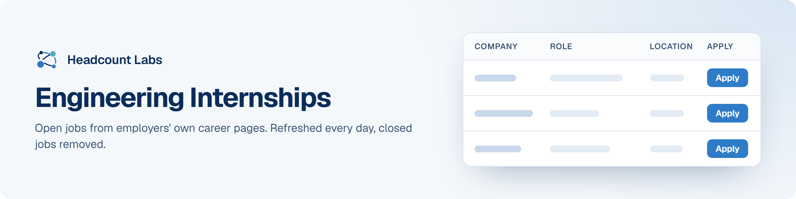

# Engineering Internships

Open mechanical, electrical, civil, chemical, hardware and manufacturing engineering internships in the US.

**400 open jobs** · 102 new since the last update · 102 removed because they closed or left the employer's board · updated October 19, 2026 at 7:57 PM EDT

This list is built and refreshed every day by [Headcount Labs](https://headcountlabs.com/?utm_source=github&utm_medium=job-list&utm_campaign=engineering-internships), which reads jobs straight from employers' own career pages and job boards. Every job here was still listed on its source board when we last read that board, within the past 3 days, and was posted in the past 30 days. Copies of the same job are merged into one row, and jobs that close are removed at the next update.

Want this data in your own app or agent? Use the [Headcount Labs jobs API](https://headcountlabs.com/docs/?utm_source=github&utm_medium=job-list&utm_campaign=engineering-internships) (free tier), the [MCP server](https://headcountlabs.com/mcp/?utm_source=github&utm_medium=job-list&utm_campaign=engineering-internships) for Claude, ChatGPT and other AI assistants, or the [open dataset](https://huggingface.co/datasets/HeadcountLabs/job-postings) on Hugging Face ([example queries](https://github.com/HeadcountLabs/job-postings)).

**Full dataset.** A bigger, one-off snapshot dated 2026-10-19 (all matching jobs, not only the open jobs below) is on Hugging Face: [Internships](https://huggingface.co/datasets/HeadcountLabs/internships). It loads with `datasets.load_dataset` and is licensed CC BY 4.0.

**Jump to:** [Posted in the last 7 days (245)](#posted-in-the-last-7-days) · [Posted 8 to 30 days ago (155)](#posted-8-to-30-days-ago)

**Columns.** *Apply* opens the original posting on the employer's site. *Details* opens the job on Headcount Labs, with every posting we found for it. *Remote* shows what the employer states; a dash means the posting doesn't say. *Pay* is the range the employer published.

## Posted in the last 7 days

| Company | Role | Location | Remote | Pay | Posted | Apply | Details |
| --- | --- | --- | --- | --- | --- | :---: | :---: |
| **Lincoln Electric** | Mechanical Engineering Summer 2027 Internship (Bettendorf, IA) | Bettendorf, IA | — | — | Oct 18 |  | <a href="https://headcountlabs.com/catalog/jobs/e9143667-1906-4696-9833-4456ae7d8156?utm_source=github&utm_medium=job-list&utm_campaign=engineering-internships">via Headcount Labs</a> |
| **Lincoln Electric** | Engineering Summer 2027 Internship (Euclid, OH) | Cleveland, OH | — | — | Oct 18 |  | <a href="https://headcountlabs.com/catalog/jobs/d2a06be5-6f5a-4649-8ba2-16cb8896dd0d?utm_source=github&utm_medium=job-list&utm_campaign=engineering-internships">via Headcount Labs</a> |
| **Lincoln Electric** | Electrical Engineering Summer 2027 Internship (Michigan City, IN) | Michigan City, IN | — | — | Oct 18 |  | <a href="https://headcountlabs.com/catalog/jobs/cac6f8bf-083c-4bbb-a1ff-20e6e912a3fd?utm_source=github&utm_medium=job-list&utm_campaign=engineering-internships">via Headcount Labs</a> |
| **Lincoln Electric** | Mechanical Engineering Summer 2027 Internship (Michigan City, IN) | Michigan City, IN | — | — | Oct 18 |  | <a href="https://headcountlabs.com/catalog/jobs/b72e015f-d726-47fe-b148-2ef4f28d84c4?utm_source=github&utm_medium=job-list&utm_campaign=engineering-internships">via Headcount Labs</a> |
| **Lincoln Electric** | Controls Engineering Summer 2027 Internship (Shelby Township, Mi) | Shelby Township, MI | — | — | Oct 18 |  | <a href="https://headcountlabs.com/catalog/jobs/a7e376ca-5fce-4794-a839-04e373e1b9b9?utm_source=github&utm_medium=job-list&utm_campaign=engineering-internships">via Headcount Labs</a> |
| **Lincoln Electric** | Mechanical Engineering Summer 2027 Internship (Gainesville, GA) | Gainesville, GA | — | — | Oct 18 |  | <a href="https://headcountlabs.com/catalog/jobs/a1028a1c-90e9-40f4-8cbc-4259820cbe79?utm_source=github&utm_medium=job-list&utm_campaign=engineering-internships">via Headcount Labs</a> |
| **Lincoln Electric** | Mechanical Engineering Summer 2027 Internship (Shelby Township, MI) | Shelby Township, MI | — | — | Oct 18 |  | <a href="https://headcountlabs.com/catalog/jobs/9c4ca22a-98dc-4ac2-b04f-10d891d07488?utm_source=github&utm_medium=job-list&utm_campaign=engineering-internships">via Headcount Labs</a> |
| **Lincoln Electric** | Controls Engineering Summer 2027 Internship (Bettendorf, IA) | Bettendorf, IA | — | — | Oct 18 |  | <a href="https://headcountlabs.com/catalog/jobs/3783fa90-5737-4852-b20c-4823c631c9f5?utm_source=github&utm_medium=job-list&utm_campaign=engineering-internships">via Headcount Labs</a> |
| **TSI, Inc.** | Engineering Technician Intern | Shoreview, MN | — | $19–$20/hr | Oct 17 |  | <a href="https://headcountlabs.com/catalog/jobs/b9f66ebe-3ab3-4288-beee-3b4dbec00a7b?utm_source=github&utm_medium=job-list&utm_campaign=engineering-internships">via Headcount Labs</a> |
| **TSI, Inc.** | Electrical/Hardware Engineer Intern | Shoreview, MN | — | $22–$23/hr | Oct 17 |  | <a href="https://headcountlabs.com/catalog/jobs/82d5deab-1973-4304-a38a-ff297ae2b6fa?utm_source=github&utm_medium=job-list&utm_campaign=engineering-internships">via Headcount Labs</a> |
| **TSI, Inc.** | Manufacturing Engineer Intern | Shoreview, MN | — | $22–$23/hr | Oct 17 |  | <a href="https://headcountlabs.com/catalog/jobs/3b065169-344a-40b8-9f2c-8bd3decc13b7?utm_source=github&utm_medium=job-list&utm_campaign=engineering-internships">via Headcount Labs</a> |
| **Hubbell Incorporated** | 2027 Summer Intern: Engineering - PLM Transformation | 

2 locations
Manchester, NH Shelton, CT
 | — | $22.50–$29/hr | Oct 17 |  | <a href="https://headcountlabs.com/catalog/jobs/f89335ae-eb40-45f5-bfab-1a198901b084?utm_source=github&utm_medium=job-list&utm_campaign=engineering-internships">via Headcount Labs</a> |
| **Hubbell Incorporated** | 2027 Summer Intern: Engineering - Firmware | Pittsburg, PA | — | $22.50–$29/hr | Oct 17 |  | <a href="https://headcountlabs.com/catalog/jobs/f4deacf8-42d0-4c7d-af1c-3be41393c169?utm_source=github&utm_medium=job-list&utm_campaign=engineering-internships">via Headcount Labs</a> |
| **Hubbell Incorporated** | 2027 Summer Intern: Engineering - Product | 

3 locations
Manchester, NH Hamilton, OH Broken Arrow, OK
 | — | $22.50–$29/hr | Oct 17 |  | <a href="https://headcountlabs.com/catalog/jobs/9ea02d77-9a98-4dd6-8445-e56dca27e1fc?utm_source=github&utm_medium=job-list&utm_campaign=engineering-internships">via Headcount Labs</a> |
| **Hubbell Incorporated** | 2027 Summer Intern: Test Engineering | 

2 locations
Solon, OH St. Louis, MO
 | — | $22.50–$29/hr | Oct 17 |  | <a href="https://headcountlabs.com/catalog/jobs/9eb89bd6-7bf9-4cca-83b8-50bf7eb1c81a?utm_source=github&utm_medium=job-list&utm_campaign=engineering-internships">via Headcount Labs</a> |
| **Hubbell Incorporated** | 2027 Summer Intern: Engineering - Product Development | 

3 locations
Solon, OH Manchester, NH St. Louis, MO
 | — | $22.50–$29/hr | Oct 17 |  | <a href="https://headcountlabs.com/catalog/jobs/9de73dfc-d889-4eb6-ade1-966f95a5ead3?utm_source=github&utm_medium=job-list&utm_campaign=engineering-internships">via Headcount Labs</a> |
| **Hubbell Incorporated** | 2027 Summer Intern: Engineering - Packaging | Greenville, SC | — | $22.50–$29/hr | Oct 17 |  | <a href="https://headcountlabs.com/catalog/jobs/5a5ded25-3ce0-4f0d-8b29-b4ed4e48bcd7?utm_source=github&utm_medium=job-list&utm_campaign=engineering-internships">via Headcount Labs</a> |
| **Hubbell Incorporated** | 2027 Summer Intern: Engineering - Process | Wilmington, MA | — | $22.50–$29/hr | Oct 17 |  | <a href="https://headcountlabs.com/catalog/jobs/16f598ba-80fc-46b8-9ca2-11736ec39812?utm_source=github&utm_medium=job-list&utm_campaign=engineering-internships">via Headcount Labs</a> |
| **Coloplast A/S** | Intern - R&amp;D Engineer | 

2 locations
Minneapolis, MN United States
 | — | — | Oct 17 |  | <a href="https://headcountlabs.com/catalog/jobs/e8e396cb-31ac-46fc-9787-5eeea0c6d2a9?utm_source=github&utm_medium=job-list&utm_campaign=engineering-internships">via Headcount Labs</a> |
| **Coloplast A/S** | Intern - Co-op - Manufacturing Engineer | 

2 locations
Minneapolis, MN United States
 | — | — | Oct 17 |  | <a href="https://headcountlabs.com/catalog/jobs/9a323679-c0a4-420c-b27b-5a8c1d03aa0d?utm_source=github&utm_medium=job-list&utm_campaign=engineering-internships">via Headcount Labs</a> |
| **Coloplast A/S** | Intern - R&amp;D Electrical Engineer | 

2 locations
Minneapolis, MN United States
 | — | — | Oct 17 |  | <a href="https://headcountlabs.com/catalog/jobs/4c6e9e6d-27b8-41aa-aec6-9cbb487bda20?utm_source=github&utm_medium=job-list&utm_campaign=engineering-internships">via Headcount Labs</a> |
| **Ames Federal Contracting Group** | Engineer Intern - Summer 2027 | Belle Glade, FL | — | — | Oct 17 |  | <a href="https://headcountlabs.com/catalog/jobs/740a41cb-bd2f-4042-97e7-6603d5b2076f?utm_source=github&utm_medium=job-list&utm_campaign=engineering-internships">via Headcount Labs</a> |
| **XL Construction Corp.** | Project Engineer Intern | San Francisco, CA | — | — | Oct 16 |  | <a href="https://headcountlabs.com/catalog/jobs/bd9a2b18-6efd-4bb2-a95d-fe48c9827a97?utm_source=github&utm_medium=job-list&utm_campaign=engineering-internships">via Headcount Labs</a> |
| **Viaflex, Inc.** | Engineering Intern: Summer 2027 | Sioux Falls, SD | On-site | — | Oct 16 |  | <a href="https://headcountlabs.com/catalog/jobs/b53aa430-ff70-4ffd-91c4-9d6b7802d410?utm_source=github&utm_medium=job-list&utm_campaign=engineering-internships">via Headcount Labs</a> |
| **Viaflex, Inc.** | Controls Engineering Intern: Summer 2027 | Sioux Falls, SD | On-site | — | Oct 16 |  | <a href="https://headcountlabs.com/catalog/jobs/a149cdd3-adfa-4270-b8eb-ed8e6c28fe92?utm_source=github&utm_medium=job-list&utm_campaign=engineering-internships">via Headcount Labs</a> |
| **VDOT** | C0154 - VDOT Engineering Intern Wage | Mechanicsville, VA | On-site | $21.78–$29.27/hr | Oct 16 |  | <a href="https://headcountlabs.com/catalog/jobs/d3675703-7444-47d7-838d-6e53924f74ce?utm_source=github&utm_medium=job-list&utm_campaign=engineering-internships">via Headcount Labs</a> |
| **USA Thornton Tomasetti, Inc.** | Structural Engineer Intern | 

9 locations
Miami, FL Portland, ME Tampa, FL Boston, MA Washington DC Philadelphia, PA New York, NY Seattle, WA Chicago, IL
 | — | $25–$35/hr | Oct 16 |  | <a href="https://headcountlabs.com/catalog/jobs/eccb9c5e-6ce5-44fe-88f1-e723282bf60d?utm_source=github&utm_medium=job-list&utm_campaign=engineering-internships">via Headcount Labs</a> |
| **US: Mastercard Technologies, LLC** | Platform Engineering Intern, Summer 2027 – St. Louis, MO, US | O'Fallon, MO | — | $25–$30/hr | Oct 16 |  | <a href="https://headcountlabs.com/catalog/jobs/64fb4456-2424-4636-a181-a2f37b0d7e7d?utm_source=github&utm_medium=job-list&utm_campaign=engineering-internships">via Headcount Labs</a> |
| **Toole Design Group LLC** | Engineering Intern | Columbus, OH | — | $20–$24.50/hr | Oct 16 |  | <a href="https://headcountlabs.com/catalog/jobs/f8fe505f-ab6f-41cd-9414-6bcec6dad8b3?utm_source=github&utm_medium=job-list&utm_campaign=engineering-internships">via Headcount Labs</a> |
| **Together AI** | Hardware Security Engineer Intern (Summer 2027) | San Francisco, CA | — | $58/hr | Oct 16 |  | <a href="https://headcountlabs.com/catalog/jobs/8699379c-f71a-4b13-9d4d-ac2c8b14cb71?utm_source=github&utm_medium=job-list&utm_campaign=engineering-internships">via Headcount Labs</a> |
| **Signify** | Electrical Engineer Intern, Cooper Lighting Solutions - Spring 2027 | Peachtree City, GA | Hybrid | $23–$31/hr | Oct 16 |  | <a href="https://headcountlabs.com/catalog/jobs/292e3011-ea6b-4e92-8dff-64b046024d8a?utm_source=github&utm_medium=job-list&utm_campaign=engineering-internships">via Headcount Labs</a> |
| **Shive Hattery Group, Inc.** | Internship - Electrical Engineering | Cedar Rapids, IA | — | — | Oct 16 |  | <a href="https://headcountlabs.com/catalog/jobs/ec3f2d4c-2826-41b8-8165-df167241bab4?utm_source=github&utm_medium=job-list&utm_campaign=engineering-internships">via Headcount Labs</a> |
| **Shive Hattery Group, Inc.** | Internship - Civil Engineering | 

4 locations
Iowa City, IA Bettendorf, IA Ralston, NE Madison, WI
 | — | — | Oct 16 |  | <a href="https://headcountlabs.com/catalog/jobs/e66d7dcb-7d23-43d7-8d98-8a43486fe03f?utm_source=github&utm_medium=job-list&utm_campaign=engineering-internships">via Headcount Labs</a> |
| **Shive Hattery Group, Inc.** | Internship - Site Civil Engineering | West Des Moines, IA | — | — | Oct 16 |  | <a href="https://headcountlabs.com/catalog/jobs/c9d93c32-4561-4a06-aa49-b61b85aceb77?utm_source=github&utm_medium=job-list&utm_campaign=engineering-internships">via Headcount Labs</a> |
| **Shive Hattery Group, Inc.** | Internship - Structural Engineering | 

2 locations
Iowa City, IA Bettendorf, IA
 | — | — | Oct 16 |  | <a href="https://headcountlabs.com/catalog/jobs/9db3e2eb-9a40-4500-b53d-bd2722392d9b?utm_source=github&utm_medium=job-list&utm_campaign=engineering-internships">via Headcount Labs</a> |
| **Shive Hattery Group, Inc.** | Internship - Traffic/Transportation Engineering | West Des Moines, IA | — | — | Oct 16 |  | <a href="https://headcountlabs.com/catalog/jobs/962f63bc-bf0c-46e4-8f88-1de479715df4?utm_source=github&utm_medium=job-list&utm_campaign=engineering-internships">via Headcount Labs</a> |
| **Shive Hattery Group, Inc.** | Internship - Civil &amp; Water Resources Engineering | West Des Moines, IA | — | — | Oct 16 |  | <a href="https://headcountlabs.com/catalog/jobs/2faecad0-32f0-45f1-b321-d354d7dfec61?utm_source=github&utm_medium=job-list&utm_campaign=engineering-internships">via Headcount Labs</a> |
| **SEL ENGINEERING SERVICES, INC.** | Electrical Engineering Intern | 

6 locations
Wesley Chapel, FL Houston, TX Plano, TX Round Rock, TX Plymouth, MI Pullman, WA
 | — | $24.25–$33/hr | Oct 16 |  | <a href="https://headcountlabs.com/catalog/jobs/6e4aa23a-7424-42c0-9825-03cfe095def4?utm_source=github&utm_medium=job-list&utm_campaign=engineering-internships">via Headcount Labs</a> |
| **Schnabel Engineering, Inc.** | Mechanical Engineering Intern | Harrisburg, PA | Remote | $19–$25/hr | Oct 16 |  | <a href="https://headcountlabs.com/catalog/jobs/07a56f2e-25c5-4d7b-9d7d-5c0dea180a66?utm_source=github&utm_medium=job-list&utm_campaign=engineering-internships">via Headcount Labs</a> |
| **Salas O'Brien** | Mechanical Engineering Intern (Fall 2026) | Corona, CA | On-site | $22–$25/hr | Oct 16 |  | <a href="https://headcountlabs.com/catalog/jobs/a83e7da6-f638-4937-a025-d4df86aaaef4?utm_source=github&utm_medium=job-list&utm_campaign=engineering-internships">via Headcount Labs</a> |
| **Salas O'Brien** | Mechanical Engineer Internship (Summer 2027) | Irvine, CA | On-site | — | Oct 16 |  | <a href="https://headcountlabs.com/catalog/jobs/a199b353-7042-49e5-8521-d71584ad1d57?utm_source=github&utm_medium=job-list&utm_campaign=engineering-internships">via Headcount Labs</a> |
| **Salas O'Brien** | Engineering Intern - Summer 2027 | Evansville, IN | On-site | — | Oct 16 |  | <a href="https://headcountlabs.com/catalog/jobs/0525928e-3c23-4b4b-ba7a-d09fc34ff5d3?utm_source=github&utm_medium=job-list&utm_campaign=engineering-internships">via Headcount Labs</a> |
| **Rockwell Automation (USA)** | Intern, Firmware Engineering | Milwaukee, WI | On-site | $20–$32/hr | Oct 16 |  | <a href="https://headcountlabs.com/catalog/jobs/cc8c9553-3de7-467b-b9a5-af88897d1a15?utm_source=github&utm_medium=job-list&utm_campaign=engineering-internships">via Headcount Labs</a> |
| **Rivian** | Engineering Intern - Technical Program Management (Spring 2027 Co-op) | Palo Alto, CA | — | $45–$51/hr | Oct 16 |  | <a href="https://headcountlabs.com/catalog/jobs/de9ef991-16f6-434f-9c65-474068b22b53?utm_source=github&utm_medium=job-list&utm_campaign=engineering-internships">via Headcount Labs</a> |
| **Peak Energy** | Supplier Industrialization Engineer Intern (Spring 2027) | Burlingame, CA | — | $30–$35/hr | Oct 16 |  | <a href="https://headcountlabs.com/catalog/jobs/1894e981-5519-49df-b9fc-1da1f7c43343?utm_source=github&utm_medium=job-list&utm_campaign=engineering-internships">via Headcount Labs</a> |
| **Passero Associates** | Aviation Civil Engineer Co-op/Intern | Charlotte, NC | — | — | Oct 16 |  | <a href="https://headcountlabs.com/catalog/jobs/f48e3d33-89e1-42a6-b218-c400c3d47e68?utm_source=github&utm_medium=job-list&utm_campaign=engineering-internships">via Headcount Labs</a> |
| **NorthWestern Energy** | Intern Construction Engineer | Billings, MT | — | $20–$21/hr | Oct 16 |  | <a href="https://headcountlabs.com/catalog/jobs/816bb7cb-3371-4c79-9268-5a2c689f249f?utm_source=github&utm_medium=job-list&utm_campaign=engineering-internships">via Headcount Labs</a> |
| **Niagara Bottling, LLC** | Engineering &amp; Technical Intern | Diamond Bar, CA | — | $29.29–$39.54/hr | Oct 16 |  | <a href="https://headcountlabs.com/catalog/jobs/8139d565-ff6c-405e-816f-2e5faf5a9624?utm_source=github&utm_medium=job-list&utm_campaign=engineering-internships">via Headcount Labs</a> |
| **Moffatt &amp; Nichol** | Structural Engineering Internship | Long Beach, CA | — | $24–$31/hr | Oct 16 |  | <a href="https://headcountlabs.com/catalog/jobs/c0b264ff-6f6b-4697-82f2-be9252c4b1f5?utm_source=github&utm_medium=job-list&utm_campaign=engineering-internships">via Headcount Labs</a> |
| **Millstone Weber** | Project Engineer Intern - Summer 2027 | 

3 locations
Denver, CO St Charles, MO Columbia, MO
 | — | $20–$23/hr | Oct 16 |  | <a href="https://headcountlabs.com/catalog/jobs/ee6c8273-9569-42dd-89d2-f53d931bbe7b?utm_source=github&utm_medium=job-list&utm_campaign=engineering-internships">via Headcount Labs</a> |
| **Michael Baker International** | Engineering Intern- Summer 2027 | 

6 locations
Dallas, TX Austin, TX San Antonio, TX Houston, TX Round Rock, TX Katy, TX
 | Hybrid | $20–$25/hr | Oct 16 |  | <a href="https://headcountlabs.com/catalog/jobs/ca42ccdd-114b-42b1-867c-772f50cafcb0?utm_source=github&utm_medium=job-list&utm_campaign=engineering-internships">via Headcount Labs</a> |
| **Marathon Petroleum Logistics Services LLC** | Logistics &amp; Storage Engineering - Project Engineer 1 (Intern to Full-Time Conversion) | 

3 locations
Findlay, OH La Palma, CA Salt Lake City, UT
 | — | $93k–$140k/yr | Oct 16 |  | <a href="https://headcountlabs.com/catalog/jobs/14eb3f07-89e2-49d3-90bf-aecf8aeb288c?utm_source=github&utm_medium=job-list&utm_campaign=engineering-internships">via Headcount Labs</a> |
| **Lutron Electronics Co., Inc** | Summer 2027 - Manufacturing Engineering Intern - Ashland, VA | Ashland, VA | — | $26.50–$39/hr | Oct 16 |  | <a href="https://headcountlabs.com/catalog/jobs/206af8ab-4fc7-45ec-b999-0353960ff1b6?utm_source=github&utm_medium=job-list&utm_campaign=engineering-internships">via Headcount Labs</a> |
| **Legence** | Plumbing/Fire Protection Engineering Internship - AMA - Summer 2027 | New York, NY | On-site | — | Oct 16 |  | <a href="https://headcountlabs.com/catalog/jobs/daf19525-f647-4fce-bf90-4caa649fb189?utm_source=github&utm_medium=job-list&utm_campaign=engineering-internships">via Headcount Labs</a> |
| **Legence** | Electrical Engineering Internship - AMA - Summer 2027 | New York, NY | On-site | — | Oct 16 |  | <a href="https://headcountlabs.com/catalog/jobs/6253b927-b10e-46cd-81cc-a39c7f6237d2?utm_source=github&utm_medium=job-list&utm_campaign=engineering-internships">via Headcount Labs</a> |
| **Legence** | Mechanical Engineer Internship - AMA - Summer 2027 | New York, NY | On-site | — | Oct 16 |  | <a href="https://headcountlabs.com/catalog/jobs/2753ae69-f043-4a39-9f90-b719033d27b4?utm_source=github&utm_medium=job-list&utm_campaign=engineering-internships">via Headcount Labs</a> |
| **Lansing Board of Water &amp; Light** | Intern, Water &amp; Steam Distribution Engineer | Lansing, MI | — | $23/yr | Oct 16 |  | <a href="https://headcountlabs.com/catalog/jobs/61704045-b300-45c8-a4f1-fb768f3c137c?utm_source=github&utm_medium=job-list&utm_campaign=engineering-internships">via Headcount Labs</a> |
| **L3Harris, Inc** | Systems Engineering Intern | 

2 locations
Salt Lake City, UT Huntsville, AL
 | — | — | Oct 16 |  | <a href="https://headcountlabs.com/catalog/jobs/71b922bb-e4aa-4bcc-94d5-ceba5976bf9d?utm_source=github&utm_medium=job-list&utm_campaign=engineering-internships">via Headcount Labs</a> |
| **KLA Corporation** | Optical Engineering Intern | Ann Arbor, MI | — | $26–$47/hr | Oct 16 |  | <a href="https://headcountlabs.com/catalog/jobs/c8f06614-1211-4f51-89b4-279ecd6135f4?utm_source=github&utm_medium=job-list&utm_campaign=engineering-internships">via Headcount Labs</a> |
| **Kingsbury** | Mechanical Engineering Intern-Summer 2027 | Philadelphia, PA | — | — | Oct 16 |  | <a href="https://headcountlabs.com/catalog/jobs/cb7e3b0d-b671-47f3-94a9-ec9854ee868c?utm_source=github&utm_medium=job-list&utm_campaign=engineering-internships">via Headcount Labs</a> |
| **Jasper Engine Exchange, Inc.** | Quality Engineer Internship: Summer 2027 | Jasper, IN | — | $20/hr | Oct 16 |  | <a href="https://headcountlabs.com/catalog/jobs/51bd77da-1093-47f8-9f0c-b0dd6ec774ab?utm_source=github&utm_medium=job-list&utm_campaign=engineering-internships">via Headcount Labs</a> |
| **Illinois Tool Works** | Industrial Engineering Co-Op Intern | 

3 locations
United States Montgomeryville, PA Danvers, MA
 | — | $24–$29/hr | Oct 16 |  | <a href="https://headcountlabs.com/catalog/jobs/e4a9c4ec-9c62-4cc3-9dc0-65e6a295933b?utm_source=github&utm_medium=job-list&utm_campaign=engineering-internships">via Headcount Labs</a> |
| **Graycor Family of Companies** | Project Engineer Internship, Commercial/Industrial Construction | 

3 locations
Oakbrook Terrace, IL Charlotte, NC Phoenix, AZ
 | — | — | Oct 16 |  | <a href="https://headcountlabs.com/catalog/jobs/0b31822d-31b6-4004-be67-d8b307a70e25?utm_source=github&utm_medium=job-list&utm_campaign=engineering-internships">via Headcount Labs</a> |
| **FSH Technologies** | Engineer - Intern | 

2 locations
Philadelphia, PA New York City, NY
 | On-site | $10k/mo | Oct 16 |  | <a href="https://headcountlabs.com/catalog/jobs/cbf44510-d698-4a7d-985b-fed93cab2fd0?utm_source=github&utm_medium=job-list&utm_campaign=engineering-internships">via Headcount Labs</a> |
| **First Solar** | Intern- Manufacturing Engineering - Integration (Spring 2027) | 

2 locations
Perrysburg, OH Walbridge, OH
 | Hybrid | $22–$25/hr | Oct 16 |  | <a href="https://headcountlabs.com/catalog/jobs/bf41a4cc-3e65-4e36-861b-bc0c339e3ad6?utm_source=github&utm_medium=job-list&utm_campaign=engineering-internships">via Headcount Labs</a> |
| **Ecolab Inc.** | Engineering Technical Sales Intern | 

20 locations
Chicago, IL Goodyear, AZ Phoenix, AZ Tucson, AZ San Francisco, CA San Jose, CA Atlanta, GA Vidalia, GA Gary, IN Boston, MA Pascagoula, MS St Louis, MO +8 more
 | Hybrid | $23–$25/hr | Oct 16 |  | <a href="https://headcountlabs.com/catalog/jobs/810d0bb3-4a97-4bbe-99fa-b1b8044f8ba9?utm_source=github&utm_medium=job-list&utm_campaign=engineering-internships">via Headcount Labs</a> |
| **Duke Energy Carolinas, LLC** | Returning Engineering Intern/Co-op Summer 2027 | 

13 locations
Charlotte, NC Arden, NC Cayuga, IN Cincinnati, OH Edwardsport, IN Goldsboro, NC Lake Mary, FL Noblesville, IN Ocala, FL Owensville, IN Plainfield, IN Raleigh, NC +1 more
 | Hybrid | — | Oct 16 |  | <a href="https://headcountlabs.com/catalog/jobs/c96eb02a-30c6-4c80-bb82-f656ad2ad6b2?utm_source=github&utm_medium=job-list&utm_campaign=engineering-internships">via Headcount Labs</a> |
| **Catalent Pharma Solutions LLC** | 2027 Intern - Engineering, Automation | Madison, WI | On-site | — | Oct 16 |  | <a href="https://headcountlabs.com/catalog/jobs/66fefd6f-32ae-4299-8451-354056a4a977?utm_source=github&utm_medium=job-list&utm_campaign=engineering-internships">via Headcount Labs</a> |
| **Blount Fine Foods** | Process &amp; Mechanical Engineer Intern | Fall River, MA | — | $24/hr | Oct 16 |  | <a href="https://headcountlabs.com/catalog/jobs/a9b46e16-582c-4dd4-9fce-c49fefccdc8f?utm_source=github&utm_medium=job-list&utm_campaign=engineering-internships">via Headcount Labs</a> |
| **BETA GROUP INC** | 2027 Summer Internship – Transportation Engineering | 

2 locations
Worcester, MA Lincoln, RI
 | — | $22–$27/hr | Oct 16 |  | <a href="https://headcountlabs.com/catalog/jobs/b40e8401-00d2-4060-b774-67bf4f38e45b?utm_source=github&utm_medium=job-list&utm_campaign=engineering-internships">via Headcount Labs</a> |
| **BETA GROUP INC** | 2027 Summer Internship – Drinking Water, Wastewater, and Stormwater Engineering | 

3 locations
Norwood, MA Hartford, CT Lincoln, RI
 | — | $22–$27/hr | Oct 16 |  | <a href="https://headcountlabs.com/catalog/jobs/b0debf69-31e7-4e70-a01f-8416c4212b03?utm_source=github&utm_medium=job-list&utm_campaign=engineering-internships">via Headcount Labs</a> |
| **BETA GROUP INC** | Structural Engineer Internship (Summer 2027) | 

2 locations
Norwood, MA Lincoln, RI
 | — | $22–$27/hr | Oct 16 |  | <a href="https://headcountlabs.com/catalog/jobs/a03563fd-d96a-48ce-8f19-852ec828389a?utm_source=github&utm_medium=job-list&utm_campaign=engineering-internships">via Headcount Labs</a> |
| **Benesch** | Structural Engineering Internship | 

5 locations
Kansas City, KS Manhattan, KS Topeka, KS Wichita, KS Franklin, TN
 | — | — | Oct 16 |  | <a href="https://headcountlabs.com/catalog/jobs/fd4cc2ef-d076-4b84-ba05-7d6dcb36a489?utm_source=github&utm_medium=job-list&utm_campaign=engineering-internships">via Headcount Labs</a> |
| **ARCO National Holdings** | Mechanical Engineer Intern | Richmond Heights, MO | — | — | Oct 16 |  | <a href="https://headcountlabs.com/catalog/jobs/b85aa1ec-736d-4c5f-a840-7373b6a4f6ac?utm_source=github&utm_medium=job-list&utm_campaign=engineering-internships">via Headcount Labs</a> |
| **ADT** | Hardware Engineering &amp; Connected Devices Internship | Boca Raton, FL | On-site | $24/hr | Oct 16 |  | <a href="https://headcountlabs.com/catalog/jobs/7c8cf833-1a82-4118-998d-f0a725d967fa?utm_source=github&utm_medium=job-list&utm_campaign=engineering-internships">via Headcount Labs</a> |
| **William Charles Construction** | Field Engineer Internship -Summer 2027 | ROCKFORD, IL | — | $20–$21/hr | Oct 15 |  | <a href="https://headcountlabs.com/catalog/jobs/954f35b7-15cb-46b1-a901-8abf088f5185?utm_source=github&utm_medium=job-list&utm_campaign=engineering-internships">via Headcount Labs</a> |
| **Whitman Requardt &amp; Associates** | Construction Engineer - Intern | 

2 locations
Morgantown, WV Charleston, WV
 | — | $21.50–$24.50/hr | Oct 15 |  | <a href="https://headcountlabs.com/catalog/jobs/b6f7dbd1-461c-4998-a465-1f43d67da3f4?utm_source=github&utm_medium=job-list&utm_campaign=engineering-internships">via Headcount Labs</a> |
| **Westlake Management Services, Inc.** | Chemical Engineer Intern | Deer Park, TX | — | — | Oct 15 |  | <a href="https://headcountlabs.com/catalog/jobs/8413b82e-0c32-4495-99e1-091b035d9dd1?utm_source=github&utm_medium=job-list&utm_campaign=engineering-internships">via Headcount Labs</a> |
| **Veolia Environnement SA** | Operations Engineering Intern | Vandalia, OH | — | — | Oct 15 |  | <a href="https://headcountlabs.com/catalog/jobs/5d5b5029-dfad-4c0d-b25b-9d0e40d76e25?utm_source=github&utm_medium=job-list&utm_campaign=engineering-internships">via Headcount Labs</a> |
| **V2X** | Project Engineering Intern - Senior | Indianapolis, IN | — | — | Oct 15 |  | <a href="https://headcountlabs.com/catalog/jobs/6478990c-d09e-41a2-991a-406547407c1a?utm_source=github&utm_medium=job-list&utm_campaign=engineering-internships">via Headcount Labs</a> |
| **SubCom** | Optical Engineer Intern (7885) | Newington, NH | — | — | Oct 15 |  | <a href="https://headcountlabs.com/catalog/jobs/ef3a9d66-10ca-464e-aec0-644f14cc66df?utm_source=github&utm_medium=job-list&utm_campaign=engineering-internships">via Headcount Labs</a> |
| **SubCom** | Process Engineer Intern (7794) | Newington, NH | — | — | Oct 15 |  | <a href="https://headcountlabs.com/catalog/jobs/74c30497-a8a7-40c9-8d00-6dfaf78dec67?utm_source=github&utm_medium=job-list&utm_campaign=engineering-internships">via Headcount Labs</a> |
| **SubCom** | Process Engineer Intern (7967) | Newington, NH | — | — | Oct 15 |  | <a href="https://headcountlabs.com/catalog/jobs/56cbbf01-461d-45d8-a592-aedb0479b5f4?utm_source=github&utm_medium=job-list&utm_campaign=engineering-internships">via Headcount Labs</a> |
| **SubCom** | Electrical Engineer Intern PC Line (8008) | Newington, NH | — | — | Oct 15 |  | <a href="https://headcountlabs.com/catalog/jobs/4a1bc869-9c54-4f9c-946b-61eba8dfbf35?utm_source=github&utm_medium=job-list&utm_campaign=engineering-internships">via Headcount Labs</a> |
| **Signify** | Mechanical Engineer Intern, Cooper Lighting Solutions - Spring 2027 | Peachtree City, GA | Hybrid | $23–$31/hr | Oct 15 |  | <a href="https://headcountlabs.com/catalog/jobs/11c2cfaa-dc7f-43eb-b36e-196c8ed0b4d1?utm_source=github&utm_medium=job-list&utm_campaign=engineering-internships">via Headcount Labs</a> |
| **Salas O'Brien** | Structural Engineer Intern - Summer 2027 | Chesterfield, MO | On-site | — | Oct 15 |  | <a href="https://headcountlabs.com/catalog/jobs/e9ff3d9f-60dd-4454-92fc-09bbf3a299a1?utm_source=github&utm_medium=job-list&utm_campaign=engineering-internships">via Headcount Labs</a> |
| **Salas O'Brien** | Structural Engineering Intern - Summer 2027 | 

4 locations
Austin, TX Dallas, TX New Orleans, LA San Antonio, TX
 | On-site | — | Oct 15 |  | <a href="https://headcountlabs.com/catalog/jobs/99386848-a623-4f20-9150-99d8c1eaa261?utm_source=github&utm_medium=job-list&utm_campaign=engineering-internships">via Headcount Labs</a> |
| **Research Innovations** | DoW SkillBridge Forward Deployed Engineer Intern | Joint Base Lewis-McChord | Hybrid | — | Oct 15 |  | <a href="https://headcountlabs.com/catalog/jobs/e80a5eb4-f9bf-4395-ac06-b0ad51365bec?utm_source=github&utm_medium=job-list&utm_campaign=engineering-internships">via Headcount Labs</a> |
| **RE/SPEC Inc.** | Student Engineering Intern - Water/Wastewater | 

2 locations
Denver, CO Colorado Springs, CO
 | — | $22–$27/hr | Oct 15 |  | <a href="https://headcountlabs.com/catalog/jobs/1279ce95-299f-4c69-af21-90f23369f37a?utm_source=github&utm_medium=job-list&utm_campaign=engineering-internships">via Headcount Labs</a> |
| **RE/SPEC Inc.** | Student Intern (Civil or Structural Engineering) | Juneau, AK | — | — | Oct 15 |  | <a href="https://headcountlabs.com/catalog/jobs/7467e164-4a33-4319-97a3-40558c77cbca?utm_source=github&utm_medium=job-list&utm_campaign=engineering-internships">via Headcount Labs</a> |
| **Pharmaworks LLC** | Engineering Intern | Tampa, FL | On-site | — | Oct 15 |  | <a href="https://headcountlabs.com/catalog/jobs/e74ec12d-ad94-4324-b005-000d98462960?utm_source=github&utm_medium=job-list&utm_campaign=engineering-internships">via Headcount Labs</a> |
| **Novelis North America HQ** | Mechanical Engineer Intern | Berea, KY | — | — | Oct 15 |  | <a href="https://headcountlabs.com/catalog/jobs/6ce03b09-0738-476b-ad54-5972aae97d0a?utm_source=github&utm_medium=job-list&utm_campaign=engineering-internships">via Headcount Labs</a> |
| **Nordson Corporation** | Manufacturing Engineer Intern | Clinton, SC | — | — | Oct 15 |  | <a href="https://headcountlabs.com/catalog/jobs/480f0f3f-f8a4-481d-86b8-c8292951e419?utm_source=github&utm_medium=job-list&utm_campaign=engineering-internships">via Headcount Labs</a> |
| **Nomagic** | Engineering and Commercial Intern | Atlanta | On-site | — | Oct 15 |  | <a href="https://headcountlabs.com/catalog/jobs/bb568db6-90f0-48f3-9585-5053a8020be5?utm_source=github&utm_medium=job-list&utm_campaign=engineering-internships">via Headcount Labs</a> |
| **Nikkiso Cryogenic Industries** | Engineering Intern I | North Las Vegas, NV | — | — | Oct 15 |  | <a href="https://headcountlabs.com/catalog/jobs/e7b4d242-38d3-4316-bf7f-61e7e778ae27?utm_source=github&utm_medium=job-list&utm_campaign=engineering-internships">via Headcount Labs</a> |
| **NextDecade Payroll Services, LLC** | Intern, Chemical Engineering | Brownsville | — | — | Oct 15 |  | <a href="https://headcountlabs.com/catalog/jobs/3ee63199-06df-42da-83d8-842d1de06f81?utm_source=github&utm_medium=job-list&utm_campaign=engineering-internships">via Headcount Labs</a> |
| **Moxtek** | Mechanical Engineering Intern (Part-time) | Orem, UT | — | $25–$26/hr | Oct 15 |  | <a href="https://headcountlabs.com/catalog/jobs/fb3ccf94-5b39-4c6a-b5dc-07a6faed13fb?utm_source=github&utm_medium=job-list&utm_campaign=engineering-internships">via Headcount Labs</a> |
| **Motorola Solutions, Inc.** | Presales Systems Engineer - 2027 Internship | 

6 locations
Linthicum, MD US Offsite, MD US Offsite, GA Alpharetta, GA Brentwood, TN US Offsite, FL
 | Hybrid | — | Oct 15 |  | <a href="https://headcountlabs.com/catalog/jobs/1b634fd5-d063-48f3-a21b-95537d0b43f2?utm_source=github&utm_medium=job-list&utm_campaign=engineering-internships">via Headcount Labs</a> |
| **McShane Construction Company LLC** | Field Engineer Intern | 

2 locations
Madison, WI Rosemont, IL
 | — | — | Oct 15 |  | <a href="https://headcountlabs.com/catalog/jobs/85e98a30-1f7e-4026-be34-43d6cb7fea09?utm_source=github&utm_medium=job-list&utm_campaign=engineering-internships">via Headcount Labs</a> |
| **MasTec Inc** | Field Engineer Internship -Summer 2027 | ROCKFORD, IL | — | $20–$21/hr | Oct 15 |  | <a href="https://headcountlabs.com/catalog/jobs/450ae55e-6d2e-4dc4-9a71-733fcde8ceb9?utm_source=github&utm_medium=job-list&utm_campaign=engineering-internships">via Headcount Labs</a> |
| **MacKay** | Civil Engineering Intern - Summer 2027 | Pasco, WA | — | $22–$25/hr | Oct 15 |  | <a href="https://headcountlabs.com/catalog/jobs/2d746cd8-b6a6-4b96-b225-6ae7a977b333?utm_source=github&utm_medium=job-list&utm_campaign=engineering-internships">via Headcount Labs</a> |
| **Lynntech, Inc.** | Electronics Engineering Intern | College Station, TX | — | — | Oct 15 |  | <a href="https://headcountlabs.com/catalog/jobs/713c8406-b217-48be-92a4-c46f03b35c7f?utm_source=github&utm_medium=job-list&utm_campaign=engineering-internships">via Headcount Labs</a> |
| **LLNL** | Computing Undergraduate Student Intern: HPC Cluster Engineer Academy Internship Program | Livermore, CA | — | $23.26–$31.62/hr | Oct 15 |  | <a href="https://headcountlabs.com/catalog/jobs/0bfa6eb7-0862-4cbc-a689-f1ae55029399?utm_source=github&utm_medium=job-list&utm_campaign=engineering-internships">via Headcount Labs</a> |
| **LivaNova** | Quality Engineering Intern | Arvada, CO | — | $25/hr | Oct 15 |  | <a href="https://headcountlabs.com/catalog/jobs/55131892-76ab-4ac8-ab41-5b8d3def6d2b?utm_source=github&utm_medium=job-list&utm_campaign=engineering-internships">via Headcount Labs</a> |
| **Leonardo DRS, Inc.** | Systems Engineering Intern &#124; Summer 2027 | Menomonee Falls, WI | — | — | Oct 15 |  | <a href="https://headcountlabs.com/catalog/jobs/e82dbf99-e2ab-4bf4-875c-c573a4aef3cb?utm_source=github&utm_medium=job-list&utm_campaign=engineering-internships">via Headcount Labs</a> |
| **Langan Engineering &amp; Environmental Services** | Intern/Co-op - Site/Civil Engineering (Summer 2027) | 

5 locations
Philadelphia, PA Fort Lauderdale, FL Doylestown, PA Pittsburgh, PA Tampa, FL
 | — | — | Oct 15 |  | <a href="https://headcountlabs.com/catalog/jobs/b8824af1-ffff-4f2e-9ca2-418eff8cf1f7?utm_source=github&utm_medium=job-list&utm_campaign=engineering-internships">via Headcount Labs</a> |
| **L3Harris, Inc** | Aerospace Engineering Intern 1 | Canoga Park, CA | — | $25–$48/hr | Oct 15 |  | <a href="https://headcountlabs.com/catalog/jobs/ca76db7b-4f00-4a51-9ec2-049202f870ae?utm_source=github&utm_medium=job-list&utm_campaign=engineering-internships">via Headcount Labs</a> |
| **KPFF Consulting Engineers** | Transportation Engineering Internship | Spokane, WA | On-site | $28–$32/hr | Oct 15 |  | <a href="https://headcountlabs.com/catalog/jobs/ad4c83e5-d45e-4be1-be79-79a582d31c04?utm_source=github&utm_medium=job-list&utm_campaign=engineering-internships">via Headcount Labs</a> |
| **KPFF Consulting Engineers** | Civil Engineering Internship | Seattle, WA | On-site | $28–$32/hr | Oct 15 |  | <a href="https://headcountlabs.com/catalog/jobs/3cc5ca6f-9409-46e0-9a98-5b5f53afd4c9?utm_source=github&utm_medium=job-list&utm_campaign=engineering-internships">via Headcount Labs</a> |
| **Johns Manville** | Engineering Intern | Richland, MS | On-site | $42k–$53k/yr | Oct 15 |  | <a href="https://headcountlabs.com/catalog/jobs/d4799e79-b461-4466-a8ab-c127c861cfef?utm_source=github&utm_medium=job-list&utm_campaign=engineering-internships">via Headcount Labs</a> |
| **Ironmark Commercial LLC** | Project Engineer Intern: Summer 2027 | Minneapolis, MN | — | $22–$28/hr | Oct 15 |  | <a href="https://headcountlabs.com/catalog/jobs/88187306-8944-4e82-8c37-7ee0f16ffeda?utm_source=github&utm_medium=job-list&utm_campaign=engineering-internships">via Headcount Labs</a> |
| **Inversion** | Avionics Mechanical Engineer - Summer Internship 2027 | Playa Vista, CA | — | $38–$41/hr | Oct 15 |  | <a href="https://headcountlabs.com/catalog/jobs/d3d4e5f0-355e-4c46-89c2-67d33435e097?utm_source=github&utm_medium=job-list&utm_campaign=engineering-internships">via Headcount Labs</a> |
| **Internal Service Fund** | Electrical / I&amp;C Engineering Intern - Year Round | Richland, WA | — | — | Oct 15 |  | <a href="https://headcountlabs.com/catalog/jobs/da7f1fa4-91b7-49a1-8c40-73307167b3e8?utm_source=github&utm_medium=job-list&utm_campaign=engineering-internships">via Headcount Labs</a> |
| **Internal Service Fund** | Civil / Mechanical Engineering Intern - Year Round | Richland, WA | — | — | Oct 15 |  | <a href="https://headcountlabs.com/catalog/jobs/6f6de649-0921-4021-b7ac-006ab6658197?utm_source=github&utm_medium=job-list&utm_campaign=engineering-internships">via Headcount Labs</a> |
| **Intel Corporation** | Module Engineering PhD Intern New 2027 | Hillsboro, OR | On-site | $121k–$121k/yr | Oct 15 |  | <a href="https://headcountlabs.com/catalog/jobs/3fd096e4-a704-44b2-94d6-b083fbab9bc6?utm_source=github&utm_medium=job-list&utm_campaign=engineering-internships">via Headcount Labs</a> |
| **Ingredion Incorporated (Corporate)** | Process Engineer Intern | Salem, OR | — | — | Oct 15 |  | <a href="https://headcountlabs.com/catalog/jobs/49816fa0-bda1-463c-8cc7-d3878436b946?utm_source=github&utm_medium=job-list&utm_campaign=engineering-internships">via Headcount Labs</a> |
| **IMEG Consultants Corp.** | Mechanical Engineering Intern &#124; Columbus, OH | 

3 locations
Columbus, OH Toledo, OH Twinsburg, OH
 | — | $22–$24/hr | Oct 15 |  | <a href="https://headcountlabs.com/catalog/jobs/0a26b201-a7ee-47ee-b113-76ecc2777cb5?utm_source=github&utm_medium=job-list&utm_campaign=engineering-internships">via Headcount Labs</a> |
| **Hubbell Incorporated** | 2027 Summer Intern: Engineering - Utility Automation | Boonton, NJ | — | $22.50–$29/hr | Oct 15 |  | <a href="https://headcountlabs.com/catalog/jobs/c3e812a1-0d6c-4a85-ac77-d3e56b5182ef?utm_source=github&utm_medium=job-list&utm_campaign=engineering-internships">via Headcount Labs</a> |
| **Heartland Business Systems, LLC** | Engineering Associate - Summer 2027 Internship Program | Eau Claire, WI | — | — | Oct 15 |  | <a href="https://headcountlabs.com/catalog/jobs/c0571b88-013a-4ddc-98ea-e3a2055d6f60?utm_source=github&utm_medium=job-list&utm_campaign=engineering-internships">via Headcount Labs</a> |
| **GFT.** | Intern - Structural Engineering | Chicago, IL | — | $21–$28/hr | Oct 15 |  | <a href="https://headcountlabs.com/catalog/jobs/8d3d8644-7c26-46b2-bc3c-784fc59da7ea?utm_source=github&utm_medium=job-list&utm_campaign=engineering-internships">via Headcount Labs</a> |
| **GeoEngineers, Inc.** | Civil Engineering Intern (Summer 2027) | 

2 locations
Baton Rouge, LA Springfield, MO
 | — | — | Oct 15 |  | <a href="https://headcountlabs.com/catalog/jobs/be6cb1d2-3094-428c-bc96-9c937894da3e?utm_source=github&utm_medium=job-list&utm_campaign=engineering-internships">via Headcount Labs</a> |
| **GeoEngineers, Inc.** | Environmental Engineering Intern (Spring 2027) | Boston, MA | — | — | Oct 15 |  | <a href="https://headcountlabs.com/catalog/jobs/a029dec4-0ab5-4c22-b7bd-2b2952b13913?utm_source=github&utm_medium=job-list&utm_campaign=engineering-internships">via Headcount Labs</a> |
| **GeoEngineers, Inc.** | Environmental Engineering Intern (Summer 2027) | Boston, MA | — | — | Oct 15 |  | <a href="https://headcountlabs.com/catalog/jobs/4e347eb6-ec83-4f1d-a165-6c4f656b35fd?utm_source=github&utm_medium=job-list&utm_campaign=engineering-internships">via Headcount Labs</a> |
| **General Matter** | Summer 2027 Internship - Information Security Engineer | Los Angeles, CA | — | $32–$46/hr | Oct 15 |  | <a href="https://headcountlabs.com/catalog/jobs/c24d9f02-3ba0-4f34-9d44-186406ab1803?utm_source=github&utm_medium=job-list&utm_campaign=engineering-internships">via Headcount Labs</a> |
| **FedEx Freight** | Intern-Engineering (Network) | Harrison, AR | — | $25/hr | Oct 15 |  | <a href="https://headcountlabs.com/catalog/jobs/d372638f-9528-4401-82f3-a2737084cda9?utm_source=github&utm_medium=job-list&utm_campaign=engineering-internships">via Headcount Labs</a> |
| **DLR Group** | Mechanical Engineering Intern &#124; Summer 2027 | 

2 locations
Charlotte, NC Durham, NC
 | — | — | Oct 15 |  | <a href="https://headcountlabs.com/catalog/jobs/52d61090-f2a0-4e00-8357-01891f49c389?utm_source=github&utm_medium=job-list&utm_campaign=engineering-internships">via Headcount Labs</a> |
| **Daimler Truck North America LLC** | Automation Engineer Intern | Gastonia, NC | On-site | $21–$29/hr | Oct 15 |  | <a href="https://headcountlabs.com/catalog/jobs/14a2742d-cdec-441a-858e-4525036bf49e?utm_source=github&utm_medium=job-list&utm_campaign=engineering-internships">via Headcount Labs</a> |
| **Constellation Energy Generation, LLC.** | Summer 2027 Power Engineering Intern - Fort Worth, TX | Fort Worth, TX | — | — | Oct 15 |  | <a href="https://headcountlabs.com/catalog/jobs/d7d66d1b-9875-46ac-8c12-37dc76b1b29f?utm_source=github&utm_medium=job-list&utm_campaign=engineering-internships">via Headcount Labs</a> |
| **Constellation Energy Generation, LLC.** | Summer 2027 Plant Performance Mechanical Engineering Intern - Aberdeen, MD | Perryman, MD | — | — | Oct 15 |  | <a href="https://headcountlabs.com/catalog/jobs/c347a570-4dc5-4b73-95be-6324eadcbb9f?utm_source=github&utm_medium=job-list&utm_campaign=engineering-internships">via Headcount Labs</a> |
| **Constellation Energy Generation, LLC.** | Summer 2027 Renewables Engineering Intern - Oakland, MD | Oakland, MD | — | — | Oct 15 |  | <a href="https://headcountlabs.com/catalog/jobs/9248678b-158a-4be1-b9c1-28434047d3a6?utm_source=github&utm_medium=job-list&utm_campaign=engineering-internships">via Headcount Labs</a> |
| **Constellation Energy Generation, LLC.** | Summer 2027 Mechanical Engineering Intern - Wharton, TX | Wharton, TX | — | — | Oct 15 |  | <a href="https://headcountlabs.com/catalog/jobs/5ba8f731-b660-478f-86df-ef08929d600f?utm_source=github&utm_medium=job-list&utm_campaign=engineering-internships">via Headcount Labs</a> |
| **Constellation Energy Generation, LLC.** | Summer 2027 Engineering Intern - Alexander City, AL | Alexander City, AL | — | — | Oct 15 |  | <a href="https://headcountlabs.com/catalog/jobs/3e266f90-0b70-46e1-b068-a997d493c930?utm_source=github&utm_medium=job-list&utm_campaign=engineering-internships">via Headcount Labs</a> |
| **Constellation Energy Generation, LLC.** | Summer 2027 Electrical Engineering Intern - Everett, MA | Everett, MA | — | — | Oct 15 |  | <a href="https://headcountlabs.com/catalog/jobs/3debe7cd-7005-43aa-939e-c6c7a136235b?utm_source=github&utm_medium=job-list&utm_campaign=engineering-internships">via Headcount Labs</a> |
| **Commonwealth Fusion Systems** | Intern - Controls Engineer - Summer 2027 | Milpitas, CA | On-site | $25–$38/hr | Oct 15 |  | <a href="https://headcountlabs.com/catalog/jobs/fc195500-b5c9-44ea-9b68-336b5d3465d1?utm_source=github&utm_medium=job-list&utm_campaign=engineering-internships">via Headcount Labs</a> |
| **Commonwealth Fusion Systems** | Intern - Mechanical Equipment Engineer - Spring 2027 | Devens, MA | On-site | $25–$38/hr | Oct 15 |  | <a href="https://headcountlabs.com/catalog/jobs/b5ad257d-c27c-4d7e-983c-215372bbf165?utm_source=github&utm_medium=job-list&utm_campaign=engineering-internships">via Headcount Labs</a> |
| **Commonwealth Fusion Systems** | Intern - Mechanical Engineer - Summer 2027 | Milpitas, CA | On-site | $25–$38/hr | Oct 15 |  | <a href="https://headcountlabs.com/catalog/jobs/a91a4209-3ec2-459b-bc6b-61745ef8da97?utm_source=github&utm_medium=job-list&utm_campaign=engineering-internships">via Headcount Labs</a> |
| **Commonwealth Fusion Systems** | Intern - Nuclear Engineer - Summer 2027 | Devens, MA | On-site | $25–$38/hr | Oct 15 |  | <a href="https://headcountlabs.com/catalog/jobs/509abf73-6c47-430a-8ef4-7e8d372047ed?utm_source=github&utm_medium=job-list&utm_campaign=engineering-internships">via Headcount Labs</a> |
| **Cirrus Logic** | 2027 Internship - Systems Engineering - Power &amp; Control | Austin, TX | Hybrid | — | Oct 15 |  | <a href="https://headcountlabs.com/catalog/jobs/5c47fd16-3f89-465f-abd5-4a458dbefd5b?utm_source=github&utm_medium=job-list&utm_campaign=engineering-internships">via Headcount Labs</a> |
| **Christman Constructors, Inc.** | Assistant Project Engineer Intern - Summer 2027 | Lansing, MI | — | — | Oct 15 |  | <a href="https://headcountlabs.com/catalog/jobs/cecd047f-aaf4-4c09-9b91-a922b62105c2?utm_source=github&utm_medium=job-list&utm_campaign=engineering-internships">via Headcount Labs</a> |
| **Carrier** | Chemical Engineering Intern - Summer | 

2 locations
Indiana Indianapolis, IN
 | On-site | — | Oct 15 |  | <a href="https://headcountlabs.com/catalog/jobs/ee495b85-7b32-4d4e-bd66-218a1715451a?utm_source=github&utm_medium=job-list&utm_campaign=engineering-internships">via Headcount Labs</a> |
| **Burke Aerospace** | Engineering Intern - CT | Farmington, CT | — | $19–$23/yr | Oct 15 |  | <a href="https://headcountlabs.com/catalog/jobs/389e3716-51ce-4b7f-af18-8e0f0fa5cb31?utm_source=github&utm_medium=job-list&utm_campaign=engineering-internships">via Headcount Labs</a> |
| **AutoStore System Inc.** | Electrical Engineering Coop | Atlanta, GA | — | — | Oct 15 |  | <a href="https://headcountlabs.com/catalog/jobs/0c21623a-e84e-4cc1-a157-56513b61a2d3?utm_source=github&utm_medium=job-list&utm_campaign=engineering-internships">via Headcount Labs</a> |
| **WISCONSIN ALUMINUM FOUNDRY CO INC** | Mechatronics/Automation Engineering Intern | Manitowoc, WI | — | — | Oct 14 |  | <a href="https://headcountlabs.com/catalog/jobs/afc63086-b894-4aa8-8cd0-7f1faf413572?utm_source=github&utm_medium=job-list&utm_campaign=engineering-internships">via Headcount Labs</a> |
| **Walker Consultants** | Structural Engineering Internship - Summer 2027 | 

4 locations
Rockville, MD Bellevue, WA Berwyn, PA Tampa, FL
 | On-site | $24–$30/hr | Oct 14 |  | <a href="https://headcountlabs.com/catalog/jobs/838b0322-47dd-48be-971d-00838071f8ef?utm_source=github&utm_medium=job-list&utm_campaign=engineering-internships">via Headcount Labs</a> |
| **Skydio** | Process Engineering Intern - Summer 2027 | San Mateo, CA | Hybrid | — | Oct 14 |  | <a href="https://headcountlabs.com/catalog/jobs/8eb03f19-73ef-4984-9d7f-a6b3775e6423?utm_source=github&utm_medium=job-list&utm_campaign=engineering-internships">via Headcount Labs</a> |
| **SCI ENGINEERING INC** | Geotechnical Engineer Intern | St Charles, MO | — | $20/hr | Oct 14 |  | <a href="https://headcountlabs.com/catalog/jobs/cd03a128-2c8e-49f6-8e08-da2279365ef3?utm_source=github&utm_medium=job-list&utm_campaign=engineering-internships">via Headcount Labs</a> |
| **Salesforce, Inc.** | Summer 2027 Intern - Solution Engineer | New York | — | $33/hr | Oct 14 |  | <a href="https://headcountlabs.com/catalog/jobs/09931128-6429-4929-aec5-7410a3d2af1a?utm_source=github&utm_medium=job-list&utm_campaign=engineering-internships">via Headcount Labs</a> |
| **Rockwell Automation (USA)** | Intern, Test Engineering (Milwaukee, WI) | Milwaukee, WI | Hybrid | $22–$32/hr | Oct 14 |  | <a href="https://headcountlabs.com/catalog/jobs/6d929850-c8ce-438b-8b11-2fd6a1b78cf6?utm_source=github&utm_medium=job-list&utm_campaign=engineering-internships">via Headcount Labs</a> |
| **Quantinuum** | Optics Engineering Intern - 1077 | US Broomfield, CO | On-site | $19–$26/hr | Oct 14 |  | <a href="https://headcountlabs.com/catalog/jobs/877a0248-39da-4d1d-8e70-e44ff92ceb8e?utm_source=github&utm_medium=job-list&utm_campaign=engineering-internships">via Headcount Labs</a> |
| **Plexus Corp.** | Intern - Process Engineer (Summer 2027) | Neenah, WI | — | $23–$27/hr | Oct 14 |  | <a href="https://headcountlabs.com/catalog/jobs/567c9c5d-51bb-45ea-af11-ad05f3c93918?utm_source=github&utm_medium=job-list&utm_campaign=engineering-internships">via Headcount Labs</a> |
| **PARAMETRIC SOLUTIONS INC.** | Engineering Intern (Spring 2027) | Jupiter, FL | On-site | — | Oct 14 |  | <a href="https://headcountlabs.com/catalog/jobs/e6a6e984-a236-4388-973a-18705f04a13e?utm_source=github&utm_medium=job-list&utm_campaign=engineering-internships">via Headcount Labs</a> |
| **Oshkosh Corporation** | FEA Engineer Intern | 

2 locations
Madison, WI Oshkosh, WI
 | On-site | $18–$37/hr | Oct 14 |  | <a href="https://headcountlabs.com/catalog/jobs/f731b054-211d-4719-b4d0-88c25b06b93e?utm_source=github&utm_medium=job-list&utm_campaign=engineering-internships">via Headcount Labs</a> |
| **Oshkosh Corporation** | Engineer Intern - Mechanical (Year Round) | Clearwater, FL | On-site | $18–$37/hr | Oct 14 |  | <a href="https://headcountlabs.com/catalog/jobs/bf752a32-6639-4ce7-9e24-69c8cb01e9f8?utm_source=github&utm_medium=job-list&utm_campaign=engineering-internships">via Headcount Labs</a> |
| **Nordson Corporation** | Electrical Engineering Intern | 

2 locations
Clinton, SC Minneapolis, MN
 | — | — | Oct 14 |  | <a href="https://headcountlabs.com/catalog/jobs/dcf7adb7-e57c-4640-a900-9959daac6262?utm_source=github&utm_medium=job-list&utm_campaign=engineering-internships">via Headcount Labs</a> |
| **Moog Military Aircraft LLC** | Intern, Systems Engineering | 

2 locations
Torrance, CA Buffalo, NY
 | On-site | $25–$31/hr | Oct 14 |  | <a href="https://headcountlabs.com/catalog/jobs/d98cea19-f1d9-4b22-83d3-120f4aa8b458?utm_source=github&utm_medium=job-list&utm_campaign=engineering-internships">via Headcount Labs</a> |
| **Monolithic Power Systems Inc.** | Applications Engineer Intern | San Jose, CA | On-site | $40–$45/hr | Oct 14 |  | <a href="https://headcountlabs.com/catalog/jobs/ed5bd824-77b9-4d98-b0ab-bdc1cca0119c?utm_source=github&utm_medium=job-list&utm_campaign=engineering-internships">via Headcount Labs</a> |
| **Modine Manufacturing Company** | Engineering/Program Management Intern | United States | Remote | — | Oct 14 |  | <a href="https://headcountlabs.com/catalog/jobs/e9221ddf-404f-4f12-b48e-93cd31aaf948?utm_source=github&utm_medium=job-list&utm_campaign=engineering-internships">via Headcount Labs</a> |
| **MACOM Technology Solutions Holdings, Inc.** | Process Engineering Intern | 

2 locations
Lowell, MA Milpitas, CA
 | — | $20–$47/hr | Oct 14 |  | <a href="https://headcountlabs.com/catalog/jobs/76cf913a-f9af-4358-a4ee-62ba9c41b991?utm_source=github&utm_medium=job-list&utm_campaign=engineering-internships">via Headcount Labs</a> |
| **MACOM Technology Solutions Holdings, Inc.** | RF Product Engineer Intern | Morrisville, NC | — | — | Oct 14 |  | <a href="https://headcountlabs.com/catalog/jobs/1cc5e339-ace5-49be-a5a8-eb888a801747?utm_source=github&utm_medium=job-list&utm_campaign=engineering-internships">via Headcount Labs</a> |
| **LCH Lab. Corp. of America Holdings** | Intern - Facilities &amp; Engineering | Durham, NC | — | — | Oct 14 |  | <a href="https://headcountlabs.com/catalog/jobs/ba6672e8-3ead-46a6-a300-f6e45d377947?utm_source=github&utm_medium=job-list&utm_campaign=engineering-internships">via Headcount Labs</a> |
| **Kuraray America** | Mechanical Engineer Intern, Summer 2027 Septon | Pasadena, TX | — | — | Oct 14 |  | <a href="https://headcountlabs.com/catalog/jobs/6cc0f940-8c36-4f32-bca4-889ca37e7e33?utm_source=github&utm_medium=job-list&utm_campaign=engineering-internships">via Headcount Labs</a> |
| **KPFF Consulting Engineers** | Bridge Structural Engineering Internship | Spokane, WA | On-site | $28–$32/hr | Oct 14 |  | <a href="https://headcountlabs.com/catalog/jobs/5ceef885-4244-4d07-b2e1-ea149bfc1904?utm_source=github&utm_medium=job-list&utm_campaign=engineering-internships">via Headcount Labs</a> |
| **Intel Corporation** | Module Engineer PhD Intern New 2027 | Hillsboro, OR | On-site | $121k–$121k/yr | Oct 14 |  | <a href="https://headcountlabs.com/catalog/jobs/6098592e-d5ee-4268-a034-89e8369d6166?utm_source=github&utm_medium=job-list&utm_campaign=engineering-internships">via Headcount Labs</a> |
| **Intel Corporation** | Process Integration &amp; Yield Engineering PhD Intern | Hillsboro, OR | On-site | $121k–$121k/yr | Oct 14 |  | <a href="https://headcountlabs.com/catalog/jobs/4b6918cb-5cfc-4fe7-b6e0-21d84adce923?utm_source=github&utm_medium=job-list&utm_campaign=engineering-internships">via Headcount Labs</a> |
| **Granite Construction Inc.** | Plant Engineer Intern | 

8 locations
Everett, WA Anchorage, AK Indio, CA Pasco, WA Reno, NV Sacramento, CA Salt Lake City, UT Tucson, AZ
 | — | — | Oct 14 |  | <a href="https://headcountlabs.com/catalog/jobs/77868972-0dbc-4a56-a560-a371b63fcfa8?utm_source=github&utm_medium=job-list&utm_campaign=engineering-internships">via Headcount Labs</a> |
| **ESP Associates** | Summer 2027 Intern - Transportation &amp; Stormwater Engineering | Little Rock, AR | — | — | Oct 14 |  | <a href="https://headcountlabs.com/catalog/jobs/d22f844a-330a-491a-b311-6acc63d89706?utm_source=github&utm_medium=job-list&utm_campaign=engineering-internships">via Headcount Labs</a> |
| **EQT Corporation** | Compression Engineer Intern | Canonsburg, PA | — | — | Oct 14 |  | <a href="https://headcountlabs.com/catalog/jobs/b5dd63a9-28c9-49e3-adc8-d453dfe9077e?utm_source=github&utm_medium=job-list&utm_campaign=engineering-internships">via Headcount Labs</a> |
| **EQT Corporation** | Civil Engineering Services Intern | Canonsburg, PA | — | — | Oct 14 |  | <a href="https://headcountlabs.com/catalog/jobs/4b3d0e0d-e46e-40c7-b97b-e7b4f4769f8d?utm_source=github&utm_medium=job-list&utm_campaign=engineering-internships">via Headcount Labs</a> |
| **Dyno Nobel** | Chemical Engineer Intern (Summer 2027) | - Graham, KY | — | — | Oct 14 |  | <a href="https://headcountlabs.com/catalog/jobs/f9d46f4e-f963-4e99-9fd0-20662eda5a2f?utm_source=github&utm_medium=job-list&utm_campaign=engineering-internships">via Headcount Labs</a> |
| **Baker Hughes Energy Services LLC** | Intern/Co-op - Engineering &amp; Technology - Spring 2027 Opportunities | 

2 locations
Houston, TX Minden, NV
 | — | $22–$44/hr | Oct 14 |  | <a href="https://headcountlabs.com/catalog/jobs/7ffd0a0b-f7fc-4a56-9464-13ed919ffa5c?utm_source=github&utm_medium=job-list&utm_campaign=engineering-internships">via Headcount Labs</a> |
| **Baker Hughes Energy Services LLC** | Intern - Engineering &amp; Technology - Spring 2027 Opportunities | Sugar Land, TX | — | $22–$44/hr | Oct 14 |  | <a href="https://headcountlabs.com/catalog/jobs/126c31a8-3cb2-495c-b64b-2b94ed203055?utm_source=github&utm_medium=job-list&utm_campaign=engineering-internships">via Headcount Labs</a> |
| **Anduril Industries** | 2027 Flight Test Engineer Intern | Costa Mesa, CA | — | $32–$40/hr | Oct 14 |  | <a href="https://headcountlabs.com/catalog/jobs/38a0c902-06c2-4065-9638-6dda3fff53e9?utm_source=github&utm_medium=job-list&utm_campaign=engineering-internships">via Headcount Labs</a> |
| **Affiliated Engineers, Inc.** | Process Engineer Intern | San Francisco, CA | On-site | — | Oct 14 |  | <a href="https://headcountlabs.com/catalog/jobs/43c79c5d-a8ba-469f-b899-6d8b271bfc1f?utm_source=github&utm_medium=job-list&utm_campaign=engineering-internships">via Headcount Labs</a> |
| **Wing** | Mechanical Engineering Intern, Summer 2027 | Palo Alto, CA | — | $120k–$126k/yr | Oct 13 |  | <a href="https://headcountlabs.com/catalog/jobs/e55f9bfc-6d1a-4621-ac2c-e692c310b9fd?utm_source=github&utm_medium=job-list&utm_campaign=engineering-internships">via Headcount Labs</a> |
| **Whitman, Requardt &amp; Associates, LLP** | Transportation Engineer - Intern | Charleston, WV | — | $21.50–$24.50/hr | Oct 13 |  | <a href="https://headcountlabs.com/catalog/jobs/50e078df-7818-496b-9452-0c00ac40f173?utm_source=github&utm_medium=job-list&utm_campaign=engineering-internships">via Headcount Labs</a> |
| **Whitman Requardt &amp; Associates** | Bridge Engineer-Intern | Richmond, VA | — | $21.50–$24.50/hr | Oct 13 |  | <a href="https://headcountlabs.com/catalog/jobs/82397891-7f37-458f-af5d-63c814a77223?utm_source=github&utm_medium=job-list&utm_campaign=engineering-internships">via Headcount Labs</a> |
| **Wade Trim** | Engineer Summer Intern - #3075 | 

2 locations
Atlanta, GA Buford, GA
 | On-site | — | Oct 13 |  | <a href="https://headcountlabs.com/catalog/jobs/c6867a62-62b7-4e9f-891b-d0aef190b450?utm_source=github&utm_medium=job-list&utm_campaign=engineering-internships">via Headcount Labs</a> |
| **Wade Trim** | Engineer Summer Intern - #3074 | Orlando, FL | On-site | — | Oct 13 |  | <a href="https://headcountlabs.com/catalog/jobs/88f71ff6-a4e1-461e-b009-5451b71f9984?utm_source=github&utm_medium=job-list&utm_campaign=engineering-internships">via Headcount Labs</a> |
| **Vulcan Materials Company** | 2027 Summer Internship- Ops &amp; Engineering | Birmingham, AL | On-site | — | Oct 13 |  | <a href="https://headcountlabs.com/catalog/jobs/df816edd-1c0f-42ad-a016-79b4a51926e7?utm_source=github&utm_medium=job-list&utm_campaign=engineering-internships">via Headcount Labs</a> |
| **The City of Saginaw** | Engineering Intern | Michigan | — | $15/hr | Oct 13 |  | <a href="https://headcountlabs.com/catalog/jobs/087cc96a-a3f9-40bc-b561-7dfb3eac8860?utm_source=github&utm_medium=job-list&utm_campaign=engineering-internships">via Headcount Labs</a> |
| **RE/SPEC Inc.** | Student Engineering Intern - Water Resources | Anchorage, AK | — | $22–$27/hr | Oct 13 |  | <a href="https://headcountlabs.com/catalog/jobs/7506a8b2-8efe-47a9-9f88-ed1642ca3b42?utm_source=github&utm_medium=job-list&utm_campaign=engineering-internships">via Headcount Labs</a> |
| **Plexus Corp.** | Intern - Digital Engineer (Spring 2027) | Neenah, WI | — | $23–$27/hr | Oct 13 |  | <a href="https://headcountlabs.com/catalog/jobs/5e04e705-f8c7-46d6-9a73-b94bebc47d5e?utm_source=github&utm_medium=job-list&utm_campaign=engineering-internships">via Headcount Labs</a> |
| **Oshkosh Corporation** | Product Safety Engineer Intern | 

2 locations
Hagerstown, MD US-MD-Hagerstown-Fountainhead
 | On-site | $18–$37/hr | Oct 13 |  | <a href="https://headcountlabs.com/catalog/jobs/be28341a-2f1d-498f-9d2b-d1883d4dce5c?utm_source=github&utm_medium=job-list&utm_campaign=engineering-internships">via Headcount Labs</a> |
| **NVIDIA USA** | Enterprise Platform Technical Marketing Engineer Intern - Summer 2027 | Santa Clara, CA | — | $20–$71/hr | Oct 13 |  | <a href="https://headcountlabs.com/catalog/jobs/a164901c-d2dc-4c6a-bbdb-47a584df16c0?utm_source=github&utm_medium=job-list&utm_campaign=engineering-internships">via Headcount Labs</a> |
| **Motorola Solutions, Inc.** | Electrical Engineer / PCB Designer Intern - Summer 2027 | Plantation, FL | — | — | Oct 13 |  | <a href="https://headcountlabs.com/catalog/jobs/de83033d-530c-4577-930a-072a8d6683c8?utm_source=github&utm_medium=job-list&utm_campaign=engineering-internships">via Headcount Labs</a> |
| **Motorola Solutions, Inc.** | Mechanical Engineering Intern - Summer 2027 | Plantation, FL | — | — | Oct 13 |  | <a href="https://headcountlabs.com/catalog/jobs/2bbe8f8d-3e17-432c-baab-71c2c199fe3c?utm_source=github&utm_medium=job-list&utm_campaign=engineering-internships">via Headcount Labs</a> |
| **Michael Baker International** | Civil Engineering Intern, Federal - Summer 2027 | Jacksonville, FL | On-site | $21/hr | Oct 13 |  | <a href="https://headcountlabs.com/catalog/jobs/927ecd82-4c91-4077-b74d-c4aff41a4f1f?utm_source=github&utm_medium=job-list&utm_campaign=engineering-internships">via Headcount Labs</a> |
| **Kunin Technologies** | Summer Intern - Engineering | Chattanooga, TN | On-site | — | Oct 13 |  | <a href="https://headcountlabs.com/catalog/jobs/8b16a130-5bde-404b-b90e-086bcaa9c29f?utm_source=github&utm_medium=job-list&utm_campaign=engineering-internships">via Headcount Labs</a> |
| **KLA Corporation** | Mechanical Design Engineer Intern | Ann Arbor, MI | — | $27–$38.50/hr | Oct 13 |  | <a href="https://headcountlabs.com/catalog/jobs/befe4b55-4732-4e9f-800e-9a6e422401c1?utm_source=github&utm_medium=job-list&utm_campaign=engineering-internships">via Headcount Labs</a> |
| **Intel Corporation** | Module Development Engineer PhD Intern New 2027 | Hillsboro, OR | On-site | $121k–$121k/yr | Oct 13 |  | <a href="https://headcountlabs.com/catalog/jobs/4a2c5989-3554-428e-aa8c-c689f6d5dbdd?utm_source=github&utm_medium=job-list&utm_campaign=engineering-internships">via Headcount Labs</a> |
| **Idaho National Laboratory** | Fire Protection Engineer Intern - Summer 2027 | Idaho Falls, ID | On-site | $26.94–$37.73/hr | Oct 13 |  | <a href="https://headcountlabs.com/catalog/jobs/8fd16487-184c-47a7-a279-a107fd7fa4fd?utm_source=github&utm_medium=job-list&utm_campaign=engineering-internships">via Headcount Labs</a> |
| **Howmet Aerospace Intern** | Intern - Health &amp; Safety Engineer - Whitehall, MI (Summer 2027) | Whitehall, MI | On-site | — | Oct 13 |  | <a href="https://headcountlabs.com/catalog/jobs/684f22e9-4652-483c-9c8e-98ffca70b9c7?utm_source=github&utm_medium=job-list&utm_campaign=engineering-internships">via Headcount Labs</a> |
| **Howmet Aerospace Intern** | Intern &amp; Co-op – Electrical/Controls Engineer - Whitehall, MI (2027) | Whitehall, MI | On-site | — | Oct 13 |  | <a href="https://headcountlabs.com/catalog/jobs/57a39eae-afdc-4a26-833c-dcaa696cb431?utm_source=github&utm_medium=job-list&utm_campaign=engineering-internships">via Headcount Labs</a> |
| **Fortive** | Electrical Engineering Intern | Irvine, CA | On-site | — | Oct 13 |  | <a href="https://headcountlabs.com/catalog/jobs/39e610b6-5acc-4ae0-b590-671dd5e64b1c?utm_source=github&utm_medium=job-list&utm_campaign=engineering-internships">via Headcount Labs</a> |
| **Dupont** | 2027 Summer Intern – Engineering Opportunities | 

14 locations
Wimington, DE Buffalo, NY Burley, ID Circleville, OH Edina, MN Hemlock, MI Joliet, IL Midland, MI Pennsauken, NJ Pevely, MO Richmond, VA Towanda, PA +2 more
 | On-site | $16.10–$25.30/hr | Oct 13 |  | <a href="https://headcountlabs.com/catalog/jobs/6d7ee63d-76c1-455d-82d5-d1f9c88636a1?utm_source=github&utm_medium=job-list&utm_campaign=engineering-internships">via Headcount Labs</a> |
| **Constellation Energy Generation, LLC.** | Summer 2027 Technical Engineering Internship - Cordova, IL (ASSOCIATE'S DEGREE ONLY) | Cordova, IL | — | — | Oct 13 |  | <a href="https://headcountlabs.com/catalog/jobs/da555df3-96fe-4e0e-b688-7236a9f239bf?utm_source=github&utm_medium=job-list&utm_campaign=engineering-internships">via Headcount Labs</a> |
| **Constellation Energy Generation, LLC.** | Summer 2027 Reactor Engineering Intern - Morris, IL | Morris, IL | — | — | Oct 13 |  | <a href="https://headcountlabs.com/catalog/jobs/6e9b97e8-7235-4ccc-9770-48a6a62deaf4?utm_source=github&utm_medium=job-list&utm_campaign=engineering-internships">via Headcount Labs</a> |
| **Blue Bird** | Intern, Mechanical Engineering | Fort Valley, GA | On-site | — | Oct 13 |  | <a href="https://headcountlabs.com/catalog/jobs/d6bbc0f0-4e7e-49d3-bf85-1c012011d509?utm_source=github&utm_medium=job-list&utm_campaign=engineering-internships">via Headcount Labs</a> |
| **Blue Bird** | Intern, Electrical Engineering | Fort Valley, GA | On-site | — | Oct 13 |  | <a href="https://headcountlabs.com/catalog/jobs/90a06e7f-dd61-46c8-933c-ad1cc3860364?utm_source=github&utm_medium=job-list&utm_campaign=engineering-internships">via Headcount Labs</a> |
| **Blue Bird** | Intern, Engineering | Fort Valley, GA | On-site | — | Oct 13 |  | <a href="https://headcountlabs.com/catalog/jobs/653b5b67-be7f-4f94-9137-e110a7ca1f98?utm_source=github&utm_medium=job-list&utm_campaign=engineering-internships">via Headcount Labs</a> |
| **Blue Bird** | Intern, Manufacturing Engineering | Fort Valley, GA | On-site | — | Oct 13 |  | <a href="https://headcountlabs.com/catalog/jobs/597354d4-b3c8-4a1a-8656-785bae1a75f4?utm_source=github&utm_medium=job-list&utm_campaign=engineering-internships">via Headcount Labs</a> |
| **Blue Bird** | Intern, Engineering - Chassis &amp; EV | Fort Valley, GA | On-site | — | Oct 13 |  | <a href="https://headcountlabs.com/catalog/jobs/28db41d0-7911-44dc-890e-c4135f909dc0?utm_source=github&utm_medium=job-list&utm_campaign=engineering-internships">via Headcount Labs</a> |
| **Astera Labs Early Career - North America 2027** | AMS Design Verification Engineer Intern | San Jose, CA | — | $35–$55/hr | Oct 13 |  | <a href="https://headcountlabs.com/catalog/jobs/f1753210-e7f7-4aee-b510-f2180c5abca9?utm_source=github&utm_medium=job-list&utm_campaign=engineering-internships">via Headcount Labs</a> |
| **Astera Labs Early Career - North America 2027** | AMS Digital Design Engineer Intern | San Jose, CA | — | $35–$55/hr | Oct 13 |  | <a href="https://headcountlabs.com/catalog/jobs/bd6bb02d-81b7-4c3b-a10d-e2dc003b5995?utm_source=github&utm_medium=job-list&utm_campaign=engineering-internships">via Headcount Labs</a> |
| **Anduril Industries** | 2027 Firmware Engineer Intern | Costa Mesa, CA | — | $42–$50/hr | Oct 13 |  | <a href="https://headcountlabs.com/catalog/jobs/373d969a-e7b0-46a6-8a62-c34f740a8160?utm_source=github&utm_medium=job-list&utm_campaign=engineering-internships">via Headcount Labs</a> |
| **Amgen** | Grad Intern - Operations - Engineering (Summer 2027) | 

2 locations
Thousand Oaks, CA US - California - Thousand Oaks
 | On-site | $35.34–$41.20/hr | Oct 13 |  | <a href="https://headcountlabs.com/catalog/jobs/7261f36a-e37d-434e-b6c9-637fe71999d4?utm_source=github&utm_medium=job-list&utm_campaign=engineering-internships">via Headcount Labs</a> |
| **Amgen** | Undergrad Intern - Operations – Engineering (Summer 2027) | 

2 locations
Thousand Oaks, CA US - California - Thousand Oaks
 | On-site | — | Oct 13 |  | <a href="https://headcountlabs.com/catalog/jobs/37df2bb9-543f-42f6-955a-2f87c252143f?utm_source=github&utm_medium=job-list&utm_campaign=engineering-internships">via Headcount Labs</a> |
| **Allison Transmission, Inc.** | Manufacturing Engineering Internship - Summer 2027 | Indianapolis, IN | — | — | Oct 13 |  | <a href="https://headcountlabs.com/catalog/jobs/3bd22c72-a91d-4b38-834b-15f531a0c942?utm_source=github&utm_medium=job-list&utm_campaign=engineering-internships">via Headcount Labs</a> |
| **31 MSI - (Marvell Semiconductor Inc.) US** | Firmware Engineer Intern, BS - Summer 2027 | 

2 locations
Santa Clara, CA Westlake Village, CA
 | — | — | Oct 13 |  | <a href="https://headcountlabs.com/catalog/jobs/8987bff5-b821-4294-be62-b2a20b03a81d?utm_source=github&utm_medium=job-list&utm_campaign=engineering-internships">via Headcount Labs</a> |
| **Tallgrass** | Intern-Asset Integrity Engineer | Lakewood, CO | Hybrid | $26.18–$37.09/hr | Oct 12 |  | <a href="https://headcountlabs.com/catalog/jobs/e9a19b16-75c2-4bb3-88db-9565fdf6c07e?utm_source=github&utm_medium=job-list&utm_campaign=engineering-internships">via Headcount Labs</a> |
| **Tallgrass** | Intern-IEC Engineer | Lakewood, CO | Hybrid | $26.18–$37.09/hr | Oct 12 |  | <a href="https://headcountlabs.com/catalog/jobs/80db626a-a96f-42b4-81cc-aa548c80fdf6?utm_source=github&utm_medium=job-list&utm_campaign=engineering-internships">via Headcount Labs</a> |
| **Tallgrass** | Intern-Reliability Engineer | Lakewood, CO | — | $26.18–$37.09/hr | Oct 12 |  | <a href="https://headcountlabs.com/catalog/jobs/2ca9e584-b219-447b-8f50-c3368241004c?utm_source=github&utm_medium=job-list&utm_campaign=engineering-internships">via Headcount Labs</a> |
| **Schweitzer Engineering Laboratories, Inc.** | Power Engineering Intern | Pullman, WA | — | $24.25–$33/hr | Oct 12 |  | <a href="https://headcountlabs.com/catalog/jobs/ce4b2383-43b4-4d5c-a8ed-4544c5f638fb?utm_source=github&utm_medium=job-list&utm_campaign=engineering-internships">via Headcount Labs</a> |
| **SCHWEITZER ENGINEERING LABORATORIES INC** | Engineering Intern | Pullman, WA | — | $24.25–$33/hr | Oct 12 |  | <a href="https://headcountlabs.com/catalog/jobs/02622a3c-fc49-43f0-93f3-42f622593471?utm_source=github&utm_medium=job-list&utm_campaign=engineering-internships">via Headcount Labs</a> |
| **PURSUIT AEROSPACE** | Engineering Intern | Cleveland, OH | — | $21/hr | Oct 12 |  | <a href="https://headcountlabs.com/catalog/jobs/95112c0b-4e40-4167-850a-16dfe409aa95?utm_source=github&utm_medium=job-list&utm_campaign=engineering-internships">via Headcount Labs</a> |
| **Oatey** | Engineering Intern, Manufacturing &amp; Automation | Shakopee, MN | On-site | $21.08–$26.35/hr | Oct 12 |  | <a href="https://headcountlabs.com/catalog/jobs/e9756e54-83e5-493f-896b-f327c75129e1?utm_source=github&utm_medium=job-list&utm_campaign=engineering-internships">via Headcount Labs</a> |
| **Moog Military Aircraft LLC** | Intern, Product Engineering | Buffalo, NY | On-site | $25–$31/hr | Oct 12 |  | <a href="https://headcountlabs.com/catalog/jobs/6aab9cbc-5c12-47b1-9055-4c54ea13c98d?utm_source=github&utm_medium=job-list&utm_campaign=engineering-internships">via Headcount Labs</a> |
| **Michael Baker International** | Civil Engineering Intern, Land Development - Summer 2027 | Moon Township, PA | On-site | $21/hr | Oct 12 |  | <a href="https://headcountlabs.com/catalog/jobs/d10c819c-5156-495e-811a-c21a9b8dafb9?utm_source=github&utm_medium=job-list&utm_campaign=engineering-internships">via Headcount Labs</a> |
| **McKinstry** | Construction Project Engineer Intern | 

5 locations
Dallas, TX Portland, OR Spokane, WA Austin, TX Seattle, WA
 | — | $24/hr | Oct 12 |  | <a href="https://headcountlabs.com/catalog/jobs/6999dbd1-6626-49f3-92bf-7ee789ebf499?utm_source=github&utm_medium=job-list&utm_campaign=engineering-internships">via Headcount Labs</a> |
| **McKinstry** | Energy Engineer Intern | 

3 locations
Madison, WI Chicago, IL Denver, CO
 | — | $24/hr | Oct 12 |  | <a href="https://headcountlabs.com/catalog/jobs/9123485f-596a-464d-aa2a-af0fc8602d01?utm_source=github&utm_medium=job-list&utm_campaign=engineering-internships">via Headcount Labs</a> |
| **Marathon Petroleum Logistics Services LLC** | Intern/Co-op - Midstream Natural Gas and NGL Services Chemical/Mechanical/Civil/Petroleum/Electrical Engineering (Spring 2027) | 

13 locations
Canonsburg, PA Bulger, PA Cadiz, OH Denver, CO Houston, TX Jewett, OH Kingfisher, OK Midland, TX Oklahoma City, OK San Antonio, TX Tulsa, OK Washington, PA +1 more
 | — | — | Oct 12 |  | <a href="https://headcountlabs.com/catalog/jobs/bb5aa005-48e5-4234-b531-35885db7b9c8?utm_source=github&utm_medium=job-list&utm_campaign=engineering-internships">via Headcount Labs</a> |
| **Marathon Petroleum Logistics Services LLC** | Intern/Co-op - Midstream Natural Gas and NGL Services Chemical/Mechanical/Civil/Petroleum/Electrical Engineering (Fall 2027) | 

13 locations
Canonsburg, PA Bulger, PA Cadiz, OH Denver, CO Houston, TX Jewett, OH Kingfisher, OK Midland, TX Oklahoma City, OK San Antonio, TX Tulsa, OK Washington, PA +1 more
 | — | — | Oct 12 |  | <a href="https://headcountlabs.com/catalog/jobs/8876a7b7-42eb-4772-8d2a-190a9c6bf6ff?utm_source=github&utm_medium=job-list&utm_campaign=engineering-internships">via Headcount Labs</a> |
| **Marathon Petroleum Logistics Services LLC** | Intern/Co-op - Midstream Natural Gas and NGL Services Chemical/Mechanical/Civil/Petroleum/Electrical Engineering (Summer 2027) | 

13 locations
Canonsburg, PA Bulger, PA Cadiz, OH Denver, CO Houston, TX Jewett, OH Kingfisher, OK Midland, TX Oklahoma City, OK San Antonio, TX Tulsa, OK Washington, PA +1 more
 | — | — | Oct 12 |  | <a href="https://headcountlabs.com/catalog/jobs/36aff814-afee-4385-aa60-f7bf0e3571c6?utm_source=github&utm_medium=job-list&utm_campaign=engineering-internships">via Headcount Labs</a> |
| **L3Harris, Inc** | Intern, Manufacturing Engineer | North Amityville, NY | — | $25.50–$48/hr | Oct 12 |  | <a href="https://headcountlabs.com/catalog/jobs/9b4eb5ef-b125-45a2-8d95-128267e2a076?utm_source=github&utm_medium=job-list&utm_campaign=engineering-internships">via Headcount Labs</a> |
| **Kuraray America** | Chemical Engineer Intern, Summer 2027 Bayport | Pasadena, TX | — | — | Oct 12 |  | <a href="https://headcountlabs.com/catalog/jobs/12c74a59-7f40-4cb6-b1de-fae01012e22d?utm_source=github&utm_medium=job-list&utm_campaign=engineering-internships">via Headcount Labs</a> |
| **KLA Corporation** | Algorithm Engineering Intern (GPU/CUDA) | Milpitas, CA | — | $49–$58/hr | Oct 12 |  | <a href="https://headcountlabs.com/catalog/jobs/e8769261-60e4-49fd-ac1c-377f63acb4b5?utm_source=github&utm_medium=job-list&utm_campaign=engineering-internships">via Headcount Labs</a> |
| **Itron, Inc.** | Intern - Electrical Engineer (Fall 2026/Winter 2027) | Raleigh, NC | On-site | — | Oct 12 |  | <a href="https://headcountlabs.com/catalog/jobs/b5131eda-661c-4891-8cf2-8afc25a61f6a?utm_source=github&utm_medium=job-list&utm_campaign=engineering-internships">via Headcount Labs</a> |
| **Intel Corporation** | Module Engineering - PhD Intern (Advanced Wet Etch and Cleans) | Hillsboro, OR | On-site | $121k–$121k/yr | Oct 12 |  | <a href="https://headcountlabs.com/catalog/jobs/e2958f9e-5345-4284-9957-71d6d9ed3477?utm_source=github&utm_medium=job-list&utm_campaign=engineering-internships">via Headcount Labs</a> |
| **Intel Corporation** | Process Integration Development Engineer PhD Intern New 2027 | Hillsboro, OR | On-site | $121k–$121k/yr | Oct 12 |  | <a href="https://headcountlabs.com/catalog/jobs/d3d1002d-02e1-4cba-b654-9065abff7c7a?utm_source=github&utm_medium=job-list&utm_campaign=engineering-internships">via Headcount Labs</a> |
| **HPE** | Firmware Engineering Intern | Sunnyvale, CA | On-site | — | Oct 12 |  | <a href="https://headcountlabs.com/catalog/jobs/f916eac4-268a-4b9f-88e0-de90cbc0ae41?utm_source=github&utm_medium=job-list&utm_campaign=engineering-internships">via Headcount Labs</a> |
| **HPE** | Hardware Service Engineer Intern | 

2 locations
All, IL Spring, TX
 | Remote | — | Oct 12 |  | <a href="https://headcountlabs.com/catalog/jobs/982fffe2-14c0-4fd3-a73a-fb846e9b53f0?utm_source=github&utm_medium=job-list&utm_campaign=engineering-internships">via Headcount Labs</a> |
| **HPE** | Thermal/Mechanical Engineering Intern | Spring, TX | Hybrid | — | Oct 12 |  | <a href="https://headcountlabs.com/catalog/jobs/8ebf8c96-ad2e-4382-8d79-6761b35ad06d?utm_source=github&utm_medium=job-list&utm_campaign=engineering-internships">via Headcount Labs</a> |
| **HPE** | ASIC Verification Engineering Intern | Roseville, CA | Hybrid | — | Oct 12 |  | <a href="https://headcountlabs.com/catalog/jobs/0b5cc9ec-d32f-4206-ad9a-faa42df7ec88?utm_source=github&utm_medium=job-list&utm_campaign=engineering-internships">via Headcount Labs</a> |
| **Granite Construction Inc.** | Civil Engineering Intern | 

2 locations
Laredo, TX Westminster, CO
 | — | — | Oct 12 |  | <a href="https://headcountlabs.com/catalog/jobs/6939277e-0cb1-4f7e-9ae4-1dd686f26853?utm_source=github&utm_medium=job-list&utm_campaign=engineering-internships">via Headcount Labs</a> |
| **Expedia, Inc.** | Security Engineering Intern - 2027 - Seattle | Washington | — | — | Oct 12 |  | <a href="https://headcountlabs.com/catalog/jobs/94d7dbc4-6296-4aef-9db4-a44f28cccd4e?utm_source=github&utm_medium=job-list&utm_campaign=engineering-internships">via Headcount Labs</a> |
| **DoorDash USA** | Electrical Engineer, Intern - Labs (Summer 2027) | Oakland, CA | — | $107k–$158k/yr | Oct 12 |  | <a href="https://headcountlabs.com/catalog/jobs/1fabe8b4-d976-4e7f-8f74-d5613848c301?utm_source=github&utm_medium=job-list&utm_campaign=engineering-internships">via Headcount Labs</a> |
| **DIALECTIC INC** | Engineering Intern | Kansas City, MO | — | — | Oct 12 |  | <a href="https://headcountlabs.com/catalog/jobs/02a980d0-fff1-43b6-b4c7-f0b9cb597cba?utm_source=github&utm_medium=job-list&utm_campaign=engineering-internships">via Headcount Labs</a> |
| **Clean Tech, Inc.** | Process Engineer (Engineering) Intern – Summer 2027 | Dundee, MI | — | — | Oct 12 |  | <a href="https://headcountlabs.com/catalog/jobs/0a053a5c-3a67-4361-9910-af5db7c6f831?utm_source=github&utm_medium=job-list&utm_campaign=engineering-internships">via Headcount Labs</a> |
| **Best Block** | Intern - Engineering | West Chester, OH | — | — | Oct 12 |  | <a href="https://headcountlabs.com/catalog/jobs/4bbc9d30-16f3-42a3-b508-496f56e4bb17?utm_source=github&utm_medium=job-list&utm_campaign=engineering-internships">via Headcount Labs</a> |
| **Benesch** | Transportation Engineering Internship | 

3 locations
Glastonbury, CT East Lansing, MI Pottsville, PA
 | — | $18–$30/hr | Oct 12 |  | <a href="https://headcountlabs.com/catalog/jobs/61109936-e789-4a8c-8850-8201fe207209?utm_source=github&utm_medium=job-list&utm_campaign=engineering-internships">via Headcount Labs</a> |
| **BAKER ENGINEERING, LLC** | Mechanical Engineer Intern | Nunica, MI | — | — | Oct 12 |  | <a href="https://headcountlabs.com/catalog/jobs/110c37d1-bcd3-463a-baf6-b5a6207436af?utm_source=github&utm_medium=job-list&utm_campaign=engineering-internships">via Headcount Labs</a> |
| **Baker Engineering LLC.** | Electrical Engineering Intern | Nunica, MI | — | — | Oct 12 |  | <a href="https://headcountlabs.com/catalog/jobs/69c95bf2-00a2-4c07-87a1-ff882e3fa315?utm_source=github&utm_medium=job-list&utm_campaign=engineering-internships">via Headcount Labs</a> |
| **Astera Labs Early Career - North America 2027** | Analog/Mixed Signal System Test Engineer Intern | San Jose, CA | — | $38–$46/hr | Oct 12 |  | <a href="https://headcountlabs.com/catalog/jobs/dccfab7b-af95-4c23-8fc6-e28460d646a9?utm_source=github&utm_medium=job-list&utm_campaign=engineering-internships">via Headcount Labs</a> |
| **Astera Labs Early Career - North America 2027** | CyberSecurity Engineer Intern | San Jose, CA | — | $35–$55/hr | Oct 12 |  | <a href="https://headcountlabs.com/catalog/jobs/a76cc10a-1a26-4fb3-94dd-47e64d1e5ae8?utm_source=github&utm_medium=job-list&utm_campaign=engineering-internships">via Headcount Labs</a> |
| **Allison Transmission, Inc.** | Internship - Manufacturing Engineer | Indianapolis, IN | — | — | Oct 12 |  | <a href="https://headcountlabs.com/catalog/jobs/f5039349-0a89-4873-bb14-b0902c9e4ad6?utm_source=github&utm_medium=job-list&utm_campaign=engineering-internships">via Headcount Labs</a> |

## Posted 8 to 30 days ago

| Company | Role | Location | Remote | Pay | Posted | Apply | Details |
| --- | --- | --- | --- | --- | --- | :---: | :---: |
| **City of Dublin** | Transportation &amp; Mobility Intern (Planning &amp; Engineering majors accepted) | Dublin, OH | — | $17–$21/hr | Oct 11 |  | <a href="https://headcountlabs.com/catalog/jobs/8c11b3c2-2d46-4924-a867-b85d7d1467ec?utm_source=github&utm_medium=job-list&utm_campaign=engineering-internships">via Headcount Labs</a> |
| **Advanced Micro Devices, Inc** | 2027 Undergrad Thermal Engineering Intern/Co-Op | 

3 locations
Santa Clara, CA Austin, TX Secaucus, NJ
 | On-site | — | Oct 11 |  | <a href="https://headcountlabs.com/catalog/jobs/73804f13-e0fd-42e4-80eb-041804de35a9?utm_source=github&utm_medium=job-list&utm_campaign=engineering-internships">via Headcount Labs</a> |
| **Advanced Micro Devices, Inc** | 2027 Masters Thermal Engineering Intern/Co-Op | 

3 locations
Santa Clara, CA Austin, TX Secaucus, NJ
 | — | — | Oct 11 |  | <a href="https://headcountlabs.com/catalog/jobs/c0685929-f2b2-4132-b282-f07f4aada6a7?utm_source=github&utm_medium=job-list&utm_campaign=engineering-internships">via Headcount Labs</a> |
| **L3Harris, Inc** | Intern, Information Security Systems Engineer (Salt Lake City, UT) | Salt Lake City, UT | — | — | Oct 10 |  | <a href="https://headcountlabs.com/catalog/jobs/058e0102-81ed-4fc7-9d02-35a8fa0a7e9f?utm_source=github&utm_medium=job-list&utm_campaign=engineering-internships">via Headcount Labs</a> |
| **Applied Materials** | 2027 Summer Mechanical Engineer Intern - BS or MS (Gloucester, MA) | Gloucester, MA | — | $31–$41/hr | Oct 10 |  | <a href="https://headcountlabs.com/catalog/jobs/01a47519-7b35-48d7-bb0e-ae798ce1cff4?utm_source=github&utm_medium=job-list&utm_campaign=engineering-internships">via Headcount Labs</a> |
| **Applied Materials** | 2027 Summer Intern - Mechanical Engineer - BS/MS Degree, (Santa Clara) | Santa Clara, CA | — | — | Oct 10 |  | <a href="https://headcountlabs.com/catalog/jobs/71a0e313-5a76-4b6c-af47-67c3915ce5f3?utm_source=github&utm_medium=job-list&utm_campaign=engineering-internships">via Headcount Labs</a> |
| **Applied Materials** | 2027 Summer Intern - Process Engineer - BS/MS Degree (Santa Clara, CA) | Santa Clara, CA | — | — | Oct 10 |  | <a href="https://headcountlabs.com/catalog/jobs/cdfd73d4-00ad-42f9-9151-40e7b28d82e4?utm_source=github&utm_medium=job-list&utm_campaign=engineering-internships">via Headcount Labs</a> |
| **Applied Materials** | 2027 Summer Electrical Engineer Intern (Controls/PCB) - BS or MS (Gloucester, MA) | Gloucester, MA | — | $31–$41/hr | Oct 10 |  | <a href="https://headcountlabs.com/catalog/jobs/90bb3021-d1e1-49f1-a39d-4d7ab830d1e8?utm_source=github&utm_medium=job-list&utm_campaign=engineering-internships">via Headcount Labs</a> |
| **Applied Materials** | 2027 Summer Intern - Electrical Engineer - BS/MS Degree, (Santa Clara) | Santa Clara, CA | — | — | Oct 10 |  | <a href="https://headcountlabs.com/catalog/jobs/6818167c-3944-4915-989c-a97c73b27c8a?utm_source=github&utm_medium=job-list&utm_campaign=engineering-internships">via Headcount Labs</a> |
| **Applied Materials** | Summer 2027 Industrial Engineer Intern- Master's (Santa Clara, CA) | Santa Clara, CA | — | — | Oct 10 |  | <a href="https://headcountlabs.com/catalog/jobs/65a8fa3f-4e27-46c4-9d0b-9673ded6ce99?utm_source=github&utm_medium=job-list&utm_campaign=engineering-internships">via Headcount Labs</a> |
| **Applied Materials** | 2027 Summer Intern - Process Engineer - PhD, (Santa Clara) | Santa Clara, CA | — | — | Oct 10 |  | <a href="https://headcountlabs.com/catalog/jobs/3d9ff962-b08c-4cea-8138-9cb781a9838b?utm_source=github&utm_medium=job-list&utm_campaign=engineering-internships">via Headcount Labs</a> |
| **Veolia Environnement SA** | Field Engineering Intern | 

8 locations
Beaumont, TX Nanticoke, PA Lincoln, NE Mount Vernon, IN Marcus Hook, PA Baton Rouge, LA Decatur, IL Houston, TX
 | — | $21.32–$24.21/hr | Oct 9 |  | <a href="https://headcountlabs.com/catalog/jobs/94030ef2-2951-4837-8e40-f55bf7a56142?utm_source=github&utm_medium=job-list&utm_campaign=engineering-internships">via Headcount Labs</a> |
| **USA Wind River** | Engineering Intern | Walnut Creek, CA | — | — | Oct 9 |  | <a href="https://headcountlabs.com/catalog/jobs/240d4b79-45b6-4aa5-829d-9805b83c45af?utm_source=github&utm_medium=job-list&utm_campaign=engineering-internships">via Headcount Labs</a> |
| **TS Conductor** | R&amp;D Engineering Intern | Huntington Beach, CA | — | $20–$22/hr | Oct 9 |  | <a href="https://headcountlabs.com/catalog/jobs/8c3825de-c3e4-4850-8d78-9488deb32103?utm_source=github&utm_medium=job-list&utm_campaign=engineering-internships">via Headcount Labs</a> |
| **Sundt** | CA Building Group Intern - Engineer | 

2 locations
Arcata, CA San Diego, CA
 | On-site | $23–$32/hr | Oct 9 |  | <a href="https://headcountlabs.com/catalog/jobs/dc33dd8d-3b59-488c-b2bb-15f631380c35?utm_source=github&utm_medium=job-list&utm_campaign=engineering-internships">via Headcount Labs</a> |
| **Rockwell Automation (USA)** | Intern, Marketing Engineer | Milwaukee, WI | Hybrid | $20–$32/yr | Oct 9 |  | <a href="https://headcountlabs.com/catalog/jobs/409ae47f-981b-41f2-8ea4-abb6139dc9d1?utm_source=github&utm_medium=job-list&utm_campaign=engineering-internships">via Headcount Labs</a> |
| **Rivian and Volkswagen Group Technologies** | Hardware Thermal Simulation Engineering Intern at UIUC Research Park (January-August 2027) | Champaign, IL | Hybrid | $35–$40/hr | Oct 9 |  | <a href="https://headcountlabs.com/catalog/jobs/8bf56e86-e561-44c5-a967-10f422ee5eb6?utm_source=github&utm_medium=job-list&utm_campaign=engineering-internships">via Headcount Labs</a> |
| **Panasonic** | Manufacturing Engineering Intern | 

2 locations
Sparks, NV De Soto, KS
 | — | — | Oct 9 |  | <a href="https://headcountlabs.com/catalog/jobs/9a89017e-cb04-4d20-93b1-80e05a43e31e?utm_source=github&utm_medium=job-list&utm_campaign=engineering-internships">via Headcount Labs</a> |
| **Panasonic** | Supplier Quality Engineering Intern | 

2 locations
Sparks, NV De Soto, KS
 | — | — | Oct 9 |  | <a href="https://headcountlabs.com/catalog/jobs/64aa2481-bc56-4fc5-aa48-ec2a9b17f758?utm_source=github&utm_medium=job-list&utm_campaign=engineering-internships">via Headcount Labs</a> |
| **Panasonic** | Materials Engineering Intern | Sparks, NV | — | — | Oct 9 |  | <a href="https://headcountlabs.com/catalog/jobs/4e4cde0f-c871-454f-9e36-9c59d3558db7?utm_source=github&utm_medium=job-list&utm_campaign=engineering-internships">via Headcount Labs</a> |
| **Panasonic** | Customer Quality Engineering Intern | Sparks, NV | — | — | Oct 9 |  | <a href="https://headcountlabs.com/catalog/jobs/3c7b60cc-7907-4efe-909a-411ffa1d7c08?utm_source=github&utm_medium=job-list&utm_campaign=engineering-internships">via Headcount Labs</a> |
| **Panasonic** | Controls Engineering Intern | Sparks, NV | — | — | Oct 9 |  | <a href="https://headcountlabs.com/catalog/jobs/8f64f44a-6719-4533-931d-73f160d0bd70?utm_source=github&utm_medium=job-list&utm_campaign=engineering-internships">via Headcount Labs</a> |
| **Panasonic** | Cell &amp; Process Engineering Intern | 

2 locations
De Soto, KS Sparks, NV
 | — | — | Oct 9 |  | <a href="https://headcountlabs.com/catalog/jobs/68495515-6d94-4b67-b6b7-56f3a56a9c2e?utm_source=github&utm_medium=job-list&utm_campaign=engineering-internships">via Headcount Labs</a> |
| **Panasonic** | Quality Systems Engineering Intern | Sparks, NV | — | — | Oct 9 |  | <a href="https://headcountlabs.com/catalog/jobs/65fa8b59-56d9-456b-a1b5-63341705af98?utm_source=github&utm_medium=job-list&utm_campaign=engineering-internships">via Headcount Labs</a> |
| **Mead &amp; Hunt** | Airport Civil Engineering Intern | Seattle, WA | — | $23–$27/hr | Oct 9 |  | <a href="https://headcountlabs.com/catalog/jobs/7bf05205-2336-428a-8968-0abfa041490f?utm_source=github&utm_medium=job-list&utm_campaign=engineering-internships">via Headcount Labs</a> |
| **KLA Corporation** | Mechanical Engineering Intern | Ann Arbor, MI | — | $27–$38.50/hr | Oct 9 |  | <a href="https://headcountlabs.com/catalog/jobs/b1d69263-26af-458a-ad40-f528bae3605e?utm_source=github&utm_medium=job-list&utm_campaign=engineering-internships">via Headcount Labs</a> |
| **IKO Southeast Inc.** | Engineering Internship | Sylacauga, AL | — | $25–$26/hr | Oct 9 |  | <a href="https://headcountlabs.com/catalog/jobs/3fbc1601-b4f3-4a13-9575-d123a1f0bf48?utm_source=github&utm_medium=job-list&utm_campaign=engineering-internships">via Headcount Labs</a> |
| **HPE** | ASIC Engineer Intern | Sunnyvale, CA | On-site | — | Oct 9 |  | <a href="https://headcountlabs.com/catalog/jobs/cf8e7e6c-33cd-40c0-afd0-6ea9b41ad434?utm_source=github&utm_medium=job-list&utm_campaign=engineering-internships">via Headcount Labs</a> |
| **Granite Construction Company** | Engineer Intern | 

4 locations
Henderson, NV Sparks, NV Anchorage, AK Fairbanks, AK
 | — | — | Oct 9 |  | <a href="https://headcountlabs.com/catalog/jobs/07cb1330-5ca2-4e57-b69d-8d35c4277a59?utm_source=github&utm_medium=job-list&utm_campaign=engineering-internships">via Headcount Labs</a> |
| **GM Performance Power Units** | Quality - Materials Engineer Intern (Summer 2027) | Concord, NC | On-site | — | Oct 9 |  | <a href="https://headcountlabs.com/catalog/jobs/f221eb4a-a558-4394-8b6a-947dbf77560c?utm_source=github&utm_medium=job-list&utm_campaign=engineering-internships">via Headcount Labs</a> |
| **GM Performance Power Units** | Supplier and Process Quality Engineer Intern (Summer 2027) | Concord, NC | On-site | — | Oct 9 |  | <a href="https://headcountlabs.com/catalog/jobs/d57c404e-f7ee-4b9a-8dd9-8ea4a11fd93e?utm_source=github&utm_medium=job-list&utm_campaign=engineering-internships">via Headcount Labs</a> |
| **Fluor** | Spring Co-op/Intern Mechanical Engineering | Greenville, SC | On-site | $48k–$83k/yr | Oct 9 |  | <a href="https://headcountlabs.com/catalog/jobs/d1a96ee5-d489-48c9-93fb-8453300c43ff?utm_source=github&utm_medium=job-list&utm_campaign=engineering-internships">via Headcount Labs</a> |
| **FCC Curtiss Wright Flow Control Corp** | Intern, Manufacturing Engineering | Brecksville, OH | — | $20/hr | Oct 9 |  | <a href="https://headcountlabs.com/catalog/jobs/df52c3ae-6131-4f41-a2f9-c29222de80cc?utm_source=github&utm_medium=job-list&utm_campaign=engineering-internships">via Headcount Labs</a> |
| **Contech Engineered Solutions LLC** | Intern, Civil/Structural Engineering | 

4 locations
West Chester, OH Mansfield, TX ALEXANDRIA, MN Greeley, CO
 | — | — | Oct 9 |  | <a href="https://headcountlabs.com/catalog/jobs/8d7bfe60-e85d-4112-a304-45e91edd03f7?utm_source=github&utm_medium=job-list&utm_campaign=engineering-internships">via Headcount Labs</a> |
| **Commonwealth Fusion Systems** | Intern - Industrial Engineer - Spring or Summer 2027 | Devens, MA | On-site | $25–$38/hr | Oct 9 |  | <a href="https://headcountlabs.com/catalog/jobs/647ad4cc-b3d4-419f-819b-fc9e324b7c85?utm_source=github&utm_medium=job-list&utm_campaign=engineering-internships">via Headcount Labs</a> |
| **Commonwealth Fusion Systems** | Intern - Nuclear/Systems Engineer - Summer 2027 | Devens, MA | On-site | $25–$38/hr | Oct 9 |  | <a href="https://headcountlabs.com/catalog/jobs/39edf999-4387-4ad4-af3b-29612ddb1991?utm_source=github&utm_medium=job-list&utm_campaign=engineering-internships">via Headcount Labs</a> |
| **Commonwealth Fusion Systems** | Intern - Manufacturing Engineer - Spring or Summer 2027 | Devens, MA | On-site | $25–$38/hr | Oct 9 |  | <a href="https://headcountlabs.com/catalog/jobs/2390456e-9213-4768-90d9-310d582a11f4?utm_source=github&utm_medium=job-list&utm_campaign=engineering-internships">via Headcount Labs</a> |
| **Cleveland-Cliffs Inc.** | Civil Engineering Intern | CTC | — | — | Oct 9 |  | <a href="https://headcountlabs.com/catalog/jobs/e66892c3-72e4-4bdd-b1a5-623e2a526e87?utm_source=github&utm_medium=job-list&utm_campaign=engineering-internships">via Headcount Labs</a> |
| **Carrier** | Electrical Engineering Intern - Summer | 

2 locations
Indiana Fort Wayne, IN
 | On-site | — | Oct 9 |  | <a href="https://headcountlabs.com/catalog/jobs/8d1f1e90-ce6e-42c3-95ce-46665c0f692c?utm_source=github&utm_medium=job-list&utm_campaign=engineering-internships">via Headcount Labs</a> |
| **Brown and Caldwell** | Process Mechanical Engineering Intern - Summer 2027 (Irvine, CA) | Irvine, CA | Hybrid | $18.40–$25.20/hr | Oct 9 |  | <a href="https://headcountlabs.com/catalog/jobs/e7e100ea-effd-4e43-b8d6-fb969e3e42b7?utm_source=github&utm_medium=job-list&utm_campaign=engineering-internships">via Headcount Labs</a> |
| **Brown and Caldwell** | Process Mechanical Engineering Intern - Summer 2027 (Salt Lake City, UT) | Salt Lake City, UT | Hybrid | $18.40–$25.20/hr | Oct 9 |  | <a href="https://headcountlabs.com/catalog/jobs/a6e0fd86-7254-42bc-8e83-51900bba22d6?utm_source=github&utm_medium=job-list&utm_campaign=engineering-internships">via Headcount Labs</a> |
| **Brown and Caldwell** | Electrical Engineering Intern - Summer 2027 (Seattle, WA) | Seattle, WA | Hybrid | $18.40–$25.20/hr | Oct 9 |  | <a href="https://headcountlabs.com/catalog/jobs/37d7443f-f728-40f9-b05f-daa64946a34e?utm_source=github&utm_medium=job-list&utm_campaign=engineering-internships">via Headcount Labs</a> |
| **BorgWarner Noblesville LLC** | Electric Machine Design Engineering Intern | Kokomo, IN | On-site | $17–$28.65/hr | Oct 9 |  | <a href="https://headcountlabs.com/catalog/jobs/913a2299-0c31-4d25-ac46-bdf8064f8ff2?utm_source=github&utm_medium=job-list&utm_campaign=engineering-internships">via Headcount Labs</a> |
| **BorgWarner Noblesville LLC** | Systems Test Automation Engineering Intern | Kokomo, IN | On-site | $17–$28.65/hr | Oct 9 |  | <a href="https://headcountlabs.com/catalog/jobs/13f3a54f-e1dd-454c-8033-8b0e7a365001?utm_source=github&utm_medium=job-list&utm_campaign=engineering-internships">via Headcount Labs</a> |
| **AVCON, INC** | Internship - Civil Engineering, Airports (Part Time) | Tampa, FL | — | — | Oct 9 |  | <a href="https://headcountlabs.com/catalog/jobs/731bca20-3d19-4711-8e1f-843ede3b756b?utm_source=github&utm_medium=job-list&utm_campaign=engineering-internships">via Headcount Labs</a> |
| **Astera Labs Early Career - North America 2027** | Analog Mixed Signal Engineer Intern | San Jose, CA or Irvine, CA | — | $47–$70/hr | Oct 9 |  | <a href="https://headcountlabs.com/catalog/jobs/e7746d5c-0888-4448-b911-0a977f053585?utm_source=github&utm_medium=job-list&utm_campaign=engineering-internships">via Headcount Labs</a> |
| **Affirm** | IT Engineer Intern (Early Careers Summer 2027) | San Francisco, CA | — | $9k/mo | Oct 9 |  | <a href="https://headcountlabs.com/catalog/jobs/b1fb59d7-4d75-4637-9759-47012ab70df2?utm_source=github&utm_medium=job-list&utm_campaign=engineering-internships">via Headcount Labs</a> |
| **Wabtec** | Mechanical Engineer Intern - Production Operations | Oak Creek, WI | — | $17–$25/hr | Oct 8 |  | <a href="https://headcountlabs.com/catalog/jobs/e236c93e-9917-4c47-9802-2494c67864af?utm_source=github&utm_medium=job-list&utm_campaign=engineering-internships">via Headcount Labs</a> |
| **Wabtec** | Mechanical Engineer Intern - New Product Development | Oak Creek, WI | — | $17–$25/hr | Oct 8 |  | <a href="https://headcountlabs.com/catalog/jobs/27f4f4fd-b3ad-491f-bc56-0c84f367256f?utm_source=github&utm_medium=job-list&utm_campaign=engineering-internships">via Headcount Labs</a> |
| **Wabtec** | Controls Engineering Intern | Oak Creek, WI | — | $20–$33/hr | Oct 8 |  | <a href="https://headcountlabs.com/catalog/jobs/b0bb09a7-046b-440c-89df-134ba350110d?utm_source=github&utm_medium=job-list&utm_campaign=engineering-internships">via Headcount Labs</a> |
| **USA Aptiv US Services General Partnership** | Mechanical Engineering Intern - Tooling | Warren, OH | — | — | Oct 8 |  | <a href="https://headcountlabs.com/catalog/jobs/90d415db-e69a-447c-b95f-5ad6bc30124c?utm_source=github&utm_medium=job-list&utm_campaign=engineering-internships">via Headcount Labs</a> |
| **T.Y. Lin International** | Intern Engineering Designer, Bridge | Alexandria, VA | Hybrid | $20–$30/hr | Oct 8 |  | <a href="https://headcountlabs.com/catalog/jobs/6e1eceb3-14a5-43dc-b0d1-51d6a52b8e3a?utm_source=github&utm_medium=job-list&utm_campaign=engineering-internships">via Headcount Labs</a> |
| **Simpson Gumpertz &amp; Heger** | Technical Intern, Structural Engineering Summer 2027 | 

3 locations
New York, NY Denver, CO Chicago, IL
 | — | $30.25–$38.25/hr | Oct 8 |  | <a href="https://headcountlabs.com/catalog/jobs/f2e3a26c-0aff-4fe6-8819-acb8d8a6dd6d?utm_source=github&utm_medium=job-list&utm_campaign=engineering-internships">via Headcount Labs</a> |
| **Schweitzer Engineering Laboratories, Inc.** | Electrical Engineering Intern | Pullman, WA | — | $24.25–$33/hr | Oct 8 |  | <a href="https://headcountlabs.com/catalog/jobs/c8ee597b-ef1a-453e-970d-096bb7b6e4a3?utm_source=github&utm_medium=job-list&utm_campaign=engineering-internships">via Headcount Labs</a> |
| **Rockwell Automation (USA)** | Intern, Customer Response Engineering | Mayfield Heights, OH | Hybrid | $20–$32/hr | Oct 8 |  | <a href="https://headcountlabs.com/catalog/jobs/c252f5fd-f42f-4c67-88c7-717cef12d294?utm_source=github&utm_medium=job-list&utm_campaign=engineering-internships">via Headcount Labs</a> |
| **Robert W. Baird &amp; Co. Incorporated** | Internship – Quality Assurance Automation Engineer (Year-Round) | Milwaukee, WI | Hybrid | — | Oct 8 |  | <a href="https://headcountlabs.com/catalog/jobs/823c88e9-5d3e-44ca-b060-bae2ed0bab97?utm_source=github&utm_medium=job-list&utm_campaign=engineering-internships">via Headcount Labs</a> |
| **Rio Tinto** | Intern-Engineering | Phoenix | — | — | Oct 8 |  | <a href="https://headcountlabs.com/catalog/jobs/65cea41a-137a-4469-8703-65df36382c4f?utm_source=github&utm_medium=job-list&utm_campaign=engineering-internships">via Headcount Labs</a> |
| **Payne &amp; Dolan, Inc.** | Civil Engineer Internship | 

2 locations
United States Green Bay, WI
 | — | — | Oct 8 |  | <a href="https://headcountlabs.com/catalog/jobs/d8d15f2f-ca5d-4674-9c5d-042220ce9e0a?utm_source=github&utm_medium=job-list&utm_campaign=engineering-internships">via Headcount Labs</a> |
| **Nissan North America, Inc. (NNA)** | Field Quality Investigations Engineering Intern - Summer 2027 - Smyrna, TN | Smyrna, TN | — | — | Oct 8 |  | <a href="https://headcountlabs.com/catalog/jobs/f51e89a3-26d5-46e6-8011-2cd8aba45b00?utm_source=github&utm_medium=job-list&utm_campaign=engineering-internships">via Headcount Labs</a> |
| **Nissan North America, Inc. (NNA)** | Trim &amp; Chassis Manufacturing Engineering Intern - Summer 2027 - Canton, MS | Canton, MS | — | — | Oct 8 |  | <a href="https://headcountlabs.com/catalog/jobs/1ebd092a-61a2-4733-9327-99c1b35da51d?utm_source=github&utm_medium=job-list&utm_campaign=engineering-internships">via Headcount Labs</a> |
| **Moog Military Aircraft LLC** | Intern, Actuation Engineering | Torrance, CA | On-site | $28–$35/hr | Oct 8 |  | <a href="https://headcountlabs.com/catalog/jobs/574f6e4b-bc6d-4f1a-9a45-6418afe605aa?utm_source=github&utm_medium=job-list&utm_campaign=engineering-internships">via Headcount Labs</a> |
| **Monolithic Power Systems Inc.** | Applications Engineering Intern | 

3 locations
San Jose, CA Detroit, MI Kirkland, WA
 | — | $42–$55/hr | Oct 8 |  | <a href="https://headcountlabs.com/catalog/jobs/2016820a-1de5-4313-9b9a-0bbd070ea18e?utm_source=github&utm_medium=job-list&utm_campaign=engineering-internships">via Headcount Labs</a> |
| **McKim &amp; Creed, Inc.** | Engineering Student Intern - Electrical | Raleigh, NC | — | — | Oct 8 |  | <a href="https://headcountlabs.com/catalog/jobs/f10b6d4f-7b3e-41fa-92b0-cc9ac207d156?utm_source=github&utm_medium=job-list&utm_campaign=engineering-internships">via Headcount Labs</a> |
| **Marigold Mining Company** | Mine Engineering Intern | Valmy, NV | — | — | Oct 8 |  | <a href="https://headcountlabs.com/catalog/jobs/c86b35d5-69d3-48e7-bd5c-54be7612fb8a?utm_source=github&utm_medium=job-list&utm_campaign=engineering-internships">via Headcount Labs</a> |
| **LLNL** | Defense Technologies Engineering Division (DTED): Graduate Intern - Summer 2027 | Livermore, CA | — | $7k–$8k/mo | Oct 8 |  | <a href="https://headcountlabs.com/catalog/jobs/22101bae-2acd-4eab-baee-ee5f6f765ebe?utm_source=github&utm_medium=job-list&utm_campaign=engineering-internships">via Headcount Labs</a> |
| **LLNL** | Defense Technologies Engineering Division (DTED): Undergraduate Intern - Summer 2027 | Livermore, CA | — | $23.26–$31.62/hr | Oct 8 |  | <a href="https://headcountlabs.com/catalog/jobs/cbc5c1e8-99df-4ecd-bd62-e606391e716b?utm_source=github&utm_medium=job-list&utm_campaign=engineering-internships">via Headcount Labs</a> |
| **Langan Engineering &amp; Environmental Services** | Intern/Co-op – Site/Civil Engineer (Spring 2027) | Cleveland, OH | — | — | Oct 8 |  | <a href="https://headcountlabs.com/catalog/jobs/9ece4197-f5b5-4688-94ed-709398a5f73c?utm_source=github&utm_medium=job-list&utm_campaign=engineering-internships">via Headcount Labs</a> |
| **JTEKT North America** | Engineering Co-op &#124; Intern | Vonore, TN | On-site | $20/hr | Oct 8 |  | <a href="https://headcountlabs.com/catalog/jobs/6bcd0826-3c66-413c-b077-5f140544d5f6?utm_source=github&utm_medium=job-list&utm_campaign=engineering-internships">via Headcount Labs</a> |
| **Intel Corporation** | Module Engineering PhD Intern 2027 | Hillsboro, OR | On-site | $121k–$121k/yr | Oct 8 |  | <a href="https://headcountlabs.com/catalog/jobs/38a105f5-ac90-4170-9b81-2b7d6e8e6735?utm_source=github&utm_medium=job-list&utm_campaign=engineering-internships">via Headcount Labs</a> |
| **Ingredion Incorporated (NA-US)** | Process Engineering Intern (Summer 2027) - Cedar Rapids, IA | Cedar Rapids, IA | — | — | Oct 8 |  | <a href="https://headcountlabs.com/catalog/jobs/37de9466-b9cf-4c5c-9501-84fa7efb546c?utm_source=github&utm_medium=job-list&utm_campaign=engineering-internships">via Headcount Labs</a> |
| **Ingredion Incorporated (NA-US)** | Reliability Engineering Intern | Winston-Salem, NC | On-site | $22–$26/hr | Oct 8 |  | <a href="https://headcountlabs.com/catalog/jobs/00c76fa5-11fb-4416-a9a0-0c6f416c823a?utm_source=github&utm_medium=job-list&utm_campaign=engineering-internships">via Headcount Labs</a> |
| **Hewlett Packard Enterprise** | Thermal Engineering Intern | Sunnyvale, CA | On-site | — | Oct 8 |  | <a href="https://headcountlabs.com/catalog/jobs/ef9154c9-e2c6-45a5-9e25-e72e35adbe6b?utm_source=github&utm_medium=job-list&utm_campaign=engineering-internships">via Headcount Labs</a> |
| **Health Care Service Corporation** | Early Careers - Security Engineering Senior Intern | Richardson, TX | Hybrid | $22.54–$40.31/hr | Oct 8 |  | <a href="https://headcountlabs.com/catalog/jobs/88242d7b-ee76-4197-a126-e0bef8b3e45b?utm_source=github&utm_medium=job-list&utm_campaign=engineering-internships">via Headcount Labs</a> |
| **Granite Construction Company** | Engineer Intern - Summer 2027 | 

2 locations
Ukiah, CA Santa Rosa, CA
 | — | $24/hr | Oct 8 |  | <a href="https://headcountlabs.com/catalog/jobs/58d62933-8975-4d76-8865-79db86397e25?utm_source=github&utm_medium=job-list&utm_campaign=engineering-internships">via Headcount Labs</a> |
| **Geosyntec Consultants, Inc.** | Intern / Co-Op – Civil / Environmental Engineering | 

2 locations
Pennington, NJ Bloomfield, NJ
 | — | — | Oct 8 |  | <a href="https://headcountlabs.com/catalog/jobs/7c1222ae-5739-4a4d-b1fa-6179d4d44f23?utm_source=github&utm_medium=job-list&utm_campaign=engineering-internships">via Headcount Labs</a> |
| **Furientis** | Engineering Internship - 2027 (MechE, EE, ME, GNC, Seekers) | Los Angeles, CA | On-site | — | Oct 8 |  | <a href="https://headcountlabs.com/catalog/jobs/81ee65c0-9d7d-4afd-8057-a0b8adb786cd?utm_source=github&utm_medium=job-list&utm_campaign=engineering-internships">via Headcount Labs</a> |
| **Colliers Engineering &amp; Design** | Civil Engineering Intern - Highway Design | Buffalo, NY | — | $18–$27/hr | Oct 8 |  | <a href="https://headcountlabs.com/catalog/jobs/370dee97-610c-493d-a6e6-9a9d7e74084f?utm_source=github&utm_medium=job-list&utm_campaign=engineering-internships">via Headcount Labs</a> |
| **Archer Daniels Midland** | Cost Excellence Engineering Intern - Decatur, IL | Decatur, IL | — | — | Oct 8 |  | <a href="https://headcountlabs.com/catalog/jobs/491cf61d-765d-46aa-aa66-d08181a685d6?utm_source=github&utm_medium=job-list&utm_campaign=engineering-internships">via Headcount Labs</a> |
| **American Water Works Service Company, Inc.** | Engineering Intern | Hopewell, VA | — | — | Oct 8 |  | <a href="https://headcountlabs.com/catalog/jobs/e6cfda0b-0d09-4e21-b360-9f4bbab1e592?utm_source=github&utm_medium=job-list&utm_campaign=engineering-internships">via Headcount Labs</a> |
| **Affiliated Engineers, Inc.** | Building Performance Engineer Intern | San Francisco, CA | On-site | — | Oct 8 |  | <a href="https://headcountlabs.com/catalog/jobs/cdf668da-0efa-4975-aa30-eb0adcdda2cd?utm_source=github&utm_medium=job-list&utm_campaign=engineering-internships">via Headcount Labs</a> |
| **AEP Service Corporation** | Engineering Intern – Ft. Wayne, IN | Fort Wayne, IN | — | — | Oct 8 |  | <a href="https://headcountlabs.com/catalog/jobs/df55f9ae-f60a-457e-a520-1696552c55bb?utm_source=github&utm_medium=job-list&utm_campaign=engineering-internships">via Headcount Labs</a> |
| **AECOM** | Internship and Entry-Level Graduate Opportunities - 2026 Cesac Civil and Construction Engineering | Indianapolis, IN | Hybrid | $60k–$105k/yr | Oct 8 |  | <a href="https://headcountlabs.com/catalog/jobs/6d0af1bd-fc6b-4e0e-9688-e9024b09685a?utm_source=github&utm_medium=job-list&utm_campaign=engineering-internships">via Headcount Labs</a> |
| **AECOM** | Electrical Engineering Intern – Networking Event with AECOM – Atlanta, GA | Atlanta, GA | — | $18–$25/hr | Oct 8 |  | <a href="https://headcountlabs.com/catalog/jobs/3993bc0f-29dc-4c53-8201-2577d4f620e9?utm_source=github&utm_medium=job-list&utm_campaign=engineering-internships">via Headcount Labs</a> |
| **Walt Disney Parks and Resorts U.S., Inc.** | Disneyland Quality Engineering Intern, Spring 2027 | Anaheim, CA | On-site | — | Oct 7 |  | <a href="https://headcountlabs.com/catalog/jobs/1da13539-49fc-404e-8625-7d66ed348104?utm_source=github&utm_medium=job-list&utm_campaign=engineering-internships">via Headcount Labs</a> |
| **US: Mastercard Technologies, LLC** | Security Infrastructure Engineering &amp; Architecture Intern, Summer 2027 – Arlington, VA, US | 

2 locations
Arlington, VA Arlington
 | — | $35–$46/hr | Oct 7 |  | <a href="https://headcountlabs.com/catalog/jobs/9a15b304-450d-41da-946e-9632312c37de?utm_source=github&utm_medium=job-list&utm_campaign=engineering-internships">via Headcount Labs</a> |
| **Steel Dynamics, Inc.** | Structural Engineering Internship | Salem, VA | — | — | Oct 7 |  | <a href="https://headcountlabs.com/catalog/jobs/1e2d01f1-446e-443a-b201-f0148c9ac93c?utm_source=github&utm_medium=job-list&utm_campaign=engineering-internships">via Headcount Labs</a> |
| **Skanska USA** | Project Engineer Intern - Summer 2027 | Conshohocken, PA | — | — | Oct 7 |  | <a href="https://headcountlabs.com/catalog/jobs/0c972184-9872-45b8-9de6-49265e5fe056?utm_source=github&utm_medium=job-list&utm_campaign=engineering-internships">via Headcount Labs</a> |
| **S&amp;C Electric Company** | Material Engineer Intern | Chicago, IL | On-site | $22–$30/hr | Oct 7 |  | <a href="https://headcountlabs.com/catalog/jobs/f2be9a51-8bf7-40f9-a168-7f14f586d6b0?utm_source=github&utm_medium=job-list&utm_campaign=engineering-internships">via Headcount Labs</a> |
| **S&amp;C Electric Company** | Mechanical Engineer Intern - Franklin,WI | Franklin, WI | On-site | $22–$30/hr | Oct 7 |  | <a href="https://headcountlabs.com/catalog/jobs/dd3c6f04-ba0a-4180-910b-37e8207432f4?utm_source=github&utm_medium=job-list&utm_campaign=engineering-internships">via Headcount Labs</a> |
| **S&amp;C Electric Company** | Mechanical Engineer (Reliability) Intern | Chicago, IL | On-site | $22–$30/hr | Oct 7 |  | <a href="https://headcountlabs.com/catalog/jobs/d5b5da4b-9573-4976-9d1e-9b983030046f?utm_source=github&utm_medium=job-list&utm_campaign=engineering-internships">via Headcount Labs</a> |
| **S&amp;C Electric Company** | Manufacturing Engineer Intern | Chicago, IL | On-site | $22–$30/hr | Oct 7 |  | <a href="https://headcountlabs.com/catalog/jobs/b3c434e9-d5ea-49e6-bfb3-c59b7f380691?utm_source=github&utm_medium=job-list&utm_campaign=engineering-internships">via Headcount Labs</a> |
| **S&amp;C Electric Company** | Tool Design Engineer Intern | Chicago, IL | On-site | $22–$30/hr | Oct 7 |  | <a href="https://headcountlabs.com/catalog/jobs/a2b1c8e9-f037-4f71-86f5-bea26007677f?utm_source=github&utm_medium=job-list&utm_campaign=engineering-internships">via Headcount Labs</a> |
| **S&amp;C Electric Company** | Test Equipment Engineering &amp; Maintenance Intern- Franklin,WI | Franklin, WI | On-site | $22–$30/hr | Oct 7 |  | <a href="https://headcountlabs.com/catalog/jobs/90be9b53-2a4f-4222-b330-2acbf62c7a3d?utm_source=github&utm_medium=job-list&utm_campaign=engineering-internships">via Headcount Labs</a> |
| **S&amp;C Electric Company** | Manufacturing Engineer Intern- Palatine,IL | Palatine, IL | On-site | $22–$30/hr | Oct 7 |  | <a href="https://headcountlabs.com/catalog/jobs/328c4635-533f-469d-bb4d-7bd81d555851?utm_source=github&utm_medium=job-list&utm_campaign=engineering-internships">via Headcount Labs</a> |
| **S&amp;C Electric Company** | Mechanical Engineer Intern- Palatine,IL | Palatine, IL | On-site | $22–$30/hr | Oct 7 |  | <a href="https://headcountlabs.com/catalog/jobs/2d5dbc18-2192-404f-80f9-275322fcf928?utm_source=github&utm_medium=job-list&utm_campaign=engineering-internships">via Headcount Labs</a> |
| **Plexus Corp.** | Intern - Digital Manufacturing Operations Engineer (Summer 2027) | Neenah, WI | — | $23–$27/hr | Oct 7 |  | <a href="https://headcountlabs.com/catalog/jobs/48a5ef24-f1d7-4597-8e25-36cded843add?utm_source=github&utm_medium=job-list&utm_campaign=engineering-internships">via Headcount Labs</a> |
| **Oshkosh Corporation** | NPD Telehandler Engineering Intern | Orrville, OH | On-site | $18–$37/hr | Oct 7 |  | <a href="https://headcountlabs.com/catalog/jobs/cab22335-0e5c-4ba9-b196-15f26c6f0906?utm_source=github&utm_medium=job-list&utm_campaign=engineering-internships">via Headcount Labs</a> |
| **One Team, Committed to Delivering Customer Results.** | Engineering Intern | Pleasant Prairie, WI | On-site | — | Oct 7 |  | <a href="https://headcountlabs.com/catalog/jobs/f9d75404-d46d-47bd-bccc-bc58e76d30c8?utm_source=github&utm_medium=job-list&utm_campaign=engineering-internships">via Headcount Labs</a> |
| **Nordson EFD LLC** | Electrical Engineering Intern | East Providence, RI | — | — | Oct 7 |  | <a href="https://headcountlabs.com/catalog/jobs/b978d3e8-e423-4c83-b895-372be116515d?utm_source=github&utm_medium=job-list&utm_campaign=engineering-internships">via Headcount Labs</a> |
| **Nissan North America, Inc. (NNA)** | Body Engineering Intern - Summer 2027 - Canton, MS | Canton, MS | — | — | Oct 7 |  | <a href="https://headcountlabs.com/catalog/jobs/b34a3e04-e19a-4157-849a-39f730196ef1?utm_source=github&utm_medium=job-list&utm_campaign=engineering-internships">via Headcount Labs</a> |
| **Moog Military Aircraft LLC** | Intern, Electrical Engineering | Torrance, CA | On-site | $29–$35/hr | Oct 7 |  | <a href="https://headcountlabs.com/catalog/jobs/8772a122-5ac1-45db-9f08-c5c048ef050a?utm_source=github&utm_medium=job-list&utm_campaign=engineering-internships">via Headcount Labs</a> |
| **Marathon Refining Logistics Services LLC** | Refining Chemical Engineering Intern/Co-op Spring 2027 | 

17 locations
Findlay, OH Anacortes, WA Canonsburg, PA Canton, OH Catlettsburg, KY Detroit, MI El Paso, TX Garyville, LA Kenai, AK Mandan, ND Martinez, CA Robinson, IL +5 more
 | — | $33.54–$42.45/hr | Oct 7 |  | <a href="https://headcountlabs.com/catalog/jobs/d4ddf9c4-bb21-4710-a063-25d6986b78ea?utm_source=github&utm_medium=job-list&utm_campaign=engineering-internships">via Headcount Labs</a> |
| **MACOM Technology Solutions Holdings, Inc.** | Photolithography Process Engineering Intern | Durham, NC | — | — | Oct 7 |  | <a href="https://headcountlabs.com/catalog/jobs/7bde16d3-e587-43e4-84eb-6ea4acf1640c?utm_source=github&utm_medium=job-list&utm_campaign=engineering-internships">via Headcount Labs</a> |
| **Lumentum Operations LLC** | Internship - Semiconductor Equipment Engineer | Greensboro, NC | — | — | Oct 7 |  | <a href="https://headcountlabs.com/catalog/jobs/4545946e-f898-40aa-9e6d-d929dfae9029?utm_source=github&utm_medium=job-list&utm_campaign=engineering-internships">via Headcount Labs</a> |
| **Lansing Board of Water &amp; Light** | Intern, Environmental Engineer | Lansing, MI | — | $23/yr | Oct 7 |  | <a href="https://headcountlabs.com/catalog/jobs/2cfcb2af-fe1c-49c4-8405-852baac12299?utm_source=github&utm_medium=job-list&utm_campaign=engineering-internships">via Headcount Labs</a> |
| **KLA Corporation** | Product Development Applications Engineer Intern (Broadband Plasma Division) | Milpitas, CA | — | $47.02–$69/hr | Oct 7 |  | <a href="https://headcountlabs.com/catalog/jobs/66010090-c066-4caf-a99f-63df59e3a27c?utm_source=github&utm_medium=job-list&utm_campaign=engineering-internships">via Headcount Labs</a> |
| **KLA Corporation** | Applications Development Engineering Intern - BBP | Milpitas, CA | — | $35–$47/hr | Oct 7 |  | <a href="https://headcountlabs.com/catalog/jobs/983415c4-4aaa-40b7-b80d-cd1a8c9e407c?utm_source=github&utm_medium=job-list&utm_campaign=engineering-internships">via Headcount Labs</a> |
| **Kawneer** | Manufacturing Engineering Intern | Cranberry Township, PA | On-site | — | Oct 7 |  | <a href="https://headcountlabs.com/catalog/jobs/b0859a6a-179c-44a1-851b-9a91fdc74dc6?utm_source=github&utm_medium=job-list&utm_campaign=engineering-internships">via Headcount Labs</a> |
| **Intel Corporation** | Module Engineering (PhD Intern) | Hillsboro, OR | On-site | $121k–$121k/yr | Oct 7 |  | <a href="https://headcountlabs.com/catalog/jobs/35443af3-55ff-448d-890e-63a1ee724998?utm_source=github&utm_medium=job-list&utm_campaign=engineering-internships">via Headcount Labs</a> |
| **HPE** | ASIC Design Engineer Intern | Sunnyvale, CA | On-site | — | Oct 7 |  | <a href="https://headcountlabs.com/catalog/jobs/78f22768-0a89-474d-b2d4-dac168ef5876?utm_source=github&utm_medium=job-list&utm_campaign=engineering-internships">via Headcount Labs</a> |
| **Happyrobot Inc.** | Product Operations Engineer Intern | San Francisco, CA | Hybrid | — | Oct 7 |  | <a href="https://headcountlabs.com/catalog/jobs/d2fe3dfa-9ae7-4500-b67b-52342565ce7e?utm_source=github&utm_medium=job-list&utm_campaign=engineering-internships">via Headcount Labs</a> |
| **Granite Construction Company** | Environmental Engineer Intern | Anchorage, AK | — | — | Oct 7 |  | <a href="https://headcountlabs.com/catalog/jobs/4bf4241b-20a8-4dfc-bafb-dbf063790b27?utm_source=github&utm_medium=job-list&utm_campaign=engineering-internships">via Headcount Labs</a> |
| **FCC Curtiss Wright Flow Control Corp** | Analysis Engineering Intern | Brea, CA | — | $25/hr | Oct 7 |  | <a href="https://headcountlabs.com/catalog/jobs/61aa5adc-4462-479a-b073-c9df37cdb7eb?utm_source=github&utm_medium=job-list&utm_campaign=engineering-internships">via Headcount Labs</a> |
| **E2 Consulting Engineers, LP** | Substation Design Engineer Intern | Pasadena, CA | — | $22–$32/hr | Oct 7 |  | <a href="https://headcountlabs.com/catalog/jobs/f1badf7a-a3bf-41fe-bf77-a95c426874f2?utm_source=github&utm_medium=job-list&utm_campaign=engineering-internships">via Headcount Labs</a> |
| **E2 Consulting Engineers, LP** | Substation Design Engineer Intern –Part Time | San Diego, CA | — | $22–$32/hr | Oct 7 |  | <a href="https://headcountlabs.com/catalog/jobs/d1c8ee17-74d8-4adf-9163-202419e48379?utm_source=github&utm_medium=job-list&utm_campaign=engineering-internships">via Headcount Labs</a> |
| **Broan-NuTone LLC** | Supplier Quality Engineer Intern | Hartford, WI | On-site | — | Oct 7 |  | <a href="https://headcountlabs.com/catalog/jobs/aafbca16-492f-4271-b76e-3e8c4434d183?utm_source=github&utm_medium=job-list&utm_campaign=engineering-internships">via Headcount Labs</a> |
| **Analog Devices** | Process Sustaining Engineering Intern | 

2 locations
Camas, WA Beaverton, OR
 | — | $22–$41/hr | Oct 7 |  | <a href="https://headcountlabs.com/catalog/jobs/018f2c49-33aa-4877-a0e9-1b3669e9d13d?utm_source=github&utm_medium=job-list&utm_campaign=engineering-internships">via Headcount Labs</a> |
| **Allison Transmission, Inc.** | Quality Engineering Intern - Summer 2027 | Indianapolis, IN | — | — | Oct 7 |  | <a href="https://headcountlabs.com/catalog/jobs/9fed3d8e-6753-4394-ad5e-b49489b4674a?utm_source=github&utm_medium=job-list&utm_campaign=engineering-internships">via Headcount Labs</a> |
| **Xcel Energy Services Inc** | Substation Field Engineering Intern - CO | Denver, CO | Hybrid | $19.29–$25/hr | Oct 6 |  | <a href="https://headcountlabs.com/catalog/jobs/5b2e7406-02d4-4b9c-a077-81a3faf1527b?utm_source=github&utm_medium=job-list&utm_campaign=engineering-internships">via Headcount Labs</a> |
| **TensorWave** | Network Engineering Intern | Las Vegas, NV | On-site | — | Oct 6 |  | <a href="https://headcountlabs.com/catalog/jobs/d4f4f248-b83a-4780-bdfe-265a846a875c?utm_source=github&utm_medium=job-list&utm_campaign=engineering-internships">via Headcount Labs</a> |
| **Precision Strip** | Electrical Engineer Intern Spring 2027 | Minster, OH | — | — | Oct 6 |  | <a href="https://headcountlabs.com/catalog/jobs/79a26120-1750-4fd6-9d5f-63e8f6e6f891?utm_source=github&utm_medium=job-list&utm_campaign=engineering-internships">via Headcount Labs</a> |
| **Oshkosh Corporation** | R&amp;D Engineering Intern | Greencastle, PA | On-site | $18–$37/hr | Oct 6 |  | <a href="https://headcountlabs.com/catalog/jobs/ec4bc49f-8d72-4d37-b484-22cf9f09c648?utm_source=github&utm_medium=job-list&utm_campaign=engineering-internships">via Headcount Labs</a> |
| **Nordson EFD LLC** | Application/System Engineer I Intern | East Providence, RI | — | — | Oct 6 |  | <a href="https://headcountlabs.com/catalog/jobs/4511c7ca-7739-4695-a8be-33cae4a7bd76?utm_source=github&utm_medium=job-list&utm_campaign=engineering-internships">via Headcount Labs</a> |
| **Manitowoc** | Summer 2027 Intern - Manufacturing Engineer | Bloomington, MN | On-site | — | Oct 6 |  | <a href="https://headcountlabs.com/catalog/jobs/c13991bc-48b4-49b8-b790-7ccebb12b1df?utm_source=github&utm_medium=job-list&utm_campaign=engineering-internships">via Headcount Labs</a> |
| **Lumentum Operations LLC** | Internship - Semiconductor Fab Process Engineer | Greensboro, NC | — | — | Oct 6 |  | <a href="https://headcountlabs.com/catalog/jobs/e6d62f4d-e8e2-47a5-bd7a-837d6ab5a29b?utm_source=github&utm_medium=job-list&utm_campaign=engineering-internships">via Headcount Labs</a> |
| **Lumentum Operations LLC** | Internship - MOCVD Process Engineer | Greensboro, NC | — | — | Oct 6 |  | <a href="https://headcountlabs.com/catalog/jobs/44ef53a3-3f8f-4529-ad5b-d731c27e58c6?utm_source=github&utm_medium=job-list&utm_campaign=engineering-internships">via Headcount Labs</a> |
| **Langan Engineering &amp; Environmental Services** | Intern/Co-op - Geotechnical Engineering (Summer 2027) | 

4 locations
Chicago, IL Houston, TX Syracuse, NY Philadelphia, PA
 | — | $22–$27/hr | Oct 6 |  | <a href="https://headcountlabs.com/catalog/jobs/5aefe8ec-74dd-4747-b3f8-b3a16352601f?utm_source=github&utm_medium=job-list&utm_campaign=engineering-internships">via Headcount Labs</a> |
| **L3Harris, Inc** | Manufacturing Engineering Intern | 

3 locations
Rochester, NY Londonderry, NH Salt Lake City, UT
 | — | — | Oct 6 |  | <a href="https://headcountlabs.com/catalog/jobs/89a5bd40-c494-407a-9c46-7b8c25dfca25?utm_source=github&utm_medium=job-list&utm_campaign=engineering-internships">via Headcount Labs</a> |
| **L3Harris, Inc** | Manufacturing Engineering Intern (Salt Lake City, UT) | Salt Lake City, UT | — | — | Oct 6 |  | <a href="https://headcountlabs.com/catalog/jobs/cc902c0c-b8cc-4ac6-9b30-9adafd538e40?utm_source=github&utm_medium=job-list&utm_campaign=engineering-internships">via Headcount Labs</a> |
| **HPE** | Electrical Engineering Labs Intern | Spring, TX | On-site | — | Oct 6 |  | <a href="https://headcountlabs.com/catalog/jobs/d22d78a8-9ace-4763-af0c-39c661f1eaaf?utm_source=github&utm_medium=job-list&utm_campaign=engineering-internships">via Headcount Labs</a> |
| **HPE** | Optical Engineering Intern | Sunnyvale, CA | On-site | — | Oct 6 |  | <a href="https://headcountlabs.com/catalog/jobs/7cec40b3-1377-49dc-b600-400196c150eb?utm_source=github&utm_medium=job-list&utm_campaign=engineering-internships">via Headcount Labs</a> |
| **HellermannTyton North America** | Intern - Automation Engineering | Milwaukee, WI | On-site | — | Oct 6 |  | <a href="https://headcountlabs.com/catalog/jobs/d3b12484-54a8-4e21-b749-b2cc851e6e14?utm_source=github&utm_medium=job-list&utm_campaign=engineering-internships">via Headcount Labs</a> |
| **First Solar (US)** | Development Engineer Intern (Spring 2027) | Perrysburg, OH | On-site | $22–$25/hr | Oct 6 |  | <a href="https://headcountlabs.com/catalog/jobs/e04edcf9-fb34-4300-86ab-6d9c8bbe260e?utm_source=github&utm_medium=job-list&utm_campaign=engineering-internships">via Headcount Labs</a> |
| **Filtration Group Corp** | Mechanical Engineering Intern | Buffalo, NY | — | $20–$23/hr | Oct 6 |  | <a href="https://headcountlabs.com/catalog/jobs/ff1a3de6-a8bd-40c0-ba22-8c37ca42973d?utm_source=github&utm_medium=job-list&utm_campaign=engineering-internships">via Headcount Labs</a> |
| **Ergotron, INC** | Manufacturing Engineer Intern | Eagan, MN | — | $20–$23/yr | Oct 6 |  | <a href="https://headcountlabs.com/catalog/jobs/0d604b0d-b75e-4fc2-a331-b5643a9f5b1c?utm_source=github&utm_medium=job-list&utm_campaign=engineering-internships">via Headcount Labs</a> |
| **Chemours** | Chemical Engineer Spring Intern | Newark, DE | — | — | Oct 6 |  | <a href="https://headcountlabs.com/catalog/jobs/cb72e97f-da1c-4aaa-9c27-ad5bb0fa91a7?utm_source=github&utm_medium=job-list&utm_campaign=engineering-internships">via Headcount Labs</a> |
| **BorgWarner PDS (USA) Inc.** | System Engineering Intern (Year-Round) | Auburn Hills PTC | — | — | Oct 6 |  | <a href="https://headcountlabs.com/catalog/jobs/4689450e-08ba-4a15-9c58-156d04fa423b?utm_source=github&utm_medium=job-list&utm_campaign=engineering-internships">via Headcount Labs</a> |
| **BorgWarner Noblesville LLC** | Electrical Design Engineer Intern | United States | On-site | $17–$28.65/hr | Oct 6 |  | <a href="https://headcountlabs.com/catalog/jobs/b4e9bf48-567e-4c96-8f5f-8c2d30a3f63f?utm_source=github&utm_medium=job-list&utm_campaign=engineering-internships">via Headcount Labs</a> |
| **Barge Design Solutions** | Mechanical Engineering Internship | Knoxville, TN | — | — | Oct 6 |  | <a href="https://headcountlabs.com/catalog/jobs/8c0b35d7-b028-4988-b17a-5d699aeb008e?utm_source=github&utm_medium=job-list&utm_campaign=engineering-internships">via Headcount Labs</a> |
| **Anduril Industries** | 2027 Systems Engineer Intern | 

5 locations
Boston, MA Costa Mesa, CA Fort Collins, CO Reston, VA Seattle, WA
 | — | $32–$48/hr | Oct 6 |  | <a href="https://headcountlabs.com/catalog/jobs/157f8118-69c3-475e-8ed1-2cd7cd191492?utm_source=github&utm_medium=job-list&utm_campaign=engineering-internships">via Headcount Labs</a> |
| **American Crystal Sugar Co** | Code Compliance Engineer Intern | East Grand Forks, MN | — | $20/hr | Oct 6 |  | <a href="https://headcountlabs.com/catalog/jobs/353a4697-c57e-4065-a01a-cd274b0ce099?utm_source=github&utm_medium=job-list&utm_campaign=engineering-internships">via Headcount Labs</a> |
| **10 Badger Meter, Inc.** | Mechanical Engineering NPD Intern | Wisconsin | — | — | Oct 6 |  | <a href="https://headcountlabs.com/catalog/jobs/fd038748-c598-44b4-99af-ee2ac2446186?utm_source=github&utm_medium=job-list&utm_campaign=engineering-internships">via Headcount Labs</a> |
| **William Charles Construction** | Intern - Field Engineer | 

5 locations
Rockford, IL Springfield, IL New Albany, IN Indianapolis, IN TERRE HAUTE, IN
 | — | $21–$23/hr | Oct 5 |  | <a href="https://headcountlabs.com/catalog/jobs/b99cbfd2-3b38-4e96-9875-388c1bc74c31?utm_source=github&utm_medium=job-list&utm_campaign=engineering-internships">via Headcount Labs</a> |
| **USA Thornton Tomasetti, Inc.** | Structrual Engineer Intern | Austin, TX | — | — | Oct 5 |  | <a href="https://headcountlabs.com/catalog/jobs/1cbe0789-de81-4bec-9fed-eb1f042ee364?utm_source=github&utm_medium=job-list&utm_campaign=engineering-internships">via Headcount Labs</a> |
| **TensorWave** | Security Engineer Intern | Las Vegas, NV | On-site | — | Oct 5 |  | <a href="https://headcountlabs.com/catalog/jobs/a6f5e9b1-59e6-4a5f-882b-8d18e659a9d1?utm_source=github&utm_medium=job-list&utm_campaign=engineering-internships">via Headcount Labs</a> |
| **SEL ENGINEERING SERVICES, INC.** | Engineering Intern | Pullman, WA | — | $24.25–$33/hr | Oct 5 |  | <a href="https://headcountlabs.com/catalog/jobs/b83dd43d-70cd-49e7-946b-c3551460ce70?utm_source=github&utm_medium=job-list&utm_campaign=engineering-internships">via Headcount Labs</a> |
| **Rockwell Automation (USA)** | Intern, Application Engineer | 

2 locations
Milwaukee, WI Wisconsin
 | Hybrid | $22–$32/hr | Oct 5 |  | <a href="https://headcountlabs.com/catalog/jobs/0d94eeed-5232-476b-b132-106d121467cd?utm_source=github&utm_medium=job-list&utm_campaign=engineering-internships">via Headcount Labs</a> |
| **Rocket Lab Corporation** | RF Engineering Intern Summer 2027 | Long Beach, CA | — | $28/hr | Oct 5 |  | <a href="https://headcountlabs.com/catalog/jobs/0224fad9-8e6e-4ac8-b32a-6eb6683c63b2?utm_source=github&utm_medium=job-list&utm_campaign=engineering-internships">via Headcount Labs</a> |
| **Rivian** | Engineering Intern - Electronics Design (Spring 2027 Co-Op) | Palo Alto, CA | — | $45–$51/hr | Oct 5 |  | <a href="https://headcountlabs.com/catalog/jobs/348b34bc-747d-46cb-a8ed-77898a838bbc?utm_source=github&utm_medium=job-list&utm_campaign=engineering-internships">via Headcount Labs</a> |
| **Northern States Power Co - MN** | Nuclear Maintenance Engineering Intern - MN | Welch, MN | Hybrid | $23.10–$24.60/hr | Oct 5 |  | <a href="https://headcountlabs.com/catalog/jobs/e9b5121d-19b8-42ff-9b3b-71c3745b4cda?utm_source=github&utm_medium=job-list&utm_campaign=engineering-internships">via Headcount Labs</a> |
| **Motorola Solutions, Inc.** | Prototype Engineer Intern - Summer 2027 | Plantation, FL | — | — | Oct 5 |  | <a href="https://headcountlabs.com/catalog/jobs/bc3754b3-e07d-4a29-a8b8-c04d2fdbb7ac?utm_source=github&utm_medium=job-list&utm_campaign=engineering-internships">via Headcount Labs</a> |
| **Moffatt &amp; Nichol** | Civil Engineering Internship - Summer 2027 | 

2 locations
Seattle, WA Federal Way, WA
 | — | $25–$32/hr | Oct 5 |  | <a href="https://headcountlabs.com/catalog/jobs/9ae7612b-432c-4343-b229-9a30e7fa1afb?utm_source=github&utm_medium=job-list&utm_campaign=engineering-internships">via Headcount Labs</a> |
| **McClure Engineering** | Mechanical Engineering Internship | United States | — | — | Oct 5 |  | <a href="https://headcountlabs.com/catalog/jobs/9cdc7aba-4f98-43f9-9797-d92145261d21?utm_source=github&utm_medium=job-list&utm_campaign=engineering-internships">via Headcount Labs</a> |
| **Mativ Holdings** | Process Engineer Intern | United States | — | $22–$25/hr | Oct 5 |  | <a href="https://headcountlabs.com/catalog/jobs/2e2f86f6-9fb6-4ab4-a883-e5c2925d72f9?utm_source=github&utm_medium=job-list&utm_campaign=engineering-internships">via Headcount Labs</a> |
| **MasTec Inc** | Intern - Field Engineer | 

5 locations
Springfield, IL Rockford, IL New Albany, IN Indianapolis, IN TERRE HAUTE, IN
 | — | $21–$23/hr | Oct 5 |  | <a href="https://headcountlabs.com/catalog/jobs/e80ead65-a2e9-48db-ab83-2b69f3d8c3e1?utm_source=github&utm_medium=job-list&utm_campaign=engineering-internships">via Headcount Labs</a> |

## Related data on Headcount Labs

- [Mechanical engineer salary data from posted pay](https://headcountlabs.com/salary-data/mechanical-engineer/)
- [Electrical engineer job postings dataset](https://headcountlabs.com/data/electrical-engineer-job-postings/)
- [US job market report: open jobs by state, top employers, pay and remote share](https://headcountlabs.com/reports/us-job-market/)

## More lists from Headcount Labs

[Software Engineering Internships](https://github.com/HeadcountLabs/software-engineering-internships) · [Data Science, AI and Machine Learning Internships](https://github.com/HeadcountLabs/data-science-ai-internships) · [Business, Finance and Marketing Internships](https://github.com/HeadcountLabs/business-finance-internships) · [Internships in the US](https://github.com/HeadcountLabs/internships) · [New Grad Software Engineer Jobs](https://github.com/HeadcountLabs/new-grad-software-engineer-jobs) · [Entry-Level and New Grad Jobs](https://github.com/HeadcountLabs/entry-level-jobs) · [Entry-Level Data Analyst Jobs](https://github.com/HeadcountLabs/entry-level-data-analyst-jobs) · [Remote Software Engineer Jobs](https://github.com/HeadcountLabs/remote-software-engineer-jobs) · [Remote Data, AI and Machine Learning Jobs](https://github.com/HeadcountLabs/remote-data-jobs) · [Remote Product Manager Jobs](https://github.com/HeadcountLabs/remote-product-manager-jobs) · [Remote Marketing Jobs](https://github.com/HeadcountLabs/remote-marketing-jobs) · [Remote Sales Jobs](https://github.com/HeadcountLabs/remote-sales-jobs) · [Remote Customer Support and Success Jobs](https://github.com/HeadcountLabs/remote-customer-support-jobs) · [Remote Healthcare Jobs](https://github.com/HeadcountLabs/remote-healthcare-jobs) · [Remote Finance and Accounting Jobs](https://github.com/HeadcountLabs/remote-finance-accounting-jobs) · [Remote Jobs in the US](https://github.com/HeadcountLabs/remote-jobs) · [AI and Machine Learning Engineer Jobs](https://github.com/HeadcountLabs/ai-ml-engineer-jobs) · [Data Engineer Jobs](https://github.com/HeadcountLabs/data-engineer-jobs) · [Cybersecurity Jobs](https://github.com/HeadcountLabs/cybersecurity-jobs) · [Product Manager Jobs](https://github.com/HeadcountLabs/product-manager-jobs) · [Registered Nurse Jobs](https://github.com/HeadcountLabs/registered-nurse-jobs) · [Software Jobs Paying $200k+](https://github.com/HeadcountLabs/high-paying-software-jobs) · [Tech and Software Jobs in the US](https://github.com/HeadcountLabs/tech-jobs) · [Jobs with Salary Listed in the US](https://github.com/HeadcountLabs/pay-transparency-jobs) · [San Francisco Bay Area Tech Jobs](https://github.com/HeadcountLabs/bay-area-tech-jobs) · [New York City Tech Jobs](https://github.com/HeadcountLabs/new-york-tech-jobs) · [Seattle Tech Jobs](https://github.com/HeadcountLabs/seattle-tech-jobs) · [Austin Tech Jobs](https://github.com/HeadcountLabs/austin-tech-jobs) · [Boston Tech Jobs](https://github.com/HeadcountLabs/boston-tech-jobs) · [Los Angeles Tech Jobs](https://github.com/HeadcountLabs/los-angeles-tech-jobs) · [Washington, DC Tech Jobs](https://github.com/HeadcountLabs/washington-dc-tech-jobs)

## Contributing

This README is generated, so edits to it are overwritten at the next update. If a job is closed, a link is broken or a detail is wrong, [open an issue](../../issues/new) with the link and we'll fix it in the data, which fixes it everywhere. Requests for new lists are welcome too.

## License

The list data is licensed under [CC BY 4.0](LICENSE). Credit "Headcount Labs (https://headcountlabs.com)" when you reuse it. Job postings belong to the employers that published them. The same rows are in [`data/jobs.csv`](data/jobs.csv).

Generated by Headcount Labs from the jobs API on October 19, 2026 at 7:57 PM EDT. At most 8 jobs per employer are shown in each list.
